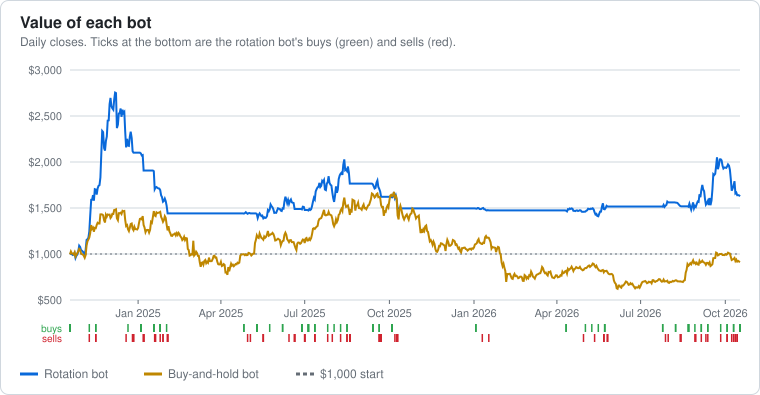
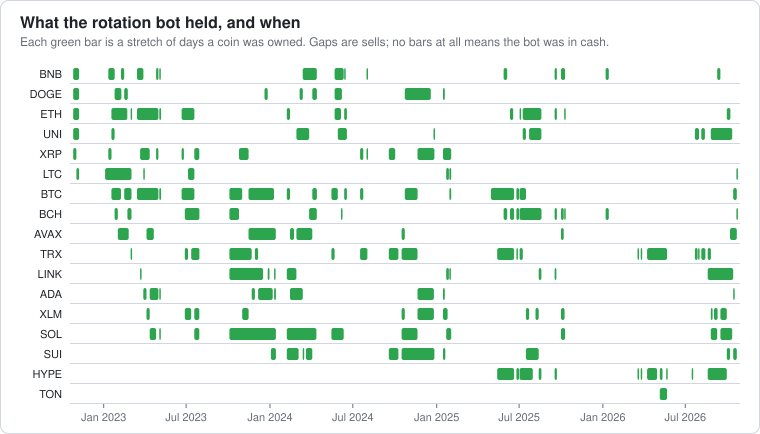
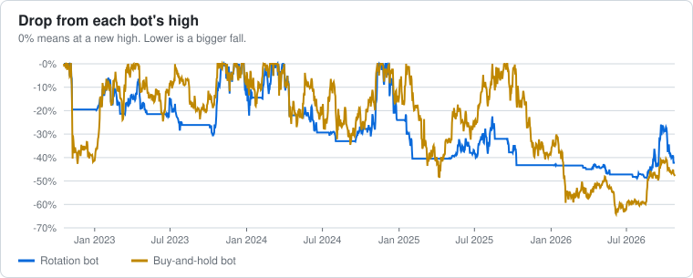

# 🪙 Crypto Dashboard

*Updated 2026-10-18 02:56 UTC with prices up to the close on 2026-10-17. Each bot started with $1,000 on 2022-10-19. Before 2026-10-19 the results are a backtest (what the rules would have done on real prices); from 2026-10-19 on they are paper trades. **No real money is used.** Prices are daily closes, after a 0.4% fee per trade. This is research, not financial advice.*

[← Main dashboard](DASHBOARD.md)

## At a glance

| Bot | Started with | Value now | Return | Worst fall | Trades | Holding now |
|---|---|---|---|---|---|---|
| **Rotation bot** | $1,000 | **$3,020.77** | +202.1% | 49% | 388 | BTC, DOT, SUI, AVAX |
| **Buy-and-hold bot** | $1,000 | **$3,225.78** | +222.6% | 64% | 3 | BTC, SOL, ETH |

## Charts

## 🔄 Rotation bot

Holds up to 5 of the strongest coins by 120-day gain, rechecked every 7 days, only while each coin and bitcoin are above their 50-day averages. Otherwise cash.

### Holding now

| Coin | Value now | Paid | Profit / loss | Share of the bot |
|---|---|---|---|---|
| BTC | $617.59 | $621.53 | -$3.93 (-0.6%) | 20% |
| DOT | $602.31 | $621.53 | -$19.22 (-3.1%) | 20% |
| SUI | $591.01 | $621.53 | -$30.51 (-4.9%) | 20% |
| AVAX | $536.46 | $613.78 | -$77.32 (-12.6%) | 18% |
| Cash | $673.39 | | | 22% |

### Latest 10 trades

| Date | | Coin | Price | Amount | Profit / loss | Why | Type |
|---|---|---|---|---|---|---|---|
| 2026-10-16 | 🔴 Sell | ADA | $0.2257 | $606.94 | -$17.01 | ADA closed below its 50-day average (its uptrend broke) | backtest |
| 2026-10-14 | 🔴 Sell | LINK | $12.44 | $613.34 | $88.09 | LINK closed below its 50-day average (its uptrend broke) | backtest |
| 2026-10-14 | 🟢 Buy | ADA | $0.2302 | $621.53 |  | weekly check: #2 by 120-day gain (+34%), in an uptrend, with bitcoin in an uptrend | backtest |
| 2026-10-14 | 🟢 Buy | BTC | $81,682.01 | $621.53 |  | weekly check: #4 by 120-day gain (+24%), in an uptrend, with bitcoin in an uptrend | backtest |
| 2026-10-14 | 🟢 Buy | DOT | $1.15 | $621.53 |  | weekly check: #5 by 120-day gain (+13%), in an uptrend, with bitcoin in an uptrend | backtest |
| 2026-10-14 | 🟢 Buy | SUI | $1.02 | $621.53 |  | weekly check: #3 by 120-day gain (+28%), in an uptrend, with bitcoin in an uptrend | backtest |
| 2026-10-12 | 🔴 Sell | UNI | $6.97 | $829.19 | $302.94 | UNI closed below its 50-day average (its uptrend broke) | backtest |
| 2026-10-12 | 🔴 Sell | SOL | $105.76 | $532.08 | $31.60 | SOL closed below its 50-day average (its uptrend broke) | backtest |
| 2026-10-08 | 🔴 Sell | ETH | $2,474.80 | $590.63 | -$55.34 | ETH closed below its 50-day average (its uptrend broke) | backtest |
| 2026-10-07 | 🔴 Sell | SUI | $1.13 | $616.25 | -$24.68 | no longer one of the top 5 at the weekly check | backtest |

<b>All 388 rotation trades</b>

| Date | | Coin | Price | Amount | Profit / loss | Why | Type |
|---|---|---|---|---|---|---|---|
| 2026-10-16 | 🔴 Sell | ADA | $0.2257 | $606.94 | -$17.01 | ADA closed below its 50-day average (its uptrend broke) | backtest |
| 2026-10-14 | 🔴 Sell | LINK | $12.44 | $613.34 | $88.09 | LINK closed below its 50-day average (its uptrend broke) | backtest |
| 2026-10-14 | 🟢 Buy | ADA | $0.2302 | $621.53 |  | weekly check: #2 by 120-day gain (+34%), in an uptrend, with bitcoin in an uptrend | backtest |
| 2026-10-14 | 🟢 Buy | BTC | $81,682.01 | $621.53 |  | weekly check: #4 by 120-day gain (+24%), in an uptrend, with bitcoin in an uptrend | backtest |
| 2026-10-14 | 🟢 Buy | DOT | $1.15 | $621.53 |  | weekly check: #5 by 120-day gain (+13%), in an uptrend, with bitcoin in an uptrend | backtest |
| 2026-10-14 | 🟢 Buy | SUI | $1.02 | $621.53 |  | weekly check: #3 by 120-day gain (+28%), in an uptrend, with bitcoin in an uptrend | backtest |
| 2026-10-12 | 🔴 Sell | UNI | $6.97 | $829.19 | $302.94 | UNI closed below its 50-day average (its uptrend broke) | backtest |
| 2026-10-12 | 🔴 Sell | SOL | $105.76 | $532.08 | $31.60 | SOL closed below its 50-day average (its uptrend broke) | backtest |
| 2026-10-08 | 🔴 Sell | ETH | $2,474.80 | $590.63 | -$55.34 | ETH closed below its 50-day average (its uptrend broke) | backtest |
| 2026-10-07 | 🔴 Sell | SUI | $1.13 | $616.25 | -$24.68 | no longer one of the top 5 at the weekly check | backtest |
| 2026-10-07 | 🟢 Buy | AVAX | $11.13 | $613.78 |  | weekly check: #4 by 120-day gain (+68%), in an uptrend, with bitcoin in an uptrend | backtest |
| 2026-09-30 | 🔴 Sell | HYPE | $90.94 | $678.96 | $153.44 | no longer one of the top 5 at the weekly check | backtest |
| 2026-09-30 | 🔴 Sell | XLM | $0.2263 | $608.27 | $109.55 | no longer one of the top 5 at the weekly check | backtest |
| 2026-09-30 | 🟢 Buy | ETH | $2,686.01 | $643.61 |  | weekly check: #4 by 120-day gain (+44%), in an uptrend, with bitcoin in an uptrend | backtest |
| 2026-09-30 | 🟢 Buy | SUI | $1.16 | $638.46 |  | weekly check: #5 by 120-day gain (+44%), in an uptrend, with bitcoin in an uptrend | backtest |
| 2026-09-16 | 🔴 Sell | BNB | $725.92 | $516.49 | -$1.80 | no longer one of the top 5 at the weekly check | backtest |
| 2026-09-16 | 🟢 Buy | SOL | $98.66 | $498.35 |  | weekly check: #4 by 120-day gain (+17%), in an uptrend, with bitcoin in an uptrend | backtest |
| 2026-09-16 | 🟢 Buy | XLM | $0.1839 | $496.29 |  | weekly check: #3 by 120-day gain (+28%), in an uptrend, with bitcoin in an uptrend | backtest |
| 2026-09-10 | 🔴 Sell | XLM | $0.1746 | $482.14 | -$6.64 | XLM closed below its 50-day average (its uptrend broke) | backtest |
| 2026-09-09 | 🔴 Sell | SOL | $101.57 | $518.29 | -$6.72 | no longer one of the top 5 at the weekly check | backtest |
| 2026-09-09 | 🟢 Buy | BNB | $722.64 | $516.22 |  | weekly check: #5 by 120-day gain (+9%), in an uptrend, with bitcoin in an uptrend | backtest |
| 2026-09-02 | 🟢 Buy | XLM | $0.1756 | $486.85 |  | weekly check: #5 by 120-day gain (+10%), in an uptrend, with bitcoin in an uptrend | backtest |
| 2026-08-30 | 🔴 Sell | XLM | $0.1746 | $488.81 | -$33.99 | XLM closed below its 50-day average (its uptrend broke) | backtest |
| 2026-08-26 | 🔴 Sell | TRX | $0.3360 | $523.20 | -$1.69 | no longer one of the top 5 at the weekly check | backtest |
| 2026-08-26 | 🟢 Buy | SOL | $102.07 | $522.94 |  | weekly check: #4 by 120-day gain (+21%), in an uptrend, with bitcoin in an uptrend | backtest |
| 2026-08-26 | 🟢 Buy | UNI | $4.38 | $522.94 |  | weekly check: #2 by 120-day gain (+35%), in an uptrend, with bitcoin in an uptrend | backtest |
| 2026-08-26 | 🟢 Buy | XLM | $0.1853 | $520.84 |  | weekly check: #5 by 120-day gain (+15%), in an uptrend, with bitcoin in an uptrend | backtest |
| 2026-08-19 | 🟢 Buy | HYPE | $69.75 | $522.80 |  | weekly check: #1 by 120-day gain (+75%), in an uptrend, with bitcoin in an uptrend | backtest |
| 2026-08-19 | 🟢 Buy | LINK | $10.56 | $522.80 |  | weekly check: #2 by 120-day gain (+12%), in an uptrend, with bitcoin in an uptrend | backtest |
| 2026-08-19 | 🟢 Buy | TRX | $0.3344 | $522.80 |  | weekly check: #3 by 120-day gain (+0%), in an uptrend, with bitcoin in an uptrend | backtest |
| 2026-08-14 | 🔴 Sell | TRX | $0.3327 | $544.29 | $4.34 | bitcoin closed below its 50-day average, so the bot moved to cash | backtest |
| 2026-08-13 | 🔴 Sell | UNI | $3.48 | $460.44 | -$79.17 | UNI closed below its 50-day average (its uptrend broke) | backtest |
| 2026-08-05 | 🟢 Buy | TRX | $0.3274 | $537.77 |  | weekly check: #2 by 120-day gain (+4%), in an uptrend, with bitcoin in an uptrend | backtest |
| 2026-08-05 | 🟢 Buy | UNI | $4.05 | $537.77 |  | weekly check: #1 by 120-day gain (+23%), in an uptrend, with bitcoin in an uptrend | backtest |
| 2026-07-31 | 🔴 Sell | UNI | $4.35 | $602.27 | $74.01 | bitcoin closed below its 50-day average, so the bot moved to cash | backtest |
| 2026-07-31 | 🔴 Sell | TRX | $0.3261 | $527.45 | -$3.74 | bitcoin closed below its 50-day average, so the bot moved to cash | backtest |
| 2026-07-29 | 🟢 Buy | TRX | $0.3258 | $529.08 |  | weekly check: #2 by 120-day gain (+4%), in an uptrend, with bitcoin in an uptrend | backtest |
| 2026-07-28 | 🔴 Sell | TRX | $0.3248 | $517.22 | -$10.70 | TRX closed below its 50-day average (its uptrend broke) | backtest |
| 2026-07-22 | 🟢 Buy | TRX | $0.3289 | $525.86 |  | weekly check: #1 by 120-day gain (+7%), in an uptrend, with bitcoin in an uptrend | backtest |
| 2026-07-22 | 🟢 Buy | UNI | $3.78 | $525.86 |  | weekly check: #2 by 120-day gain (+5%), in an uptrend, with bitcoin in an uptrend | backtest |
| 2026-07-16 | 🔴 Sell | HYPE | $60.70 | $485.16 | -$53.29 | HYPE closed below its 50-day average (its uptrend broke) | backtest |
| 2026-07-15 | 🟢 Buy | HYPE | $66.86 | $536.51 |  | weekly check: #1 by 120-day gain (+62%), in an uptrend, with bitcoin in an uptrend | backtest |
| 2026-05-22 | 🔴 Sell | TRX | $0.3623 | $634.76 | $72.84 | bitcoin closed below its 50-day average, so the bot moved to cash | backtest |
| 2026-05-22 | 🔴 Sell | TON | $1.84 | $425.39 | -$146.94 | bitcoin closed below its 50-day average, so the bot moved to cash | backtest |
| 2026-05-22 | 🔴 Sell | HYPE | $54.58 | $542.69 | -$6.92 | bitcoin closed below its 50-day average, so the bot moved to cash | backtest |
| 2026-05-20 | 🟢 Buy | HYPE | $54.84 | $547.44 |  | weekly check: #1 by 120-day gain (+161%), in an uptrend, with bitcoin in an uptrend | backtest |
| 2026-05-12 | 🔴 Sell | HYPE | $40.26 | $530.54 | -$42.22 | HYPE closed below its 50-day average (its uptrend broke) | backtest |
| 2026-05-06 | 🟢 Buy | HYPE | $43.12 | $570.63 |  | weekly check: #1 by 120-day gain (+53%), in an uptrend, with bitcoin in an uptrend | backtest |
| 2026-05-06 | 🟢 Buy | TON | $2.45 | $570.63 |  | weekly check: #2 by 120-day gain (+29%), in an uptrend, with bitcoin in an uptrend | backtest |
| 2026-04-30 | 🔴 Sell | HYPE | $39.69 | $570.54 | $8.88 | HYPE closed below its 50-day average (its uptrend broke) | backtest |
| 2026-04-08 | 🟢 Buy | HYPE | $38.76 | $559.38 |  | weekly check: #1 by 120-day gain (+39%), in an uptrend, with bitcoin in an uptrend | backtest |
| 2026-04-08 | 🟢 Buy | TRX | $0.3180 | $559.38 |  | weekly check: #2 by 120-day gain (+13%), in an uptrend, with bitcoin in an uptrend | backtest |
| 2026-03-26 | 🔴 Sell | HYPE | $39.15 | $546.91 | -$20.84 | bitcoin closed below its 50-day average, so the bot moved to cash | backtest |
| 2026-03-26 | 🔴 Sell | TRX | $0.3115 | $557.75 | -$10.04 | bitcoin closed below its 50-day average, so the bot moved to cash | backtest |
| 2026-03-25 | 🟢 Buy | HYPE | $40.32 | $565.56 |  | weekly check: #1 by 120-day gain (+19%), in an uptrend, with bitcoin in an uptrend | backtest |
| 2026-03-25 | 🟢 Buy | TRX | $0.3146 | $565.56 |  | weekly check: #2 by 120-day gain (+15%), in an uptrend, with bitcoin in an uptrend | backtest |
| 2026-03-19 | 🔴 Sell | HYPE | $39.35 | $535.37 | -$41.98 | bitcoin closed below its 50-day average, so the bot moved to cash | backtest |
| 2026-03-19 | 🔴 Sell | TRX | $0.3036 | $571.22 | -$6.28 | bitcoin closed below its 50-day average, so the bot moved to cash | backtest |
| 2026-03-18 | 🟢 Buy | HYPE | $42.11 | $575.21 |  | weekly check: #1 by 120-day gain (+9%), in an uptrend, with bitcoin in an uptrend | backtest |
| 2026-03-18 | 🟢 Buy | TRX | $0.3045 | $575.21 |  | weekly check: #2 by 120-day gain (+5%), in an uptrend, with bitcoin in an uptrend | backtest |
| 2026-01-14 | 🔴 Sell | BCH | $597.40 | $545.38 | -$33.52 | no longer one of the top 5 at the weekly check | backtest |
| 2026-01-14 | 🔴 Sell | BNB | $948.47 | $605.14 | $26.01 | no longer one of the top 5 at the weekly check | backtest |
| 2026-01-07 | 🟢 Buy | BCH | $629.20 | $576.72 |  | weekly check: #1 by 120-day gain (+8%), in an uptrend, with bitcoin in an uptrend | backtest |
| 2026-01-07 | 🟢 Buy | BNB | $900.30 | $576.72 |  | weekly check: #2 by 120-day gain (+2%), in an uptrend, with bitcoin in an uptrend | backtest |
| 2025-10-10 | 🔴 Sell | BNB | $1,102.47 | $676.34 | $41.37 | bitcoin closed below its 50-day average, so the bot moved to cash | backtest |
| 2025-10-10 | 🔴 Sell | SOL | $188.43 | $534.41 | -$99.99 | SOL closed below its 50-day average (its uptrend broke) | backtest |
| 2025-10-10 | 🔴 Sell | BCH | $513.50 | $517.37 | -$74.55 | BCH closed below its 50-day average (its uptrend broke) | backtest |
| 2025-10-09 | 🔴 Sell | XLM | $0.3794 | $600.00 | -$34.66 | XLM closed below its 50-day average (its uptrend broke) | backtest |
| 2025-10-09 | 🔴 Sell | ETH | $4,368.09 | $567.04 | -$25.09 | ETH closed below its 50-day average (its uptrend broke) | backtest |
| 2025-10-08 | 🟢 Buy | BCH | $583.10 | $589.86 |  | weekly check: #5 by 120-day gain (+33%), in an uptrend, with bitcoin in an uptrend | backtest |
| 2025-10-08 | 🟢 Buy | ETH | $4,525.72 | $589.86 |  | weekly check: #2 by 120-day gain (+61%), in an uptrend, with bitcoin in an uptrend | backtest |
| 2025-10-07 | 🔴 Sell | AVAX | $27.93 | $572.35 | -$62.20 | AVAX closed below its 50-day average (its uptrend broke) | backtest |
| 2025-10-07 | 🔴 Sell | BCH | $576.20 | $612.10 | -$22.61 | BCH closed below its 50-day average (its uptrend broke) | backtest |
| 2025-10-01 | 🟢 Buy | AVAX | $30.73 | $632.26 |  | weekly check: #4 by 120-day gain (+45%), in an uptrend, with bitcoin in an uptrend | backtest |
| 2025-10-01 | 🟢 Buy | BCH | $592.80 | $632.26 |  | weekly check: #2 by 120-day gain (+48%), in an uptrend, with bitcoin in an uptrend | backtest |
| 2025-10-01 | 🟢 Buy | BNB | $1,026.50 | $632.26 |  | weekly check: #1 by 120-day gain (+55%), in an uptrend, with bitcoin in an uptrend | backtest |
| 2025-10-01 | 🟢 Buy | SOL | $222.04 | $632.26 |  | weekly check: #5 by 120-day gain (+43%), in an uptrend, with bitcoin in an uptrend | backtest |
| 2025-10-01 | 🟢 Buy | XLM | $0.3982 | $632.26 |  | weekly check: #3 by 120-day gain (+46%), in an uptrend, with bitcoin in an uptrend | backtest |
| 2025-09-22 | 🔴 Sell | BCH | $567.10 | $632.75 | -$60.64 | BCH closed below its 50-day average (its uptrend broke) | backtest |
| 2025-09-22 | 🔴 Sell | BNB | $992.90 | $690.12 | -$3.49 | bitcoin closed below its 50-day average, so the bot moved to cash | backtest |
| 2025-09-22 | 🔴 Sell | ETH | $4,199.08 | $629.42 | -$63.96 | ETH closed below its 50-day average (its uptrend broke) | backtest |
| 2025-09-22 | 🔴 Sell | HYPE | $47.27 | $563.17 | -$129.94 | bitcoin closed below its 50-day average, so the bot moved to cash | backtest |
| 2025-09-21 | 🔴 Sell | LINK | $22.96 | $658.55 | -$34.94 | LINK closed below its 50-day average (its uptrend broke) | backtest |
| 2025-09-17 | 🟢 Buy | BCH | $616.70 | $690.85 |  | weekly check: #3 by 120-day gain (+56%), in an uptrend, with bitcoin in an uptrend | backtest |
| 2025-09-17 | 🟢 Buy | BNB | $989.98 | $690.85 |  | weekly check: #5 by 120-day gain (+52%), in an uptrend, with bitcoin in an uptrend | backtest |
| 2025-09-17 | 🟢 Buy | ETH | $4,590.53 | $690.85 |  | weekly check: #2 by 120-day gain (+82%), in an uptrend, with bitcoin in an uptrend | backtest |
| 2025-09-17 | 🟢 Buy | HYPE | $57.75 | $690.85 |  | weekly check: #1 by 120-day gain (+118%), in an uptrend, with bitcoin in an uptrend | backtest |
| 2025-09-17 | 🟢 Buy | LINK | $23.99 | $690.85 |  | weekly check: #4 by 120-day gain (+53%), in an uptrend, with bitcoin in an uptrend | backtest |
| 2025-08-19 | 🔴 Sell | BCH | $548.50 | $670.49 | $40.77 | bitcoin closed below its 50-day average, so the bot moved to cash | backtest |
| 2025-08-19 | 🔴 Sell | ETH | $4,075.59 | $911.59 | $286.17 | bitcoin closed below its 50-day average, so the bot moved to cash | backtest |
| 2025-08-19 | 🔴 Sell | UNI | $9.95 | $606.76 | -$18.82 | bitcoin closed below its 50-day average, so the bot moved to cash | backtest |
| 2025-08-19 | 🔴 Sell | HYPE | $41.30 | $602.13 | -$97.87 | HYPE closed below its 50-day average (its uptrend broke) | backtest |
| 2025-08-19 | 🔴 Sell | LINK | $23.56 | $677.17 | -$17.55 | bitcoin closed below its 50-day average, so the bot moved to cash | backtest |
| 2025-08-13 | 🔴 Sell | SUI | $4.00 | $678.90 | $5.20 | no longer one of the top 5 at the weekly check | backtest |
| 2025-08-13 | 🔴 Sell | XLM | $0.4519 | $716.28 | $76.69 | no longer one of the top 5 at the weekly check | backtest |
| 2025-08-13 | 🟢 Buy | HYPE | $47.65 | $697.59 |  | weekly check: #1 by 120-day gain (+217%), in an uptrend, with bitcoin in an uptrend | backtest |
| 2025-08-13 | 🟢 Buy | LINK | $23.98 | $692.01 |  | weekly check: #4 by 120-day gain (+96%), in an uptrend, with bitcoin in an uptrend | backtest |
| 2025-08-06 | 🟢 Buy | XLM | $0.4001 | $636.72 |  | weekly check: #5 by 120-day gain (+81%), in an uptrend, with bitcoin in an uptrend | backtest |
| 2025-07-31 | 🔴 Sell | HYPE | $40.83 | $639.28 | $9.69 | HYPE closed below its 50-day average (its uptrend broke) | backtest |
| 2025-07-23 | 🔴 Sell | XLM | $0.4278 | $625.66 | -$42.46 | no longer one of the top 5 at the weekly check | backtest |
| 2025-07-23 | 🟢 Buy | UNI | $10.18 | $623.16 |  | weekly check: #5 by 120-day gain (+46%), in an uptrend, with bitcoin in an uptrend | backtest |
| 2025-07-16 | 🔴 Sell | BTC | $118,630.43 | $680.65 | $50.89 | no longer one of the top 5 at the weekly check | backtest |
| 2025-07-16 | 🔴 Sell | UNI | $8.90 | $661.33 | $39.46 | no longer one of the top 5 at the weekly check | backtest |
| 2025-07-16 | 🟢 Buy | SUI | $3.94 | $670.99 |  | weekly check: #3 by 120-day gain (+73%), in an uptrend, with bitcoin in an uptrend | backtest |
| 2025-07-16 | 🟢 Buy | XLM | $0.4533 | $665.62 |  | weekly check: #4 by 120-day gain (+66%), in an uptrend, with bitcoin in an uptrend | backtest |
| 2025-07-09 | 🔴 Sell | TRX | $0.2899 | $636.61 | $7.02 | no longer one of the top 5 at the weekly check | backtest |
| 2025-07-09 | 🟢 Buy | ETH | $2,768.74 | $621.77 |  | weekly check: #3 by 120-day gain (+44%), in an uptrend, with bitcoin in an uptrend | backtest |
| 2025-07-09 | 🟢 Buy | UNI | $8.30 | $619.23 |  | weekly check: #4 by 120-day gain (+36%), in an uptrend, with bitcoin in an uptrend | backtest |
| 2025-07-04 | 🔴 Sell | ETH | $2,508.04 | $609.38 | -$20.10 | ETH closed below its 50-day average (its uptrend broke) | backtest |
| 2025-07-02 | 🟢 Buy | BCH | $510.90 | $627.04 |  | weekly check: #2 by 120-day gain (+59%), in an uptrend, with bitcoin in an uptrend | backtest |
| 2025-07-02 | 🟢 Buy | BTC | $108,849.60 | $627.04 |  | weekly check: #3 by 120-day gain (+25%), in an uptrend, with bitcoin in an uptrend | backtest |
| 2025-07-02 | 🟢 Buy | ETH | $2,570.41 | $627.04 |  | weekly check: #4 by 120-day gain (+18%), in an uptrend, with bitcoin in an uptrend | backtest |
| 2025-07-02 | 🟢 Buy | HYPE | $39.88 | $627.04 |  | weekly check: #1 by 120-day gain (+133%), in an uptrend, with bitcoin in an uptrend | backtest |
| 2025-07-02 | 🟢 Buy | TRX | $0.2844 | $627.04 |  | weekly check: #5 by 120-day gain (+17%), in an uptrend, with bitcoin in an uptrend | backtest |
| 2025-07-01 | 🔴 Sell | BCH | $500.20 | $649.88 | $17.49 | bitcoin closed below its 50-day average, so the bot moved to cash | backtest |
| 2025-07-01 | 🔴 Sell | BTC | $105,681.14 | $617.58 | -$14.69 | BTC closed below its 50-day average (its uptrend broke) | backtest |
| 2025-07-01 | 🔴 Sell | HYPE | $36.92 | $625.55 | -$6.75 | bitcoin closed below its 50-day average, so the bot moved to cash | backtest |
| 2025-06-26 | 🔴 Sell | TRX | $0.2710 | $622.45 | -$9.83 | TRX closed below its 50-day average (its uptrend broke) | backtest |
| 2025-06-25 | 🟢 Buy | BCH | $482.80 | $629.79 |  | weekly check: #2 by 120-day gain (+65%), in an uptrend, with bitcoin in an uptrend | backtest |
| 2025-06-25 | 🟢 Buy | BTC | $107,340.58 | $629.79 |  | weekly check: #3 by 120-day gain (+21%), in an uptrend, with bitcoin in an uptrend | backtest |
| 2025-06-25 | 🟢 Buy | HYPE | $37.02 | $629.79 |  | weekly check: #1 by 120-day gain (+83%), in an uptrend, with bitcoin in an uptrend | backtest |
| 2025-06-25 | 🟢 Buy | TRX | $0.2731 | $629.79 |  | weekly check: #4 by 120-day gain (+18%), in an uptrend, with bitcoin in an uptrend | backtest |
| 2025-06-20 | 🔴 Sell | BTC | $103,297.99 | $660.60 | $53.30 | BTC closed below its 50-day average (its uptrend broke) | backtest |
| 2025-06-20 | 🔴 Sell | HYPE | $33.37 | $812.83 | $193.47 | bitcoin closed below its 50-day average, so the bot moved to cash | backtest |
| 2025-06-20 | 🔴 Sell | TRX | $0.2722 | $608.29 | -$10.26 | bitcoin closed below its 50-day average, so the bot moved to cash | backtest |
| 2025-06-20 | 🔴 Sell | BCH | $473.70 | $591.77 | $51.45 | bitcoin closed below its 50-day average, so the bot moved to cash | backtest |
| 2025-06-18 | 🔴 Sell | ETH | $2,525.00 | $488.13 | -$51.78 | no longer one of the top 5 at the weekly check | backtest |
| 2025-06-11 | 🟢 Buy | BCH | $428.90 | $537.95 |  | weekly check: #2 by 120-day gain (+29%), in an uptrend, with bitcoin in an uptrend | backtest |
| 2025-06-11 | 🟢 Buy | ETH | $2,771.61 | $537.95 |  | weekly check: #5 by 120-day gain (+6%), in an uptrend, with bitcoin in an uptrend | backtest |
| 2025-06-05 | 🔴 Sell | BCH | $385.00 | $535.47 | -$59.87 | BCH closed below its 50-day average (its uptrend broke) | backtest |
| 2025-06-05 | 🔴 Sell | BNB | $633.32 | $544.75 | -$50.63 | BNB closed below its 50-day average (its uptrend broke) | backtest |
| 2025-05-28 | 🟢 Buy | BCH | $424.80 | $593.20 |  | weekly check: #5 by 120-day gain (+3%), in an uptrend, with bitcoin in an uptrend | backtest |
| 2025-05-28 | 🟢 Buy | BNB | $686.89 | $593.20 |  | weekly check: #4 by 120-day gain (+4%), in an uptrend, with bitcoin in an uptrend | backtest |
| 2025-05-14 | 🟢 Buy | HYPE | $25.19 | $616.12 |  | weekly check: #2 by 120-day gain (+10%), in an uptrend, with bitcoin in an uptrend | backtest |
| 2025-05-14 | 🟢 Buy | TRX | $0.2746 | $616.12 |  | weekly check: #1 by 120-day gain (+24%), in an uptrend, with bitcoin in an uptrend | backtest |
| 2025-04-30 | 🟢 Buy | BTC | $94,172.00 | $604.66 |  | weekly check: #1 by 120-day gain (+1%), in an uptrend, with bitcoin in an uptrend | backtest |
| 2025-02-02 | 🔴 Sell | XRP | $2.58 | $631.50 | -$143.40 | XRP closed below its 50-day average (its uptrend broke) | backtest |
| 2025-02-02 | 🔴 Sell | SOL | $203.51 | $556.57 | -$152.33 | SOL closed below its 50-day average (its uptrend broke) | backtest |
| 2025-02-02 | 🔴 Sell | BTC | $97,700.59 | $609.52 | -$42.67 | BTC closed below its 50-day average (its uptrend broke) | backtest |
| 2025-02-02 | 🔴 Sell | LTC | $109.12 | $609.29 | -$42.89 | LTC closed below its 50-day average (its uptrend broke) | backtest |
| 2025-02-01 | 🔴 Sell | LINK | $22.98 | $628.55 | -$23.71 | LINK closed below its 50-day average (its uptrend broke) | backtest |
| 2025-01-29 | 🟢 Buy | BTC | $103,733.24 | $649.75 |  | weekly check: #4 by 120-day gain (+71%), in an uptrend, with bitcoin in an uptrend | backtest |
| 2025-01-29 | 🟢 Buy | LINK | $23.66 | $649.75 |  | weekly check: #2 by 120-day gain (+115%), in an uptrend, with bitcoin in an uptrend | backtest |
| 2025-01-29 | 🟢 Buy | LTC | $115.90 | $649.75 |  | weekly check: #3 by 120-day gain (+83%), in an uptrend, with bitcoin in an uptrend | backtest |
| 2025-01-28 | 🔴 Sell | LINK | $22.61 | $629.01 | -$80.18 | LINK closed below its 50-day average (its uptrend broke) | backtest |
| 2025-01-28 | 🔴 Sell | LTC | $109.92 | $670.54 | -$38.82 | LTC closed below its 50-day average (its uptrend broke) | backtest |
| 2025-01-25 | 🔴 Sell | XLM | $0.4172 | $657.54 | -$117.46 | XLM closed below its 50-day average (its uptrend broke) | backtest |
| 2025-01-22 | 🟢 Buy | LINK | $25.30 | $706.67 |  | weekly check: #3 by 120-day gain (+108%), in an uptrend, with bitcoin in an uptrend | backtest |
| 2025-01-22 | 🟢 Buy | LTC | $115.38 | $706.67 |  | weekly check: #4 by 120-day gain (+73%), in an uptrend, with bitcoin in an uptrend | backtest |
| 2025-01-22 | 🟢 Buy | SOL | $257.36 | $706.67 |  | weekly check: #5 by 120-day gain (+69%), in an uptrend, with bitcoin in an uptrend | backtest |
| 2025-01-20 | 🔴 Sell | SUI | $4.42 | $702.82 | -$72.36 | SUI closed below its 50-day average (its uptrend broke) | backtest |
| 2025-01-19 | 🔴 Sell | ADA | $0.9930 | $710.27 | -$64.94 | ADA closed below its 50-day average (its uptrend broke) | backtest |
| 2025-01-19 | 🔴 Sell | DOGE | $0.3584 | $715.44 | -$59.79 | DOGE closed below its 50-day average (its uptrend broke) | backtest |
| 2025-01-15 | 🟢 Buy | ADA | $1.08 | $772.37 |  | weekly check: #5 by 120-day gain (+222%), in an uptrend, with bitcoin in an uptrend | backtest |
| 2025-01-15 | 🟢 Buy | DOGE | $0.3854 | $772.37 |  | weekly check: #4 by 120-day gain (+281%), in an uptrend, with bitcoin in an uptrend | backtest |
| 2025-01-15 | 🟢 Buy | SUI | $4.84 | $772.37 |  | weekly check: #3 by 120-day gain (+314%), in an uptrend, with bitcoin in an uptrend | backtest |
| 2025-01-15 | 🟢 Buy | XLM | $0.4881 | $772.37 |  | weekly check: #2 by 120-day gain (+416%), in an uptrend, with bitcoin in an uptrend | backtest |
| 2025-01-15 | 🟢 Buy | XRP | $3.14 | $772.37 |  | weekly check: #1 by 120-day gain (+438%), in an uptrend, with bitcoin in an uptrend | backtest |
| 2024-12-27 | 🔴 Sell | SUI | $4.08 | $755.97 | $365.93 | bitcoin closed below its 50-day average, so the bot moved to cash | backtest |
| 2024-12-27 | 🔴 Sell | XRP | $2.15 | $1,010.42 | $484.58 | bitcoin closed below its 50-day average, so the bot moved to cash | backtest |
| 2024-12-27 | 🔴 Sell | UNI | $13.35 | $790.81 | -$39.52 | bitcoin closed below its 50-day average, so the bot moved to cash | backtest |
| 2024-12-26 | 🔴 Sell | ADA | $0.8611 | $565.98 | $35.59 | ADA closed below its 50-day average (its uptrend broke) | backtest |
| 2024-12-26 | 🔴 Sell | XLM | $0.3547 | $754.16 | $223.01 | XLM closed below its 50-day average (its uptrend broke) | backtest |
| 2024-12-25 | 🟢 Buy | UNI | $13.91 | $827.17 |  | weekly check: #5 by 120-day gain (+143%), in an uptrend, with bitcoin in an uptrend | backtest |
| 2024-12-19 | 🔴 Sell | DOGE | $0.3143 | $830.49 | $455.85 | DOGE closed below its 50-day average (its uptrend broke) | backtest |
| 2024-11-20 | 🔴 Sell | SOL | $235.48 | $588.35 | $198.98 | no longer one of the top 5 at the weekly check | backtest |
| 2024-11-20 | 🔴 Sell | TRX | $0.1947 | $468.78 | $79.88 | no longer one of the top 5 at the weekly check | backtest |
| 2024-11-20 | 🔴 Sell | BTC | $94,286.56 | $527.26 | $150.84 | no longer one of the top 5 at the weekly check | backtest |
| 2024-11-20 | 🟢 Buy | ADA | $0.8003 | $528.13 |  | weekly check: #4 by 120-day gain (+95%), in an uptrend, with bitcoin in an uptrend | backtest |
| 2024-11-20 | 🟢 Buy | XLM | $0.2474 | $528.13 |  | weekly check: #3 by 120-day gain (+145%), in an uptrend, with bitcoin in an uptrend | backtest |
| 2024-11-20 | 🟢 Buy | XRP | $1.10 | $521.80 |  | weekly check: #5 by 120-day gain (+85%), in an uptrend, with bitcoin in an uptrend | backtest |
| 2024-10-23 | 🔴 Sell | AVAX | $26.75 | $368.00 | -$20.49 | no longer one of the top 5 at the weekly check | backtest |
| 2024-10-23 | 🔴 Sell | XLM | $0.0944 | $380.63 | -$7.91 | no longer one of the top 5 at the weekly check | backtest |
| 2024-10-23 | 🟢 Buy | BTC | $66,668.65 | $374.32 |  | weekly check: #5 by 120-day gain (+8%), in an uptrend, with bitcoin in an uptrend | backtest |
| 2024-10-23 | 🟢 Buy | DOGE | $0.1400 | $371.32 |  | weekly check: #4 by 120-day gain (+11%), in an uptrend, with bitcoin in an uptrend | backtest |
| 2024-10-16 | 🟢 Buy | AVAX | $28.02 | $387.02 |  | weekly check: #4 by 120-day gain (+5%), in an uptrend, with bitcoin in an uptrend | backtest |
| 2024-10-16 | 🟢 Buy | SOL | $154.28 | $387.02 |  | weekly check: #3 by 120-day gain (+12%), in an uptrend, with bitcoin in an uptrend | backtest |
| 2024-10-16 | 🟢 Buy | SUI | $2.08 | $387.02 |  | weekly check: #1 by 120-day gain (+160%), in an uptrend, with bitcoin in an uptrend | backtest |
| 2024-10-16 | 🟢 Buy | TRX | $0.1601 | $387.02 |  | weekly check: #2 by 120-day gain (+39%), in an uptrend, with bitcoin in an uptrend | backtest |
| 2024-10-16 | 🟢 Buy | XLM | $0.0956 | $387.02 |  | weekly check: #5 by 120-day gain (+5%), in an uptrend, with bitcoin in an uptrend | backtest |
| 2024-10-09 | 🔴 Sell | SUI | $1.88 | $510.10 | $149.21 | bitcoin closed below its 50-day average, so the bot moved to cash | backtest |
| 2024-10-09 | 🔴 Sell | TRX | $0.1605 | $383.45 | $23.07 | bitcoin closed below its 50-day average, so the bot moved to cash | backtest |
| 2024-10-02 | 🔴 Sell | XRP | $0.5383 | $328.76 | -$31.39 | XRP closed below its 50-day average (its uptrend broke) | backtest |
| 2024-09-18 | 🟢 Buy | SUI | $1.31 | $358.84 |  | weekly check: #2 by 120-day gain (+15%), in an uptrend, with bitcoin in an uptrend | backtest |
| 2024-09-18 | 🟢 Buy | TRX | $0.1496 | $358.84 |  | weekly check: #1 by 120-day gain (+21%), in an uptrend, with bitcoin in an uptrend | backtest |
| 2024-09-18 | 🟢 Buy | XRP | $0.5852 | $358.84 |  | weekly check: #3 by 120-day gain (+9%), in an uptrend, with bitcoin in an uptrend | backtest |
| 2024-08-02 | 🔴 Sell | TRX | $0.1236 | $349.01 | -$31.09 | TRX closed below its 50-day average (its uptrend broke) | backtest |
| 2024-08-02 | 🔴 Sell | BNB | $542.90 | $351.71 | -$24.67 | BNB closed below its 50-day average (its uptrend broke) | backtest |
| 2024-08-02 | 🔴 Sell | XRP | $0.5607 | $336.13 | -$40.19 | bitcoin closed below its 50-day average, so the bot moved to cash | backtest |
| 2024-07-31 | 🟢 Buy | BNB | $576.50 | $374.98 |  | weekly check: #3 by 120-day gain (+5%), in an uptrend, with bitcoin in an uptrend | backtest |
| 2024-07-31 | 🟢 Buy | XRP | $0.6230 | $374.98 |  | weekly check: #2 by 120-day gain (+6%), in an uptrend, with bitcoin in an uptrend | backtest |
| 2024-07-24 | 🔴 Sell | BTC | $65,376.00 | $384.77 | $4.53 | no longer one of the top 5 at the weekly check | backtest |
| 2024-07-24 | 🔴 Sell | XRP | $0.6179 | $372.31 | -$7.88 | no longer one of the top 5 at the weekly check | backtest |
| 2024-07-17 | 🟢 Buy | BTC | $64,087.99 | $378.71 |  | weekly check: #3 by 120-day gain (+3%), in an uptrend, with bitcoin in an uptrend | backtest |
| 2024-07-17 | 🟢 Buy | TRX | $0.1336 | $378.71 |  | weekly check: #1 by 120-day gain (+19%), in an uptrend, with bitcoin in an uptrend | backtest |
| 2024-07-17 | 🟢 Buy | XRP | $0.6260 | $378.71 |  | weekly check: #2 by 120-day gain (+7%), in an uptrend, with bitcoin in an uptrend | backtest |
| 2024-06-18 | 🔴 Sell | UNI | $9.77 | $387.06 | -$30.04 | bitcoin closed below its 50-day average, so the bot moved to cash | backtest |
| 2024-06-18 | 🔴 Sell | BTC | $65,175.32 | $371.82 | -$20.67 | BTC closed below its 50-day average (its uptrend broke) | backtest |
| 2024-06-18 | 🔴 Sell | ETH | $3,483.42 | $381.05 | -$11.48 | bitcoin closed below its 50-day average, so the bot moved to cash | backtest |
| 2024-06-13 | 🔴 Sell | BNB | $599.80 | $377.12 | -$15.40 | BNB closed below its 50-day average (its uptrend broke) | backtest |
| 2024-06-12 | 🟢 Buy | BNB | $619.40 | $391.01 |  | weekly check: #1 by 120-day gain (+91%), in an uptrend, with bitcoin in an uptrend | backtest |
| 2024-06-12 | 🟢 Buy | BTC | $68,263.99 | $391.01 |  | weekly check: #3 by 120-day gain (+37%), in an uptrend, with bitcoin in an uptrend | backtest |
| 2024-06-12 | 🟢 Buy | ETH | $3,560.12 | $391.01 |  | weekly check: #4 by 120-day gain (+35%), in an uptrend, with bitcoin in an uptrend | backtest |
| 2024-06-11 | 🔴 Sell | SOL | $149.31 | $392.24 | -$27.44 | SOL closed below its 50-day average (its uptrend broke) | backtest |
| 2024-06-11 | 🔴 Sell | BNB | $602.50 | $400.84 | -$11.43 | BNB closed below its 50-day average (its uptrend broke) | backtest |
| 2024-06-08 | 🔴 Sell | BCH | $469.50 | $404.18 | -$25.45 | BCH closed below its 50-day average (its uptrend broke) | backtest |
| 2024-06-07 | 🔴 Sell | DOGE | $0.1482 | $364.55 | -$47.58 | DOGE closed below its 50-day average (its uptrend broke) | backtest |
| 2024-06-05 | 🔴 Sell | ETH | $3,865.99 | $421.43 | $10.66 | no longer one of the top 5 at the weekly check | backtest |
| 2024-06-05 | 🟢 Buy | BCH | $495.20 | $428.01 |  | weekly check: #2 by 120-day gain (+111%), in an uptrend, with bitcoin in an uptrend | backtest |
| 2024-05-29 | 🔴 Sell | BTC | $67,652.42 | $425.53 | $5.72 | no longer one of the top 5 at the weekly check | backtest |
| 2024-05-29 | 🟢 Buy | UNI | $10.44 | $415.56 |  | weekly check: #3 by 120-day gain (+67%), in an uptrend, with bitcoin in an uptrend | backtest |
| 2024-05-22 | 🔴 Sell | TRX | $0.1201 | $395.80 | -$23.89 | no longer one of the top 5 at the weekly check | backtest |
| 2024-05-22 | 🟢 Buy | BNB | $614.80 | $410.67 |  | weekly check: #3 by 120-day gain (+106%), in an uptrend, with bitcoin in an uptrend | backtest |
| 2024-05-22 | 🟢 Buy | DOGE | $0.1663 | $410.67 |  | weekly check: #1 by 120-day gain (+113%), in an uptrend, with bitcoin in an uptrend | backtest |
| 2024-05-22 | 🟢 Buy | ETH | $3,737.73 | $409.09 |  | weekly check: #5 by 120-day gain (+67%), in an uptrend, with bitcoin in an uptrend | backtest |
| 2024-05-15 | 🟢 Buy | BTC | $66,206.50 | $418.11 |  | weekly check: #2 by 120-day gain (+53%), in an uptrend, with bitcoin in an uptrend | backtest |
| 2024-05-15 | 🟢 Buy | SOL | $158.52 | $418.11 |  | weekly check: #1 by 120-day gain (+62%), in an uptrend, with bitcoin in an uptrend | backtest |
| 2024-05-15 | 🟢 Buy | TRX | $0.1263 | $418.11 |  | weekly check: #3 by 120-day gain (+17%), in an uptrend, with bitcoin in an uptrend | backtest |
| 2024-04-13 | 🔴 Sell | BNB | $553.10 | $414.92 | -$61.62 | bitcoin closed below its 50-day average, so the bot moved to cash | backtest |
| 2024-04-13 | 🔴 Sell | BCH | $479.60 | $359.51 | -$47.66 | BCH closed below its 50-day average (its uptrend broke) | backtest |
| 2024-04-13 | 🔴 Sell | BTC | $63,924.51 | $406.99 | -$16.29 | BTC closed below its 50-day average (its uptrend broke) | backtest |
| 2024-04-13 | 🔴 Sell | DOGE | $0.1525 | $362.68 | -$57.05 | DOGE closed below its 50-day average (its uptrend broke) | backtest |
| 2024-04-12 | 🔴 Sell | SOL | $153.16 | $554.82 | $184.75 | SOL closed below its 50-day average (its uptrend broke) | backtest |
| 2024-04-03 | 🔴 Sell | AVAX | $45.89 | $415.31 | $47.19 | AVAX closed below its 50-day average (its uptrend broke) | backtest |
| 2024-04-03 | 🔴 Sell | SUI | $1.67 | $427.99 | -$25.48 | SUI closed below its 50-day average (its uptrend broke) | backtest |
| 2024-04-03 | 🟢 Buy | BTC | $65,963.28 | $421.65 |  | weekly check: #5 by 120-day gain (+50%), in an uptrend, with bitcoin in an uptrend | backtest |
| 2024-04-03 | 🟢 Buy | DOGE | $0.1752 | $418.28 |  | weekly check: #4 by 120-day gain (+86%), in an uptrend, with bitcoin in an uptrend | backtest |
| 2024-03-27 | 🔴 Sell | UNI | $12.25 | $407.36 | $40.79 | no longer one of the top 5 at the weekly check | backtest |
| 2024-03-27 | 🟢 Buy | BCH | $539.10 | $405.74 |  | weekly check: #5 by 120-day gain (+141%), in an uptrend, with bitcoin in an uptrend | backtest |
| 2024-03-20 | 🟢 Buy | SUI | $1.75 | $451.76 |  | weekly check: #2 by 120-day gain (+249%), in an uptrend, with bitcoin in an uptrend | backtest |
| 2024-03-14 | 🔴 Sell | SUI | $1.57 | $453.58 | -$19.33 | SUI closed below its 50-day average (its uptrend broke) | backtest |
| 2024-03-13 | 🔴 Sell | DOGE | $0.1690 | $474.23 | $27.56 | no longer one of the top 5 at the weekly check | backtest |
| 2024-03-13 | 🔴 Sell | DOT | $11.37 | $475.55 | $31.03 | no longer one of the top 5 at the weekly check | backtest |
| 2024-03-13 | 🟢 Buy | BNB | $630.50 | $474.89 |  | weekly check: #5 by 120-day gain (+160%), in an uptrend, with bitcoin in an uptrend | backtest |
| 2024-03-13 | 🟢 Buy | SUI | $1.62 | $471.09 |  | weekly check: #3 by 120-day gain (+186%), in an uptrend, with bitcoin in an uptrend | backtest |
| 2024-03-06 | 🔴 Sell | ADA | $0.7349 | $537.48 | $111.79 | no longer one of the top 5 at the weekly check | backtest |
| 2024-03-06 | 🟢 Buy | DOGE | $0.1578 | $444.77 |  | weekly check: #4 by 120-day gain (+115%), in an uptrend, with bitcoin in an uptrend | backtest |
| 2024-03-06 | 🟢 Buy | DOT | $10.54 | $442.62 |  | weekly check: #5 by 120-day gain (+114%), in an uptrend, with bitcoin in an uptrend | backtest |
| 2024-03-04 | 🔴 Sell | SUI | $1.49 | $353.47 | -$15.79 | SUI closed below its 50-day average (its uptrend broke) | backtest |
| 2024-02-28 | 🔴 Sell | LINK | $19.43 | $378.31 | $8.95 | no longer one of the top 5 at the weekly check | backtest |
| 2024-02-28 | 🟢 Buy | AVAX | $40.33 | $366.46 |  | weekly check: #2 by 120-day gain (+256%), in an uptrend, with bitcoin in an uptrend | backtest |
| 2024-02-28 | 🟢 Buy | UNI | $10.93 | $364.95 |  | weekly check: #4 by 120-day gain (+163%), in an uptrend, with bitcoin in an uptrend | backtest |
| 2024-02-23 | 🔴 Sell | AVAX | $35.92 | $356.03 | -$65.55 | AVAX closed below its 50-day average (its uptrend broke) | backtest |
| 2024-02-14 | 🔴 Sell | BTC | $51,795.17 | $427.89 | $58.33 | no longer one of the top 5 at the weekly check | backtest |
| 2024-02-14 | 🔴 Sell | ETH | $2,774.81 | $419.21 | $49.68 | no longer one of the top 5 at the weekly check | backtest |
| 2024-02-14 | 🟢 Buy | ADA | $0.5768 | $423.55 |  | weekly check: #5 by 120-day gain (+134%), in an uptrend, with bitcoin in an uptrend | backtest |
| 2024-02-14 | 🟢 Buy | AVAX | $42.22 | $420.16 |  | weekly check: #3 by 120-day gain (+364%), in an uptrend, with bitcoin in an uptrend | backtest |
| 2024-02-07 | 🟢 Buy | BTC | $44,349.60 | $367.85 |  | weekly check: #4 by 120-day gain (+62%), in an uptrend, with bitcoin in an uptrend | backtest |
| 2024-02-07 | 🟢 Buy | ETH | $2,425.10 | $367.85 |  | weekly check: #5 by 120-day gain (+55%), in an uptrend, with bitcoin in an uptrend | backtest |
| 2024-02-07 | 🟢 Buy | LINK | $18.82 | $367.85 |  | weekly check: #3 by 120-day gain (+159%), in an uptrend, with bitcoin in an uptrend | backtest |
| 2024-02-07 | 🟢 Buy | SOL | $101.14 | $367.85 |  | weekly check: #1 by 120-day gain (+357%), in an uptrend, with bitcoin in an uptrend | backtest |
| 2024-02-07 | 🟢 Buy | SUI | $1.54 | $367.85 |  | weekly check: #2 by 120-day gain (+271%), in an uptrend, with bitcoin in an uptrend | backtest |
| 2024-01-14 | 🔴 Sell | SOL | $93.81 | $736.61 | $551.32 | bitcoin closed below its 50-day average, so the bot moved to cash | backtest |
| 2024-01-14 | 🔴 Sell | AVAX | $35.29 | $388.03 | $157.96 | AVAX closed below its 50-day average (its uptrend broke) | backtest |
| 2024-01-14 | 🔴 Sell | DOT | $7.32 | $244.15 | -$11.47 | bitcoin closed below its 50-day average, so the bot moved to cash | backtest |
| 2024-01-14 | 🔴 Sell | ADA | $0.5251 | $238.03 | -$20.52 | ADA closed below its 50-day average (its uptrend broke) | backtest |
| 2024-01-12 | 🔴 Sell | LINK | $14.15 | $239.81 | -$17.59 | LINK closed below its 50-day average (its uptrend broke) | backtest |
| 2024-01-10 | 🔴 Sell | SUI | $0.8420 | $287.34 | -$2.89 | no longer one of the top 5 at the weekly check | backtest |
| 2024-01-10 | 🟢 Buy | ADA | $0.5660 | $257.60 |  | weekly check: #4 by 120-day gain (+131%), in an uptrend, with bitcoin in an uptrend | backtest |
| 2024-01-10 | 🟢 Buy | LINK | $15.07 | $256.45 |  | weekly check: #3 by 120-day gain (+153%), in an uptrend, with bitcoin in an uptrend | backtest |
| 2024-01-07 | 🔴 Sell | ADA | $0.4945 | $228.77 | $22.13 | ADA closed below its 50-day average (its uptrend broke) | backtest |
| 2024-01-03 | 🟢 Buy | SUI | $0.8437 | $289.07 |  | weekly check: #5 by 120-day gain (+72%), in an uptrend, with bitcoin in an uptrend | backtest |
| 2023-12-31 | 🔴 Sell | LINK | $14.94 | $290.23 | -$36.81 | LINK closed below its 50-day average (its uptrend broke) | backtest |
| 2023-12-27 | 🔴 Sell | BTC | $43,428.85 | $327.19 | -$4.44 | no longer one of the top 5 at the weekly check | backtest |
| 2023-12-27 | 🟢 Buy | LINK | $16.71 | $325.88 |  | weekly check: #3 by 120-day gain (+170%), in an uptrend, with bitcoin in an uptrend | backtest |
| 2023-12-20 | 🟢 Buy | BTC | $43,668.93 | $330.32 |  | weekly check: #4 by 120-day gain (+68%), in an uptrend, with bitcoin in an uptrend | backtest |
| 2023-12-17 | 🔴 Sell | LINK | $14.01 | $331.65 | $147.97 | LINK closed below its 50-day average (its uptrend broke) | backtest |
| 2023-12-13 | 🔴 Sell | BTC | $42,869.03 | $255.67 | $27.95 | no longer one of the top 5 at the weekly check | backtest |
| 2023-12-13 | 🟢 Buy | DOT | $7.60 | $254.64 |  | weekly check: #5 by 120-day gain (+58%), in an uptrend, with bitcoin in an uptrend | backtest |
| 2023-12-06 | 🔴 Sell | TRX | $0.1048 | $206.55 | $0.98 | no longer one of the top 5 at the weekly check | backtest |
| 2023-12-06 | 🟢 Buy | ADA | $0.4429 | $205.72 |  | weekly check: #4 by 120-day gain (+49%), in an uptrend, with bitcoin in an uptrend | backtest |
| 2023-11-29 | 🔴 Sell | ADA | $0.3816 | $205.57 | -$1.05 | no longer one of the top 5 at the weekly check | backtest |
| 2023-11-29 | 🟢 Buy | TRX | $0.1034 | $204.74 |  | weekly check: #4 by 120-day gain (+31%), in an uptrend, with bitcoin in an uptrend | backtest |
| 2023-11-22 | 🔴 Sell | TRX | $0.1012 | $206.62 | $23.45 | no longer one of the top 5 at the weekly check | backtest |
| 2023-11-22 | 🟢 Buy | ADA | $0.3805 | $205.80 |  | weekly check: #5 by 120-day gain (+25%), in an uptrend, with bitcoin in an uptrend | backtest |
| 2023-11-15 | 🔴 Sell | XRP | $0.6481 | $229.36 | $31.17 | no longer one of the top 5 at the weekly check | backtest |
| 2023-11-15 | 🔴 Sell | XLM | $0.1214 | $227.68 | -$3.90 | no longer one of the top 5 at the weekly check | backtest |
| 2023-11-15 | 🟢 Buy | AVAX | $20.70 | $228.52 |  | weekly check: #3 by 120-day gain (+50%), in an uptrend, with bitcoin in an uptrend | backtest |
| 2023-11-15 | 🟢 Buy | BTC | $37,858.20 | $226.69 |  | weekly check: #5 by 120-day gain (+27%), in an uptrend, with bitcoin in an uptrend | backtest |
| 2023-11-01 | 🔴 Sell | BTC | $35,421.43 | $231.59 | $48.31 | no longer one of the top 5 at the weekly check | backtest |
| 2023-11-01 | 🟢 Buy | XLM | $0.1225 | $230.66 |  | weekly check: #5 by 120-day gain (+19%), in an uptrend, with bitcoin in an uptrend | backtest |
| 2023-10-25 | 🔴 Sell | BCH | $254.20 | $198.06 | $14.92 | no longer one of the top 5 at the weekly check | backtest |
| 2023-10-25 | 🟢 Buy | XRP | $0.5552 | $197.27 |  | weekly check: #4 by 120-day gain (+15%), in an uptrend, with bitcoin in an uptrend | backtest |
| 2023-10-04 | 🟢 Buy | BCH | $233.10 | $182.35 |  | weekly check: #1 by 120-day gain (+103%), in an uptrend, with bitcoin in an uptrend | backtest |
| 2023-10-04 | 🟢 Buy | BTC | $27,778.57 | $182.35 |  | weekly check: #5 by 120-day gain (+2%), in an uptrend, with bitcoin in an uptrend | backtest |
| 2023-10-04 | 🟢 Buy | LINK | $7.67 | $182.35 |  | weekly check: #2 by 120-day gain (+23%), in an uptrend, with bitcoin in an uptrend | backtest |
| 2023-10-04 | 🟢 Buy | SOL | $23.13 | $182.35 |  | weekly check: #4 by 120-day gain (+13%), in an uptrend, with bitcoin in an uptrend | backtest |
| 2023-10-04 | 🟢 Buy | TRX | $0.0889 | $182.35 |  | weekly check: #3 by 120-day gain (+14%), in an uptrend, with bitcoin in an uptrend | backtest |
| 2023-07-30 | 🔴 Sell | BCH | $253.00 | $213.15 | $21.89 | bitcoin closed below its 50-day average, so the bot moved to cash | backtest |
| 2023-07-30 | 🔴 Sell | TRX | $0.0800 | $185.05 | $3.51 | bitcoin closed below its 50-day average, so the bot moved to cash | backtest |
| 2023-07-30 | 🔴 Sell | SOL | $24.25 | $172.01 | -$16.05 | bitcoin closed below its 50-day average, so the bot moved to cash | backtest |
| 2023-07-30 | 🔴 Sell | XLM | $0.1565 | $186.75 | -$1.38 | bitcoin closed below its 50-day average, so the bot moved to cash | backtest |
| 2023-07-30 | 🔴 Sell | XRP | $0.7046 | $158.46 | -$27.30 | bitcoin closed below its 50-day average, so the bot moved to cash | backtest |
| 2023-07-19 | 🔴 Sell | BTC | $29,909.21 | $192.45 | -$2.09 | no longer one of the top 5 at the weekly check | backtest |
| 2023-07-19 | 🔴 Sell | ETH | $1,888.63 | $192.95 | -$1.60 | no longer one of the top 5 at the weekly check | backtest |
| 2023-07-19 | 🔴 Sell | LTC | $91.99 | $176.73 | -$21.88 | no longer one of the top 5 at the weekly check | backtest |
| 2023-07-19 | 🟢 Buy | SOL | $26.31 | $187.38 |  | weekly check: #5 by 120-day gain (+17%), in an uptrend, with bitcoin in an uptrend | backtest |
| 2023-07-19 | 🟢 Buy | XLM | $0.1564 | $187.38 |  | weekly check: #3 by 120-day gain (+62%), in an uptrend, with bitcoin in an uptrend | backtest |
| 2023-07-19 | 🟢 Buy | XRP | $0.8199 | $185.13 |  | weekly check: #2 by 120-day gain (+75%), in an uptrend, with bitcoin in an uptrend | backtest |
| 2023-07-12 | 🔴 Sell | XLM | $0.0961 | $181.52 | -$9.61 | no longer one of the top 5 at the weekly check | backtest |
| 2023-07-12 | 🟢 Buy | TRX | $0.0778 | $180.79 |  | weekly check: #3 by 120-day gain (+16%), in an uptrend, with bitcoin in an uptrend | backtest |
| 2023-07-05 | 🔴 Sell | TRX | $0.0771 | $198.18 | $6.98 | no longer one of the top 5 at the weekly check | backtest |
| 2023-07-05 | 🟢 Buy | LTC | $102.60 | $197.91 |  | weekly check: #5 by 120-day gain (+19%), in an uptrend, with bitcoin in an uptrend | backtest |
| 2023-06-28 | 🟢 Buy | BCH | $225.10 | $190.40 |  | weekly check: #1 by 120-day gain (+71%), in an uptrend, with bitcoin in an uptrend | backtest |
| 2023-06-28 | 🟢 Buy | TRX | $0.0737 | $190.40 |  | weekly check: #5 by 120-day gain (+7%), in an uptrend, with bitcoin in an uptrend | backtest |
| 2023-06-28 | 🟢 Buy | XLM | $0.1004 | $190.40 |  | weekly check: #3 by 120-day gain (+15%), in an uptrend, with bitcoin in an uptrend | backtest |
| 2023-06-26 | 🔴 Sell | XRP | $0.4790 | $184.93 | -$9.58 | XRP closed below its 50-day average (its uptrend broke) | backtest |
| 2023-06-21 | 🟢 Buy | BTC | $29,993.89 | $193.77 |  | weekly check: #2 by 120-day gain (+23%), in an uptrend, with bitcoin in an uptrend | backtest |
| 2023-06-21 | 🟢 Buy | ETH | $1,889.11 | $193.77 |  | weekly check: #3 by 120-day gain (+14%), in an uptrend, with bitcoin in an uptrend | backtest |
| 2023-06-21 | 🟢 Buy | XRP | $0.4999 | $193.77 |  | weekly check: #1 by 120-day gain (+28%), in an uptrend, with bitcoin in an uptrend | backtest |
| 2023-05-07 | 🔴 Sell | BTC | $28,430.10 | $193.84 | -$5.63 | BTC closed below its 50-day average (its uptrend broke) | backtest |
| 2023-05-07 | 🔴 Sell | ETH | $1,870.40 | $194.30 | -$5.18 | ETH closed below its 50-day average (its uptrend broke) | backtest |
| 2023-05-04 | 🔴 Sell | ADA | $0.3873 | $194.54 | -$4.94 | ADA closed below its 50-day average (its uptrend broke) | backtest |
| 2023-05-04 | 🔴 Sell | BNB | $323.80 | $196.63 | -$2.86 | BNB closed below its 50-day average (its uptrend broke) | backtest |
| 2023-05-04 | 🔴 Sell | SOL | $21.74 | $193.45 | -$6.02 | SOL closed below its 50-day average (its uptrend broke) | backtest |
| 2023-05-03 | 🟢 Buy | ADA | $0.3940 | $198.70 |  | weekly check: #4 by 120-day gain (+56%), in an uptrend, with bitcoin in an uptrend | backtest |
| 2023-05-03 | 🟢 Buy | BNB | $325.90 | $198.70 |  | weekly check: #5 by 120-day gain (+32%), in an uptrend, with bitcoin in an uptrend | backtest |
| 2023-05-03 | 🟢 Buy | BTC | $29,026.16 | $198.70 |  | weekly check: #1 by 120-day gain (+74%), in an uptrend, with bitcoin in an uptrend | backtest |
| 2023-05-03 | 🟢 Buy | ETH | $1,905.12 | $198.70 |  | weekly check: #3 by 120-day gain (+57%), in an uptrend, with bitcoin in an uptrend | backtest |
| 2023-05-03 | 🟢 Buy | SOL | $22.24 | $198.70 |  | weekly check: #2 by 120-day gain (+66%), in an uptrend, with bitcoin in an uptrend | backtest |
| 2023-05-01 | 🔴 Sell | BTC | $28,068.26 | $223.28 | $28.42 | BTC closed below its 50-day average (its uptrend broke) | backtest |
| 2023-05-01 | 🔴 Sell | ETH | $1,830.73 | $214.36 | $19.53 | ETH closed below its 50-day average (its uptrend broke) | backtest |
| 2023-05-01 | 🔴 Sell | ADA | $0.3868 | $198.14 | -$10.79 | bitcoin closed below its 50-day average, so the bot moved to cash | backtest |
| 2023-05-01 | 🔴 Sell | BNB | $328.50 | $180.03 | -$2.60 | bitcoin closed below its 50-day average, so the bot moved to cash | backtest |
| 2023-05-01 | 🔴 Sell | XRP | $0.4649 | $181.66 | -$0.24 | XRP closed below its 50-day average (its uptrend broke) | backtest |
| 2023-04-26 | 🔴 Sell | SOL | $21.28 | $183.88 | -$23.34 | SOL closed below its 50-day average (its uptrend broke) | backtest |
| 2023-04-26 | 🟢 Buy | BNB | $330.60 | $181.91 |  | weekly check: #4 by 120-day gain (+34%), in an uptrend, with bitcoin in an uptrend | backtest |
| 2023-04-26 | 🟢 Buy | XRP | $0.4618 | $181.18 |  | weekly check: #5 by 120-day gain (+26%), in an uptrend, with bitcoin in an uptrend | backtest |
| 2023-04-21 | 🔴 Sell | AVAX | $16.94 | $180.67 | -$12.80 | AVAX closed below its 50-day average (its uptrend broke) | backtest |
| 2023-04-12 | 🔴 Sell | XRP | $0.5049 | $231.52 | $36.63 | no longer one of the top 5 at the weekly check | backtest |
| 2023-04-12 | 🔴 Sell | XLM | $0.1036 | $184.76 | -$7.93 | no longer one of the top 5 at the weekly check | backtest |
| 2023-04-12 | 🟢 Buy | ADA | $0.4047 | $208.14 |  | weekly check: #5 by 120-day gain (+29%), in an uptrend, with bitcoin in an uptrend | backtest |
| 2023-04-12 | 🟢 Buy | SOL | $23.80 | $206.48 |  | weekly check: #1 by 120-day gain (+71%), in an uptrend, with bitcoin in an uptrend | backtest |
| 2023-04-05 | 🔴 Sell | ADA | $0.3923 | $198.72 | $4.10 | no longer one of the top 5 at the weekly check | backtest |
| 2023-04-05 | 🟢 Buy | AVAX | $18.00 | $192.75 |  | weekly check: #3 by 120-day gain (+32%), in an uptrend, with bitcoin in an uptrend | backtest |
| 2023-04-05 | 🟢 Buy | XLM | $0.1072 | $191.95 |  | weekly check: #5 by 120-day gain (+25%), in an uptrend, with bitcoin in an uptrend | backtest |
| 2023-03-30 | 🔴 Sell | LTC | $89.06 | $187.52 | -$6.26 | LTC closed below its 50-day average (its uptrend broke) | backtest |
| 2023-03-29 | 🔴 Sell | BNB | $313.70 | $197.86 | $3.10 | no longer one of the top 5 at the weekly check | backtest |
| 2023-03-29 | 🟢 Buy | ADA | $0.3811 | $193.82 |  | weekly check: #4 by 120-day gain (+23%), in an uptrend, with bitcoin in an uptrend | backtest |
| 2023-03-29 | 🟢 Buy | LTC | $91.31 | $193.03 |  | weekly check: #5 by 120-day gain (+20%), in an uptrend, with bitcoin in an uptrend | backtest |
| 2023-03-25 | 🔴 Sell | LINK | $7.08 | $190.55 | -$4.18 | LINK closed below its 50-day average (its uptrend broke) | backtest |
| 2023-03-22 | 🟢 Buy | LINK | $7.17 | $193.97 |  | weekly check: #5 by 120-day gain (+12%), in an uptrend, with bitcoin in an uptrend | backtest |
| 2023-03-22 | 🟢 Buy | XRP | $0.4213 | $193.97 |  | weekly check: #4 by 120-day gain (+12%), in an uptrend, with bitcoin in an uptrend | backtest |
| 2023-03-15 | 🟢 Buy | BNB | $306.30 | $193.97 |  | weekly check: #3 by 120-day gain (+11%), in an uptrend, with bitcoin in an uptrend | backtest |
| 2023-03-15 | 🟢 Buy | BTC | $24,285.66 | $193.97 |  | weekly check: #1 by 120-day gain (+44%), in an uptrend, with bitcoin in an uptrend | backtest |
| 2023-03-15 | 🟢 Buy | ETH | $1,649.96 | $193.97 |  | weekly check: #2 by 120-day gain (+32%), in an uptrend, with bitcoin in an uptrend | backtest |
| 2023-03-03 | 🔴 Sell | LTC | $90.56 | $237.41 | $37.84 | LTC closed below its 50-day average (its uptrend broke) | backtest |
| 2023-03-03 | 🔴 Sell | BTC | $22,354.34 | $187.62 | -$18.10 | BTC closed below its 50-day average (its uptrend broke) | backtest |
| 2023-03-03 | 🔴 Sell | BCH | $126.40 | $189.19 | -$24.96 | BCH closed below its 50-day average (its uptrend broke) | backtest |
| 2023-03-03 | 🔴 Sell | ETH | $1,569.45 | $177.96 | -$12.33 | ETH closed below its 50-day average (its uptrend broke) | backtest |
| 2023-03-03 | 🔴 Sell | TRX | $0.0672 | $181.54 | -$8.76 | bitcoin closed below its 50-day average, so the bot moved to cash | backtest |
| 2023-03-01 | 🟢 Buy | ETH | $1,665.22 | $189.58 |  | weekly check: #5 by 120-day gain (+5%), in an uptrend, with bitcoin in an uptrend | backtest |
| 2023-03-01 | 🟢 Buy | TRX | $0.0698 | $189.58 |  | weekly check: #4 by 120-day gain (+11%), in an uptrend, with bitcoin in an uptrend | backtest |
| 2023-02-25 | 🔴 Sell | AVAX | $17.94 | $188.81 | -$33.32 | AVAX closed below its 50-day average (its uptrend broke) | backtest |
| 2023-02-23 | 🔴 Sell | DOGE | $0.0843 | $191.86 | -$13.04 | DOGE closed below its 50-day average (its uptrend broke) | backtest |
| 2023-02-22 | 🔴 Sell | ETH | $1,643.14 | $214.25 | $15.53 | no longer one of the top 5 at the weekly check | backtest |
| 2023-02-22 | 🟢 Buy | BCH | $142.00 | $213.39 |  | weekly check: #3 by 120-day gain (+26%), in an uptrend, with bitcoin in an uptrend | backtest |
| 2023-02-15 | 🔴 Sell | BNB | $317.40 | $209.97 | -$8.86 | no longer one of the top 5 at the weekly check | backtest |
| 2023-02-15 | 🟢 Buy | BTC | $24,324.05 | $204.98 |  | weekly check: #4 by 120-day gain (+26%), in an uptrend, with bitcoin in an uptrend | backtest |
| 2023-02-15 | 🟢 Buy | DOGE | $0.0893 | $204.14 |  | weekly check: #2 by 120-day gain (+49%), in an uptrend, with bitcoin in an uptrend | backtest |
| 2023-02-09 | 🔴 Sell | DOGE | $0.0814 | $200.79 | -$14.23 | DOGE closed below its 50-day average (its uptrend broke) | backtest |
| 2023-02-08 | 🔴 Sell | BTC | $22,963.00 | $218.86 | $20.12 | no longer one of the top 5 at the weekly check | backtest |
| 2023-02-08 | 🟢 Buy | BNB | $328.20 | $217.98 |  | weekly check: #5 by 120-day gain (+21%), in an uptrend, with bitcoin in an uptrend | backtest |
| 2023-02-01 | 🔴 Sell | BCH | $136.20 | $222.26 | $5.43 | no longer one of the top 5 at the weekly check | backtest |
| 2023-02-01 | 🟢 Buy | AVAX | $20.95 | $221.37 |  | weekly check: #4 by 120-day gain (+20%), in an uptrend, with bitcoin in an uptrend | backtest |
| 2023-01-25 | 🔴 Sell | BNB | $306.90 | $217.85 | $14.00 | no longer one of the top 5 at the weekly check | backtest |
| 2023-01-25 | 🔴 Sell | UNI | $6.60 | $214.04 | $16.14 | no longer one of the top 5 at the weekly check | backtest |
| 2023-01-25 | 🟢 Buy | BCH | $131.80 | $215.95 |  | weekly check: #5 by 120-day gain (+15%), in an uptrend, with bitcoin in an uptrend | backtest |
| 2023-01-25 | 🟢 Buy | DOGE | $0.0865 | $214.22 |  | weekly check: #2 by 120-day gain (+43%), in an uptrend, with bitcoin in an uptrend | backtest |
| 2023-01-18 | 🔴 Sell | XRP | $0.3782 | $205.09 | $1.30 | no longer one of the top 5 at the weekly check | backtest |
| 2023-01-18 | 🟢 Buy | BTC | $20,677.47 | $197.87 |  | weekly check: #4 by 120-day gain (+10%), in an uptrend, with bitcoin in an uptrend | backtest |
| 2023-01-18 | 🟢 Buy | ETH | $1,511.43 | $197.87 |  | weekly check: #2 by 120-day gain (+14%), in an uptrend, with bitcoin in an uptrend | backtest |
| 2023-01-18 | 🟢 Buy | UNI | $6.05 | $197.05 |  | weekly check: #3 by 120-day gain (+14%), in an uptrend, with bitcoin in an uptrend | backtest |
| 2023-01-11 | 🟢 Buy | BNB | $284.80 | $202.98 |  | weekly check: #3 by 120-day gain (+3%), in an uptrend, with bitcoin in an uptrend | backtest |
| 2023-01-11 | 🟢 Buy | XRP | $0.3728 | $202.98 |  | weekly check: #2 by 120-day gain (+12%), in an uptrend, with bitcoin in an uptrend | backtest |
| 2023-01-04 | 🟢 Buy | LTC | $75.46 | $198.62 |  | weekly check: #1 by 120-day gain (+39%), in an uptrend, with bitcoin in an uptrend | backtest |
| 2022-11-08 | 🔴 Sell | BNB | $327.40 | $224.73 | $23.84 | bitcoin closed below its 50-day average, so the bot moved to cash | backtest |
| 2022-11-08 | 🔴 Sell | DOGE | $0.0883 | $242.03 | $41.06 | bitcoin closed below its 50-day average, so the bot moved to cash | backtest |
| 2022-11-08 | 🔴 Sell | ETH | $1,334.77 | $169.78 | -$30.90 | ETH closed below its 50-day average (its uptrend broke) | backtest |
| 2022-11-08 | 🔴 Sell | UNI | $6.07 | $180.74 | -$19.98 | UNI closed below its 50-day average (its uptrend broke) | backtest |
| 2022-11-08 | 🔴 Sell | LTC | $57.82 | $179.79 | -$11.21 | bitcoin closed below its 50-day average, so the bot moved to cash | backtest |
| 2022-11-02 | 🔴 Sell | XRP | $0.4497 | $191.04 | -$9.72 | XRP closed below its 50-day average (its uptrend broke) | backtest |
| 2022-11-02 | 🟢 Buy | LTC | $60.95 | $190.28 |  | weekly check: #5 by 120-day gain (+23%), in an uptrend, with bitcoin in an uptrend | backtest |
| 2022-10-26 | 🟢 Buy | BNB | $290.20 | $200.00 |  | weekly check: #4 by 120-day gain (+28%), in an uptrend, with bitcoin in an uptrend | backtest |
| 2022-10-26 | 🟢 Buy | DOGE | $0.0727 | $200.00 |  | weekly check: #5 by 120-day gain (+10%), in an uptrend, with bitcoin in an uptrend | backtest |
| 2022-10-26 | 🟢 Buy | ETH | $1,566.10 | $200.00 |  | weekly check: #2 by 120-day gain (+37%), in an uptrend, with bitcoin in an uptrend | backtest |
| 2022-10-26 | 🟢 Buy | UNI | $6.69 | $200.00 |  | weekly check: #3 by 120-day gain (+36%), in an uptrend, with bitcoin in an uptrend | backtest |
| 2022-10-26 | 🟢 Buy | XRP | $0.4689 | $200.00 |  | weekly check: #1 by 120-day gain (+39%), in an uptrend, with bitcoin in an uptrend | backtest |

[Rotation bot journal](crypto/journal-rotation.md)

## 🏦 Buy-and-hold bot

Bought equal thirds of BTC, ETH and SOL on day one and never sells.

### Holding now

| Coin | Value now | Paid | Profit / loss | Share of the bot |
|---|---|---|---|---|
| BTC | $1,414.72 | $333.33 | $1,081.38 (+324.4%) | 44% |
| SOL | $1,190.30 | $333.33 | $856.97 (+257.1%) | 37% |
| ETH | $620.76 | $333.33 | $287.43 (+86.2%) | 19% |
| Cash | $0.00 | | | 0% |

| Date | | Coin | Price | Amount | Profit / loss | Why | Type |
|---|---|---|---|---|---|---|---|
| 2022-10-19 | 🟢 Buy | BTC | $19,123.97 | $333.33 |  | day one: equal thirds of BTC, ETH and SOL, held for good | backtest |
| 2022-10-19 | 🟢 Buy | ETH | $1,285.09 | $333.33 |  | day one: equal thirds of BTC, ETH and SOL, held for good | backtest |
| 2022-10-19 | 🟢 Buy | SOL | $28.86 | $333.33 |  | day one: equal thirds of BTC, ETH and SOL, held for good | backtest |

[Buy-and-hold bot journal](crypto/journal-hold.md)

## Month by month

Each bot's value at the end of each month.

| Month end | Rotation bot | Buy-and-hold bot |
|---|---|---|
| 2026-10 | $3,021 | $3,226 |
| 2026-09 | $3,636 | $3,504 |
| 2026-08 | $2,822 | $3,187 |
| 2026-07 | $2,689 | $2,411 |
| 2026-06 | $2,683 | $2,271 |
| 2026-05 | $2,683 | $2,746 |
| 2026-04 | $2,819 | $2,864 |
| 2026-03 | $2,797 | $2,686 |
| 2026-02 | $2,876 | $2,641 |
| 2026-01 | $2,876 | $3,215 |
| 2025-12 | $2,884 | $3,723 |
| 2025-11 | $2,884 | $3,877 |
| 2025-10 | $2,884 | $5,051 |
| 2025-09 | $3,161 | $5,451 |
| 2025-08 | $3,454 | $5,322 |
| 2025-07 | $3,333 | $4,946 |
| 2025-06 | $3,203 | $4,283 |
| 2025-05 | $3,202 | $4,269 |
| 2025-04 | $3,021 | $3,796 |
| 2025-03 | $3,023 | $3,337 |
| 2025-02 | $3,023 | $3,747 |
| 2025-01 | $3,420 | $5,297 |
| 2024-12 | $3,862 | $4,665 |
| 2024-11 | $4,501 | $5,364 |
| 2024-10 | $2,012 | $3,812 |
| 2024-09 | $1,946 | $3,526 |
| 2024-08 | $1,794 | $3,230 |
| 2024-07 | $1,872 | $3,932 |
| 2024-06 | $1,894 | $3,665 |
| 2024-05 | $2,034 | $4,050 |
| 2024-04 | $2,091 | $3,290 |
| 2024-03 | $2,678 | $4,508 |
| 2024-02 | $2,074 | $3,370 |
| 2024-01 | $1,839 | $2,444 |
| 2023-12 | $2,060 | $2,494 |
| 2023-11 | $1,471 | $1,867 |
| 2023-10 | $1,207 | $1,512 |
| 2023-09 | $912 | $1,146 |
| 2023-08 | $912 | $1,103 |
| 2023-07 | $912 | $1,260 |
| 2023-06 | $1,055 | $1,246 |
| 2023-05 | $969 | $1,196 |
| 2023-04 | $1,023 | $1,252 |
| 2023-03 | $1,075 | $1,208 |
| 2023-02 | $1,017 | $1,068 |
| 2023-01 | $1,128 | $1,086 |
| 2022-12 | $993 | $711 |
| 2022-11 | $993 | $795 |
| 2022-10 | $1,176 | $1,137 |

## Files

- [Every trade, both bots (CSV)](crypto/trades.csv)
- [How these strategies were chosen](crypto/STRATEGIES.md)
