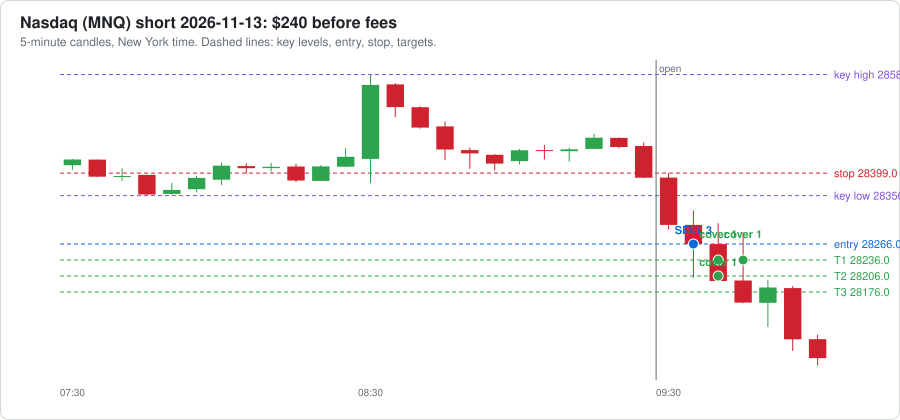

# Agent dashboard

Last updated 2026-11-14 04:06 New York time. Everything here is written by software and AI agents. It can be wrong, so check anything you plan to act on.

**[🪙 Open the Crypto Dashboard →](CRYPTO-DASHBOARD.md)** · **[𝕏 Open the X Brief Dashboard →](X-DASHBOARD.md)**

## Reminders

- ⏰ When your broker is connected: log every trade in trade-journal.md with a heading like `### Trade #1 | 2026-10-16` (swap the `__` in the template for the trade number) and keep the `- **Session:**` line, so the post-session reviewer can see your trades. Or ask Claude to build automatic trade logging into the paper trading agent.
- ⏰ Before trading real money: make this repo private (GitHub → Settings → Danger Zone → Change visibility). First run `git cherry-pick 0f7e3a2` so the paper trader checks less often and stays under GitHub's 2,000 free Actions minutes a month for private repos (it is public now to keep Actions free and unlimited).
- ⏰ 𝕏 **Turn on X auto-posting once @cashflowbrief00 gets traction:** 500+ followers, OR any post with 10,000+ views, OR 1,000+ views a day for a week (check the account's Analytics). Then tell Claude "turn on X auto-posting". It needs X API keys from developer.x.com (about $2.50-3/month for 5-6 posts a day, within the $25 AI budget) and X's "automated account" label.

[Edit reminders](REMINDERS.md)

## Agent status

| | Agent | What it does | Last ran | Runs |
|---|---|---|---|---|
| 🟢 | Market brief: nasdaq | Writes the brief before the New York session | 20 hours ago | weekdays about 7-8 AM New York time |
| 🟢 | Market brief: gold | Writes the brief before the Asia session | 34 hours ago | Sun-Thu evenings about 6-7 PM New York time |
| 🟢 | World news brief | Overnight news and today's events: politics, economy, war, trade | under an hour ago | daily about 5-6 AM New York time |
| 🟢 | Crypto research brief | Pumping coins, whales, government and adoption news | under an hour ago | daily about 5:30-6:30 AM New York time |
| 🟢 | Stock research brief | Movers, AI, nuclear, minerals, earnings dates and estimates | 23 hours ago | Mon, Wed, Fri about 6-7 AM New York time |
| 🟢 | Paper trader | Paper trades every session with your rules and runs a practice prop challenge | 9 hours ago | after each session ends |
| 🟢 | Scorer | Checks each lean against what price did | 11 hours ago | after each session ends |

🟢 ran recently  🟡 a bit late  🔴 check it  ⚪ never ran

## 📒 Trade journal (paper)

- **Tradeify 50K evaluation: balance $50,233**, $1,581 above the drawdown floor, $2,767 to pass; today $892, $2,142 left before the daily loss limit. [Details](paper-trading/summary.md)
- 📐 Opening range (9:30-10:00, tracked, not traded): $1,320 over 9 trades in 10 sessions since 2026-11-02, vs -$2,312 for the real Nasdaq rule (ahead). [Details](paper-trading/summary.md)

Newest first. Times are New York time. Each sale shows contracts @ price, time. The 📈 link opens a chart of the trade; TV opens the same market on TradingView (add [the strategy](tradingview/breakout_strategy.pine) to see each trade marked).

| Date | Market | Side | Lots | Entry | Target 1 | Target 2 | Target 3 / out | Result | What could have gone better | See it |
|---|---|---|---|---|---|---|---|---|---|---|
| 2026-11-13 | Nasdaq | short | 3 | 28266.0 @ 09:35 stop 28399.0 | 1 @ 28236.0, 09:40 ($60) | 1 @ 28206.0, 09:40 ($120) | stop: 1 @ 28236.0, 09:45 ($60) | ✅ **$237** out 09:45 | • The last contracts were stopped at Target 1, then price reached Target 3 by 10:00. A looser stop after Target 2 would have caught it. | [📈 chart](paper-trading/charts/2026-11-13-nasdaq.svg) · [TV](https://www.tradingview.com/chart/?symbol=CME_MINI%3AMNQ1%21&interval=5) |
| 2026-11-13 | Gold | long | 5 | 3886.5 @ 18:50 stop 3882.3 | 1 @ 3892.5, 19:05 ($60) | 2 @ 3898.5, 20:15 ($240) | 2 @ 3904.5, 20:15 ($360) | ✅ **$655** out 20:15 | • Price kept going 15.90 points past Target 3 (by 20:20). Letting the last 2 contract(s) run with a trailing stop could have made up to $318 more. | [📈 chart](paper-trading/charts/2026-11-12-gold.svg) · [TV](https://www.tradingview.com/chart/?symbol=COMEX_MINI%3AMGC1%21&interval=5) |
| 2026-11-12 | Nasdaq | – | 0 | skipped: risk too big | | | | $0 | Breakout long at 09:40, but even the small size risked $808 and only $589 could be lost today without breaking the daily loss limit or the drawdown, so it was skipped. | [TV](https://www.tradingview.com/chart/?symbol=CME_MINI%3AMNQ1%21&interval=5) |
| 2026-11-12 | Gold | long | 5 | 4004.4 @ 20:15 stop 3997.4 | – | – | stop: 5 @ 3997.4, 20:30 (-$350) | ❌ **-$355** out 20:30 | • Price never reached Target 1: the best it did was +0.70 points, and Target 1 needed 6. • The breakout failed and price kept going the other way, so the stop did its job and kept the loss small. • The entry was 3.70 points past the key level, chasing a stretched move. Waiting for a pullback toward the level would have meant a better price and a smaller risk. | [📈 chart](paper-trading/charts/2026-11-11-gold.svg) · [TV](https://www.tradingview.com/chart/?symbol=COMEX_MINI%3AMGC1%21&interval=5) |
| 2026-11-11 | Nasdaq | short | 5 | 28246.75 @ 09:45 stop 28362.0 | 1 @ 28216.75, 09:50 ($60) | – | stop: 4 @ 28362.0, 10:25 (-$922) | ❌ **-$867** out 10:25 | • Target 1 paid $60, but the stop stayed at the start. Moving it to breakeven after Target 1 would have ended this trade at about $60 instead of -$862. • The entry was 65.00 points past the key level, chasing a stretched move. Waiting for a pullback toward the level would have meant a better price and a smaller risk. | [📈 chart](paper-trading/charts/2026-11-11-nasdaq.svg) · [TV](https://www.tradingview.com/chart/?symbol=CME_MINI%3AMNQ1%21&interval=5) |
| 2026-11-11 | Gold | long | 5 | 4055.3 @ 20:35 stop 4043.7 | 1 @ 4061.3, 00:10 ($60) | 2 @ 4067.3, 00:30 ($240) | 2 @ 4073.3, 00:30 ($360) | ✅ **$655** out 00:30 | • Clean trade: price stalled near Target 3, so taking the full profit there was right. | [📈 chart](paper-trading/charts/2026-11-10-gold.svg) · [TV](https://www.tradingview.com/chart/?symbol=COMEX_MINI%3AMGC1%21&interval=5) |
| 2026-11-10 | Nasdaq | long | 3 | 28049.75 @ 10:00 stop 27868.75 | 1 @ 28079.75, 10:05 ($60) | – | stop: 2 @ 27868.75, 10:35 (-$724) | ❌ **-$667** out 10:35 | • Target 1 paid $60, but the stop stayed at the start. Moving it to breakeven after Target 1 would have ended this trade at about $60 instead of -$664. • The entry was 52.25 points past the key level, chasing a stretched move. Waiting for a pullback toward the level would have meant a better price and a smaller risk. | [📈 chart](paper-trading/charts/2026-11-10-nasdaq.svg) · [TV](https://www.tradingview.com/chart/?symbol=CME_MINI%3AMNQ1%21&interval=5) |
| 2026-11-10 | Gold | – | 0 | no breakout, no trade | | | | $0 | No confirmed breakout in the first 60 minutes. Key high 4156.20, low 4130.80. | [TV](https://www.tradingview.com/chart/?symbol=COMEX_MINI%3AMGC1%21&interval=5) |
| 2026-11-09 | Nasdaq | – | 0 | skipped: risk too big | | | | $0 | Breakout long at 09:35, but even the small size risked $1,467 and only $1,073 could be lost today without breaking the daily loss limit or the drawdown, so it was skipped. | [TV](https://www.tradingview.com/chart/?symbol=CME_MINI%3AMNQ1%21&interval=5) |
| 2026-11-09 | Gold | long | 5 | 4115.0 @ 20:15 stop 4111.7 | 1 @ 4121.0, 20:25 ($60) | – | stop: 4 @ 4111.7, 20:30 (-$132) | ❌ **-$77** out 20:30 | • Target 1 paid $60, but the stop stayed at the start. Moving it to breakeven after Target 1 would have ended this trade at about $60 instead of -$72. • Fakeout re-entry (switched off): price closed back beyond the entry at 20:35; re-entering 3 contracts at 4119.3 (stop 4112.9) would have made $357. | [📈 chart](paper-trading/charts/2026-11-08-gold.svg) · [TV](https://www.tradingview.com/chart/?symbol=COMEX_MINI%3AMGC1%21&interval=5) |
| 2026-11-06 | Nasdaq | – | 0 | skipped: daily profit cap | | | | $0 | Not taken: this trading day was already up $600, the daily profit cap that keeps the biggest day small for the 35% consistency rule. | [TV](https://www.tradingview.com/chart/?symbol=CME_MINI%3AMNQ1%21&interval=5) |
| 2026-11-06 | Gold | short | 5 | 4072.7 @ 20:45 stop 4085.0 | 1 @ 4066.7, 20:55 ($60) | 2 @ 4060.7, 22:05 ($240) | 2 @ 4054.7, 22:30 ($360) | ✅ **$655** out 22:30 | • Price kept going 6.30 points past Target 3 (by 23:05). Letting the last 2 contract(s) run with a trailing stop could have made up to $126 more. | [📈 chart](paper-trading/charts/2026-11-05-gold.svg) · [TV](https://www.tradingview.com/chart/?symbol=COMEX_MINI%3AMGC1%21&interval=5) |
| 2026-11-05 | Nasdaq | – | 0 | skipped: daily profit cap | | | | $0 | Not taken: this trading day was already up $600, the daily profit cap that keeps the biggest day small for the 35% consistency rule. | [TV](https://www.tradingview.com/chart/?symbol=CME_MINI%3AMNQ1%21&interval=5) |
| 2026-11-05 | Gold | long | 5 | 4118.4 @ 20:15 stop 4104.3 | 1 @ 4124.4, 20:20 ($60) | 2 @ 4130.4, 20:35 ($240) | 2 @ 4136.4, 20:45 ($360) | ✅ **$655** out 20:45 | • Price kept going 8.00 points past Target 3 (by 20:50). Letting the last 2 contract(s) run with a trailing stop could have made up to $160 more. | [📈 chart](paper-trading/charts/2026-11-04-gold.svg) · [TV](https://www.tradingview.com/chart/?symbol=COMEX_MINI%3AMGC1%21&interval=5) |
| 2026-11-04 | Nasdaq | – | 0 | skipped: risk too big | | | | $0 | Breakout long at 09:40, but even the small size risked $2,352 and only $1,242 could be lost today without breaking the daily loss limit or the drawdown, so it was skipped. | [TV](https://www.tradingview.com/chart/?symbol=CME_MINI%3AMNQ1%21&interval=5) |

**Latest trade:**

[Full journal with every fill](paper-trading/paper-journal.md)

## 👔 CEO check

**❌ 3 broken rule(s)** ([read the full check](reports/ceo/latest.md))

<b>What the CEO checked</b>

##### Futures paper trader

- ❌ gold 2026-11-12 20:00: entered 1370 minutes after the open (the window is 60).
- ❌ Tradeify practice evaluation failed: reset on 2026-10-28: only $96 above the floor, too close for any trade.
- ❌ Tradeify practice evaluation failed: reset on 2026-11-02: only $299 above the floor, too close for any trade.
- ✅ Tradeify practice evaluation: $1,581 above the $2,000 trailing drawdown floor.

##### Your trade journal

- ✅ No trades logged yet, nothing to check.

##### Crypto bots

- ✅ Rotation bot: 8 trades, buys only at weekly checks, never more than 4 coins at once.
- ✅ Buy-and-hold bot has never sold.

##### Alpaca copy

- ✅ All 10 Alpaca orders were for the bot's coins and within the limit.

##### Costs

- ✅ Spent $8.17 so far this month on 78 AI runs; on pace for about $19 (budget $50).

##### Agent health

- ✅ Every research brief worked on its last run.

##### Ready to run on its own?

- ✅ 20 of 15 trading days on the paper record
- ⏳ 3 rule problem(s) in the paper trader above
- ⏳ the Tradeify practice account never failed
- ⏳ the Tradeify practice evaluation has not passed yet
- ⏳ profit factor 0.84 (needs 1.3 or more), total $-1,128 over 25 trades
- ✅ worst trading day $-1,071 (needs $-1,250 or better)
- ⏳ You: Tradeify confirms in writing that TradersPost automation is allowed on the Select 50K
- ⏳ You: 2+ weeks of the live 50K alerts traded by hand with no rule broken
- ⏳ You + Claude: 2-3 sessions on a TradersPost paper account matching the chart

## 📅 Weekly report

<b>Week ending 2026-11-08</b>

#### The week in one look

- **Futures paper:** +$652 this week
- **Rotation bot:** $0.00 this week
- **Buy-and-hold bot:** -$30.12 this week
- **AI costs:** $4.21 this week

#### Futures paper trading

- **This week:** +$652 after fees, 4 trades (3 wins, 1 losses), 5 sessions with no trade
- **Since paper trading began:** -$708 over 18 trades
- Nasdaq (MNQ): -$1,015 over 1 trades
- Gold (MGC): +$1,667 over 3 trades

| Day | Market | Side | Entry | Result |
|---|---|---|---|---|
| 2026-11-02 | nasdaq | long | 28886.75 at 10:25 | -$1,015 |
| 2026-11-04 | gold | long | 3963.4 at 20:15 | +$357 |
| 2026-11-05 | gold | long | 4118.4 at 20:15 | +$655 |
| 2026-11-06 | gold | short | 4072.7 at 20:45 | +$655 |

#### TradingView strategy

| Market | Export date | Forward test (since paper start) | Whole export |
|---|---|---|---|
| Nasdaq (MNQ) | 2026-10-18 | 0 trades, $0 | 25 trades, +$3,684, 56% wins |
| Gold (MGC) | 2026-10-18 | 0 trades, $0 | 22 trades, +$699, 32% wins |

Export the List of trades from each chart and say "update TradingView" to refresh these numbers.

#### Crypto paper bots

| Bot | Start of week | End of week | Change | Since it started ($1,000) |
|---|---|---|---|---|
| Rotation bot | $979.35 | $979.35 | $0.00 (+0.0%) | -$20.65 |
| Buy-and-hold bot | $936.92 | $906.80 | -$30.12 (-3.2%) | -$93.20 |

**Alpaca copy:** 0 order(s) this week.

#### Market briefs (Nasdaq and gold)

- 7 briefs scored; 1 gave a direction, 1 of those were right.
- 6 were Neutral.

#### CEO check

**❌ Rules were broken this week.** 17 checks ran. [Latest CEO check](../ceo/latest.md)

#### AI costs this week

| Agent | Runs | Cost |
|---|---|---|
| crypto-brief | 7 | $1.74 |
| market-brief-nasdaq | 5 | $0.66 |
| stock-brief | 3 | $0.59 |
| world-brief | 7 | $0.58 |
| market-brief-gold | 4 | $0.57 |
| x-posts | 13 | $0.06 |
| **Total** | 39 | **$4.21** |

At this pace: about $18 a month.

[Main dashboard](../../DASHBOARD.md) · [Crypto dashboard](../../CRYPTO-DASHBOARD.md)

[All weekly reports](reports/weekly/)

## Paper trading

- Total after fees: **-$1,128** over 25 trades (39 sessions watched)
- Trading days with a trade: **19**, profitable: **7**, losing: 12
- Win rate: 44%
- Profit factor: 0.84
- Biggest drop from a high (max drawdown): $4,620
- Room left before the $4,000 max drawdown: **$628**
- Progress toward a prop demo: **19 of 20** trading days

<b>Challenge simulation, results by market, and daily results</b>

#### By market

| Market | Trades | Wins | Total after fees |
|---|---|---|---|
| nasdaq | 11 | 4 | -$3,014 |
| gold | 14 | 7 | $1,886 |

#### Daily results

| Trading day | Sessions | Result after fees |
|---|---|---|
| 2026-11-13 | gold long, nasdaq short | $892 |
| 2026-11-12 | gold long, nasdaq skipped, risk too big for today's limits | -$355 |
| 2026-11-11 | gold long, nasdaq short | -$212 |
| 2026-11-10 | gold no trade, nasdaq long | -$667 |
| 2026-11-09 | gold long, nasdaq skipped, risk too big for today's limits | -$77 |
| 2026-11-06 | gold short, nasdaq skipped, daily profit cap reached | $655 |
| 2026-11-05 | gold long, nasdaq skipped, daily profit cap reached | $655 |
| 2026-11-04 | gold long, nasdaq skipped, risk too big for today's limits | $357 |
| 2026-11-03 | gold no trade, nasdaq no trade | $0 |
| 2026-11-02 | nasdaq long | -$1,015 |
| 2026-10-30 | gold short, nasdaq skipped, risk too big for today's limits | -$265 |
| 2026-10-29 | gold short, nasdaq skipped, risk too big for today's limits | -$365 |
| 2026-10-28 | gold long, nasdaq short | -$1,071 |
| 2026-10-27 | gold no trade, nasdaq long | -$688 |
| 2026-10-26 | gold short, nasdaq no trade | -$329 |
| 2026-10-23 | gold short, nasdaq long | -$888 |
| 2026-10-22 | gold short, nasdaq short | $1,070 |
| 2026-10-21 | gold no trade, nasdaq short | -$252 |
| 2026-10-20 | gold short, nasdaq long | $1,070 |
| 2026-10-19 | gold no trade, nasdaq long | $357 |

[Every paper trade](paper-journal.md) · [Raw data](trades.csv)

[Paper trading journal](paper-trading/paper-journal.md) · [TradingView strategy](tradingview/breakout_strategy.pine)

## 📈 TradingView strategy results

From the latest **List of trades** export of each chart. One trade = one entry (TradingView counts each target as a separate trade). Forward test = trades from 2026-10-19 on.

| Market | Export date | Trades | Wins / losses | Win rate | Total | Profit factor | Max drawdown | Forward test |
|---|---|---|---|---|---|---|---|---|
| Nasdaq (MNQ) | 2026-10-18 (trades since 2026-08-25) | 25 | 14 / 11 | 56% | **$3,684** | 1.99 | $1,066 | 0 trades, $0 |
| Gold (MGC) | 2026-10-18 (trades since 2026-08-24) | 22 | 7 / 15 | 32% | **$699** | 1.30 | $1,559 | 0 trades, $0 |
| **Both** | | 47 | 21 / 26 | 45% | **$4,384** | 1.72 | | |

<b>Latest 10 TradingView trades</b>

| Entry (New York) | Market | Side | Entry price | Contracts | Result |
|---|---|---|---|---|---|
| 2026-10-15 09:35 | Nasdaq (MNQ) | short | 29,830.00 | 5 | ❌ -$68 |
| 2026-10-14 20:05 | Gold (MGC) | short | 4,138.90 | 5 | ❌ -$105 |
| 2026-10-14 09:35 | Nasdaq (MNQ) | short | 30,578.50 | 5 | ❌ -$192 |
| 2026-10-13 09:35 | Nasdaq (MNQ) | short | 30,757.25 | 5 | ❌ -$20 |
| 2026-10-12 20:05 | Gold (MGC) | short | 4,187.60 | 5 | ✅ $420 |
| 2026-10-12 09:45 | Nasdaq (MNQ) | short | 30,969.50 | 5 | ✅ $660 |
| 2026-10-08 20:05 | Gold (MGC) | long | 4,168.70 | 5 | ❌ -$20 |
| 2026-10-07 20:05 | Gold (MGC) | short | 4,131.60 | 5 | ❌ -$250 |
| 2026-10-07 09:35 | Nasdaq (MNQ) | short | 31,180.50 | 5 | ❌ -$704 |
| 2026-10-06 20:05 | Gold (MGC) | long | 4,191.20 | 5 | ❌ -$8 |

To refresh: export the List of trades from each chart in TradingView, double-click `tradingview/update-exports.command`, then push in GitHub Desktop.

## Latest briefs

Click a brief to read it here. The summary is at the top of each.

<b>🌍 World news brief, 2026-11-14, event risk Low</b>

#### Top things for today
1. **US-China trade council met.** The two sides discussed tariff cuts and farm trade at their first trade council meeting on Friday, Nov 13. China's Commerce Ministry reported it Saturday. It said a leaders' meeting in Shenzhen is expected next week. The proposed $60 billion package of reciprocal tariff cuts has not been finalised. (Reuters via Press News Agency) Why it matters: tariffs, the dollar and risk appetite.
2. **Trump extended a Jones Act waiver, reportedly.** Hawaii News Now says debate continues over the impact on savings (headline only). Why it matters: shipping costs and energy transport.
3. **Rubio on Iran.** i24NEWS carried a live blog of Rubio warning that a nuclear-armed Iran could hold the US and the Middle East hostage (headline only). Why it matters: Middle East risk and energy.
4. **CFTC sued Louisiana and Arkansas** over prediction-market jurisdiction (CFTC press releases). Why it matters: regulation of futures-style venues.
5. **Senate leadership.** The New York Times reports Chris Van Hollen is set to challenge Chuck Schumer for Senate Majority Leader (headline only). Why it matters: the fiscal and legislative outlook.

#### Today's schedule (New York time)
| Time | Event | Who or where | Confirmed? |
|---|---|---|---|
| – | No major events listed | Economic calendar | Yes |

No scheduled events found. Sunday Nov 15 also has no major events listed.

Coming up this week: the calendar lists nothing. A Trump-Xi meeting in Shenzhen is expected next week (date and time unconfirmed).

#### Event risk today
Low - Markets are closed and the calendar is empty, but the US-China trade talks and Iran rhetoric could produce weekend headlines.

#### Politics and policy
- The Washington Post reports that Canada's PM Carney reported progress in trade talks with Trump (headline only).
- THV11 reports the White House Correspondents' Dinner shooting suspect is charged with terrorism. Law Commentary says the DOJ added a terrorism charge against a Trump assassination suspect (both headline only).
- The Washington Post reports Brian Monahan is out as attending physician to Congress amid a Pentagon probe (headline only).
- The Supreme Court is considering a case on religious schools and public funding (Every CRS Report, headline only).
- Nothing found on the Fed, Treasury, executive orders or overnight Trump quotes.

#### Economics
Nothing found. No data was released overnight.

Fortune reports a $300 million logistics hub in Vietnam (headline only).

#### SEC, CFTC and hearings
- SEC: no source detail beyond the title – the SEC proposed executive and director compensation disclosure reforms on Friday at 11:57 AM (SEC).
- CFTC: it sued Louisiana on Friday at 4:00 PM after a state court blocked CFTC-regulated exchanges. It sued Arkansas on Friday at 10:46 AM over its jurisdiction over prediction markets (CFTC). Law360 says the Arkansas suit targets the state's Kalshi enforcement action (headline only). RG.org says the DOJ joined the Louisiana suit (headline only).
- Startup Fortune says CFTC Chair Selig reports crypto firms are signing up for CFTC rules while Congress stalls (headline only).
- No hearings found.

#### War, trade and tariffs
- US-China: see the top item. A Reuters analysis found Chinese purchases of US farm goods other than soybeans are on track for a seven-year low, despite a $17 billion annual purchase pledge. China has urged Washington to implement the tariff-reduction deal, calling it a prerequisite for more farm purchases. Why it matters: trade policy and the dollar.
- Ukraine: UNITED24 Media reports daily Russian losses of 1,710 troops, 6 tanks and 33 artillery systems (headline only).
- Iran: see Rubio above.

#### Country briefs
- **China:** The trade council met by video, and a leaders' meeting is expected next week (Reuters via Press News Agency).
- **European Union:** Nothing found.
- **United Kingdom:** Nothing found.
- **Japan:** Nothing found.
- **India:** Nothing found.
- **Russia:** UNITED24 Media reports daily losses of 1,710 troops (headline only).
- **Canada:** Carney reports progress in trade talks with Trump while expanding ties with Asia (The Washington Post, headline only).

[Read the full brief with all the details](reports/news/2026-11-14-world-brief.md) · [All news briefs](reports/news/)

<b>🪙 Crypto brief, 2026-11-14</b>

#### Top things today

1. **Fear and Greed fell to 13 (Extreme Fear).** The index dropped from 20 to 13. Bitcoin fell below $68,000 on Nov 13, its lowest since Aug 19 (CoinDesk via KuCoin). Why it matters: it is the deepest fear reading in months.
2. **Leveraged longs were flushed.** CoinGlass counted $1.65 billion in liquidations over 24 hours. Talos says Bitcoin order-book depth is thin and leverage is high. Why it matters: thin books can make moves sharper.
3. **Institutions are pulling money.** Strategy and other treasury firms were removed from MSCI indexes, the dollar is stronger, and Bitcoin ETFs have had $1.9B of net outflows this month (Bloomingbit). Nvidia CEO Jensen Huang's resignation was also cited as a trigger. Why it matters: these are the stated drivers of the selloff.
4. **The White House nominated four SEC and CFTC commissioners.** The SEC nominees have a Senate Banking hearing on Nov 19. Why it matters: both agencies are short-staffed while the market-structure bill is stalled.
5. **Akedo (AKE) is the only big pump.** It is up 162.7% on our data with no clear news found. Why it matters: it is a speculative outlier in a falling market.

#### Coins to research

| Coin | 24h move | Why it is moving | Red flags |
|---|---|---|---|
| Akedo (AKE) | +162.7% (live data) | I found no news for today. It is a gaming token on BNB Chain. Its 24h range ran from $0.002576 to $0.01369 (CoinGabbar). Outlets quote different gains (370%, 382%), so the figure is unconfirmed. | Pump with no news. 24h volume ($523M) is larger than market cap ($307M). It sat about 77% below its Sept 20 peak in October. It has monthly unlocks of about 2.1B tokens (CoinDelx). Earlier coverage flagged whale concentration (unconfirmed). |
| Pearl (PEARL) | +12.1% | No reason found. | Down 12.5% over 7 days. Volume is small next to the pump. |
| Pieverse (PIEVERSE) | +9.0% | No reason found. | Up 24.2% in 7 days. No news. |
| Midnight (NIGHT) | +8.3% | No reason found. | Up 16% in 7 days with no news found. |
| Injective (INJ) | +4.9% | No reason found. It is also trending. | Small move. Still down 4% in 7 days. |
| Ozone Chain (OZO) | +3.7% | No reason found. | 24h volume is only $351.6K. It is up 65.1% in 7 days. Thin liquidity. |

#### Whale watch

| When | Coin | Amount (USD) | Who | Direction |
|---|---|---|---|---|
| Nov 12 (about 8 hours before the report; exact time not given) | BTC | ~$73.78M (1,000 BTC) | A whale dormant four years (Lookonchain via PANews) | Onto an exchange (Binance) |
| Nov 13, 1:22 AM ET (06:22 UTC) | ETH | ~$19.91M (10,380 ETH) | Wallet 0x4cee (Lookonchain) | Received. This is not confirmed as a purchase. |
| Nov 13 (time not given) | ETH | ~$32.3M (16,700 ETH) | Wallet 0xBE4 (Lookonchain) | Sold |
| Nov 13 (time not given) | BTC and ETH | Wallet 0x6046 lost exposure to about $25.2M of ETH and $38.77M of BTC | Wallet 0x6046 (Lookonchain) | Liquidated |

The two Nov 13 wallet rows are from reports with no exact times.

#### Government and regulation

- **SEC and CFTC nominees:** Nathan Anonick and Matthew Rowland were nominated to the CFTC. Kristin Johnson and Steven Levine were nominated to the SEC. The SEC has two of five seats filled. The CFTC has only Chair Selig. Confirmation is expected before Democrats take the Senate in January 2027. (The Block, Crypto Briefing)
- **Clarity Act:** It stalled in the Senate on Sept 15 on a 49-50 procedural vote. Passage this Congress is seen as unlikely. (Startup Fortune)
- **CFTC rules:** Regulation CTX and CAM, floated Oct 5, would give crypto exchanges a federal route that skips state licences. Selig says firms are opting in. (CNBC via Startup Fortune)
- **House Democrats' draft:** They are reportedly drafting an SEC-led market-structure bill that would curb the CFTC's role and add Trump ethics rules. It is a draft only. (Crypto Briefing)
- **France:** The Senate begins budget debate Nov 20 and takes up revenue articles from Nov 23, where crypto tax amendments could be revived. The Assembly had stripped them. (Wisdom of Wallets)

#### Who is buying and adopting

- **Strategy:** It bought 1,036 BTC (Nov 2–8) at about $79,012 each and now holds 850,364 BTC. That is well above today's price. (TCB)
- **Coinbase:** Armstrong said its treasury reached 18,000 BTC.
- **PNC and Coinbase:** A pilot lets eligible corporate customers receive payments in USDC.
- **Other:** NYSE selected Avalanche. I found no new country purchases.

#### Next 7 days

| Date | Event | Coin or topic |
|---|---|---|
| Nov 14, 3:00 AM (time zone not stated) | Unlock of about $1.7M (Chainbase) | C |
| Nov 15, 3:00 PM (time zone not stated) | Unlock of about $5.07M (Starknet) | STRK |
| Nov 15 (Sunday) | Weekly close; the next test is $69,555 (Coinspeaker) | BTC |
| Nov 19 | Senate Banking hearing for SEC nominees (hearing time not found) | SEC / regulation |
| Nov 20 | French Senate budget debate begins | France crypto tax |
| Nov 23 | French Senate takes up revenue articles | France crypto tax |

The unlock times come from a source that doesn't state its time zone, so treat them as unconfirmed. I found no ETF deadlines.

[Read the full brief with all the details](reports/crypto/2026-11-14-crypto-brief.md) · [All crypto briefs](reports/crypto/)

<b>📈 Stocks brief, 2026-11-13</b>

#### Top things today
1. **Nvidia CEO Jensen Huang resigned effective immediately.** The stock dove as much as 16% at the low but ended down 4.3% amid multiple scandals around him (NBC News). Why it matters: the biggest AI stock has no CEO days before earnings.
2. **Nvidia reports Tuesday, Nov 17.** Yahoo consensus is $2.47 EPS on $108.8B revenue. Timing is not confirmed. Why it matters: it is the first report after the leadership shock.
3. **AMD (+5.9%) and Broadcom (+5.5%) rose as Nvidia fell.** CNBC noted AMD is the only other company that makes a full rack-scale AI system. Why it matters: money is moving to Nvidia's rivals.
4. **Super Micro fell 11.3% on a DOJ probe.** The DOJ is investigating compliance with export rules for related servers (reported by Semafor, per CNBC). Why it matters: it is an export-control risk for AI server makers.
5. **AI cloud names sold off.** Nebius fell about 17% and CoreWeave 6.9%, with IREN down 6.5%. Why it matters: the neocloud group is trading on guidance and capex worries.

#### Stocks to research
| Ticker | Theme | Move | Why | Red flags |
|---|---|---|---|---|
| NVDA | AI | -4.3% (5d -8.5%) | CEO resigned; earnings Nov 17 | Headed for a sixth straight weekly drop; leadership unclear |
| AMD | AI | +5.9% (5d +44.7%) | Seen as a Nvidia rival gaining share | Up about 45% in 5 days; move is partly sentiment |
| AVGO | AI | +5.5% (5d +25.0%) | Rose alongside AMD | Same sympathy move; no company-specific news found |
| SMCI | AI servers | -11.3% | DOJ export probe | Legal risk; one customer drove 44% of quarterly revenue |
| NBIS | AI cloud | -16.8% | Cut full-year revenue guidance, shifted some December revenue to 2027, raised capex | Guidance cut despite an earnings beat |
| LEU | Nuclear fuel | -7.4% (5d +16.7%) | Roth upgraded it to Buy on Nov 6 (Daily Trade Alert) | Volatile; no news found for Thursday's drop |

No new IPO or new stock with a big move turned up. SPCX (Space Exploration Technologies, a large, actively traded name) was flat at +0.1%.

#### AI and tech
- **Nvidia turmoil.** The board removed Huang, pushing Nvidia's market cap below $4 trillion (KuCoin News). Shares are down roughly 30% over the past month (Yahoo Finance). CNBC also reports a roughly $2 trillion loss in value since the early-October peak.
- **Super Micro probe.** Dell and HPE had already been hit earlier in the week. A board probe into Huang's alleged ties to a Chinese spy had dragged on AI server names (24/7 Wall St).
- **Neoclouds.** CoreWeave gave back some of the prior session's gains from a strong quarterly print (Yahoo Finance). Nebius and IREN fell with it.
- **Other chip moves.** TSM fell 1.9% and Intel 2%. The Philadelphia semiconductor index fell 0.5%, and a memory-supplier ETF fell 2.6% (NBC News).

#### Nuclear and critical minerals
- **Nuclear and uranium stocks fell Thursday.** Examples: CCJ -3.4%, OKLO -5.5%, SMR -7.8%, LEU -7.4%, URA -3.8%. Most are still up over five days. I found no single catalyst for the drop.
- **Copper and lithium are weak.** Copper broke below its 200-day moving average, and uranium and lithium prices also remain under pressure in the short term (FXEmpire). Chinese battery-grade lithium carbonate rose Friday. US PPI data is due Friday.
- **Government support for nuclear.** The US planned to lend $4.2 billion to Vistra to boost nuclear output, a source said on Oct 4 (Mining.com). VST is up 19.2% over five days.
- **Rare earths and export limits.** Nothing new found for today. MP rose 2.0%.

#### Earnings
**Results since yesterday:** Nebius reported and beat earnings estimates. The stock still fell 17% (NBC News). The cause was lower revenue guidance and higher capex. I found no other notable results in these themes.

| Date | Ticker | Timing | EPS estimate | Revenue estimate |
|---|---|---|---|---|
| 2026-11-17 | NVDA | Not confirmed | $2.47 | $108.8B |
| 2026-11-17 | SQM | Not confirmed | $2.03 | $2.2B |

#### Smart money
- **Roth Capital** upgraded Centrus Energy (LEU) from Neutral to Buy on Nov 6 (Daily Trade Alert).
- **Jones Trading** upgraded IREN from Hold to Buy on Nov 6 (Chartmill). The stock fell 6.5% Thursday.
- **Congress:** Rep. John McGuire disclosed several small Micron purchases and a partial Broadcom sale, each $1K–$15K, with trades dated in late September and early October (Benzinga). Nothing found for nuclear or minerals.
- **Insider buying:** Nothing found.

[Read the full brief with all the details](reports/stocks/2026-11-13-stock-brief.md) · [All stocks briefs](reports/stocks/)

<b>📊 Nasdaq 100 futures market brief, 2026-11-13</b>

### Nasdaq 100 futures brief: Friday, Nov 13, 2026

**1. What is driving the market**
- Nvidia is the main story. Its shares lost about 11% this week through Thursday, when CEO Jensen Huang quit after reports of alleged extramarital affairs. The stock is still on course for its longest streak of weekly losses since October 2012. It was up 1.8% in premarket trading on Friday.
- The Nasdaq 100 lost 0.3% on Thursday. U.S. crude rose 2.6% that day. WTI is above $88 a barrel.
- Rates are the second driver. October CPI came in hot. CME FedWatch put the odds of a 25 bp hike on Dec 9 at around 85% to 90%. Reuters says traders are fully pricing in a hike. The 10-year yield was reported at 5.103%.
- Early Friday, futures were flat to slightly lower. Nasdaq 100 E-minis were down 0.11% at 5:03 a.m. ET. Strong earnings have at times kept the negative mood in check this week.

**2. Scheduled events (New York time)**
- **8:30 AM:** October PPI. Consensus is +0.4% on the month and +0.3% for core. It could be crucial in determining how much the Fed raises rates next month. This comes before the 9:30 open.
- **9:10 AM:** Fed's Collins. Logan is listed at 9:40 AM, but only one source shows this.
- **10:50 AM:** Fed's Bowman.
- **12:00 PM:** Fed's Daly.
- **7:00 PM:** Fed's Jefferson, after the session.
- I found no major Nasdaq 100 earnings reports today. The only earnings I saw listed were for Richemont, which is not a US company.

**3. Key levels (from the price data)**
- Previous session high: **28652.25**.
- Previous session low: **28044.50**.
- Previous close: **28388.25**.
- Last-5-session high: **28697.00**.
- Last-5-session low: **26988.50**.
- Since the close, the range is **28243.25 to 28607.75**.
- The latest price of **28398.00** is mid-range. It is not near a high or a low. It is 254.25 below the high and 353.50 above the low, and it sits almost on the previous close. The nearest levels are the overnight high (28607.75) above and the overnight low (28243.25) below.

**4. Volume**
Yesterday's volume was 0.83x the average of the five sessions before it. That is below average. It suggests weaker participation, so the pullback was not driven by heavy selling. The market also showed little conviction either way.

**5. Directional lean**
**Neutral. Confidence: Low.** Price sits in the middle of the previous range, so neither a high nor a low gives an edge. Volume was light, which fits a market waiting for news. The news conflicts. Nvidia is bouncing and earnings have been supportive. Against that, rate-hike pricing, high yields and oil are headwinds. The 8:30 PPI and several Fed speakers could change the picture quickly. This is a probability-based lean, not a prediction or a trade instruction.

I would shift toward **Bullish** if PPI comes in cool and price holds above the previous high of 28652.25 on rising volume. I would shift toward **Bearish** if PPI is hot and price falls below the previous low of 28044.50. A move past 28697.00, the last-5-session high, would also matter.

**6. Event risk: High.** PPI lands before the open and is followed by three or four Fed speakers. Rate-hike expectations are already running at about 85% to 90%.

**7. Sources**
- CNBC
- Reuters (via Investing.com and MarketScreener)
- Yahoo Finance
- Stocktwits/Benzinga
- Newsquawk
- TheStreet Pro
- Kiplinger
- ZeroHedge
- Investing.com
- StockTitan
- CoinGabbar
- investingLive
- JournalArta

**Unverified:** I could not confirm Logan's 9:40 AM time from a second source. The Reuters pre-market moves were taken at 5:03 a.m. ET and may be out of date.

BIAS: Neutral | CONFIDENCE: Low

[Open the file](reports/2026-11-13-nasdaq-brief.md)

<b>📊 Gold futures market brief, 2026-11-12</b>

### Gold Futures Brief: Asia Session, Nov 12–13, 2026

#### 1. What is driving gold
- Gold is under pressure from rate-hike worries. A hot inflation report on Tuesday put a December hike on the table. CME FedWatch showed a December hike fully priced.
- Fed speakers added to this today. Hammack said rates need to go higher. Daly said further tightening will be needed.
- Bond yields rose. The 30-year Treasury auction cleared at 5.441%. Babypips' headline calls it a bond selloff that sank gold.
- Kitco shows spot gold down $107 on the day, with a low of $3,852.10.

#### 2. Scheduled events (New York time)
- **6:30 PM tonight:** NY Fed President Williams speaks. Kiplinger lists him at 6:30 pm. This is the same time the bot may start entering.
- **Friday 8:30 AM:** Core PPI. Forecast 0.3%, previous 0.7%. This is after the session ends, but the market may position for it.
- **Friday 7:00 PM:** Fed Vice Chair Jefferson speaks. This falls after tonight's session.
- **Weekend:** Headlines on Iran and the Houthis may also decide where oil opens on Sunday evening.
- I did not verify any big earnings or other central bank speakers for tonight's window.

#### 3. Key levels (from the price data)
- Latest price: 3881.40.
- Previous Asia session high: 4005.90.
- Previous Asia session low: 3933.00. This is also the lowest low of the last 5 sessions.
- Highest high of the last 5 sessions: 4150.70.
- Since the last close: high 3961.10, low 3856.70.

Price is 51.60 below the previous session low. That low (3933.00) is now overhead and may act as resistance. Price is also only 24.70 above the 3856.70 recent low, so it sits **near support, not resistance**. If that low breaks, there is no earlier low in the data to point to.

#### 4. Volume
The previous session traded 0.92x the average of the 5 sessions before it. That is slightly below average. Participation was a bit light, not strong. Light volume on a drop can mean the move lacks conviction. That signal is weak, though.

#### 5. Directional lean
**Bearish, Medium confidence.** Price has broken below the previous session low and is trading near the recent low. The news is hawkish: a hike is priced in, and yields are rising. Volume was only slightly light, so it does not clearly confirm or contradict the move. The main risk is that the drop is already large, so a bounce toward 3933.00 is possible. Williams speaks at 6:30 PM, which could cause a sharp move either way.

What would change my lean:
- Price reclaims 3933.00 and holds above it.
- Fed speakers sound less hawkish.
- Yields fall back.

Any of these would move me toward Neutral. This is a probability-based lean, not a prediction or a trade instruction.

#### 6. Event risk: Medium
Williams speaks right as entries may begin and rate-hike pricing is driving gold. The big data, Core PPI, comes after the session ends.

#### 7. Sources
- Price data block (Yahoo Finance)
- Kitco
- Babypips
- Investing.com
- Kiplinger
- Finviz
- Macrobullseye

BIAS: Bearish | CONFIDENCE: Medium

[Open the file](reports/2026-11-12-gold-brief.md)

## Latest lean for each market

| Market | Brief written | Lean | Confidence | Event risk | Price then | Full brief |
|---|---|---|---|---|---|---|
| nasdaq | 2026-11-13 07:53 | ◆ Neutral | Low | High | 28398.00 | [read it](reports/2026-11-13-nasdaq-brief.md) |
| gold | 2026-11-12 18:32 | ▼ Bearish | Medium | Medium | 3881.40 | [read it](reports/2026-11-12-gold-brief.md) |

A lean is a probability-based view, not a prediction. ▲ Bullish  ▼ Bearish  ◆ Neutral

## Scorecard

- Briefs scored: **30** (Bullish or Bearish calls: 6)
- Right: 3, Wrong: 3, Session ended flat: 0
- Hit rate when the session was decisive: **50%**
- For comparison, price went up in 50% of decisive sessions
- ⚠️ Only 6 directional calls so far. Treat the numbers as noise until there are at least 30.

By confidence:

| Confidence | Right | Wrong | Flat | Hit rate |
|---|---|---|---|---|
| High | 0 | 0 | 0 | n/a |
| Medium | 2 | 2 | 0 | 50% |
| Low | 1 | 1 | 0 | 50% |

[Full scorecard](reports/scorecard.md)

## Charts

## Recent results

| Brief | Market | Lean | Confidence | Session moved | Result |
|---|---|---|---|---|---|
| 2026-11-13 | nasdaq | ◆ Neutral | Low | Down (-1.24%) | Moved |
| 2026-11-12 | gold | ▼ Bearish | Medium | Up (0.29%) | Wrong |
| 2026-11-11 | gold | ▼ Bearish | Medium | Down (-1.65%) | Right |
| 2026-11-11 | nasdaq | ◆ Neutral | Low | Up (0.46%) | Moved |
| 2026-11-10 | gold | ▼ Bearish | Medium | Up (0.64%) | Wrong |
| 2026-11-10 | nasdaq | ◆ Neutral | Low | Up (0.33%) | Moved |
| 2026-11-09 | gold | ◆ Neutral | Low | Down (-0.26%) | Moved |
| 2026-11-06 | nasdaq | ◆ Neutral | Low | Down (-0.34%) | Moved |
| 2026-11-05 | gold | ◆ Neutral | Low | Down (-0.38%) | Moved |
| 2026-11-05 | nasdaq | ▼ Bearish | Low | Down (-5.16%) | Right |

## Your journals

- Trades logged: **0**. [Open the trade journal](trade-journal.md)
- No-trade sessions explained: **3**. [Open the no-trade journal](no-trade-journal.md)

<b>Latest no-trade sessions</b>

##### No-trade session | 2026-10-18 | Asia
- **Instrument:** Gold futures
- **What happened:** No signal. The rules gave no entry.
- **Why:** No 5-minute candle closed above the previous high (4211.20) or below the previous low (4167.50) in the first 30 minutes after the 20:00 open. (Previous Asia session was 2026-10-15.)
- **First 30 minutes, candle by candle:**
  - 20:00 candle: close 4205.50, closed inside the range (5.70 below the high, 38.00 above the low).
  - 20:05 candle: close 4204.40, closed inside the range (6.80 below the high, 36.90 above the low).
  - 20:10 candle: close 4201.70, closed inside the range (9.50 below the high, 34.20 above the low).
  - 20:15 candle: close 4199.00, closed inside the range (12.20 below the high, 31.50 above the low).
  - 20:20 candle: close 4196.40, closed inside the range (14.80 below the high, 28.90 above the low).
  - 20:25 candle: close 4196.00, closed inside the range (15.20 below the high, 28.50 above the low).
- **Closest call:** Price got within 2.80 of the previous high (its highest point was 4208.40) but never reached it.
- **After the window:** No candle closed beyond either level for the rest of the session.
- **What the market was showing:** The session range was 25.60 points, 60% of the average of the last 5 (a quiet session). Open to close it moved -12.30 points (-0.29%).
- **The morning brief said:** Neutral (Low confidence), event risk Medium.
- **Verdict:** Consistent with your rules. There was no setup, so staying out was correct under the rules.
- **Your notes:**

##### No-trade session | 2026-10-16 | New York
- **Instrument:** Nasdaq 100 futures
- **What happened:** No signal. The rules gave no entry.
- **Why:** No 5-minute candle closed above the previous high (30196.75) or below the previous low (29622.50) in the first 15 minutes after the 09:30 open. (Previous New York session was 2026-10-15.)
- **First 15 minutes, candle by candle:**
  - 09:30 candle: close 29969.75, closed inside the range (227.00 below the high, 347.25 above the low).
  - 09:35 candle: close 29895.25, closed inside the range (301.50 below the high, 272.75 above the low).
  - 09:40 candle: close 29936.25, closed inside the range (260.50 below the high, 313.75 above the low).
- **Closest call:** Price got within 151.00 of the previous high (its highest point was 30045.75) but never reached it.
- **After the window:** A candle first closed below the previous low at 12:45, but that was after the 15-minute window, so the rules did not allow an entry.
- **What the market was showing:** The session range was 777.00 points, 219% of the average of the last 5 (a busy session). Open to close it moved -644.75 points (-2.15%).
- **The morning brief said:** Neutral (Low confidence), event risk Medium.
- **Verdict:** Consistent with your rules. There was no setup, so staying out was correct under the rules.
- **Your notes:**

##### No-trade session | 2026-10-15 | Asia
- **Instrument:** Gold futures
- **What happened:** No signal. The rules gave no entry.
- **Why:** No 5-minute candle closed above the previous high (4183.30) or below the previous low (4152.70) in the first 15 minutes after the 21:00 open. (Previous Asia session was 2026-10-14.)
- **First 15 minutes, candle by candle:**
  - 21:00 candle: close 4176.50, closed inside the range (6.80 below the high, 23.80 above the low).
  - 21:05 candle: close 4178.00, closed inside the range (5.30 below the high, 25.30 above the low).
  - 21:10 candle: close 4178.50, closed inside the range (4.80 below the high, 25.80 above the low).
- **Closest call:** Price got within 1.60 of the previous high (its highest point was 4181.70) but never reached it.
- **After the window:** A candle first closed above the previous high at 22:30, but that was after the 15-minute window, so the rules did not allow an entry.
- **What the market was showing:** The session range was 43.70 points, 98% of the average of the last 5 (a normal session). Open to close it moved +33.70 points (+0.81%).
- **The morning brief said:** Neutral (Low confidence), event risk High.
- **Verdict:** Consistent with your rules. There was no setup, so staying out was correct under the rules.
- **Your notes:**

## Still to build

| Agent | Purpose | Status |
|---|---|---|
| Product selling agent (separate repo) | Main Agent from your Obsidian notes: what to sell, sourcing, advertising | ⚪ not built yet |
| Live demo trading | Sends the TradingView strategy's orders to a Tradovate demo or prop challenge account, behind a risk gatekeeper | ⚪ not built yet |

## Links

- [All reports](reports/)
- [Trading rules](trading-rules.md)
- [Bias log](reports/bias-log.csv)
