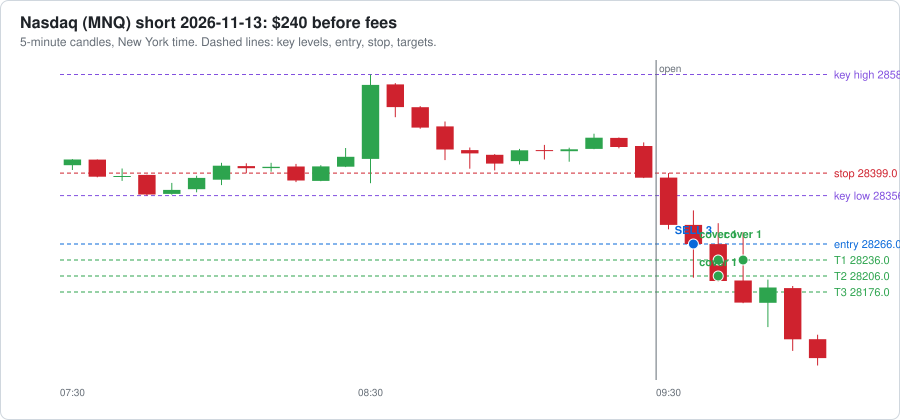

# Agent dashboard

Last updated 2026-11-15 18:37 New York time. Everything here is written by software and AI agents. It can be wrong, so check anything you plan to act on.

**[🪙 Open the Crypto Dashboard →](CRYPTO-DASHBOARD.md)** · **[𝕏 Open the X Brief Dashboard →](X-DASHBOARD.md)**

## Reminders

- ⏰ When your broker is connected: log every trade in trade-journal.md with a heading like `### Trade #1 | 2026-10-16` (swap the `__` in the template for the trade number) and keep the `- **Session:**` line, so the post-session reviewer can see your trades. Or ask Claude to build automatic trade logging into the paper trading agent.
- ⏰ Before trading real money: make this repo private (GitHub → Settings → Danger Zone → Change visibility). First run `git cherry-pick 0f7e3a2` so the paper trader checks less often and stays under GitHub's 2,000 free Actions minutes a month for private repos (it is public now to keep Actions free and unlimited).
- ⏰ 𝕏 **Turn on X auto-posting once @cashflowbrief00 gets traction:** 500+ followers, OR any post with 10,000+ views, OR 1,000+ views a day for a week (check the account's Analytics). Then tell Claude "turn on X auto-posting". It needs X API keys from developer.x.com (about $2.50-3/month for 5-6 posts a day, within the $25 AI budget) and X's "automated account" label.

[Edit reminders](REMINDERS.md)

## Agent status

| | Agent | What it does | Last ran | Runs |
|---|---|---|---|---|
| 🟢 | Market brief: nasdaq | Writes the brief before the New York session | 25 hours ago | weekdays about 7-8 AM New York time |
| 🟢 | Market brief: gold | Writes the brief before the Asia session | under an hour ago | Sun-Thu evenings about 6-7 PM New York time |
| 🟢 | World news brief | Overnight news and today's events: politics, economy, war, trade | 8 hours ago | daily about 5-6 AM New York time |
| 🟢 | Crypto research brief | Pumping coins, whales, government and adoption news | 8 hours ago | daily about 5:30-6:30 AM New York time |
| 🟢 | Stock research brief | Movers, AI, nuclear, minerals, earnings dates and estimates | 3 days ago | Mon, Wed, Fri about 6-7 AM New York time |
| 🟢 | Paper trader | Paper trades every session with your rules and runs a practice prop challenge | 48 hours ago | after each session ends |
| 🟢 | Scorer | Checks each lean against what price did | 2 days ago | after each session ends |

🟢 ran recently  🟡 a bit late  🔴 check it  ⚪ never ran

## 📒 Trade journal (paper)

- **Tradeify 50K evaluation: balance $50,233**, $1,581 above the drawdown floor, $2,767 to pass; today $892, $2,142 left before the daily loss limit. [Details](paper-trading/summary.md)
- 📐 Opening range (9:30-10:00, tracked, not traded): $1,320 over 9 trades in 10 sessions since 2026-11-02, vs -$2,312 for the real Nasdaq rule (ahead). [Details](paper-trading/summary.md)

Newest first. Times are New York time. Each sale shows contracts @ price, time. The 📈 link opens a chart of the trade; TV opens the same market on TradingView (add [the strategy](tradingview/breakout_strategy.pine) to see each trade marked).

| Date | Market | Side | Lots | Entry | Target 1 | Target 2 | Target 3 / out | Result | What could have gone better | See it |
|---|---|---|---|---|---|---|---|---|---|---|
| 2026-11-13 | Nasdaq | short | 3 | 28266.0 @ 09:35 stop 28399.0 | 1 @ 28236.0, 09:40 ($60) | 1 @ 28206.0, 09:40 ($120) | stop: 1 @ 28236.0, 09:45 ($60) | ✅ **$237** out 09:45 | • The last contracts were stopped at Target 1, then price reached Target 3 by 10:00. A looser stop after Target 2 would have caught it. | [📈 chart](paper-trading/charts/2026-11-13-nasdaq.svg) · [TV](https://www.tradingview.com/chart/?symbol=CME_MINI%3AMNQ1%21&interval=5) |
| 2026-11-13 | Gold | long | 5 | 3886.5 @ 18:50 stop 3882.3 | 1 @ 3892.5, 19:05 ($60) | 2 @ 3898.5, 20:15 ($240) | 2 @ 3904.5, 20:15 ($360) | ✅ **$655** out 20:15 | • Price kept going 15.90 points past Target 3 (by 20:20). Letting the last 2 contract(s) run with a trailing stop could have made up to $318 more. | [📈 chart](paper-trading/charts/2026-11-12-gold.svg) · [TV](https://www.tradingview.com/chart/?symbol=COMEX_MINI%3AMGC1%21&interval=5) |
| 2026-11-12 | Nasdaq | – | 0 | skipped: risk too big | | | | $0 | Breakout long at 09:40, but even the small size risked $808 and only $589 could be lost today without breaking the daily loss limit or the drawdown, so it was skipped. | [TV](https://www.tradingview.com/chart/?symbol=CME_MINI%3AMNQ1%21&interval=5) |
| 2026-11-12 | Gold | long | 5 | 4004.4 @ 20:15 stop 3997.4 | – | – | stop: 5 @ 3997.4, 20:30 (-$350) | ❌ **-$355** out 20:30 | • Price never reached Target 1: the best it did was +0.70 points, and Target 1 needed 6. • The breakout failed and price kept going the other way, so the stop did its job and kept the loss small. • The entry was 3.70 points past the key level, chasing a stretched move. Waiting for a pullback toward the level would have meant a better price and a smaller risk. | [📈 chart](paper-trading/charts/2026-11-11-gold.svg) · [TV](https://www.tradingview.com/chart/?symbol=COMEX_MINI%3AMGC1%21&interval=5) |
| 2026-11-11 | Nasdaq | short | 5 | 28246.75 @ 09:45 stop 28362.0 | 1 @ 28216.75, 09:50 ($60) | – | stop: 4 @ 28362.0, 10:25 (-$922) | ❌ **-$867** out 10:25 | • Target 1 paid $60, but the stop stayed at the start. Moving it to breakeven after Target 1 would have ended this trade at about $60 instead of -$862. • The entry was 65.00 points past the key level, chasing a stretched move. Waiting for a pullback toward the level would have meant a better price and a smaller risk. | [📈 chart](paper-trading/charts/2026-11-11-nasdaq.svg) · [TV](https://www.tradingview.com/chart/?symbol=CME_MINI%3AMNQ1%21&interval=5) |
| 2026-11-11 | Gold | long | 5 | 4055.3 @ 20:35 stop 4043.7 | 1 @ 4061.3, 00:10 ($60) | 2 @ 4067.3, 00:30 ($240) | 2 @ 4073.3, 00:30 ($360) | ✅ **$655** out 00:30 | • Clean trade: price stalled near Target 3, so taking the full profit there was right. | [📈 chart](paper-trading/charts/2026-11-10-gold.svg) · [TV](https://www.tradingview.com/chart/?symbol=COMEX_MINI%3AMGC1%21&interval=5) |
| 2026-11-10 | Nasdaq | long | 3 | 28049.75 @ 10:00 stop 27868.75 | 1 @ 28079.75, 10:05 ($60) | – | stop: 2 @ 27868.75, 10:35 (-$724) | ❌ **-$667** out 10:35 | • Target 1 paid $60, but the stop stayed at the start. Moving it to breakeven after Target 1 would have ended this trade at about $60 instead of -$664. • The entry was 52.25 points past the key level, chasing a stretched move. Waiting for a pullback toward the level would have meant a better price and a smaller risk. | [📈 chart](paper-trading/charts/2026-11-10-nasdaq.svg) · [TV](https://www.tradingview.com/chart/?symbol=CME_MINI%3AMNQ1%21&interval=5) |
| 2026-11-10 | Gold | – | 0 | no breakout, no trade | | | | $0 | No confirmed breakout in the first 60 minutes. Key high 4156.20, low 4130.80. | [TV](https://www.tradingview.com/chart/?symbol=COMEX_MINI%3AMGC1%21&interval=5) |
| 2026-11-09 | Nasdaq | – | 0 | skipped: risk too big | | | | $0 | Breakout long at 09:35, but even the small size risked $1,467 and only $1,073 could be lost today without breaking the daily loss limit or the drawdown, so it was skipped. | [TV](https://www.tradingview.com/chart/?symbol=CME_MINI%3AMNQ1%21&interval=5) |
| 2026-11-09 | Gold | long | 5 | 4115.0 @ 20:15 stop 4111.7 | 1 @ 4121.0, 20:25 ($60) | – | stop: 4 @ 4111.7, 20:30 (-$132) | ❌ **-$77** out 20:30 | • Target 1 paid $60, but the stop stayed at the start. Moving it to breakeven after Target 1 would have ended this trade at about $60 instead of -$72. • Fakeout re-entry (switched off): price closed back beyond the entry at 20:35; re-entering 3 contracts at 4119.3 (stop 4112.9) would have made $357. | [📈 chart](paper-trading/charts/2026-11-08-gold.svg) · [TV](https://www.tradingview.com/chart/?symbol=COMEX_MINI%3AMGC1%21&interval=5) |
| 2026-11-06 | Nasdaq | – | 0 | skipped: daily profit cap | | | | $0 | Not taken: this trading day was already up $600, the daily profit cap that keeps the biggest day small for the 35% consistency rule. | [TV](https://www.tradingview.com/chart/?symbol=CME_MINI%3AMNQ1%21&interval=5) |
| 2026-11-06 | Gold | short | 5 | 4072.7 @ 20:45 stop 4085.0 | 1 @ 4066.7, 20:55 ($60) | 2 @ 4060.7, 22:05 ($240) | 2 @ 4054.7, 22:30 ($360) | ✅ **$655** out 22:30 | • Price kept going 6.30 points past Target 3 (by 23:05). Letting the last 2 contract(s) run with a trailing stop could have made up to $126 more. | [📈 chart](paper-trading/charts/2026-11-05-gold.svg) · [TV](https://www.tradingview.com/chart/?symbol=COMEX_MINI%3AMGC1%21&interval=5) |
| 2026-11-05 | Nasdaq | – | 0 | skipped: daily profit cap | | | | $0 | Not taken: this trading day was already up $600, the daily profit cap that keeps the biggest day small for the 35% consistency rule. | [TV](https://www.tradingview.com/chart/?symbol=CME_MINI%3AMNQ1%21&interval=5) |
| 2026-11-05 | Gold | long | 5 | 4118.4 @ 20:15 stop 4104.3 | 1 @ 4124.4, 20:20 ($60) | 2 @ 4130.4, 20:35 ($240) | 2 @ 4136.4, 20:45 ($360) | ✅ **$655** out 20:45 | • Price kept going 8.00 points past Target 3 (by 20:50). Letting the last 2 contract(s) run with a trailing stop could have made up to $160 more. | [📈 chart](paper-trading/charts/2026-11-04-gold.svg) · [TV](https://www.tradingview.com/chart/?symbol=COMEX_MINI%3AMGC1%21&interval=5) |
| 2026-11-04 | Nasdaq | – | 0 | skipped: risk too big | | | | $0 | Breakout long at 09:40, but even the small size risked $2,352 and only $1,242 could be lost today without breaking the daily loss limit or the drawdown, so it was skipped. | [TV](https://www.tradingview.com/chart/?symbol=CME_MINI%3AMNQ1%21&interval=5) |

**Latest trade:**

[Full journal with every fill](paper-trading/paper-journal.md)

## 👔 CEO check

**❌ 2 broken rule(s)** ([read the full check](reports/ceo/latest.md))

<b>What the CEO checked</b>

##### Futures paper trader

- ❌ Tradeify practice evaluation failed: reset on 2026-10-28: only $96 above the floor, too close for any trade.
- ❌ Tradeify practice evaluation failed: reset on 2026-11-02: only $299 above the floor, too close for any trade.
- ✅ Tradeify practice evaluation: $1,581 above the $2,000 trailing drawdown floor.

##### Your trade journal

- ✅ No trades logged yet, nothing to check.

##### Crypto bots

- ✅ Rotation bot: 8 trades, buys only at weekly checks, never more than 4 coins at once.
- ✅ Buy-and-hold bot has never sold.

##### Alpaca copy

- ✅ All 10 Alpaca orders were for the bot's coins and within the limit.

##### Costs

- ✅ Spent $8.99 so far this month on 84 AI runs; on pace for about $18 (budget $50).

##### Agent health

- ✅ Every research brief worked on its last run.

##### Ready to run on its own?

- ✅ 20 of 15 trading days on the paper record
- ⏳ 2 rule problem(s) in the paper trader above
- ⏳ the Tradeify practice account never failed
- ⏳ the Tradeify practice evaluation has not passed yet
- ⏳ profit factor 0.84 (needs 1.3 or more), total $-1,128 over 25 trades
- ✅ worst trading day $-1,071 (needs $-1,250 or better)
- ⏳ You: Tradeify confirms in writing that TradersPost automation is allowed on the Select 50K
- ⏳ You: 2+ weeks of the live 50K alerts traded by hand with no rule broken
- ⏳ You + Claude: 2-3 sessions on a TradersPost paper account matching the chart

## 📅 Weekly report

<b>Week ending 2026-11-15</b>

#### The week in one look

- **Futures paper:** -$419 this week
- **Rotation bot:** $0.00 this week
- **Buy-and-hold bot:** -$145.27 this week
- **AI costs:** $4.14 this week

#### Futures paper trading

- **This week:** -$419 after fees, 7 trades (3 wins, 4 losses), 3 sessions with no trade
- **Since paper trading began:** -$1,128 over 25 trades
- Nasdaq (MNQ): -$1,297 over 3 trades
- Gold (MGC): +$878 over 4 trades

| Day | Market | Side | Entry | Result |
|---|---|---|---|---|
| 2026-11-09 | gold | long | 4115.0 at 20:15 | -$77 |
| 2026-11-10 | nasdaq | long | 28049.75 at 10:00 | -$667 |
| 2026-11-11 | gold | long | 4055.3 at 20:35 | +$655 |
| 2026-11-11 | nasdaq | short | 28246.75 at 09:45 | -$867 |
| 2026-11-12 | gold | long | 4004.4 at 20:15 | -$355 |
| 2026-11-13 | gold | long | 3886.5 at 18:50 | +$655 |
| 2026-11-13 | nasdaq | short | 28266.0 at 09:35 | +$237 |

#### TradingView strategy

| Market | Export date | Forward test (since paper start) | Whole export |
|---|---|---|---|
| Nasdaq (MNQ) | 2026-10-18 | 0 trades, $0 | 25 trades, +$3,684, 56% wins |
| Gold (MGC) | 2026-10-18 | 0 trades, $0 | 22 trades, +$699, 32% wins |

Export the List of trades from each chart and say "update TradingView" to refresh these numbers.

#### Crypto paper bots

| Bot | Start of week | End of week | Change | Since it started ($1,000) |
|---|---|---|---|---|
| Rotation bot | $979.35 | $979.35 | $0.00 (+0.0%) | -$20.65 |
| Buy-and-hold bot | $876.58 | $731.31 | -$145.27 (-16.6%) | -$268.69 |

**Alpaca copy:** 0 order(s) this week.

#### Market briefs (Nasdaq and gold)

- 7 briefs scored; 3 gave a direction, 1 of those were right.
- 4 were Neutral.

#### CEO check

**❌ Rules were broken this week.** 17 checks ran. [Latest CEO check](../ceo/latest.md)

#### AI costs this week

| Agent | Runs | Cost |
|---|---|---|
| crypto-brief | 7 | $1.78 |
| market-brief-nasdaq | 6 | $0.72 |
| world-brief | 7 | $0.61 |
| stock-brief | 3 | $0.54 |
| market-brief-gold | 4 | $0.43 |
| x-posts | 12 | $0.06 |
| **Total** | 39 | **$4.14** |

At this pace: about $18 a month.

[Main dashboard](../../DASHBOARD.md) · [Crypto dashboard](../../CRYPTO-DASHBOARD.md)

[All weekly reports](reports/weekly/)

## Paper trading

- Total after fees: **-$1,128** over 25 trades (39 sessions watched)
- Trading days with a trade: **19**, profitable: **7**, losing: 12
- Win rate: 44%
- Profit factor: 0.84
- Biggest drop from a high (max drawdown): $4,620
- Room left before the $4,000 max drawdown: **$628**
- Progress toward a prop demo: **19 of 20** trading days

<b>Challenge simulation, results by market, and daily results</b>

#### By market

| Market | Trades | Wins | Total after fees |
|---|---|---|---|
| nasdaq | 11 | 4 | -$3,014 |
| gold | 14 | 7 | $1,886 |

#### Daily results

| Trading day | Sessions | Result after fees |
|---|---|---|
| 2026-11-13 | gold long, nasdaq short | $892 |
| 2026-11-12 | gold long, nasdaq skipped, risk too big for today's limits | -$355 |
| 2026-11-11 | gold long, nasdaq short | -$212 |
| 2026-11-10 | gold no trade, nasdaq long | -$667 |
| 2026-11-09 | gold long, nasdaq skipped, risk too big for today's limits | -$77 |
| 2026-11-06 | gold short, nasdaq skipped, daily profit cap reached | $655 |
| 2026-11-05 | gold long, nasdaq skipped, daily profit cap reached | $655 |
| 2026-11-04 | gold long, nasdaq skipped, risk too big for today's limits | $357 |
| 2026-11-03 | gold no trade, nasdaq no trade | $0 |
| 2026-11-02 | nasdaq long | -$1,015 |
| 2026-10-30 | gold short, nasdaq skipped, risk too big for today's limits | -$265 |
| 2026-10-29 | gold short, nasdaq skipped, risk too big for today's limits | -$365 |
| 2026-10-28 | gold long, nasdaq short | -$1,071 |
| 2026-10-27 | gold no trade, nasdaq long | -$688 |
| 2026-10-26 | gold short, nasdaq no trade | -$329 |
| 2026-10-23 | gold short, nasdaq long | -$888 |
| 2026-10-22 | gold short, nasdaq short | $1,070 |
| 2026-10-21 | gold no trade, nasdaq short | -$252 |
| 2026-10-20 | gold short, nasdaq long | $1,070 |
| 2026-10-19 | gold no trade, nasdaq long | $357 |

[Every paper trade](paper-journal.md) · [Raw data](trades.csv)

[Paper trading journal](paper-trading/paper-journal.md) · [TradingView strategy](tradingview/breakout_strategy.pine)

## 🎡 Options wheel (paper)

Two paper accounts run side by side: **ours** ($10K CAD, cheaper stocks) and a **Ryan-style** copy (Options With Ryan's rules, pretend $200K USD on his stocks). Compare them by **%**, since the sizes differ. [Rules and research](experiments/wheel-strategy-research.md)

### Ours ($10K CAD)

Starts trading on the first weekday run (2:37 PM New York).

### Ryan-style ($200K USD, his stocks)

Starts trading on the first weekday run (2:37 PM New York).

## 📈 TradingView strategy results

From the latest **List of trades** export of each chart. One trade = one entry (TradingView counts each target as a separate trade). Forward test = trades from 2026-10-19 on.

| Market | Export date | Trades | Wins / losses | Win rate | Total | Profit factor | Max drawdown | Forward test |
|---|---|---|---|---|---|---|---|---|
| Nasdaq (MNQ) | 2026-10-18 (trades since 2026-08-25) | 25 | 14 / 11 | 56% | **$3,684** | 1.99 | $1,066 | 0 trades, $0 |
| Gold (MGC) | 2026-10-18 (trades since 2026-08-24) | 22 | 7 / 15 | 32% | **$699** | 1.30 | $1,559 | 0 trades, $0 |
| **Both** | | 47 | 21 / 26 | 45% | **$4,384** | 1.72 | | |

<b>Latest 10 TradingView trades</b>

| Entry (New York) | Market | Side | Entry price | Contracts | Result |
|---|---|---|---|---|---|
| 2026-10-15 09:35 | Nasdaq (MNQ) | short | 29,830.00 | 5 | ❌ -$68 |
| 2026-10-14 20:05 | Gold (MGC) | short | 4,138.90 | 5 | ❌ -$105 |
| 2026-10-14 09:35 | Nasdaq (MNQ) | short | 30,578.50 | 5 | ❌ -$192 |
| 2026-10-13 09:35 | Nasdaq (MNQ) | short | 30,757.25 | 5 | ❌ -$20 |
| 2026-10-12 20:05 | Gold (MGC) | short | 4,187.60 | 5 | ✅ $420 |
| 2026-10-12 09:45 | Nasdaq (MNQ) | short | 30,969.50 | 5 | ✅ $660 |
| 2026-10-08 20:05 | Gold (MGC) | long | 4,168.70 | 5 | ❌ -$20 |
| 2026-10-07 20:05 | Gold (MGC) | short | 4,131.60 | 5 | ❌ -$250 |
| 2026-10-07 09:35 | Nasdaq (MNQ) | short | 31,180.50 | 5 | ❌ -$704 |
| 2026-10-06 20:05 | Gold (MGC) | long | 4,191.20 | 5 | ❌ -$8 |

To refresh: export the List of trades from each chart in TradingView, double-click `tradingview/update-exports.command`, then push in GitHub Desktop.

## Latest briefs

Click a brief to read it here. The summary is at the top of each.

<b>🌍 World news brief, 2026-11-15, event risk High</b>

#### Top things for today
1. **Hormuz tanker incidents.** Iran's Revolutionary Guards (IRGC) say two more tankers hit mines in the southern Strait of Hormuz. ISNA says one carried over two million barrels of crude and sank. The claims have not been independently verified. Why it matters: energy prices and safe-haven demand (gold).
2. **Iran strikes on Bahrain.** Bahrain says its air defences destroyed several Iranian aerial attacks. Iran says it targeted a radar at al-Riffa air base, in retaliation for a U.S. strike in Sirik last week. Why it matters: Gulf escalation and risk appetite.
3. **Fed Chair Warsh speaks Monday at 12:00 PM.** Why it matters: rate expectations and the dollar.
4. **Trump on the FAA ground stop.** Trump urged Congress to fund an air traffic control overhaul (Anadolu, headline only). Why it matters: possible spending debate.
5. **Russia-Ukraine talks stalled.** The two sides traded air attacks (Radio Free Europe/Radio Liberty, headline only). Why it matters: energy and risk sentiment.

#### Today's schedule (New York time)
| Time | Event | Who or where | Confirmed? |
|---|---|---|---|
| All day | No major economic events | Calendar | Yes |

Coming up this week: Mon 8:30 AM Canada CPI m/m (forecast 0.3%, previous 0.1%), median CPI y/y (2.0%, 1.9%) and trimmed CPI y/y (1.9%, 1.8%). Mon 12:00 PM Fed Chair Warsh speaks. Tue 8:30 AM US retail sales (0.2%, previous 0.8%) and core retail sales (0.4%, previous 0.9%). Wed 2:00 AM UK CPI y/y (3.6%, previous 3.5%). Wed 2:30 AM and 10:00 AM BOE Gov Bailey speaks. Wed 2:00 PM FOMC minutes.

#### Event risk today
High - Markets are closed, but the Hormuz and Bahrain events are unresolved and could be reflected in prices when trading reopens.

#### Politics and policy
- Trump broke his silence on the nationwide ground stop and asked Congress for more money (KSL News, headline only). He also blamed Biden for an aviation "disaster" (TRT World, headline only).
- Trump criticized a judge's two-week halt to his Washington golf project and said the administration will appeal (Your Valley, headline only).
- A Trump team is preparing a "tough response" to Democratic investigations (NYT, via The New Voice of Ukraine, headline only).
- Van Hollen said claims he can't win Senate majority leader are nonsense (The Hill, headline only).

#### Economics
Nothing found on overnight data. No major releases are listed for the weekend.

#### SEC, CFTC and hearings
- Senate Ag panel set a Nov. 17 hearing for CFTC nominees (RG.org, headline only; time not given, unconfirmed).
- Trump named CFTC and SEC nominees for the first time in a year (Hoodline, headline only).
- The CFTC sued Louisiana and Arkansas over prediction markets (CFTC releases, Fri Nov 13). Louisiana: a state court blocked CFTC-regulated exchanges.
- The CFTC is weighing action against Kalshi over contract filing procedures (디지털투데이, headline only).
- The SEC proposed executive and director compensation disclosure reforms (SEC, Fri).
- CLARITY Act is unlikely to advance (Crypto News, headline only).

#### War, trade and tariffs
- **Iran/Hormuz:** The U.S. has imposed a naval blockade on Iranian ports and helped tankers move through the strait, which normally carries about one-fifth of global oil. The IRGC says the strait is closed. UKMTO said traffic was about 65% below pre-war levels. Considerable doubts remain about Iran's mine claims. A British maritime monitor was aware of an Indian authority report of a tanker attack, but it was unclear if this was the same incident. Why it matters: oil supply, shipping costs, inflation.
- **Russia-Ukraine:** Air attacks continued as US-mediated talks failed to break the deadlock (RFE/RL, headline only). Zelenskyy warned that Starshield restrictions threaten Ukraine's energy defenses (LEX 18, headline only).
- **Israel:** The election race between Eisenkot and Netanyahu to build a government continues (Jerusalem Post, headline only).
- **Trade:** ASEAN Digital Economy Framework Agreement signed in Manila (IndexBox, headline only).

#### Country briefs
- **China:** Nothing found.
- **European Union:** Nothing found.
- **United Kingdom:** UK CPI is due Wednesday at 2:00 AM (forecast 3.6%).
- **Japan:** Nothing found.
- **India:** Bloomberg ran a feature on India's $130 billion wedding economy (headline only).
- **Russia:** Air attacks with Ukraine continue (RFE/RL, headline only).
- **Canada:** CPI is due Monday at 8:30 AM (calendar figures above).

[Read the full brief with all the details](reports/news/2026-11-15-world-brief.md) · [All news briefs](reports/news/)

<b>🪙 Crypto brief, 2026-11-15</b>

#### Top things today

1. **Crypto is in extreme fear.** The Fear & Greed Index fell to 10 from 13 on Saturday and 20 on Friday. Bitcoin touched $62,080.91 before climbing back above $65,000. (BigGo/Alternative.me) Why it matters: this is the weakest sentiment reading in this stretch.
2. **Spot Bitcoin ETFs keep bleeding.** They had $2.35 billion in net outflows over two straight weeks. BlackRock's iShares Bitcoin Trust extended its outflow streak to 11 sessions. (Cointelegraph via BigGo) Why it matters: the institutional bid is missing.
3. **Leveraged longs got hit.** Long liquidations were about $1.2 billion in the slide. (Crypto Briefing) Why it matters: forced selling can speed up drops.
4. **A disputed $123M SOL deposit.** Lookonchain tied a $123M SOL deposit at Coinbase Prime to Forward Industries via Arkham labels. Forward says it made no such transfer. (Solana Compass) Why it matters: it is a possible large seller, and ownership is unconfirmed.
5. **US crypto law is stalled.** The CLARITY Act remains stalled as Democrats prepare to control Congress. (crypto.news) Why it matters: the SEC and CFTC are setting rules on their own.

#### Coins to research

I found no news for most of these moves. Treat them as unexplained.

| Coin | 24h move | Why it is moving | Red flags |
|---|---|---|---|
| Ultima (ULTIMA) | +37.0% | No news found. | Pump with no news. Volume is $6.3M against a $99.9M market cap. 7d is -2.2%. |
| Kite (KITE) | +6.3% (7d +26.1%) | No news found for today. A Nov 3 unlock was about 46% of its market cap. (TokenPost) | Large recent unlock. Mid-size cap of $326.1M. |
| Derive (DRV) | +8.4% | No news found. | 7d is -12.3%. Volume is small at $16.4M. |
| Venice Token (VVV) | +10.1% | No news found. | 7d is -5.8%. No catalyst found. |
| EVAA Protocol (EVAA) | +41.2% | No news found. It is trending on CoinGecko. | Rank 837, so tiny. Pump with no news. |
| AudaCity (DACITYCOIN) | +261.9% | No news found. It is trending on CoinGecko. | Rank 961, very small. Likely a meme coin. Extreme move. Holder concentration not checked. |

Also trending: Gato The Cat (GATO, +39.4%, rank 850) and Identity.md (IMD, +21.2%, rank 868). Same red flags: tiny caps and no news found.

#### Whale watch

| When | Coin | Amount (USD) | Who | Direction |
|---|---|---|---|---|
| About 6:41 PM, Nov 14 | SOL | ~$123M | Wallets Arkham links to Forward Industries. Forward denies it. Owner unconfirmed. (Lookonchain/Arkham via Solana Compass) | Onto an exchange (Coinbase Prime deposit address) |
| Nov 12 (older than one day) | BTC | ~$73.78M (1,000 BTC) | A whale dormant for four years (PANews/Lookonchain) | Onto an exchange (Binance). Sale not confirmed. |

#### Government and regulation

- **CLARITY Act (market structure bill):** it would divide SEC and CFTC oversight of crypto. It needed 60 votes to proceed. It failed in September. Status: stalled. Democrats won both chambers in the Nov 3 midterms. (crypto.news, American Banker)
- **Nominations:** Trump nominated Kristin Johnson and Steven Levine to the SEC, and Nathan Anonick and Matthew Rowland to the CFTC. They await Senate confirmation hearings. No hearing date found. (crypto.news)
- **SEC:** "Regulation Crypto Assets" is a proposal with two exemptions that let some crypto firms raise capital without full securities registration. (American Banker)
- **CFTC:** It is seeking public input on a federal framework for leveraged crypto trading. (American Banker)
- **Possible deal areas:** Industry groups see narrower agreements possible on crypto taxation, stablecoin yields and illicit-finance safeguards. (crypto.news)
- **Low-profile item:** crypto.news mentions a data-center permitting bill that bitcoin miners are weighing. I found no details.
- **Other countries:** Nothing found.

#### Who is buying and adopting

- **Strategy:** bought another 1,036 BTC from Nov 2 to 8, bringing holdings to 850,364 BTC. (BigGo)
- **Sellers and stress:** MARA sold 13,597 BTC for about $1.1B, using $750M to repay loans. Nakamoto pushed a $60M USDT repayment from December 2026 to December 2027. Nakamoto also sold 184 BTC in Q3. (BigGo, CryptoNews)
- **Governments:** Nothing new found. The US Strategic Bitcoin Reserve dates from a March 6, 2025 order, funded initially with forfeited bitcoin. (Bitcoin.com)
- **Stablecoin payments by companies:** Nothing found.

#### Next 7 days

All times New York (EST). Token-unlock times were converted from Beijing time. Unlock figures are projections.

| Date | Event | Coin or topic |
|---|---|---|
| Nov 15 (today) | STRK, SEI, SIGN and CYBER unlocks (about $25M total, TokenPost). Connex also unlocks. | STRK, SEI, SIGN, CYBER, CONX |
| Nov 16, 6:03 AM | ~1.17B CRO unlock, about 2.3% of circulating supply, worth ~$51.4M (PANews) | CRO |
| Nov 16, 8:00 AM | 92.65M ARB unlock, ~$12.5M (Phemex) | ARB |
| Nov 20, 6:00 AM | ~23.29M ZRO unlock, ~$34.7M (PANews) | LayerZero (ZRO) |
| Nov 20, ~7:00 AM (unconfirmed time zone) | KAITO unlock of 17.6M tokens (~$3M). Bedrock (BR) also unlocks ~$2M that day. | KAITO, BR |
| Nov 22, ~7:00 AM (unconfirmed time zone) | MBG unlock of ~23.6M tokens (~$2.4M) | MBG |

No hearings or ETF deadlines found.

[Read the full brief with all the details](reports/crypto/2026-11-15-crypto-brief.md) · [All crypto briefs](reports/crypto/)

<b>📈 Stocks brief, 2026-11-13</b>

#### Top things today
1. **Nvidia CEO Jensen Huang resigned effective immediately.** The stock dove as much as 16% at the low but ended down 4.3% amid multiple scandals around him (NBC News). Why it matters: the biggest AI stock has no CEO days before earnings.
2. **Nvidia reports Tuesday, Nov 17.** Yahoo consensus is $2.47 EPS on $108.8B revenue. Timing is not confirmed. Why it matters: it is the first report after the leadership shock.
3. **AMD (+5.9%) and Broadcom (+5.5%) rose as Nvidia fell.** CNBC noted AMD is the only other company that makes a full rack-scale AI system. Why it matters: money is moving to Nvidia's rivals.
4. **Super Micro fell 11.3% on a DOJ probe.** The DOJ is investigating compliance with export rules for related servers (reported by Semafor, per CNBC). Why it matters: it is an export-control risk for AI server makers.
5. **AI cloud names sold off.** Nebius fell about 17% and CoreWeave 6.9%, with IREN down 6.5%. Why it matters: the neocloud group is trading on guidance and capex worries.

#### Stocks to research
| Ticker | Theme | Move | Why | Red flags |
|---|---|---|---|---|
| NVDA | AI | -4.3% (5d -8.5%) | CEO resigned; earnings Nov 17 | Headed for a sixth straight weekly drop; leadership unclear |
| AMD | AI | +5.9% (5d +44.7%) | Seen as a Nvidia rival gaining share | Up about 45% in 5 days; move is partly sentiment |
| AVGO | AI | +5.5% (5d +25.0%) | Rose alongside AMD | Same sympathy move; no company-specific news found |
| SMCI | AI servers | -11.3% | DOJ export probe | Legal risk; one customer drove 44% of quarterly revenue |
| NBIS | AI cloud | -16.8% | Cut full-year revenue guidance, shifted some December revenue to 2027, raised capex | Guidance cut despite an earnings beat |
| LEU | Nuclear fuel | -7.4% (5d +16.7%) | Roth upgraded it to Buy on Nov 6 (Daily Trade Alert) | Volatile; no news found for Thursday's drop |

No new IPO or new stock with a big move turned up. SPCX (Space Exploration Technologies, a large, actively traded name) was flat at +0.1%.

#### AI and tech
- **Nvidia turmoil.** The board removed Huang, pushing Nvidia's market cap below $4 trillion (KuCoin News). Shares are down roughly 30% over the past month (Yahoo Finance). CNBC also reports a roughly $2 trillion loss in value since the early-October peak.
- **Super Micro probe.** Dell and HPE had already been hit earlier in the week. A board probe into Huang's alleged ties to a Chinese spy had dragged on AI server names (24/7 Wall St).
- **Neoclouds.** CoreWeave gave back some of the prior session's gains from a strong quarterly print (Yahoo Finance). Nebius and IREN fell with it.
- **Other chip moves.** TSM fell 1.9% and Intel 2%. The Philadelphia semiconductor index fell 0.5%, and a memory-supplier ETF fell 2.6% (NBC News).

#### Nuclear and critical minerals
- **Nuclear and uranium stocks fell Thursday.** Examples: CCJ -3.4%, OKLO -5.5%, SMR -7.8%, LEU -7.4%, URA -3.8%. Most are still up over five days. I found no single catalyst for the drop.
- **Copper and lithium are weak.** Copper broke below its 200-day moving average, and uranium and lithium prices also remain under pressure in the short term (FXEmpire). Chinese battery-grade lithium carbonate rose Friday. US PPI data is due Friday.
- **Government support for nuclear.** The US planned to lend $4.2 billion to Vistra to boost nuclear output, a source said on Oct 4 (Mining.com). VST is up 19.2% over five days.
- **Rare earths and export limits.** Nothing new found for today. MP rose 2.0%.

#### Earnings
**Results since yesterday:** Nebius reported and beat earnings estimates. The stock still fell 17% (NBC News). The cause was lower revenue guidance and higher capex. I found no other notable results in these themes.

| Date | Ticker | Timing | EPS estimate | Revenue estimate |
|---|---|---|---|---|
| 2026-11-17 | NVDA | Not confirmed | $2.47 | $108.8B |
| 2026-11-17 | SQM | Not confirmed | $2.03 | $2.2B |

#### Smart money
- **Roth Capital** upgraded Centrus Energy (LEU) from Neutral to Buy on Nov 6 (Daily Trade Alert).
- **Jones Trading** upgraded IREN from Hold to Buy on Nov 6 (Chartmill). The stock fell 6.5% Thursday.
- **Congress:** Rep. John McGuire disclosed several small Micron purchases and a partial Broadcom sale, each $1K–$15K, with trades dated in late September and early October (Benzinga). Nothing found for nuclear or minerals.
- **Insider buying:** Nothing found.

[Read the full brief with all the details](reports/stocks/2026-11-13-stock-brief.md) · [All stocks briefs](reports/stocks/)

<b>📊 Nasdaq 100 futures market brief, 2026-11-14</b>

### Nasdaq 100 futures brief for Monday, Nov 16, 2026

Today is Saturday. The next New York session is Monday. I could not check weekend news, so Friday's close is the latest information.

#### 1. What is driving the market
- **Nvidia turmoil.** CFO Colette Kress is interim CEO after Jensen Huang left the company. Nvidia fell 2% Friday, after a drop of more than 4% the day before.
- **Chip selloff.** The Nasdaq-100 index fell 1.22%, the weakest of the major indexes. AMD fell 10.95%.
- **Inflation.** Producer prices rose 6.5% from a year earlier, the largest annual rise since November 2022.
- **Weekly picture.** The S&P 500 and Nasdaq still snapped four-week losing streaks.
- **Fear gauge.** The VIX rose 3.21% to 19.30, a second straight gain.

#### 2. Scheduled events (New York time)
Monday, Nov 16:
- **8:30 AM:** Empire State manufacturing survey. Sources disagree on the forecast. One says 19. Another says 10.0.
- **9:05 AM:** New York Fed President John Williams speaks.
- **12:00 PM:** One calendar lists Fed Chair Kevin Warsh giving remarks. I found only that source, so this is unverified.
- **After the close:** Several small earnings reports. I saw no mega-cap Nasdaq names on the list.

Later in the week:
- **Tuesday, after the close (about 4:20 PM):** Nvidia is confirmed to report. Options imply a move of about 10.8%. This falls after Monday's session, but traders may position for it.
- **Wednesday:** Minutes of the Fed's latest meeting.

I could not confirm the exact date of the next CPI release. The sources conflict.

#### 3. Key levels (from the price data)
- Previous session high: **28399.00**
- Previous session low: **27695.25**
- Previous session close: **28038.25**
- 5-session high: **28697.00**
- 5-session low: **27316.25**
- Since the close: high 28044.50, low 27766.50

The latest price is 28034.75. It is in the middle of the previous range, 364.25 below the high and 339.50 above the low. It is not near resistance or support. The data is stale (last candle Friday 16:55), and Monday may open with a gap.

#### 4. Volume
The previous session traded 1.18x the average of the five sessions before it. That is moderately above average. It came on a down day led by chip stocks. This suggests real participation in the selling, though not an extreme surge.

#### 5. Directional lean
**Neutral. Confidence: Low.**

The signals conflict. Price sits mid-range, so it gives no edge. Above-average volume on a down day and the Nvidia news lean bearish. The weekly gain and the broad market strength lean the other way. Nvidia's earnings on Tuesday and the Fed speakers add uncertainty. The data is also stale, so a weekend gap could change the picture.

**What would change the lean:**
- A move above 28399.00 with strong volume would shift it toward bullish.
- A break below 27695.25 with strong volume would shift it toward bearish.
- Weekend news on Nvidia's leadership, or a hawkish Fed tone, could also change it.

This is a probability-based lean, not a prediction or a trade instruction.

#### 6. Event risk
**High.** The Nvidia leadership crisis, hot inflation data, Fed speakers, and Nvidia's earnings the next evening could all move the market.

#### 7. Sources
- CappNotes
- TheStreet
- CNBC
- Yahoo Finance
- Investrade
- Economic Weekly (Substack)
- KuCoin News (calendar)
- eOption
- LiteFinance
- Earnings Whispers
- EarningsWatcher
- Price levels came from the supplied Yahoo Finance futures data.

BIAS: Neutral | CONFIDENCE: Low

[Open the file](reports/2026-11-14-nasdaq-brief.md)

<b>📊 Gold futures market brief, 2026-11-15</b>

### Gold Futures Brief: Asia Session, Sun Nov 15 to Mon Nov 16, 2026

#### 1. What is driving gold
- Gold is under pressure from rate fears. Gold fell more than 2.5% to around $3,870 on Thursday. The cause was a stronger US dollar, expectations of more Fed tightening and rising oil prices.
- Firm inflation data is part of the story. A firmer US CPI after a respectable jobs report pushed up interest rates and rate expectations, which hurt gold.
- Analysts have turned bearish. Kitco's weekly survey showed Wall Street sentiment turning sharply bearish, and Main Street bears became the majority.
- Goldman Sachs also cut its year-end gold target, per a Kitco headline.
- The Fed context is hawkish. The Fed held at 3.75%–4.00% by a 10–2 vote, with two members wanting a hike.

#### 2. Scheduled events (New York time)
- **During the Asia session (8 PM to 4 AM):**
  - Monday's calendar lists Chinese activity data (Oct), BoJ's Takata and the ASEAN Summit. I could not verify exact release times for these.
  - A crypto-focused preview also mentions Japan's Q3 GDP (Crypto Rover's list). I could not verify its time either.
- **Just after the session:**
  - Fed's Barr speaks at 5:00 AM, Williams at 9:05 AM and Chair Warsh at 12:00 PM.
  - Empire State Manufacturing is at 8:30 AM Monday.
- **Later this week:** FOMC minutes come out Wednesday. I did not verify the time.
- Nothing I found is scheduled in the session that is as big as Warsh's speech. Markets may position ahead of it.

#### 3. Key levels (from the price data)
- Previous session high: **3927.20**
- Previous session low: **3888.00**
- Previous session close: 3900.50
- High since that close: 3909.90
- Low since that close: **3871.10**
- Lowest low of the last 5 sessions: 3888.00. The highest high of those sessions is 4150.70, which is far above price.
- Latest price is **3883.00**, which is 5.00 below the previous session low. That makes it a new 5-session low.
- Price is sitting near **support**, but it has slipped under the old low. The 3888.00 level may now act as resistance. The 3871.10 low is only about 12 points below price.

#### 4. Volume
The previous session traded **1.15x** the average of the 5 sessions before it. That is slightly above average, so participation was modestly firm rather than strong. The drop under the low came with decent but not heavy activity. I have no volume data yet for tonight.

#### 5. Directional lean
**Bias: Bearish. Confidence: Medium.**

Price is under the previous session low and near a 5-session low. The news backs that up: a hawkish Fed, a firm dollar and bearish analyst sentiment. Volume was slightly above average, so sellers had some participation, but it is not a strong signal. The lean is

[Open the file](reports/2026-11-15-gold-brief.md)

## Latest lean for each market

| Market | Brief written | Lean | Confidence | Event risk | Price then | Full brief |
|---|---|---|---|---|---|---|
| nasdaq | 2026-11-14 17:40 | ◆ Neutral | Low | High | 28034.75 | [read it](reports/2026-11-14-nasdaq-brief.md) |
| gold | 2026-11-15 18:36 | ? Unknown | Unknown | n/a | 3883.00 | [read it](reports/2026-11-15-gold-brief.md) |

A lean is a probability-based view, not a prediction. ▲ Bullish  ▼ Bearish  ◆ Neutral

## Scorecard

- Briefs scored: **30** (Bullish or Bearish calls: 6)
- Right: 3, Wrong: 3, Session ended flat: 0
- Hit rate when the session was decisive: **50%**
- For comparison, price went up in 50% of decisive sessions
- ⚠️ Only 6 directional calls so far. Treat the numbers as noise until there are at least 30.

By confidence:

| Confidence | Right | Wrong | Flat | Hit rate |
|---|---|---|---|---|
| High | 0 | 0 | 0 | n/a |
| Medium | 2 | 2 | 0 | 50% |
| Low | 1 | 1 | 0 | 50% |

[Full scorecard](reports/scorecard.md)

## Charts

## Recent results

| Brief | Market | Lean | Confidence | Session moved | Result |
|---|---|---|---|---|---|
| 2026-11-13 | nasdaq | ◆ Neutral | Low | Down (-1.24%) | Moved |
| 2026-11-12 | gold | ▼ Bearish | Medium | Up (0.29%) | Wrong |
| 2026-11-11 | gold | ▼ Bearish | Medium | Down (-1.65%) | Right |
| 2026-11-11 | nasdaq | ◆ Neutral | Low | Up (0.46%) | Moved |
| 2026-11-10 | gold | ▼ Bearish | Medium | Up (0.64%) | Wrong |
| 2026-11-10 | nasdaq | ◆ Neutral | Low | Up (0.33%) | Moved |
| 2026-11-09 | gold | ◆ Neutral | Low | Down (-0.26%) | Moved |
| 2026-11-06 | nasdaq | ◆ Neutral | Low | Down (-0.34%) | Moved |
| 2026-11-05 | gold | ◆ Neutral | Low | Down (-0.38%) | Moved |
| 2026-11-05 | nasdaq | ▼ Bearish | Low | Down (-5.16%) | Right |

## Your journals

- Trades logged: **0**. [Open the trade journal](trade-journal.md)
- No-trade sessions explained: **3**. [Open the no-trade journal](no-trade-journal.md)

<b>Latest no-trade sessions</b>

##### No-trade session | 2026-10-18 | Asia
- **Instrument:** Gold futures
- **What happened:** No signal. The rules gave no entry.
- **Why:** No 5-minute candle closed above the previous high (4211.20) or below the previous low (4167.50) in the first 30 minutes after the 20:00 open. (Previous Asia session was 2026-10-15.)
- **First 30 minutes, candle by candle:**
  - 20:00 candle: close 4205.50, closed inside the range (5.70 below the high, 38.00 above the low).
  - 20:05 candle: close 4204.40, closed inside the range (6.80 below the high, 36.90 above the low).
  - 20:10 candle: close 4201.70, closed inside the range (9.50 below the high, 34.20 above the low).
  - 20:15 candle: close 4199.00, closed inside the range (12.20 below the high, 31.50 above the low).
  - 20:20 candle: close 4196.40, closed inside the range (14.80 below the high, 28.90 above the low).
  - 20:25 candle: close 4196.00, closed inside the range (15.20 below the high, 28.50 above the low).
- **Closest call:** Price got within 2.80 of the previous high (its highest point was 4208.40) but never reached it.
- **After the window:** No candle closed beyond either level for the rest of the session.
- **What the market was showing:** The session range was 25.60 points, 60% of the average of the last 5 (a quiet session). Open to close it moved -12.30 points (-0.29%).
- **The morning brief said:** Neutral (Low confidence), event risk Medium.
- **Verdict:** Consistent with your rules. There was no setup, so staying out was correct under the rules.
- **Your notes:**

##### No-trade session | 2026-10-16 | New York
- **Instrument:** Nasdaq 100 futures
- **What happened:** No signal. The rules gave no entry.
- **Why:** No 5-minute candle closed above the previous high (30196.75) or below the previous low (29622.50) in the first 15 minutes after the 09:30 open. (Previous New York session was 2026-10-15.)
- **First 15 minutes, candle by candle:**
  - 09:30 candle: close 29969.75, closed inside the range (227.00 below the high, 347.25 above the low).
  - 09:35 candle: close 29895.25, closed inside the range (301.50 below the high, 272.75 above the low).
  - 09:40 candle: close 29936.25, closed inside the range (260.50 below the high, 313.75 above the low).
- **Closest call:** Price got within 151.00 of the previous high (its highest point was 30045.75) but never reached it.
- **After the window:** A candle first closed below the previous low at 12:45, but that was after the 15-minute window, so the rules did not allow an entry.
- **What the market was showing:** The session range was 777.00 points, 219% of the average of the last 5 (a busy session). Open to close it moved -644.75 points (-2.15%).
- **The morning brief said:** Neutral (Low confidence), event risk Medium.
- **Verdict:** Consistent with your rules. There was no setup, so staying out was correct under the rules.
- **Your notes:**

##### No-trade session | 2026-10-15 | Asia
- **Instrument:** Gold futures
- **What happened:** No signal. The rules gave no entry.
- **Why:** No 5-minute candle closed above the previous high (4183.30) or below the previous low (4152.70) in the first 15 minutes after the 21:00 open. (Previous Asia session was 2026-10-14.)
- **First 15 minutes, candle by candle:**
  - 21:00 candle: close 4176.50, closed inside the range (6.80 below the high, 23.80 above the low).
  - 21:05 candle: close 4178.00, closed inside the range (5.30 below the high, 25.30 above the low).
  - 21:10 candle: close 4178.50, closed inside the range (4.80 below the high, 25.80 above the low).
- **Closest call:** Price got within 1.60 of the previous high (its highest point was 4181.70) but never reached it.
- **After the window:** A candle first closed above the previous high at 22:30, but that was after the 15-minute window, so the rules did not allow an entry.
- **What the market was showing:** The session range was 43.70 points, 98% of the average of the last 5 (a normal session). Open to close it moved +33.70 points (+0.81%).
- **The morning brief said:** Neutral (Low confidence), event risk High.
- **Verdict:** Consistent with your rules. There was no setup, so staying out was correct under the rules.
- **Your notes:**

## Still to build

| Agent | Purpose | Status |
|---|---|---|
| Product selling agent (separate repo) | Main Agent from your Obsidian notes: what to sell, sourcing, advertising | ⚪ not built yet |
| Live demo trading | Sends the TradingView strategy's orders to a Tradovate demo or prop challenge account, behind a risk gatekeeper | ⚪ not built yet |

## Links

- [All reports](reports/)
- [Trading rules](trading-rules.md)
- [Bias log](reports/bias-log.csv)
