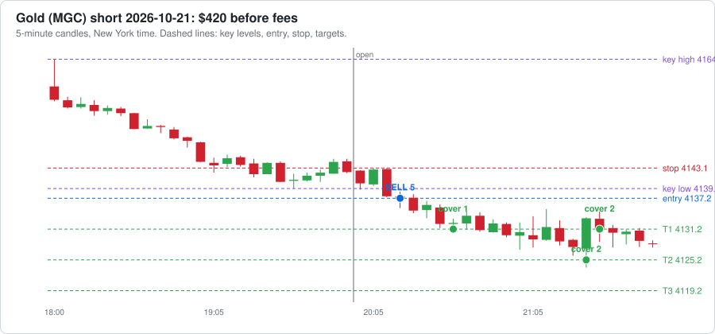

# Agent dashboard

Last updated 2026-10-21 21:55 New York time. Everything here is written by software and AI agents. It can be wrong, so check anything you plan to act on.

**[🪙 Open the Crypto Dashboard →](CRYPTO-DASHBOARD.md)**

## Reminders

- ⏰ When your broker is connected: log every trade in trade-journal.md with a heading like `### Trade #1 | 2026-10-16` (swap the `__` in the template for the trade number) and keep the `- **Session:**` line, so the post-session reviewer can see your trades. Or ask Claude to build automatic trade logging into the paper trading agent.
- ⏰ Before trading real money: make this repo private (GitHub → Settings → Danger Zone → Change visibility). First run `git cherry-pick 0f7e3a2` so the paper trader checks less often and stays under GitHub's 2,000 free Actions minutes a month for private repos (it is public now to keep Actions free and unlimited).

[Edit reminders](REMINDERS.md)

## Agent status

| | Agent | What it does | Last ran | Runs |
|---|---|---|---|---|
| 🟢 | Market brief: nasdaq | Writes the brief before the New York session | 13 hours ago | weekdays about 7-8 AM New York time |
| 🟢 | Market brief: gold | Writes the brief before the Asia session | 3 hours ago | Sun-Thu evenings about 6-7 PM New York time |
| 🟢 | World news brief | Overnight news and today's events: politics, economy, war, trade | 16 hours ago | daily about 5-6 AM New York time |
| 🟢 | Crypto research brief | Pumping coins, whales, government and adoption news | 15 hours ago | daily about 5:30-6:30 AM New York time |
| 🟢 | Stock research brief | Movers, AI, nuclear, minerals, earnings dates and estimates | 15 hours ago | Mon, Wed, Fri about 6-7 AM New York time |
| 🟢 | Paper trader | Paper trades every session with your rules and runs a practice prop challenge | under an hour ago | after each session ends |
| 🟢 | Scorer | Checks each lean against what price did | 4 hours ago | after each session ends |

🟢 ran recently  🟡 a bit late  🔴 check it  ⚪ never ran

## 📒 Trade journal (paper)

- **Room before the $4,000 max drawdown: $4,000** · 🟢 normal size. Under $1,500 left, it pauses until the next morning and then trades small.

Newest first. Times are New York time. Each sale shows contracts @ price, time. The 📈 link opens a chart of the trade; TV opens the same market on TradingView (add [the strategy](tradingview/breakout_strategy.pine) to see each trade marked).

| Date | Market | Side | Lots | Entry | Target 1 | Target 2 | Target 3 / out | Result | What could have gone better | See it |
|---|---|---|---|---|---|---|---|---|---|---|
| 2026-10-22 | Gold | short | 5 | 4137.2 @ 20:15 stop 4143.1 | 1 @ 4131.2, 20:35 ($60) | 2 @ 4125.2, 21:25 ($240) | stop: 2 @ 4131.2, 21:30 ($120) | ✅ **$415** out 21:30 | • Moving the stop to Target 1 after Target 2 locked in the profit; price never reached Target 3 afterwards. | [📈 chart](paper-trading/charts/2026-10-21-gold.svg) · [TV](https://www.tradingview.com/chart/?symbol=COMEX_MINI%3AMGC1%21&interval=5) |
| 2026-10-21 | Nasdaq | short | 5 | 29818.5 @ 10:15 stop 29843.25 | – | – | stop: 5 @ 29843.25, 10:20 (-$248) | ❌ **-$252** out 10:20 | • Price never reached Target 1: the best it did was +25.75 points, and Target 1 needed 30. • The breakout failed and price kept going the other way, so the stop did its job and kept the loss small. | [📈 chart](paper-trading/charts/2026-10-21-nasdaq.svg) · [TV](https://www.tradingview.com/chart/?symbol=CME_MINI%3AMNQ1%21&interval=5) |
| 2026-10-21 | Gold | – | 0 | no breakout, no trade | | | | $0 | No confirmed breakout in the first 60 minutes. Key high 4149.80, low 4132.00. | [TV](https://www.tradingview.com/chart/?symbol=COMEX_MINI%3AMGC1%21&interval=5) |
| 2026-10-20 | Nasdaq | long | 5 | 29717.75 @ 10:05 stop 29604.0 | 1 @ 29747.75, 10:15 ($60) | 2 @ 29777.75, 10:15 ($240) | 2 @ 29807.75, 10:25 ($360) | ✅ **$655** out 10:25 | • Price kept going 95.75 points past Target 3 (by 10:30). Letting the last 2 contract(s) run with a trailing stop could have made up to $383 more. | [📈 chart](paper-trading/charts/2026-10-20-nasdaq.svg) · [TV](https://www.tradingview.com/chart/?symbol=CME_MINI%3AMNQ1%21&interval=5) |
| 2026-10-20 | Gold | short | 5 | 4150.6 @ 20:55 stop 4152.4 | 1 @ 4144.6, 21:00 ($60) | 2 @ 4138.6, 21:15 ($240) | stop: 2 @ 4144.6, 21:40 ($120) | ✅ **$415** out 21:40 | • Moving the stop to Target 1 after Target 2 locked in the profit; price never reached Target 3 afterwards. | [📈 chart](paper-trading/charts/2026-10-19-gold.svg) · [TV](https://www.tradingview.com/chart/?symbol=COMEX_MINI%3AMGC1%21&interval=5) |
| 2026-10-19 | Nasdaq | long | 5 | 29841.25 @ 10:15 stop 29694.0 | 1 @ 29871.25, 11:00 ($60) | 2 @ 29901.25, 11:15 ($240) | 2 @ 29931.25, 11:20 ($360) | ✅ **$655** out 11:20 | • Price kept going 52.25 points past Target 3 (by 11:35). Letting the last 2 contract(s) run with a trailing stop could have made up to $209 more. | [📈 chart](paper-trading/charts/2026-10-19-nasdaq.svg) · [TV](https://www.tradingview.com/chart/?symbol=CME_MINI%3AMNQ1%21&interval=5) |
| 2026-10-19 | Gold | – | 0 | no breakout, no trade | | | | $0 | No confirmed breakout in the first 60 minutes. Key high 4207.10, low 4191.10. | [TV](https://www.tradingview.com/chart/?symbol=COMEX_MINI%3AMGC1%21&interval=5) |

**Latest trade:**

[Full journal with every fill](paper-trading/paper-journal.md)

## 👔 CEO check

**✅ All clear** ([read the full check](reports/ceo/latest.md))

<b>What the CEO checked</b>

##### Futures paper trader

- ✅ All 4 paper trades followed the rules (one per session, inside the 60-minute window, right size, stop managed).
- ✅ Room left before the $4,000 max drawdown: $3,748.

##### Your trade journal

- ✅ No trades logged yet, nothing to check.

##### Crypto bots

- ✅ Rotation bot: 4 trades, buys only at weekly checks, never more than 4 coins at once.
- ✅ Buy-and-hold bot has never sold.

##### Alpaca copy

- ✅ All 7 Alpaca orders were for the bot's coins and within the limit.

##### Costs

- ✅ Spent $2.08 so far this month on 16 AI runs; on pace for about $3 (budget $50).

##### Agent health

- ✅ Every research brief worked on its last run.

## 📅 Weekly report

<b>Week ending 2026-10-18</b>

#### The week in one look

- **Futures paper:** $0 this week
- **Rotation bot:** -$3.20 this week
- **Buy-and-hold bot:** -$4.00 this week
- **AI costs:** $0.00 this week

#### Futures paper trading

No sessions recorded this week.

#### TradingView strategy

| Market | Export date | Forward test (since paper start) | Whole export |
|---|---|---|---|
| Nasdaq (MNQ) | 2026-10-18 | 0 trades, $0 | 25 trades, +$3,684, 56% wins |
| Gold (MGC) | 2026-10-18 | 0 trades, $0 | 22 trades, +$699, 32% wins |

Export the List of trades from each chart and say "update TradingView" to refresh these numbers.

#### Crypto paper bots

| Bot | Start of week | End of week | Change | Since it started ($1,000) |
|---|---|---|---|---|
| Rotation bot | $1,000.00 | $996.80 | -$3.20 (-0.3%) | -$3.20 |
| Buy-and-hold bot | $1,000.00 | $996.00 | -$4.00 (-0.4%) | -$4.00 |

Trades this week:

| Day | Bot | | Coin | Amount | Profit / loss |
|---|---|---|---|---|---|
| 2026-10-17 | Buy-and-hold bot | 🟢 Buy | BTC | $333.33 |  |
| 2026-10-17 | Buy-and-hold bot | 🟢 Buy | ETH | $333.33 |  |
| 2026-10-17 | Buy-and-hold bot | 🟢 Buy | SOL | $333.33 |  |
| 2026-10-17 | Rotation bot | 🟢 Buy | AVAX | $200.00 |  |
| 2026-10-17 | Rotation bot | 🟢 Buy | BCH | $200.00 |  |
| 2026-10-17 | Rotation bot | 🟢 Buy | BTC | $200.00 |  |
| 2026-10-17 | Rotation bot | 🟢 Buy | SUI | $200.00 |  |

**Alpaca copy:** 7 order(s) this week: buy AVAX, buy BCH, buy BTC, buy DOT, buy AVAX, buy BCH, sell DOT

#### Market briefs (Nasdaq and gold)

- 3 briefs scored; 0 gave a direction, 0 of those were right.
- 3 were Neutral.

#### CEO check

**❌ Rules were broken this week.** 2 checks ran. [Latest CEO check](../ceo/latest.md)

#### AI costs this week

No AI runs logged this week.

[Main dashboard](../../DASHBOARD.md) · [Crypto dashboard](../../CRYPTO-DASHBOARD.md)

[All weekly reports](reports/weekly/)

## Paper trading

- Total after fees: **$1,888** over 5 trades (7 sessions watched)
- Trading days with a trade: **4**, profitable: **3**, losing: 1
- Win rate: 80%
- Profit factor: 8.48
- Biggest drop from a high (max drawdown): $252
- Room left before the $4,000 max drawdown: **$4,000**
- Progress toward a prop demo: **4 of 20** trading days

<b>Challenge simulation, results by market, and daily results</b>

#### By market

| Market | Trades | Wins | Total after fees |
|---|---|---|---|
| nasdaq | 3 | 2 | $1,058 |
| gold | 2 | 2 | $830 |

#### Challenge simulation: Tradeify Growth 50K (practice)

Rules: reach $3,000 profit before the balance drops $2,000 below its highest end-of-day balance. Stop for the day after losing $1,250. Check the firm's current rules before relying on this.

**Passed 0, failed 0, 1 in progress.**

| Attempt | Started | Ended | Trading days | Balance | Result | Note |
|---|---|---|---|---|---|---|
| 1 | 2026-10-19 | 2026-10-22 | 4 | $51,888 | In progress |  |

#### Daily results

| Trading day | Sessions | Result after fees |
|---|---|---|
| 2026-10-22 | gold short | $415 |
| 2026-10-21 | gold no trade, nasdaq short | -$252 |
| 2026-10-20 | gold short, nasdaq long | $1,070 |
| 2026-10-19 | gold no trade, nasdaq long | $655 |

[Every paper trade](paper-journal.md) · [Raw data](trades.csv)

[Paper trading journal](paper-trading/paper-journal.md) · [TradingView strategy](tradingview/breakout_strategy.pine)

## 📈 TradingView strategy results

From the latest **List of trades** export of each chart. One trade = one entry (TradingView counts each target as a separate trade). Forward test = trades from 2026-10-19 on.

| Market | Export date | Trades | Wins / losses | Win rate | Total | Profit factor | Max drawdown | Forward test |
|---|---|---|---|---|---|---|---|---|
| Nasdaq (MNQ) | 2026-10-18 (trades since 2026-08-25) | 25 | 14 / 11 | 56% | **$3,684** | 1.99 | $1,066 | 0 trades, $0 |
| Gold (MGC) | 2026-10-18 (trades since 2026-08-24) | 22 | 7 / 15 | 32% | **$699** | 1.30 | $1,559 | 0 trades, $0 |
| **Both** | | 47 | 21 / 26 | 45% | **$4,384** | 1.72 | | |

<b>Latest 10 TradingView trades</b>

| Entry (New York) | Market | Side | Entry price | Contracts | Result |
|---|---|---|---|---|---|
| 2026-10-15 09:35 | Nasdaq (MNQ) | short | 29,830.00 | 5 | ❌ -$68 |
| 2026-10-14 20:05 | Gold (MGC) | short | 4,138.90 | 5 | ❌ -$105 |
| 2026-10-14 09:35 | Nasdaq (MNQ) | short | 30,578.50 | 5 | ❌ -$192 |
| 2026-10-13 09:35 | Nasdaq (MNQ) | short | 30,757.25 | 5 | ❌ -$20 |
| 2026-10-12 20:05 | Gold (MGC) | short | 4,187.60 | 5 | ✅ $420 |
| 2026-10-12 09:45 | Nasdaq (MNQ) | short | 30,969.50 | 5 | ✅ $660 |
| 2026-10-08 20:05 | Gold (MGC) | long | 4,168.70 | 5 | ❌ -$20 |
| 2026-10-07 20:05 | Gold (MGC) | short | 4,131.60 | 5 | ❌ -$250 |
| 2026-10-07 09:35 | Nasdaq (MNQ) | short | 31,180.50 | 5 | ❌ -$704 |
| 2026-10-06 20:05 | Gold (MGC) | long | 4,191.20 | 5 | ❌ -$8 |

To refresh: export the List of trades from each chart in TradingView, double-click `tradingview/update-exports.command`, then push in GitHub Desktop.

## Latest briefs

Click a brief to read it here. The summary is at the top of each.

<b>🌍 World news brief, 2026-10-21, event risk Medium</b>

Results are JSON strings; parse.## Top things for today
1. **Trump rallies in South Carolina.** Trump is campaigning for Republican candidates in South Carolina, with midterms 13 days away (Fox News). Why it matters: political risk and headline risk for policy and risk appetite.
2. **Student loan collections.** An unverified social media post cites Forbes. It says the Education and Treasury departments are preparing to go after wages and benefits of borrowers in default, using private debt collectors. I could not confirm this independently. Why it matters: it is a consumer-income and fiscal headline.
3. **Trump's North Carolina rally.** He spoke for more than 90 minutes in Greenville. He announced a new manufacturing plant in the state and $1.5 billion toward semiconductor chip production (NBC News, ABC11). Why it matters: industrial policy and spending headlines.
4. **DOJ fraud-tip program.** Trump and Vice President Vance announced a Justice Department program that pays tipsters for help finding fraud (NBC News). Why it matters: it is a fiscal and enforcement headline, with limited direct market link.
5. **Data gap.** My search tool hit its usage limit after one search. I found no economic calendar, central bank, tariff, war or country data for today. Why it matters: check a live calendar and newswire before trading.

#### Today's schedule (New York time)
| Time | Event | Who or where | Confirmed? |
|---|---|---|---|
| 7:00 PM | Political rally | Trump, T. Ed Garrison Arena, Pendleton, SC | Listed on Roll Call's presidential schedule; the page layout is slightly unclear (Roll Call) |
| Not found | Economic data releases | Not found | No scheduled events found |
| Not found | Fed and other central bank speakers | Not found | No scheduled events found |

#### Event risk today
Medium - I could not verify today's data or Fed calendar, so this rating reflects only the Trump rally and political headlines. Treat it as provisional.

#### Politics and policy
- **Trump overnight:** At a Greenville, NC rally for Senate candidate Michael Whatley, Trump promised cash and waivers if Republicans win the midterms (NBC News). He said a vote for Whatley is a vote for his policies (ABC11). He also attacked Democratic candidates, including Roy Cooper (Fox News).
- **Midterms:** Democrats are widening the Senate battleground map. Affordability is a central issue (Fox News).
- **Federal student loans:** There is an unconfirmed report of a Treasury and Education plan to collect on defaulted loans (social media citing Forbes).
- **Ilhan Omar:** One social media post says she was raided by DHS. I could not verify it.
- **Congress, Treasury, Fed, executive orders:** Nothing found.

#### Economics
Nothing found.

#### War, trade and tariffs
Nothing found.

#### Country briefs
- **China:** Nothing found.
- **European Union:** Nothing found.
- **United Kingdom:** Nothing found.
- **Japan:** Nothing found.
- **India:** Nothing found.
- **Russia:** Nothing found.
- **Canada:** Nothing found.

[Read the full brief with all the details](reports/news/2026-10-21-world-brief.md) · [All news briefs](reports/news/)

<b>🪙 Crypto brief, 2026-10-21</b>

#### Top things today
1. Search tools failed today, so I have no news to confirm why the market moved. The only data I have is the live numbers. Why it matters: any explanation for today's moves would be a guess.
2. Bitcoin is at $83,320 (+2.2% in 24h, 7d flat). Ethereum is at $2,454 (+2.9%) and Solana is at $106.50 (+2.4%). Why it matters: the whole market rose together, though weekly moves are still flat to slightly negative.
3. The Fear and Greed Index reads 63 (Greed). Why it matters: sentiment is warm while weekly prices have not moved.
4. Zcash (ZEC) is up 12.4% at $1,277.8, with a $21.7B market cap and $1.1B in 24h volume. It is trending on CoinGecko at rank 10. Why it matters: it is by far the largest coin among today's top gainers, and the volume is real.
5. NEAR is up 11.0% with $1.5B in volume, and it is also trending. Why it matters: volume is high for a coin this size, which points to broad interest. I found no cause.

#### Coins to research
I found no news for any coin in this table. "Why it is moving" is "No cause found" throughout. The flags come from the live data only.

| Coin | 24h move | Why it is moving | Red flags |
|---|---|---|---|
| Convex Finance (CVX) | +21.0% (7d +33.0%) | No cause found | Small cap ($238.1M). Big weekly run-up. |
| Pearl (PEARL) | +19.4% | No cause found. Also trending. | Volume is only $12.6M against an $822.2M cap. Pump with no news. |
| Akedo (AKE) | +19.4% (7d +43.6%) | No cause found | Volume is only $16.9M against an $828.4M cap. Big weekly run-up. |
| Provenance Blockchain (HASH) | +15.2% | No cause found | Volume is only $41.8K against a $442.9M cap. This looks thin and easy to move. |
| Doodles (DOOD) | +123.4% | No cause found. Trending. | Rank 743, so tiny. A pump with no news. |
| IOST | +93.5% | No cause found. Trending. | Rank 420. A pump with no news. |

Other coins I noticed: Railgun (RAIL) is up 12.7% on only $361.1K volume. Useless Coin (USELESS) is up 14.5% but down 10.1% over 7 days. I did not check holder concentration for any coin.

#### Whale watch
No whale moves found.

#### Government and regulation
Nothing found.

#### Who is buying and adopting
Nothing found.

#### Next 7 days
No scheduled events found.

I could not run searches, so the last four sections are empty because I could not look, not because nothing happened. Check Whale Alert, Lookonchain, Arkham, CoinDesk and the SEC and CFTC sites directly.

[Read the full brief with all the details](reports/crypto/2026-10-21-crypto-brief.md) · [All crypto briefs](reports/crypto/)

<b>📈 Stocks brief, 2026-10-21</b>

#### Top things today
1. Meta and Tesla report after today's close (timing unconfirmed). Meta is down 9.0% over 5 days and Tesla is flat at -0.4%. Why it matters: the results could move AI spending sentiment.
2. AI and chip stocks fell over the last 5 days. AMD fell 11.7%, ARM 13.4%, SMCI 16.9% and CRWV 20.2%. Why it matters: the weakness is concentrated in the more speculative AI names.
3. Nuclear stocks also fell. LEU dropped 18.2%, SMR 14.0%, OKLO 13.5% and CEG 12.5%. Why it matters: the group is moving as one, which points to a sector-wide trend.
4. Braze (BRZE) rose 51.7% to $45.57 on heavy volume. I could not confirm the cause. Why it matters: it is the biggest mover in the live data, and a move this large usually follows company news.
5. Newmont and Southern Copper report tomorrow, followed by Freeport on Oct 27. Why it matters: these results will show how the miners are doing.

#### Stocks to research
| Ticker | Theme | Move | Why | Red flags |
|---|---|---|---|---|
| BRZE | Software | +51.7% to $45.57 | Top gainer and among the most active by volume | Cause not confirmed. A one-day jump this large can reverse. |
| CRWV | AI infrastructure | +1.7% on the day, -20.2% over 5 days | Most active by volume. Sharp pullback. | Large 5-day drop and no news found |
| LEU | Uranium enrichment | -18.2% over 5 days | Biggest drop among nuclear names. Reports Nov 4. | Estimated revenue is only $63.6M, so it is small. No news found. |
| META | AI | -9.0% over 5 days | Reports today | Event risk |
| SMCI | AI servers | -16.9% over 5 days | Reports Nov 3 | Large drop with no news found |
| RUN | Solar | +9.9% to $7.57 | Top small-cap gainer | Small cap ($1.8B). No news found. |

IPOs and new stocks: SPCX (Space Exploration Technologies) is among the most active names. It last traded at $147.79 (-0.1%), with a market cap of $1.9T. I found no details on its listing.

#### AI and tech
Nothing found. My news searches failed because I hit the tool's search limit, so I have no sourced news items. The live data shows these 1-day moves: META -1.6%, ARM -3.1%, IREN -4.0%, and NVDA -0.3% at $216.47.

#### Nuclear and critical minerals
Nothing found. I have no news on government deals or export limits. Over the last 5 days, MP fell 8.0%, USAR 10.8% and UEC 5.0%. NEM rose 1.1% over the same period.

#### Earnings
Results since yesterday: nothing found. I could not check them.

| Date | Ticker | Timing | EPS est. | Revenue est. |
|---|---|---|---|---|
| 2026-10-21 | META | Unconfirmed | $6.80 | $63.4B |
| 2026-10-21 | TSLA | Unconfirmed | $0.45 | $28.3B |
| 2026-10-22 | NEM | Unconfirmed | $1.94 | $6.3B |
| 2026-10-22 | SCCO | Unconfirmed | $1.99 | $4.4B |
| 2026-10-27 | FCX | Unconfirmed | $0.83 | $7.4B |
| 2026-10-28 | GOOGL | Unconfirmed | $2.99 | $127.9B |
| 2026-10-28 | MSFT | Unconfirmed | $4.72 | $90.7B |
| 2026-10-29 | AMZN | Unconfirmed | $1.98 | $202.2B |
| 2026-10-30 | CCJ | Unconfirmed | $0.31 | $750.6M |
| 2026-11-02 | AAPL | Unconfirmed | $1.98 | $113.4B |
| 2026-11-02 | BWXT | Unconfirmed | $1.19 | $972.3M |
| 2026-11-02 | PLTR | Unconfirmed | $0.41 | $2.2B |
| 2026-11-03 | AMD | Unconfirmed | $1.93 | $13.1B |
| 2026-11-03 | SMCI | Unconfirmed | $1.04 | $15.0B |
| 2026-11-04 | ALB | Unconfirmed | $2.55 | $1.5B |
| 2026-11-04 | ARM | Unconfirmed | $0.47 | $1.4B |
| 2026-11-04 | LEU | Unconfirmed | $0.01 | $63.6M |

#### Smart money
Nothing found. I could not check analyst actions, insider buying or congressional trades.

[Read the full brief with all the details](reports/stocks/2026-10-21-stock-brief.md) · [All stocks briefs](reports/stocks/)

<b>📊 Nasdaq 100 futures market brief, 2026-10-21</b>

### Nasdaq 100 Futures Brief for the New York Session, Oct 21, 2026

#### 1. What is driving futures
- US stock futures rose Wednesday as SpaceX's results renewed enthusiasm for the AI trade ahead of Tesla and Meta earnings.
- SpaceX shares rose over 8% overnight on better-than-expected results. Elon Musk said SpaceX and Tesla have formed special committees to discuss a possible merger. No terms have been agreed.
- Netflix is a drag. It beat on earnings, but its shares fell more than 6% after hours on a lower Q4 revenue outlook.
- Tuesday's cash session was split. The Dow gained 1.02%, while the Nasdaq Composite slipped 0.02%.
- Chip stocks fell eight straight sessions through last Friday and entered correction mode, down 10% from recent highs.

#### 2. Scheduled events (New York time)
- No economic reports are scheduled for Wednesday.
- 10:30 AM: EIA crude inventories.
- 1:00 PM: 20-year bond auction.
- Fed speakers: none expected. The FOMC blackout period runs through Oct 29, so we'll hear nothing from Fed officials.
- After the close (still matters for positioning): Tesla, Meta and IBM report after the close. Tesla's call starts at 5:30 p.m. ET.
- Earnings during the session: Texas Instruments, Lam Research and others are expected on Oct 21. I could not verify exact release times for each.
- Thursday: weekly jobless claims at 8:30 AM.

#### 3. Key levels (from the price data)
- Previous session high: **29,903.50**
- Previous session low: **29,391.75**
- Previous close: **29,687.75**
- Since the close: high **30,010.25**, low **29,687.25**
- 5-session high: **30,660.75**
- 5-session low: **29,268.75**

The latest price is 29,853.75. It is inside the previous range, 49.75 below the high and 462.00 above the low. **It is sitting near resistance, not support.** It is also below the overnight high of 30,010.25.

#### 4. Volume
The previous session traded 0.98x the average of the five sessions before it. That is average participation. It is neither strong nor weak, so it doesn't confirm a move either way.

#### 5. Directional lean
**Neutral. Confidence: Low.**

Price is near the top of the previous range, close to resistance. Overnight news is mildly positive because of SpaceX and the AI trade. Volume was only average, so there was no strong conviction behind Tuesday's move. Mixed Netflix and chip-sector signals, plus big Meta and Tesla earnings after the close, may keep buyers and sellers cautious. These signals conflict, so I don't see a clear edge.

What would change the lean:
- **Toward bullish:** a hold above the overnight high of 30,010.25 with rising volume.
- **Toward bearish:** a rejection at resistance and a drop back below the previous low of 29,391.75.

This is a probability-based lean, not a prediction or a trade instruction.

#### 6. Event risk
**Medium.** There is no major data and no Fed speakers, but Tesla and Meta report after the close, and a heavy earnings week could drive moves in tech.

#### 7. Sources
- Yahoo Finance (market news and live coverage)
- Investing.com (economic calendar)
- Kiplinger (weekly calendar and Fed blackout)
- CNBC (Netflix results)
- Schwab
- Investrade
- TS2.tech
- Tech-Insider
- Phemex

Price data came from the supplied block and may be delayed.

BIAS: Neutral | CONFIDENCE: Low

[Open the file](reports/2026-10-21-nasdaq-brief.md)

<b>📊 Gold futures market brief, 2026-10-21</b>

### Gold Futures Brief: Asia Session, Oct 21–22, 2026

#### 1. What is driving gold
- Gold has been weak. Spot gold traded near $4,114 on Wednesday, a fourth straight daily decline. The one-month change is about minus 5.7%.
- One source blames oil and rates. It says gold struggles to rally with Brent near $110 and a December Fed hike priced in. It puts the US 10-year yield at 5.116%. This is a single secondary source, so treat it with some caution.
- Kitco later showed spot at $4,139, up $14.90 on the day. That suggests a small bounce late in the day.

#### 2. Scheduled events (New York time)
- **Fed blackout:** The FOMC blackout runs through Thursday, Oct 29, so no Fed officials should speak. The rate decision is on Oct 28 at 2:00 PM ET, which is after this session.
- **Japan CPI:** One calendar lists it as Thursday Oct 22, a Tier 1 release at 19:30. I could not confirm the time zone, but 19:30 NY would be about 8:30 AM Tokyo. That is just before the session opens. Please verify it.
- **US jobless claims:** Thursday at 8:30 AM. This comes after the Asia session ends at 4:00 AM.
- **Flash PMIs and Michigan sentiment:** Due Friday, Oct 23, also after this session.
- I did not find any central bank speakers or major earnings scheduled for the session itself.

#### 3. Key levels (from price data)
- Previous Asia session high: **4147.70**
- Previous Asia session low: **4124.00**
- Previous close: **4142.30**
- Since that close: high **4164.30**, low **4122.30**
- Last 5 Asia sessions: high **4211.20**, low **4124.00**

The latest price is **4143.90**. That is 3.80 below the previous high and 19.90 above the previous low. It is **sitting near resistance**. The 4164.30 level above it is also worth watching.

#### 4. Volume
The previous session traded 0.94x the average of the five sessions before it. That is slightly below average, which suggests mildly weak participation. Moves in that session had little conviction behind them.

#### 5. Directional lean
**Neutral, Low confidence.**

The signals conflict. The news backdrop leans negative: four down days, high yields and rate-hike pricing. But price is now near the top of the previous range, after holding above the previous low. Volume was slightly light, so neither side showed strong participation. With a quiet calendar and a Fed blackout, the session could just chop between roughly 4124 and 4164.

**What would change the lean:**
- A sustained move above the 4164.30 post-close high on rising volume would shift it toward Bullish.
- A drop below 4122.30–4124.00 on rising volume would shift it toward Bearish.
- A surprise from Japan CPI, oil or yields could also change it.

This is a probability-based lean. It is not a prediction or a trade instruction.

#### 6. Event risk
**Medium.** There are no scheduled US events during the session, but Japan CPI lands near the open (time unconfirmed), and oil and yield moves have been driving gold.

#### 7. Sources
- Price data: Yahoo Finance (as supplied)
- financefeeds.com
- kitco.com
- Kiplinger (kiplinger.com)
- Investing.com economic calendar preview
- MTS Insights calendar
- federalreserve.gov

I could not verify the Japan CPI release time zone or any Asia-session central bank speakers.

BIAS: Neutral | CONFIDENCE: Low

[Open the file](reports/2026-10-21-gold-brief.md)

## Latest lean for each market

| Market | Brief written | Lean | Confidence | Event risk | Price then | Full brief |
|---|---|---|---|---|---|---|
| nasdaq | 2026-10-21 08:29 | ◆ Neutral | Low | Medium | 29853.75 | [read it](reports/2026-10-21-nasdaq-brief.md) |
| gold | 2026-10-21 19:18 | ◆ Neutral | Low | Medium | 4143.90 | [read it](reports/2026-10-21-gold-brief.md) |

A lean is a probability-based view, not a prediction. ▲ Bullish  ▼ Bearish  ◆ Neutral

## Scorecard

- Briefs scored: **8** (Bullish or Bearish calls: 1)
- Right: 0, Wrong: 1, Session ended flat: 0
- Hit rate when the session was decisive: **0%**
- For comparison, price went up in 57% of decisive sessions
- ⚠️ Only 1 directional calls so far. Treat the numbers as noise until there are at least 30.

By confidence:

| Confidence | Right | Wrong | Flat | Hit rate |
|---|---|---|---|---|
| High | 0 | 0 | 0 | n/a |
| Medium | 0 | 0 | 0 | n/a |
| Low | 0 | 1 | 0 | 0% |

[Full scorecard](reports/scorecard.md)

## Charts

## Recent results

| Brief | Market | Lean | Confidence | Session moved | Result |
|---|---|---|---|---|---|
| 2026-10-21 | nasdaq | ◆ Neutral | Low | Up (0.41%) | Moved |
| 2026-10-20 | gold | ◆ Neutral | Low | Up (0.24%) | Moved |
| 2026-10-20 | nasdaq | ▼ Bearish | Low | Up (0.32%) | Wrong |
| 2026-10-19 | nasdaq | ◆ Neutral | Low | Flat (-0.19%) | Calm |
| 2026-10-18 | gold | ◆ Neutral | Low | Down (-0.29%) | Moved |
| 2026-10-16 | nasdaq | ◆ Neutral | Low | Down (-2.14%) | Moved |
| 2026-10-15 | gold | ◆ Neutral | Low | Up (0.81%) | Moved |
| 2026-10-15 | nasdaq | ◆ Neutral | Low | Down (-2.14%) | Moved |

## Your journals

- Trades logged: **0**. [Open the trade journal](trade-journal.md)
- No-trade sessions explained: **3**. [Open the no-trade journal](no-trade-journal.md)

<b>Latest no-trade sessions</b>

##### No-trade session | 2026-10-18 | Asia
- **Instrument:** Gold futures
- **What happened:** No signal. The rules gave no entry.
- **Why:** No 5-minute candle closed above the previous high (4211.20) or below the previous low (4167.50) in the first 30 minutes after the 20:00 open. (Previous Asia session was 2026-10-15.)
- **First 30 minutes, candle by candle:**
  - 20:00 candle: close 4205.50, closed inside the range (5.70 below the high, 38.00 above the low).
  - 20:05 candle: close 4204.40, closed inside the range (6.80 below the high, 36.90 above the low).
  - 20:10 candle: close 4201.70, closed inside the range (9.50 below the high, 34.20 above the low).
  - 20:15 candle: close 4199.00, closed inside the range (12.20 below the high, 31.50 above the low).
  - 20:20 candle: close 4196.40, closed inside the range (14.80 below the high, 28.90 above the low).
  - 20:25 candle: close 4196.00, closed inside the range (15.20 below the high, 28.50 above the low).
- **Closest call:** Price got within 2.80 of the previous high (its highest point was 4208.40) but never reached it.
- **After the window:** No candle closed beyond either level for the rest of the session.
- **What the market was showing:** The session range was 25.60 points, 60% of the average of the last 5 (a quiet session). Open to close it moved -12.30 points (-0.29%).
- **The morning brief said:** Neutral (Low confidence), event risk Medium.
- **Verdict:** Consistent with your rules. There was no setup, so staying out was correct under the rules.
- **Your notes:**

##### No-trade session | 2026-10-16 | New York
- **Instrument:** Nasdaq 100 futures
- **What happened:** No signal. The rules gave no entry.
- **Why:** No 5-minute candle closed above the previous high (30196.75) or below the previous low (29622.50) in the first 15 minutes after the 09:30 open. (Previous New York session was 2026-10-15.)
- **First 15 minutes, candle by candle:**
  - 09:30 candle: close 29969.75, closed inside the range (227.00 below the high, 347.25 above the low).
  - 09:35 candle: close 29895.25, closed inside the range (301.50 below the high, 272.75 above the low).
  - 09:40 candle: close 29936.25, closed inside the range (260.50 below the high, 313.75 above the low).
- **Closest call:** Price got within 151.00 of the previous high (its highest point was 30045.75) but never reached it.
- **After the window:** A candle first closed below the previous low at 12:45, but that was after the 15-minute window, so the rules did not allow an entry.
- **What the market was showing:** The session range was 777.00 points, 219% of the average of the last 5 (a busy session). Open to close it moved -644.75 points (-2.15%).
- **The morning brief said:** Neutral (Low confidence), event risk Medium.
- **Verdict:** Consistent with your rules. There was no setup, so staying out was correct under the rules.
- **Your notes:**

##### No-trade session | 2026-10-15 | Asia
- **Instrument:** Gold futures
- **What happened:** No signal. The rules gave no entry.
- **Why:** No 5-minute candle closed above the previous high (4183.30) or below the previous low (4152.70) in the first 15 minutes after the 21:00 open. (Previous Asia session was 2026-10-14.)
- **First 15 minutes, candle by candle:**
  - 21:00 candle: close 4176.50, closed inside the range (6.80 below the high, 23.80 above the low).
  - 21:05 candle: close 4178.00, closed inside the range (5.30 below the high, 25.30 above the low).
  - 21:10 candle: close 4178.50, closed inside the range (4.80 below the high, 25.80 above the low).
- **Closest call:** Price got within 1.60 of the previous high (its highest point was 4181.70) but never reached it.
- **After the window:** A candle first closed above the previous high at 22:30, but that was after the 15-minute window, so the rules did not allow an entry.
- **What the market was showing:** The session range was 43.70 points, 98% of the average of the last 5 (a normal session). Open to close it moved +33.70 points (+0.81%).
- **The morning brief said:** Neutral (Low confidence), event risk High.
- **Verdict:** Consistent with your rules. There was no setup, so staying out was correct under the rules.
- **Your notes:**

## Still to build

| Agent | Purpose | Status |
|---|---|---|
| Product selling agent (separate repo) | Main Agent from your Obsidian notes: what to sell, sourcing, advertising | ⚪ not built yet |
| Live demo trading | Sends the TradingView strategy's orders to a Tradovate demo or prop challenge account, behind a risk gatekeeper | ⚪ not built yet |

## Links

- [All reports](reports/)
- [Trading rules](trading-rules.md)
- [Bias log](reports/bias-log.csv)
