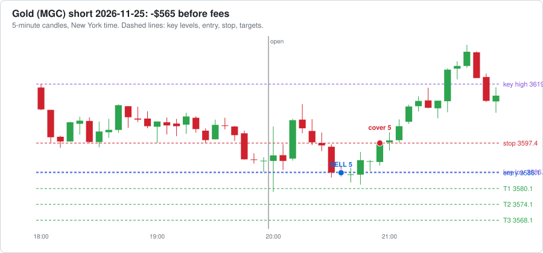
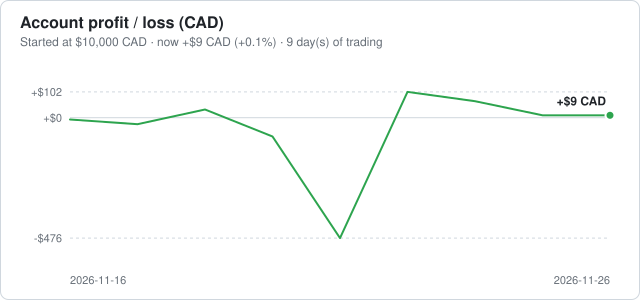
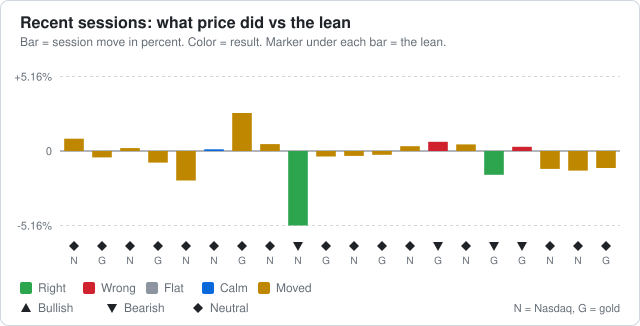

# Agent dashboard

Last updated 2026-11-27 14:37 New York time. Everything here is written by software and AI agents. It can be wrong, so check anything you plan to act on.

**[🪙 Open the Crypto Dashboard →](CRYPTO-DASHBOARD.md)** · **[𝕏 Open the X Brief Dashboard →](X-DASHBOARD.md)**

## Reminders

- ⏰ When your broker is connected: log every trade in trade-journal.md with a heading like `### Trade #1 | 2026-10-16` (swap the `__` in the template for the trade number) and keep the `- **Session:**` line, so the post-session reviewer can see your trades. Or ask Claude to build automatic trade logging into the paper trading agent.
- ⏰ Before trading real money: make this repo private (GitHub → Settings → Danger Zone → Change visibility). First run `git cherry-pick 0f7e3a2` so the paper trader checks less often and stays under GitHub's 2,000 free Actions minutes a month for private repos (it is public now to keep Actions free and unlimited).
- ⏰ 𝕏 **Turn on X auto-posting once @cashflowbrief00 gets traction:** 500+ followers, OR any post with 10,000+ views, OR 1,000+ views a day for a week (check the account's Analytics). Then tell Claude "turn on X auto-posting". It needs X API keys from developer.x.com (about $2.50-3/month for 5-6 posts a day, within the $25 AI budget) and X's "automated account" label.

[Edit reminders](REMINDERS.md)

## Agent status

| | Agent | What it does | Last ran | Runs |
|---|---|---|---|---|
| 🔴 | Market brief: nasdaq | Writes the brief before the New York session | 9 days ago | weekdays about 7-8 AM New York time |
| 🔴 | Market brief: gold | Writes the brief before the Asia session | 11 days ago | Sun-Thu evenings about 6-7 PM New York time |
| 🔴 | World news brief | Overnight news and today's events: politics, economy, war, trade | 9 days ago | daily about 5-6 AM New York time |
| 🔴 | Crypto research brief | Pumping coins, whales, government and adoption news | 9 days ago | daily about 5:30-6:30 AM New York time |
| 🔴 | Stock research brief | Movers, AI, nuclear, minerals, earnings dates and estimates | 9 days ago | Mon, Wed, Fri about 6-7 AM New York time |
| 🟢 | Paper trader | Paper trades every session with your rules and runs a practice prop challenge | 25 hours ago | after each session ends |
| 🟢 | Scorer | Checks each lean against what price did | under an hour ago | after each session ends |

🟢 ran recently  🟡 a bit late  🔴 check it  ⚪ never ran

## ⚠️ Problems

- ❌ **World news brief** failed on its last run: `anthropic.BadRequestError: Error code: 400 - {'type': 'error', 'error': {'type': 'invalid_request_error', 'message': 'Your credit balance is too low to access the Anthropic API. Please go to Plans & B` ([full log](reports/news/last-run-log.txt))
- ❌ **Crypto brief** failed on its last run: `anthropic.BadRequestError: Error code: 400 - {'type': 'error', 'error': {'type': 'invalid_request_error', 'message': 'Your credit balance is too low to access the Anthropic API. Please go to Plans & B` ([full log](reports/crypto/last-run-log.txt))
- ❌ **Stock brief** failed on its last run: `anthropic.BadRequestError: Error code: 400 - {'type': 'error', 'error': {'type': 'invalid_request_error', 'message': 'Your credit balance is too low to access the Anthropic API. Please go to Plans & B` ([full log](reports/stocks/last-run-log.txt))

Open the repo's Actions tab on GitHub for more detail.

## 📒 Trade journal (paper)

- **Tradeify 50K evaluation: balance $49,430**, $1,430 above the drawdown floor, $3,570 to pass; today -$570, $680 left before the daily loss limit. [Details](paper-trading/summary.md)
- 📐 Opening range (9:30-10:00, tracked, not traded): $3,090 over 14 trades in 18 sessions since 2026-11-02, vs -$2,600 for the real Nasdaq rule (ahead). [Details](paper-trading/summary.md)
- 🐍 **MAMBA (tracking, kept forever): $12,301** over 97 trades since 2026-09-20, 58 won. Last: 2026-11-25 nasdaq short $510. [Every trade](paper-trading/mamba.csv)

Newest first. Times are New York time. Each sale shows contracts @ price, time. The 📈 link opens a chart of the trade; TV opens the same market on TradingView (add [the strategy](tradingview/breakout_strategy.pine) to see each trade marked).

| Date | Market | Side | Lots | Entry | Target 1 | Target 2 | Target 3 / out | Result | What could have gone better | See it |
|---|---|---|---|---|---|---|---|---|---|---|
| 2026-11-26 | Gold | short | 5 | 3586.1 @ 20:35<br>stop 3597.4 | – | – | stop: 5 @ 3597.4, 20:55 (-$565) | ❌ **-$570**<br>out 20:55 | • Price never reached Target 1: the best it did was +4.50 points, and Target 1 needed 6.<br>• The breakout failed and price kept going the other way, so the stop did its job and kept the loss small. | [📈 chart](paper-trading/charts/2026-11-25-gold.svg) · [TV](https://www.tradingview.com/chart/?symbol=COMEX_MINI%3AMGC1%21&interval=5) |
| 2026-11-25 | Nasdaq | – | 0 | skipped: risk too big | | | | $0 | Breakout short at 09:35, but even the small size risked $1,534 and only $224 could be lost today without breaking the daily loss limit or the drawdown, so it was skipped. | [TV](https://www.tradingview.com/chart/?symbol=CME_MINI%3AMNQ1%21&interval=5) |
| 2026-11-25 | Gold | short | 5 | 3534.1 @ 20:20<br>stop 3540.2 | – | – | stop: 5 @ 3540.2, 20:25 (-$305) | ❌ **-$310**<br>out 20:25 | • Price never reached Target 1: the best it did was +1.60 points, and Target 1 needed 6.<br>• The breakout failed and price kept going the other way, so the stop did its job and kept the loss small.<br>• The entry was 3.80 points past the key level, chasing a stretched move. Waiting for a pullback toward the level would have meant a better price and a smaller risk. | [📈 chart](paper-trading/charts/2026-11-24-gold.svg) · [TV](https://www.tradingview.com/chart/?symbol=COMEX_MINI%3AMGC1%21&interval=5) |
| 2026-11-24 | Nasdaq | – | 0 | skipped: risk too big | | | | $0 | Breakout long at 10:00, but even the small size risked $513 and only $470 could be lost today without breaking the daily loss limit or the drawdown, so it was skipped. | [TV](https://www.tradingview.com/chart/?symbol=CME_MINI%3AMNQ1%21&interval=5) |
| 2026-11-24 | Gold | long | 5 | 3674.1 @ 20:35<br>stop 3660.6 | – | – | stop: 5 @ 3660.6, 20:50 (-$675) | ❌ **-$680**<br>out 20:50 | • Price never reached Target 1: the best it did was +2.60 points, and Target 1 needed 6.<br>• The breakout failed and price kept going the other way, so the stop did its job and kept the loss small.<br>• The entry was 5.10 points past the key level, chasing a stretched move. Waiting for a pullback toward the level would have meant a better price and a smaller risk. | [📈 chart](paper-trading/charts/2026-11-23-gold.svg) · [TV](https://www.tradingview.com/chart/?symbol=COMEX_MINI%3AMGC1%21&interval=5) |
| 2026-11-23 | Nasdaq | – | 0 | skipped: risk too big | | | | $0 | Breakout long at 10:20, but even the small size risked $1,233 and only $545 could be lost today without breaking the daily loss limit or the drawdown, so it was skipped. | [TV](https://www.tradingview.com/chart/?symbol=CME_MINI%3AMNQ1%21&interval=5) |
| 2026-11-23 | Gold | long | 3 | 3618.1 @ 20:10<br>stop 3585.0 | 1 @ 3624.1, 20:15 ($60) | – | stop: 2 @ 3585.0, 21:10 (-$662) | ❌ **-$605**<br>out 21:10 | • Target 1 paid $60, but the stop stayed at the start. Moving it to breakeven after Target 1 would have ended this trade at about $60 instead of -$602.<br>• The entry was 30.10 points past the key level, chasing a stretched move. Waiting for a pullback toward the level would have meant a better price and a smaller risk. | [📈 chart](paper-trading/charts/2026-11-22-gold.svg) · [TV](https://www.tradingview.com/chart/?symbol=COMEX_MINI%3AMGC1%21&interval=5) |
| 2026-11-20 | Nasdaq | long | 3 | 26432.0 @ 09:55<br>stop 26189.0 | 1 @ 26462.0, 10:00 ($60) | 1 @ 26492.0, 10:00 ($120) | stop: 1 @ 26462.0, 10:05 ($60) | ✅ **$237**<br>out 10:05 | • Moving the stop to Target 1 after Target 2 locked in the profit; price never reached Target 3 afterwards. | [📈 chart](paper-trading/charts/2026-11-20-nasdaq.svg) · [TV](https://www.tradingview.com/chart/?symbol=CME_MINI%3AMNQ1%21&interval=5) |
| 2026-11-20 | Gold | short | 5 | 3576.0 @ 20:25<br>stop 3592.3 | 1 @ 3570.0, 20:40 ($60) | 2 @ 3564.0, 20:40 ($240) | stop: 2 @ 3570.0, 20:45 ($120) | ✅ **$415**<br>out 20:45 | • The last contracts were stopped at Target 1, then price reached Target 3 by 21:20. A looser stop after Target 2 would have caught it. | [📈 chart](paper-trading/charts/2026-11-19-gold.svg) · [TV](https://www.tradingview.com/chart/?symbol=COMEX_MINI%3AMGC1%21&interval=5) |
| 2026-11-19 | Nasdaq | – | 0 | skipped: risk too big | | | | $0 | Breakout short at 10:15, but even the small size risked $1,434 and only $1,150 could be lost today without breaking the daily loss limit or the drawdown, so it was skipped. | [TV](https://www.tradingview.com/chart/?symbol=CME_MINI%3AMNQ1%21&interval=5) |
| 2026-11-19 | Gold | – | 0 | no breakout, no trade | | | | $0 | No confirmed breakout in the first 60 minutes. Key high 3757.60, low 3727.40. | [TV](https://www.tradingview.com/chart/?symbol=COMEX_MINI%3AMGC1%21&interval=5) |
| 2026-11-18 | Nasdaq | – | 0 | skipped: risk too big | | | | $0 | Breakout short at 09:40, but even the small size risked $1,282 and only $1,168 could be lost today without breaking the daily loss limit or the drawdown, so it was skipped. | [TV](https://www.tradingview.com/chart/?symbol=CME_MINI%3AMNQ1%21&interval=5) |
| 2026-11-18 | Gold | short | 5 | 3810.4 @ 20:45<br>stop 3820.5 | 1 @ 3804.4, 21:00 ($60) | 2 @ 3798.4, 21:05 ($240) | stop: 2 @ 3804.4, 21:10 ($120) | ✅ **$415**<br>out 21:10 | • Moving the stop to Target 1 after Target 2 locked in the profit; price never reached Target 3 afterwards. | [📈 chart](paper-trading/charts/2026-11-17-gold.svg) · [TV](https://www.tradingview.com/chart/?symbol=COMEX_MINI%3AMGC1%21&interval=5) |
| 2026-11-17 | Nasdaq | short | 5 | 27266.75 @ 09:35<br>stop 27342.5 | – | – | stop: 5 @ 27342.5, 09:40 (-$758) | ❌ **-$762**<br>out 09:40 | • Price never reached Target 1: the best it did was +46.00 points, and Target 1 needed 30.<br>• After the stop, price turned and reached +608.25 points by 10:50. The stop (75.75 points from entry) was too tight: a stop just past the key level (27319.0) would have kept you in.<br>• The entry was 52.25 points past the key level, chasing a stretched move. Waiting for a pullback toward the level would have meant a better price and a smaller risk.<br>• Fakeout re-entry (switched off): price closed back beyond the entry at 09:50; re-entering 3 contracts at 27247.25 (stop 27278.25) would have made -$189. | [📈 chart](paper-trading/charts/2026-11-17-nasdaq.svg) · [TV](https://www.tradingview.com/chart/?symbol=CME_MINI%3AMNQ1%21&interval=5) |
| 2026-11-17 | Gold | short | 5 | 3849.2 @ 20:20<br>stop 3856.8 | – | – | stop: 5 @ 3856.8, 20:35 (-$380) | ❌ **-$385**<br>out 20:35 | • Price never reached Target 1: the best it did was +3.30 points, and Target 1 needed 6.<br>• The breakout failed and price kept going the other way, so the stop did its job and kept the loss small.<br>• The entry was 5.00 points past the key level, chasing a stretched move. Waiting for a pullback toward the level would have meant a better price and a smaller risk. | [📈 chart](paper-trading/charts/2026-11-16-gold.svg) · [TV](https://www.tradingview.com/chart/?symbol=COMEX_MINI%3AMGC1%21&interval=5) |

**Latest trade:**



[Full journal with every fill](paper-trading/paper-journal.md)

## 👔 CEO check

**❌ 6 broken rule(s)** ([read the full check](reports/ceo/latest.md))

<details>
<summary><b>What the CEO checked</b></summary>

##### Futures paper trader

- ❌ Tradeify practice evaluation failed: reset on 2026-10-28: only $96 above the floor, too close for any trade.
- ❌ Tradeify practice evaluation failed: reset on 2026-11-02: only $299 above the floor, too close for any trade.
- ❌ Tradeify practice evaluation failed: reset on 2026-11-26: only $324 above the floor, too close for any trade.
- ✅ Tradeify practice evaluation: $1,430 above the $2,000 trailing drawdown floor.

##### Your trade journal

- ✅ No trades logged yet, nothing to check.

##### Crypto bots

- ✅ Rotation bot: 8 trades, buys only at weekly checks, never more than 4 coins at once.
- ✅ Buy-and-hold bot has never sold.

##### Alpaca copy

- ✅ All 10 Alpaca orders were for the bot's coins and within the limit.

##### Costs

- ✅ Spent $11.37 so far this month on 97 AI runs; on pace for about $13 (budget $50).

##### Agent health

- ❌ World brief failed on its last run. See its last-run-log.txt.
- ❌ Crypto brief failed on its last run. See its last-run-log.txt.
- ❌ Stock brief failed on its last run. See its last-run-log.txt.

##### Ready to run on its own?

- ✅ 29 of 15 trading days on the paper record
- ⏳ 3 rule problem(s) in the paper trader above
- ⏳ the Tradeify practice account never failed
- ⏳ the Tradeify practice evaluation has not passed yet
- ⏳ profit factor 0.76 (needs 1.3 or more), total $-2,481 over 36 trades
- ✅ worst trading day $-1,148 (needs $-1,250 or better)
- ⏳ You: Tradeify confirms in writing that TradersPost automation is allowed on the Select 50K
- ⏳ You: 2+ weeks of the live 50K alerts traded by hand with no rule broken
- ⏳ You + Claude: 2-3 sessions on a TradersPost paper account matching the chart

</details>

## 📅 Weekly report

<details>
<summary><b>Week ending 2026-11-22</b></summary>

#### The week in one look

- **Futures paper:** +$812 this week
- **Rotation bot:** $0.00 this week
- **Buy-and-hold bot:** -$49.50 this week
- **AI costs:** $2.29 this week

#### Futures paper trading

- **This week:** +$812 after fees, 7 trades (5 wins, 2 losses), 3 sessions with no trade
- **Since paper trading began:** -$316 over 32 trades
- Nasdaq (MNQ): -$288 over 3 trades
- Gold (MGC): +$1,100 over 4 trades

| Day | Market | Side | Entry | Result |
|---|---|---|---|---|
| 2026-11-16 | gold | short | 3875.3 at 20:05 | +$655 |
| 2026-11-16 | nasdaq | short | 27437.0 at 10:00 | +$237 |
| 2026-11-17 | gold | short | 3849.2 at 20:20 | -$385 |
| 2026-11-17 | nasdaq | short | 27266.75 at 09:35 | -$762 |
| 2026-11-18 | gold | short | 3810.4 at 20:45 | +$415 |
| 2026-11-20 | gold | short | 3576.0 at 20:25 | +$415 |
| 2026-11-20 | nasdaq | long | 26432.0 at 09:55 | +$237 |

#### TradingView strategy

| Market | Export date | Forward test (since paper start) | Whole export |
|---|---|---|---|
| Nasdaq (MNQ) | 2026-10-18 | 0 trades, $0 | 25 trades, +$3,684, 56% wins |
| Gold (MGC) | 2026-10-18 | 0 trades, $0 | 22 trades, +$699, 32% wins |

Export the List of trades from each chart and say "update TradingView" to refresh these numbers.

#### Crypto paper bots

| Bot | Start of week | End of week | Change | Since it started ($1,000) |
|---|---|---|---|---|
| Rotation bot | $979.35 | $979.35 | $0.00 (+0.0%) | -$20.65 |
| Buy-and-hold bot | $753.33 | $703.83 | -$49.50 (-6.6%) | -$296.17 |

**Alpaca copy:** 0 order(s) this week.

#### Market briefs (Nasdaq and gold)

- 2 briefs scored; 0 gave a direction, 0 of those were right.
- 2 were Neutral.

#### CEO check

**❌ Rules were broken this week.** 18 checks ran. [Latest CEO check](../ceo/latest.md)

#### AI costs this week

| Agent | Runs | Cost |
|---|---|---|
| crypto-brief | 3 | $0.72 |
| market-brief-nasdaq | 3 | $0.61 |
| stock-brief | 2 | $0.48 |
| world-brief | 3 | $0.30 |
| market-brief-gold | 1 | $0.17 |
| **Total** | 12 | **$2.29** |

At this pace: about $10 a month.

[Main dashboard](../../DASHBOARD.md) · [Crypto dashboard](../../CRYPTO-DASHBOARD.md)

</details>

[All weekly reports](reports/weekly/)

## Paper trading

### 🏁 Scoreboard: your TradingView scripts since 11/15 (read 2026-11-19)

| Market | Script | Trades | Won | Profit factor | Total |
|---|---|---|---|---|---|
| Nasdaq | MAMBA | 4 | 2 (50%) | 1.23 | **$302** |
| Nasdaq | Opening Range | 3 | 2 (67%) | 2.65 | **$635** |
| Nasdaq | Session Breakout 50K | 4 | 2 (50%) | 1.31 | **$244** |
| Gold | MAMBA | 4 | 3 (75%) | 15.18 | **$1,106** |
| Gold | Opening Range | 2 | 2 (100%) | no losses | **$840** |
| Gold | Session Breakout 50K | 2 | 1 (50%) | 2.54 | **$400** |

*Ask Claude to refresh from TradingView.*

### 🐍 MAMBA, every trade kept forever (since Sep 20, updates by itself)

| Market | Trades | Won | Profit factor | Total |
|---|---|---|---|---|
| Nasdaq | 48 | 30 (62%) | 1.51 | $6,625 |
| Gold (night) | 49 | 28 (57%) | 1.89 | $5,676 |
| **Total** | 97 | 58 (60%) | 1.64 | $12,301 |

[Every MAMBA trade](paper-trading/mamba.csv) · Yahoo prices, can differ a little from TradingView

- Total after fees: **-$2,481** over 36 trades (56 sessions watched)
- Trading days with a trade: **27**, profitable: **10**, losing: 17
- Win rate: 44%
- Profit factor: 0.76
- Biggest drop from a high (max drawdown): $4,726
- Room left before the $4,000 max drawdown: **$0**
- Progress toward a prop demo: **27 of 20** trading days


*Your three TradingView scripts on Nasdaq and gold from Nov 15 on, read from TradingView's Strategy Tester (saved in `tradingview/script-trades/`). Ask Claude to refresh them.*

**Results so far (Sep 20 - Nov 15):**


<details>
<summary><b>Challenge simulation, results by market, and daily results</b></summary>

#### By market

| Market | Trades | Wins | Total after fees |
|---|---|---|---|
| nasdaq | 14 | 6 | -$3,302 |
| gold | 22 | 10 | $821 |


#### Daily results

| Trading day | Sessions | Result after fees |
|---|---|---|
| 2026-11-26 | gold short | -$570 |
| 2026-11-25 | gold short, nasdaq skipped, risk too big for today's limits | -$310 |
| 2026-11-24 | gold long, nasdaq skipped, risk too big for today's limits | -$680 |
| 2026-11-23 | gold long, nasdaq skipped, risk too big for today's limits | -$605 |
| 2026-11-20 | gold short, nasdaq long | $652 |
| 2026-11-19 | gold no trade, nasdaq skipped, risk too big for today's limits | $0 |
| 2026-11-18 | gold short, nasdaq skipped, risk too big for today's limits | $415 |
| 2026-11-17 | gold short, nasdaq short | -$1,148 |
| 2026-11-16 | gold short, nasdaq short | $892 |
| 2026-11-13 | gold long, nasdaq short | $892 |
| 2026-11-12 | gold long, nasdaq skipped, risk too big for today's limits | -$355 |
| 2026-11-11 | gold long, nasdaq short | -$212 |
| 2026-11-10 | gold no trade, nasdaq long | -$667 |
| 2026-11-09 | gold long, nasdaq skipped, risk too big for today's limits | -$77 |
| 2026-11-06 | gold short, nasdaq skipped, daily profit cap reached | $655 |
| 2026-11-05 | gold long, nasdaq skipped, daily profit cap reached | $655 |
| 2026-11-04 | gold long, nasdaq skipped, risk too big for today's limits | $357 |
| 2026-11-03 | gold no trade, nasdaq no trade | $0 |
| 2026-11-02 | nasdaq long | -$1,015 |
| 2026-10-30 | gold short, nasdaq skipped, risk too big for today's limits | -$265 |
| 2026-10-29 | gold short, nasdaq skipped, risk too big for today's limits | -$365 |
| 2026-10-28 | gold long, nasdaq short | -$1,071 |
| 2026-10-27 | gold no trade, nasdaq long | -$688 |
| 2026-10-26 | gold short, nasdaq no trade | -$329 |
| 2026-10-23 | gold short, nasdaq long | -$888 |
| 2026-10-22 | gold short, nasdaq short | $1,070 |
| 2026-10-21 | gold no trade, nasdaq short | -$252 |
| 2026-10-20 | gold short, nasdaq long | $1,070 |
| 2026-10-19 | gold no trade, nasdaq long | $357 |

[Every paper trade](paper-journal.md) · [Raw data](trades.csv)


</details>

[Paper trading journal](paper-trading/paper-journal.md) · [TradingView strategy](tradingview/breakout_strategy.pine)

## 🎡 Options wheel (paper)

Two paper accounts run side by side: **ours** ($10K CAD, cheaper stocks) and a **Ryan-style** copy (Options With Ryan's rules, pretend $200K USD on his stocks). Compare them by **%**, since the sizes differ. [Rules and research](experiments/wheel-strategy-research.md)


*Live paper results, updated every weekday after the 2:37 PM run.*

<details>
<summary><b>Past-year backtest of all three accounts</b></summary>


*Backtest with estimated option prices. Rebuild it with `PYTHONPATH=agents:experiments python3 experiments/options_accounts_chart.py`.*

</details>

| Account | Up / down % | Wins / losses | Open | Since |
|---|---|---|---|---|
| Ours ($10K CAD) | **-1.4%** | 0 / 0 | 4 | 2026-11-16 |
| Ryan-style ($200K USD) | **-0.3%** | 0 / 0 | 4 | 2026-11-16 |

### Ours ($10K CAD)

Updated 2026-11-26 21:22 New York. Started 2026-11-16.

| | |
|---|---|
| Account value | **$9,860 CAD** ($6,889 USD) |
| Up / down | **-140 CAD** (-1.4%) |
| Closed trades | 0 wins, 0 losses |
| Cash | $10,217 CAD, of which $6,011 CAD is set aside to cover the puts |


| Stock | Holding | Sold put on | Bought shares on | Got / paid | Option worth now | Stock now | Expiry | Up / down CAD | Up / down % |
|---|---|---|---|---|---|---|---|---|---|
| NU | 1 put $12 | 2026-11-16 | - | got $0.37 | $0.42 | $12.36 | 2026-12-18 | 🔴 -8 | -0.5% |
| RIG | 1 put $5 | 2026-11-16 | - | got $0.18 | $0.23 | $5.03 | 2026-12-18 | 🔴 -8 | -1.1% |
| RIVN | 1 put $11 | 2026-11-16 | - | got $0.44 | $0.54 | $11.71 | 2026-12-18 | 🔴 -15 | -0.9% |
| SOFI | 1 put $14 | 2026-11-16 | - | got $0.55 | $1.31 | $13.07 | 2026-12-18 | 🔴 -110 | -5.5% |

[Account](paper-trading/wheel/summary.md) · [Every move](paper-trading/wheel/journal.md)

### Ryan-style ($200K USD, his stocks)

Updated 2026-11-26 21:22 New York. Started 2026-11-16.

| | |
|---|---|
| Account value | **$199,436 USD** |
| Up / down | **-564 USD** (-0.3%) |
| Closed trades | 0 wins, 0 losses |
| Cash | $203,471 USD, of which $56,700 USD is set aside to cover the puts |


| Stock | Holding | Sold put on | Bought shares on | Got / paid | Option worth now | Stock now | Expiry | Up / down USD | Up / down % |
|---|---|---|---|---|---|---|---|---|---|
| BE | 1 put $125 | 2026-11-20 | - | got $11.29 | $6.47 | $152.89 | 2026-12-18 | 🟢 +481 | +3.8% |
| CRDO | 1 put $105 | 2026-11-16 | - | got $8.90 | $12.55 | $106.79 | 2026-12-18 | 🔴 -366 | -3.5% |
| HOOD | 3 puts $65 | 2026-11-16 | - | got $3.02 | $4.55 | $65.78 | 2026-12-18 | 🔴 -459 | -2.4% |
| NVDA | 1 put $142 | 2026-11-16 | - | got $5.49 | $7.67 | $149.30 | 2026-12-18 | 🔴 -219 | -1.5% |

[Account](paper-trading/wheel-ryan/summary.md) · [Every move](paper-trading/wheel-ryan/journal.md)

## 💰 Iron condor income account (paper, $10K CAD)

A separate cash-flow test: SPY/QQQ iron condors, about 30 days out. Backtest: about $100-250 CAD a month, with drops of 16-30% along the way.

Updated 2026-11-26 21:22 New York. Started 2026-11-16. Goal: steady monthly cash flow from SPY/QQQ iron condors.

| | |
|---|---|
| Account value | **$10,009 CAD** ($6,994 USD) |
| Up / down | **+9 CAD** (+0.1%) |
| Closed this month (2026-11) | **+0 CAD** |
| Closed trades | 0 wins, 0 losses |
| Money at risk now | $3,154 CAD (limit 36% of the account) |





| Underlying | Condor | Opened | Price then / now | Credit | Worth now | Up / down CAD | Max loss CAD |
|---|---|---|---|---|---|---|---|
| QQQ | 1x 600/615 puts + 708/721 calls exp 2026-12-18 | 2026-11-16 | $661.75 / $633.93 | $4.31 | $4.41 | 🔴 -18 | 1,534 |
| SPY | 1x 690/703 puts + 772/787 calls exp 2026-12-18 | 2026-11-16 | $739.95 / $716.70 | $3.71 | $3.49 | 🟢 +28 | 1,620 |

| Month | Profit / loss |
|---|---|
| (no closed trades yet) | |

[Account](paper-trading/condor/summary.md) · [Every move](paper-trading/condor/journal.md)

## 📈 TradingView strategy results

From the latest **List of trades** export of each chart. One trade = one entry (TradingView counts each target as a separate trade). Forward test = trades from 2026-10-19 on.

| Market | Export date | Trades | Wins / losses | Win rate | Total | Profit factor | Max drawdown | Forward test |
|---|---|---|---|---|---|---|---|---|
| Nasdaq (MNQ) | 2026-10-18 (trades since 2026-08-25) | 25 | 14 / 11 | 56% | **$3,684** | 1.99 | $1,066 | 0 trades, $0 |
| Gold (MGC) | 2026-10-18 (trades since 2026-08-24) | 22 | 7 / 15 | 32% | **$699** | 1.30 | $1,559 | 0 trades, $0 |
| **Both** | | 47 | 21 / 26 | 45% | **$4,384** | 1.72 | | |

<details>
<summary><b>Latest 10 TradingView trades</b></summary>

| Entry (New York) | Market | Side | Entry price | Contracts | Result |
|---|---|---|---|---|---|
| 2026-10-15 09:35 | Nasdaq (MNQ) | short | 29,830.00 | 5 | ❌ -$68 |
| 2026-10-14 20:05 | Gold (MGC) | short | 4,138.90 | 5 | ❌ -$105 |
| 2026-10-14 09:35 | Nasdaq (MNQ) | short | 30,578.50 | 5 | ❌ -$192 |
| 2026-10-13 09:35 | Nasdaq (MNQ) | short | 30,757.25 | 5 | ❌ -$20 |
| 2026-10-12 20:05 | Gold (MGC) | short | 4,187.60 | 5 | ✅ $420 |
| 2026-10-12 09:45 | Nasdaq (MNQ) | short | 30,969.50 | 5 | ✅ $660 |
| 2026-10-08 20:05 | Gold (MGC) | long | 4,168.70 | 5 | ❌ -$20 |
| 2026-10-07 20:05 | Gold (MGC) | short | 4,131.60 | 5 | ❌ -$250 |
| 2026-10-07 09:35 | Nasdaq (MNQ) | short | 31,180.50 | 5 | ❌ -$704 |
| 2026-10-06 20:05 | Gold (MGC) | long | 4,191.20 | 5 | ❌ -$8 |

</details>

To refresh: export the List of trades from each chart in TradingView, double-click `tradingview/update-exports.command`, then push in GitHub Desktop.

## Latest briefs

Click a brief to read it here. The summary is at the top of each.

<details>
<summary><b>🌍 World news brief, 2026-11-18, event risk High</b></summary>

#### Top things for today
1. **Iran-Gulf escalation.** Iran said it targeted US drone and missile sites at Kuwait's Ali Al Salem base overnight. This followed a US strike on Qeshm Island in the Strait of Hormuz, and Bahrain also reported intercepting attacks (Reuters, AP). Why it matters: oil and shipping risk, and safe-haven demand.
2. **Trump–Xi–Putin summit.** Trump landed in Shenzhen for APEC. The three-way talks are set for Thursday, with hopes for a trade truce beyond January 2027 (CNBC). Why it matters: US-China trade, tariffs and risk appetite.
3. **FOMC minutes at 2:00 PM.** Why it matters: rate expectations and the dollar.
4. **UK inflation and Bailey.** UK inflation hit a one-year high (Yahoo Finance UK, headline only), and BOE Governor Bailey speaks twice today. Why it matters: global rate expectations and the pound.
5. **US tech outages.** Vance scrapped his schedule to address the outages, and the administration says they are not linked (CNBC, headline only). Why it matters: operational risk for banks and infrastructure.

#### Today's schedule (New York time)
| Time | Event | Who or where | Confirmed? |
|---|---|---|---|
| 2:00 AM | CPI y/y (forecast 3.6%, previous 3.5%) | UK (GBP) | Yes (already released) |
| 2:30 AM | BOE Governor Bailey speaks | UK (GBP) | Yes |
| 10:00 AM | BOE Governor Bailey speaks | UK (GBP) | Yes |
| 2:00 PM | FOMC Meeting Minutes | US (USD) | Yes |
| Not announced | Trump at APEC summit | Shenzhen, China | Event confirmed; times (unconfirmed) |
| Thursday, time (unconfirmed) | Trump–Xi–Putin trilateral; Trump–Putin one-on-one (a US official confirmed this to CNN) | Shenzhen, China | Trilateral planned; times (unconfirmed) |

Coming up this week: The calendar lists no further high-impact events. Thursday Nov 19 has two medium-impact US releases at 8:30 AM:
- Philly Fed Manufacturing Index (forecast 19.2, previous 20.9).
- Unemployment Claims (forecast 199K, previous 200K).

#### Event risk today
High - The FOMC minutes and Bailey's two speeches fall on the same day as active US-Iran strikes and Trump's China summit.

#### Politics and policy
- **Trump in China:** Xi greeted Trump on the tarmac, which was a rare move (CNN, NBC). Trump has said he wants to discuss nuclear weapons and Ukraine, though aides had earlier said Ukraine was not on the agenda (TNND). Why it matters: trade and geopolitics.
- **Iran:** Trump said the US takes seriously a possible Iranian plot, after a CNN report on a possible dirty-bomb scheme (Reuters). He has also said the conflict is "effectively over" while not ruling out major combat (The Hill). AP says he is sending a third carrier and more troops.
- **Philippines:** Philippine officials said no deal is signed yet, tempering Trump's claim of a "very big" trade pact (KTUL, headline only).
- **Congress:**
  - Democrat Mary Peltola flipped the Alaska Senate seat, giving Democrats a 56-44 edge (Washington Post, headline only).
  - A leading House Democrat is targeting Trump's inner circle in first investigations (Washington Post, headline only).
  - A Senate panel advanced Trump's FCC nominee (Reuters, headline only).
- **Fed/Treasury:** Nothing found beyond today's FOMC minutes.

#### Economics
- **UK:** Inflation hit a one-year high (Yahoo Finance UK, headline only). The exact figure is not in the sources. The calendar forecast was 3.6%.
- **Italy:** Prometeia says growth is slowing as inflation hits 5.4% (FinTech Global, headline only).
- **Europe:** Breakingthenews.net reported that Europe closed after inflation data (headline only).
- **US:** No US data was released overnight.

#### SEC, CFTC and hearings
- **SEC:** Nothing in the last 2 days.
- **CFTC:** It announced the agenda for a December roundtable on 24/7 trading (official release, Tue Nov 17). The date and time were not in the feed.
- **Nvidia/Commerce:** Sen. Tim Scott says Nvidia CEO Jensen Huang and Commerce Secretary Lutnick agreed to testify before the Senate (CNBC, headline only). UPI also reports that Huang will testify (headline only). The date and time are (unconfirmed).
- **CFTC nominees:** They declined to give a verdict on sports betting at a hearing (DeFi Rate, headline only).

#### War, trade and tariffs
- **US-Iran:** The US hit an Iranian missile launch site on Qeshm Island on Tuesday evening. It said this was in response to Iranian attacks on US assets (Reuters).
  - Iran then fired on Kuwait, its first attack on Kuwait since September. Bahrain said it intercepted Iranian attacks for a third time in a week (Reuters).
  - Neither country reported damage (AP).
  - Iran's army chief said any response to new US attacks would be "more devastating" (New Arab).
  - Qatar has been mediating indirect talks. Gulf leaders reportedly asked Trump not to attack Iran (New Arab).
  - Why it matters: Hormuz shipping and energy risk.
- **US-China:** Trump and Xi will hold bilateral talks, with hopes for a trade truce beyond January 2027. Expectations for concrete outcomes are low (CNBC). Calls to curb Nvidia chip sales are also in the background (CNBC).
- **Lebanon:** A World Bank official said reconstruction is making slow progress (Al Jazeera, headline only).

#### Country briefs
- **China:**
  - Shenzhen hosts APEC. Xi opened the summit with calls for free trade and AI cooperation (CNBC).
  - Xi and Putin met ahead of Trump's arrival (NBC).
- **European Union:**
  - Italy's inflation hit 5.4% (FinTech Global, headline only).
  - Europe closed after inflation data (Breakingthenews.net, headline only).
- **United Kingdom:**
  - Inflation hit a one-year high, and mining stocks dragged the FTSE 100 lower (Yahoo Finance UK, headline only).
  - Bailey speaks at 2:30 AM and 10:00 AM.
- **Japan:** Nothing found.
- **India:** Nothing found.
- **Russia:**
  - Putin is in Shenzhen and held talks with Xi (NBC).
  - Trump may meet him one-on-one on Thursday. A US official confirmed this to CNN, but it was not on the original schedule (TNND, CNN).
- **Canada:** Nothing found.

[Read the full brief with all the details](reports/news/2026-11-18-world-brief.md) · [All news briefs](reports/news/)

</details>

<details>
<summary><b>🪙 Crypto brief, 2026-11-18</b></summary>

#### Top things today

1. **Bitcoin is near $62,750 and the Fear and Greed Index is 11.** BTC fell from $75,495 on Nov. 9 to $64,520 by Nov. 16 (Decibel via TheStreet). The weekend sell-off pushed BTC close to $62,000 and triggered about $2B in liquidations, mostly leveraged longs (Altcoinbuzz). Why it matters: forced selling is still shaping price.
2. **Whales are sending BTC to exchanges.** Lookonchain and Whale Alert data shows about 8,407 BTC (~$540M) moved to Binance, Coinbase and Kraken since Nov. 16 (Bitbase). A deposit does not prove the holder sold (Finwire). Why it matters: coins on exchanges can be sold.
3. **Spot Bitcoin ETFs keep losing money.** US spot Bitcoin ETFs had $239.9M in net outflows on Nov. 17 (Bitbase). Funds had about $1.9B in outflows over seven sessions (Bitcoin.com). Why it matters: it shows steady institutional selling.
4. **SEC and CFTC nominee hearings start this week.** The Senate Banking Committee hears SEC nominees Kristin Johnson and Steven Levine at 10 a.m. Thursday (Cryptonews.net). Why it matters: it decides who staffs the regulators while the market structure bill is stuck.
5. **Pieverse is up 61% on a thin story.** As of Nov. 3, 25 whales controlled 96.73% of its market cap (Interactive Crypto). Why it matters: a few holders can move the price.

#### Coins to research

| Coin | 24h move | Why it is moving | Red flags |
|---|---|---|---|
| Pieverse (PIEVERSE) | +61.2% (7d +94.2%) | Earlier rallies were tied to the AI-agent story and a derivatives squeeze (KuCoin). I found no news for today's jump (unconfirmed). | A Nov. 14 unlock added 33.4M tokens (Coinedition). Holders are concentrated. Futures open interest is high (Coinedition). |
| Pearl (PEARL) | +16.5% (7d +49.2%) | No cause found. | Pump with no news found. 24h volume is only ~5% of market cap. |
| Momentum (MMT) | +80.3% (trending) | No cause found. | Rank 410, so small and thin. Pump with no news found. |
| Bitway (BTW) | +10.9% (7d -54.4%) | No cause found. | Down 54% on the week, so this may be a bounce. Volume is low. |
| Pudgy Penguins (PENGU) | +3.7% (trending) | No news found. | Still down 26.5% on the week. |
| WASTED / Wanted Star (WSTAR) | +0.0% | Trending only. Rank ~978 and ~945. | Tiny, unknown coins with no price move. I found no information on them. |

#### Whale watch

| When | Coin | Amount (USD) | Who | Direction |
|---|---|---|---|---|
| Nov. 17 (time not given) | BTC | $99.64M (1,562 BTC) | Unidentified wallet (Whale Alert) | Onto an exchange (Coinbase Institutional) |
| Past 24h to Nov. 18 | BTC | $67.17M (1,040 BTC) | Whale wallet bc1q7s (Lookonchain) | Onto an exchange (Binance) |
| Nov. 16–18 | BTC | ~$540M total, six transfers | Various (Whale Alert) | Onto an exchange (Binance, Coinbase, Kraken) |
| About 1 day ago (unconfirmed) | ETH to BTC | $136.8M (74,880 ETH) | Wallet Lookonchain labels as the Binance attacker | Swapped via THORChain |

#### Government and regulation

- **CLARITY Act (market structure bill):** It failed a Senate cloture vote 49-50 on Sept. 15 and dies Jan. 3 unless the lame-duck session revives it (Cryptonews.net). Sen. Lummis blamed Democrats. Industry groups see little chance of a broad law before Democrats take control on Jan. 3 (BigGo).
- **SEC and CFTC nominees:** Trump sent four names on Nov. 12: Johnson and Levine for the SEC, Anonick and Rowland for the CFTC (CoinTurk). The Senate Agriculture Committee is set to hear the CFTC pair, and the CFTC has only one sitting commissioner (Cryptonews.net). The CFTC hearing date is reported inconsistently: Tuesday in one source, "not yet scheduled" in another.
- **Mining-related bill:** A separate energy permitting bill passed the Senate with wide bipartisan support. It would speed project approvals and raise grid-upgrade costs for large data centers (CoinTurk). One report says it could affect Bitcoin mining (Analytics Insight).
- **Courts:** The Supreme Court declined to hear Custodia Bank's Fed master account case (Caleb & Brown).
- **GENIUS Act (stablecoins):** It takes effect on the earlier of Jan. 18, 2027 or 120 days after final rules (Evernorth S-1). Treasury proposed rules on Aug. 18 and the Fed on Sept. 29, and comment periods had not closed as of that filing.
- **Other countries:** Nothing found.

#### Who is buying and adopting

- **Strategy:** It bought 485 BTC ($33.4M), bringing holdings to 850,849 BTC (Caleb & Brown). The same source says MSCI will drop Strategy from its indexes.
- **Twenty One Capital (Tether-controlled):** It paid cash for 154.32 BTC (~$10M) and holds about 43,668 BTC (BeInCrypto).
- **Strive:** It added 251 BTC, reaching 43,404 BTC (Coinjuice).
- **Scale check:** These buys total about $57.7M, versus ETF outflows roughly 16 times larger (Coinjuice).
- **BitMine:** A headline says it will stop buying ETH at 5% of supply (Caleb & Brown). I have no details.
- **Governments and stablecoin payments:** Nothing new found.

#### Next 7 days

| Date | Event | Coin or topic |
|---|---|---|
| Wed, Nov. 18 | Fed minutes release (IBTimes); time not found | Macro / BTC |
| Thu, Nov. 19, 10 a.m. ET | Senate Banking hearing on SEC nominees Johnson and Levine | SEC / regulation |
| Date unconfirmed | Senate Agriculture hearing on CFTC nominees | CFTC / regulation |

I found no token unlocks or ETF deadlines in the next 7 days.

[Read the full brief with all the details](reports/crypto/2026-11-18-crypto-brief.md) · [All crypto briefs](reports/crypto/)

</details>

<details>
<summary><b>📈 Stocks brief, 2026-11-18</b></summary>

#### Top things today
1. **Nvidia beat, then faded.** Nvidia topped Q3 expectations, announced a $150 billion buyback, and gave a stronger Q4 outlook than analysts expected. The stock then fell over 2%, extending a rout that has erased $2 trillion from its October record, and the S&P 500 fell for a fifth straight day (Bloomberg). Why it matters: good news is not lifting AI stocks.
2. **Anthropic prices its IPO tonight.** It is offering 825 million shares at $70 to $78 each (Benzinga). The WSJ reported it could price above $80. Why it matters: it tests demand for AI.
3. **SEC inquiry into Nvidia.** The WSJ reported a civil inquiry into whether Nvidia's disclosures misled investors. This follows CEO Jensen Huang's Nov. 12 resignation (Motley Fool). Why it matters: leadership and governance risk sits on the biggest AI stock.
4. **Copper and gold sold off hard.** Copper had its heaviest selloff in eight months as AI-linked bets unwound (Mining.com). Why it matters: FCX, SCCO and NEM fell 5% to 6% in the live data.
5. **Security software and TJX jumped.** TJX rose on strong sales and higher guidance, and BellRing also gained (Benzinga). Why it matters: money is moving to stocks with clear results.

#### Stocks to research
| Ticker | Theme | Move | Why | Red flags |
|---|---|---|---|---|
| MP | Rare earths | +5.2% (5d -0.1%) | Bounced while peers fell. Needham resumed coverage (Quantisnow). Trump-Xi meeting is a catalyst. | Cause of the bounce not confirmed. Sector is volatile. |
| USAR | Rare earths | +3.2% (5d -17.2%) | Holds $1.2B cash. | Q3 revenue of $3M missed the $13.55M consensus. Down 37% in a month. |
| NNE | Nuclear | +0.3% (5d -9.2%) | Only watchlist earnings date: Nov. 30. | Small company. Pre-revenue. Sector weak. |
| TENB | Cybersecurity | +13.4% | Moved with QLYS, S and NTSK (all up 9% to 11%). | I found no company-specific news. |
| BRBR | Consumer | +23.7% | Better-than-expected quarterly sales (Benzinga). | Small cap ($1.6B). Big one-day jump. |
| ANT (Anthropic) | AI IPO | Not yet trading | Offering roughly eight times oversubscribed (Insider Paper). | New stock. Pricing and first-day volatility unknown. |

#### AI and tech
- **Nvidia results.** Revenue grew more than 100% year over year to $115.84 billion, yet the stock traded 2.12% lower at midday (Motley Fool). Q4 revenue guidance is about $130 billion. Semiconductor ETFs were up about 2.8% in premarket trading (CNBC). Live data shows AMD, AVGO and SMCI up 3% to 4% at the last close.
- **Nvidia governance.** The board created a National Security and Export Control Oversight Committee (Benzinga). Huang said many people have asked him to return as CEO. The scope of the SEC probe includes scrutiny of chip sales in Asia (newsletter).
- **Anthropic private placement.** Seven tech companies, including Google, Nvidia, AMD and Microsoft, agreed to buy $26 billion of non-voting shares at the IPO price (AFP).
- **AI financing strain.** Nvidia-backed Nscale said in an amended prospectus that it will need more financing to meet 2027 obligations. That fits the weak CRWV and SMCI five-day moves.

#### Nuclear and critical minerals
- **Metals selloff.** London copper fell as much as 4% to $12,700 a ton, a seven-month low (Bloomberg, via Price Group). Eleven large copper-exposed miners have lost a combined $141 billion in a month (Mining.com). December COMEX gold was down $92.80 to $3,771.40. A firmer dollar and higher-for-longer rate expectations weigh on gold.
- **Rare earths.** The selloff came ahead of a Trump-Xi meeting, with no company-specific news (24/7 Wall St). Chinese suppliers were also reported refusing some U.S. buyers. Today's bounce in MP and USAR has no news I could find.
- **Uranium and nuclear.** Cameco fell 12% in a week to a 52-week low with no news of its own, as AI-linked nuclear stocks sold off (Yahoo Finance). Long-term uranium hit a record $96/lb in early October, yet shares fell. NuScale hit a 52-week low in an earlier session.
- **Government deals and export limits.** Nothing new found today. Earlier this month, Constellation highlighted a conditional Energy Department loan commitment of up to $5 billion for nuclear uprates.

#### Earnings
**Results since yesterday**
- **Nvidia (after the close Tuesday):** revenue was $115.84B against roughly $109B expected. Wall Street expected about $109 billion (Coinpaper). It rose after hours, then fell more than 2% Wednesday. I did not find the EPS comparison.
- **TJX (before the open):** EPS of $1.34 met consensus, and sales of $15.952B beat $15.839B (Benzinga). FY27 adjusted EPS guidance is now $5.17 to $5.20 (Investing.com). The stock rose about 11%.
- **BellRing:** sales beat estimates and the stock jumped about 24%. I did not find the figures.
- **Cybersecurity names (TENB, QLYS, S, NTSK):** all rose 9% to 13%. I could not confirm a catalyst.

| Date | Ticker | Timing | EPS estimate | Revenue estimate |
|---|---|---|---|---|
| 2026-11-30 | NNE | Not known | $-0.26 | $1.5M |

#### Smart money
- **Duquesne (Druckenmiller) 13F:** New Q3 stakes worth $129.1M in three major gold miners, and exits from copper, steel, aluminum and semiconductor stocks (regulatory filing). It also sold out of Southern Copper (Mining.com).
- **Oklo:** Shares fell 3.8% after an analyst downgrade (Defense World). I could not confirm which firm issued it.
- **Rare earths:** Needham resumed coverage of MP Materials with a new price target (Quantisnow). I did not find the target.
- Insider buying and Congress trades: nothing found.

[Read the full brief with all the details](reports/stocks/2026-11-18-stock-brief.md) · [All stocks briefs](reports/stocks/)

</details>

<details>
<summary><b>📊 Nasdaq 100 futures market brief, 2026-11-18</b></summary>

#### Price data used

```
PRICE DATA (Nasdaq 100 futures, Yahoo Finance, New York time, may be delayed)
Latest price: 27130.25 at 2026-11-18 14:50
Previous New York session (2026-11-17 09:30 to 16:00): high 27351.00, low 26658.50, close 27086.25, volume 714,186
Highest high of the last 5 New York sessions: 28697.00
Lowest low of the last 5 New York sessions: 26658.50
Since that session closed: high 27609.75, low 26921.75.
Latest price is INSIDE the previous range (220.75 below the high, 471.75 above the low).
Volume: the previous session traded 1.34x the average of the 5 session(s) before it.
```

**Nasdaq 100 futures brief, Wed Nov 18, 2026**

**Timing note:** Your price block's latest print is 14:50 on Nov 18. That is still inside today's cash session. I cover the rest of today and the next session on Thursday, Nov 19, 9:30 AM.

**1. What is driving the market**
- Nasdaq and S&P 500 futures rose Wednesday after Nvidia beat third-quarter estimates and gave a strong revenue outlook.
- Nvidia raised its guidance for the fiscal year ending January 2028, projecting 75% year-on-year growth.
- This follows a weak Tuesday. The Nasdaq Composite fell 0.7% and touched its lowest level since April.
- Rates are a headwind. Odds of a December hike are near 95%. Sources differ on the exact pricing.
- Investors are also focused on the Anthropic IPO. It is set to price Wednesday and start trading Thursday.
- I could not verify how markets reacted to the 2:00 PM FOMC minutes.

**2. Scheduled events (New York time)**
- Today, Wed Nov 18:
  - FOMC minutes at 2:00 PM. These are already out, but I did not find the reaction.
  - Williams at 2:30 PM and Kashkari at 4:15 PM.
  - Palo Alto Networks reports after the close.
  - Anthropic IPO pricing is expected after the US close.
- Thu Nov 19:
  - Philly Fed (forecast 19.2) and jobless claims (forecast 199K), both at 8:30 AM.
  - Walmart reports at 7:00 AM.
  - Fed speakers: Jefferson, Goolsbee, Barkin and Barr. I did not verify their times.
  - Anthropic (ANT) begins trading Thursday. I did not verify the exact time.
  - Intuit reports after the close.

**3. Key levels (from your price data)**
- Previous session high: 27351.00
- Previous session low: 26658.50
- Previous session close: 27086.25
- Since that close: high 27609.75, low 26921.75
- Five-session high: 28697.00
- Latest price: 27130.25. It sits mid-range, a little closer to the high (220.75 away) than the low (471.75 away). It is near neither resistance nor support. It is also close to the prior close.
- Price traded above the previous high since that close, then came back inside the range.

**4. Volume**
The previous session traded 714,186 contracts, which is 1.34x the average of the five sessions before it. That signals strong participation. Tuesday was a down day, so the heavy volume points to real selling. Volume alone does not show direction.

**5. Directional lean: Neutral | Confidence: Low**
The signals conflict. The Nvidia beat is a positive, and price has bounced from the 26921.75 low. But price is mid-range after failing to hold above the previous high. The prior session was heavy-volume and down. Rate-hike fears and the AI-IPO supply worry remain. The lean would turn Bullish if price held above 27351.00 and above the since-close high of 27609.75, with strong volume and a calm Anthropic debut. It would turn Bearish if price lost 26658.50 on heavy volume or Thursday's data and Fed speakers pushed rate-hike fears higher. This is a probability-based lean, not a prediction or a trade instruction.

**6. Event risk: High**
Thursday has Walmart, jobless claims, Philly Fed, Fed speakers and the Anthropic debut, all with a December rate hike priced in.

**7. Sources**
CNBC, Trad

[Open the file](reports/2026-11-18-nasdaq-brief.md)

</details>

<details>
<summary><b>📊 Gold futures market brief, 2026-11-16</b></summary>

#### Price data used

```
PRICE DATA (Gold futures, Yahoo Finance, New York time, may be delayed)
Latest price: 3874.10 at 2026-11-16 23:40
Previous Asia session (2026-11-15 20:00 to 04:00): high 3892.60, low 3835.20, close 3863.40, volume 57,377
Highest high of the last 5 Asia sessions: 4150.70
Lowest low of the last 5 Asia sessions: 3835.20
Since that session closed: high 3892.60, low 3843.70.
Latest price is INSIDE the previous range (18.50 below the high, 38.90 above the low).
Volume: the previous session traded 1.53x the average of the 5 session(s) before it.
```

**Gold futures brief: Asia session, 2026-11-16**

**1. What is driving gold**
- Gold opened Monday at its lowest in over a year. A strong dollar and high 10-year yields are driving it, and a December Fed rate hike looks near certain.
- CME FedWatch showed a 93.4% chance of a hike after the December 8-9 meeting.
- Spot gold fell to $3,832 in early Asian trade, its lowest since October 2025, then recovered to about $3,872.
- Kitco reports gold fell back below $4,000 last week.
- Gold is down 6.64% over the past month.
- FXStreet says momentum is weak, and recovery attempts are likely to be capped by nearby resistance.
- I could not verify what Fed Chair Warsh said in his 12:00 PM ET speech today, or how gold reacted.

**2. Scheduled events (New York time)**
- Mon 6:10 PM: Fed's Barr and Barkin speak.
- Mon 9:00 PM: NZD inflation expectations.
- Tue 8:30 AM: US retail sales, forecast 0.2% against 0.8% before. This is after the session ends at 4:00 AM, but positioning may build ahead of it.
- Tue 9:10 AM: Fed's Waller speaks.
- Wed 2:00 PM: FOMC minutes.
- I did not find any other scheduled Asia-hours releases. Unscheduled headlines are still possible.

**3. Key levels (from the price data)**
- Previous session high: 3892.60.
- Previous session low: 3835.20.
- Low since that session closed: 3843.70.
- Previous session close: 3863.40.
- Highest high of the last 5 Asia sessions: 4150.70. This is far above current price, and it shows how much gold has dropped.
- The latest price is 3874.10. That is 18.50 below the high and 38.90 above the low, so it is in the upper part of the range. It is closer to resistance (the 3892.60 high) than to support (the 3835.20 low), but it is not at either.
- The data's timestamp is 23:40 on Nov 16, so the session may already be under way.

**4. Volume**
The previous session traded 1.53x the average of the 5 sessions before it. That is strong participation. It happened on a selloff to a 13-month low, so the heavy volume sits with the sellers. Participation was strong, but the data does not show whether buyers or sellers will win next.

**5. Directional lean: Neutral | Confidence: Low**
The news and trend are bearish. The dollar is firm, rate-hike bets are high, and gold is at multi-month lows. Price has bounced off the low and sits inside the previous range, with no breakout in either direction. Volume was heavy, but it does not show who will win from here. Because these signals conflict, I stay Neutral with Low confidence. I also could not verify the market's reaction to Warsh's speech.

The lean would turn Bearish if price breaks below 3835.20 with strong volume, or if hawkish Fed talk lifts the dollar further. It would turn Bullish if price breaks above 3892.60 and holds, especially if retail sales or Fed comments soften hike expectations. This is a probability-based lean, not a prediction or a trade instruction.

**6. Event risk: Medium**
Few scheduled releases fall inside the session. The market is very sensitive to Fed headlines, though, and gold is at a 13-month low, so surprises can move it quickly.

**7. Sources**
Yahoo Finance, FinanceFeeds (citing FXStreet and Reuters), FXStreet, Trading Economics, Kitco, Newsquawk, Investing.com, TradeDupe, FedRateCalc, Fortune, MetalsDaily.

BIAS: Neutral | CONFIDENCE: Low

[Open the file](reports/2026-11-16-gold-brief.md)

</details>

## Latest lean for each market

| Market | Brief written | Lean | Confidence | Event risk | Price then | Full brief |
|---|---|---|---|---|---|---|
| nasdaq | 2026-11-18 15:03 | ? Unknown | Unknown | High | 27130.25 | [read it](reports/2026-11-18-nasdaq-brief.md) |
| gold | 2026-11-16 23:56 | ◆ Neutral | Low | Medium | 3874.10 | [read it](reports/2026-11-16-gold-brief.md) |

A lean is a probability-based view, not a prediction. ▲ Bullish  ▼ Bearish  ◆ Neutral

## Scorecard

- Briefs scored: **32** (Bullish or Bearish calls: 6)
- Right: 3, Wrong: 3, Session ended flat: 0
- Hit rate when the session was decisive: **50%**
- For comparison, price went up in 47% of decisive sessions
- ⚠️ Only 6 directional calls so far. Treat the numbers as noise until there are at least 30.

By confidence:

| Confidence | Right | Wrong | Flat | Hit rate |
|---|---|---|---|---|
| High | 0 | 0 | 0 | n/a |
| Medium | 2 | 2 | 0 | 50% |
| Low | 1 | 1 | 0 | 50% |

[Full scorecard](reports/scorecard.md)

## Charts




## Recent results

| Brief | Market | Lean | Confidence | Session moved | Result |
|---|---|---|---|---|---|
| 2026-11-16 | gold | ◆ Neutral | Low | Down (-1.18%) | Moved |
| 2026-11-14 | nasdaq | ◆ Neutral | Low | Down (-1.36%) | Moved |
| 2026-11-13 | nasdaq | ◆ Neutral | Low | Down (-1.24%) | Moved |
| 2026-11-12 | gold | ▼ Bearish | Medium | Up (0.29%) | Wrong |
| 2026-11-11 | gold | ▼ Bearish | Medium | Down (-1.65%) | Right |
| 2026-11-11 | nasdaq | ◆ Neutral | Low | Up (0.46%) | Moved |
| 2026-11-10 | gold | ▼ Bearish | Medium | Up (0.64%) | Wrong |
| 2026-11-10 | nasdaq | ◆ Neutral | Low | Up (0.33%) | Moved |
| 2026-11-09 | gold | ◆ Neutral | Low | Down (-0.26%) | Moved |
| 2026-11-06 | nasdaq | ◆ Neutral | Low | Down (-0.34%) | Moved |

## Your journals

- Trades logged: **0**. [Open the trade journal](trade-journal.md)
- No-trade sessions explained: **3**. [Open the no-trade journal](no-trade-journal.md)

<details>
<summary><b>Latest no-trade sessions</b></summary>

##### No-trade session | 2026-10-18 | Asia
- **Instrument:** Gold futures
- **What happened:** No signal. The rules gave no entry.
- **Why:** No 5-minute candle closed above the previous high (4211.20) or below the previous low (4167.50) in the first 30 minutes after the 20:00 open. (Previous Asia session was 2026-10-15.)
- **First 30 minutes, candle by candle:**
  - 20:00 candle: close 4205.50, closed inside the range (5.70 below the high, 38.00 above the low).
  - 20:05 candle: close 4204.40, closed inside the range (6.80 below the high, 36.90 above the low).
  - 20:10 candle: close 4201.70, closed inside the range (9.50 below the high, 34.20 above the low).
  - 20:15 candle: close 4199.00, closed inside the range (12.20 below the high, 31.50 above the low).
  - 20:20 candle: close 4196.40, closed inside the range (14.80 below the high, 28.90 above the low).
  - 20:25 candle: close 4196.00, closed inside the range (15.20 below the high, 28.50 above the low).
- **Closest call:** Price got within 2.80 of the previous high (its highest point was 4208.40) but never reached it.
- **After the window:** No candle closed beyond either level for the rest of the session.
- **What the market was showing:** The session range was 25.60 points, 60% of the average of the last 5 (a quiet session). Open to close it moved -12.30 points (-0.29%).
- **The morning brief said:** Neutral (Low confidence), event risk Medium.
- **Verdict:** Consistent with your rules. There was no setup, so staying out was correct under the rules.
- **Your notes:**

##### No-trade session | 2026-10-16 | New York
- **Instrument:** Nasdaq 100 futures
- **What happened:** No signal. The rules gave no entry.
- **Why:** No 5-minute candle closed above the previous high (30196.75) or below the previous low (29622.50) in the first 15 minutes after the 09:30 open. (Previous New York session was 2026-10-15.)
- **First 15 minutes, candle by candle:**
  - 09:30 candle: close 29969.75, closed inside the range (227.00 below the high, 347.25 above the low).
  - 09:35 candle: close 29895.25, closed inside the range (301.50 below the high, 272.75 above the low).
  - 09:40 candle: close 29936.25, closed inside the range (260.50 below the high, 313.75 above the low).
- **Closest call:** Price got within 151.00 of the previous high (its highest point was 30045.75) but never reached it.
- **After the window:** A candle first closed below the previous low at 12:45, but that was after the 15-minute window, so the rules did not allow an entry.
- **What the market was showing:** The session range was 777.00 points, 219% of the average of the last 5 (a busy session). Open to close it moved -644.75 points (-2.15%).
- **The morning brief said:** Neutral (Low confidence), event risk Medium.
- **Verdict:** Consistent with your rules. There was no setup, so staying out was correct under the rules.
- **Your notes:**

##### No-trade session | 2026-10-15 | Asia
- **Instrument:** Gold futures
- **What happened:** No signal. The rules gave no entry.
- **Why:** No 5-minute candle closed above the previous high (4183.30) or below the previous low (4152.70) in the first 15 minutes after the 21:00 open. (Previous Asia session was 2026-10-14.)
- **First 15 minutes, candle by candle:**
  - 21:00 candle: close 4176.50, closed inside the range (6.80 below the high, 23.80 above the low).
  - 21:05 candle: close 4178.00, closed inside the range (5.30 below the high, 25.30 above the low).
  - 21:10 candle: close 4178.50, closed inside the range (4.80 below the high, 25.80 above the low).
- **Closest call:** Price got within 1.60 of the previous high (its highest point was 4181.70) but never reached it.
- **After the window:** A candle first closed above the previous high at 22:30, but that was after the 15-minute window, so the rules did not allow an entry.
- **What the market was showing:** The session range was 43.70 points, 98% of the average of the last 5 (a normal session). Open to close it moved +33.70 points (+0.81%).
- **The morning brief said:** Neutral (Low confidence), event risk High.
- **Verdict:** Consistent with your rules. There was no setup, so staying out was correct under the rules.
- **Your notes:**

</details>

## Still to build

| Agent | Purpose | Status |
|---|---|---|
| Product selling agent (separate repo) | Main Agent from your Obsidian notes: what to sell, sourcing, advertising | ⚪ not built yet |
| Live demo trading | Sends the TradingView strategy's orders to a Tradovate demo or prop challenge account, behind a risk gatekeeper | ⚪ not built yet |

## Links

- [All reports](reports/)
- [Trading rules](trading-rules.md)
- [Bias log](reports/bias-log.csv)
