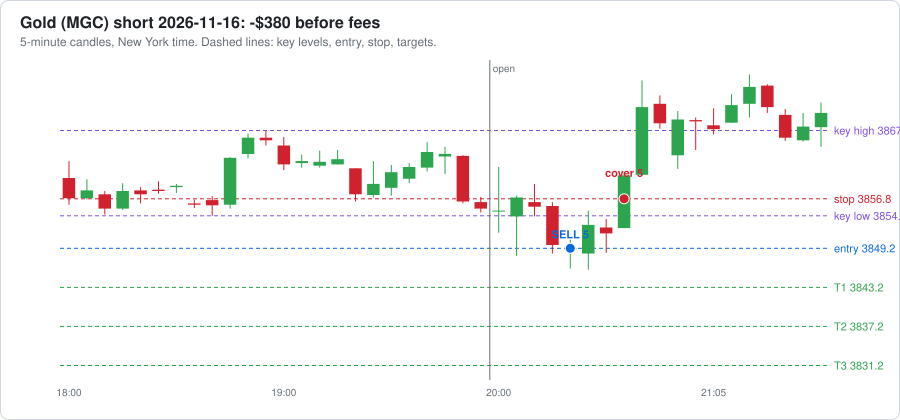
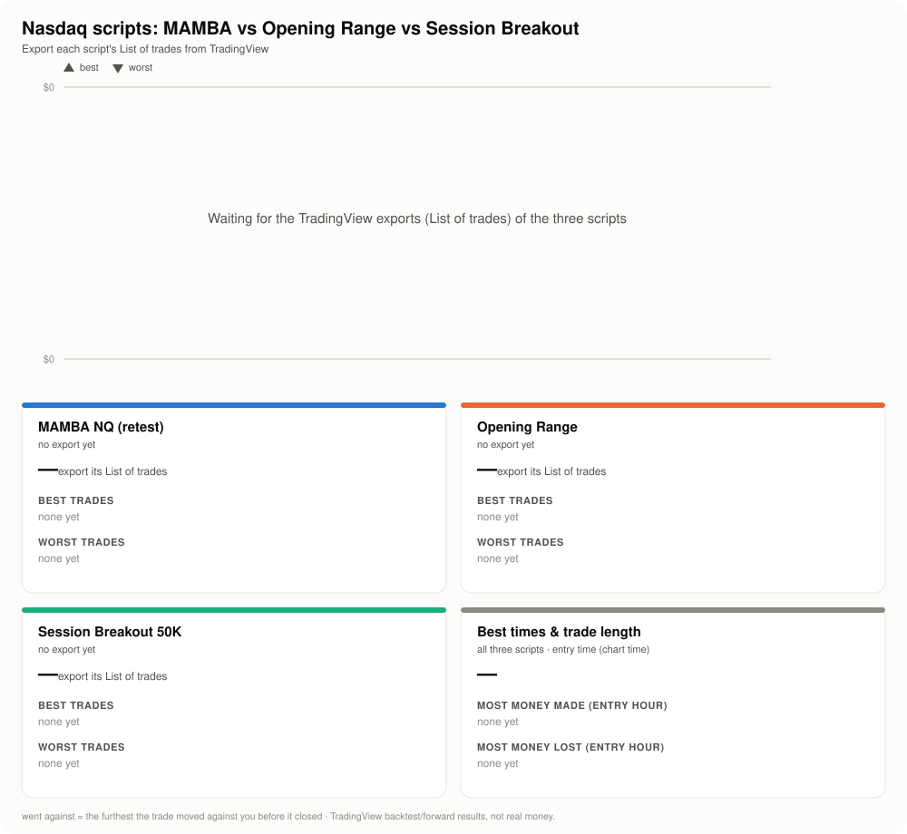
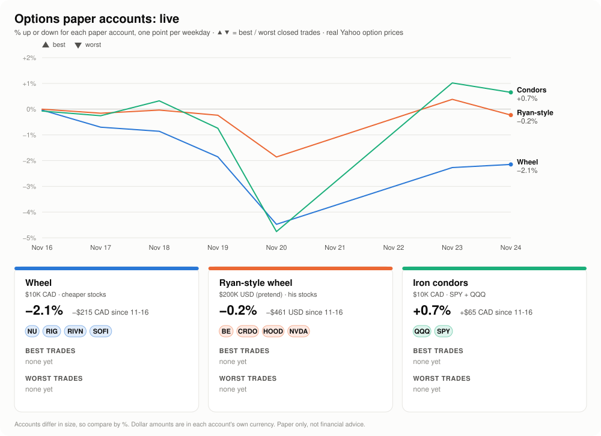
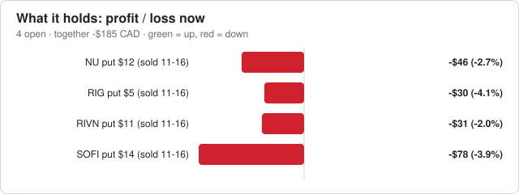
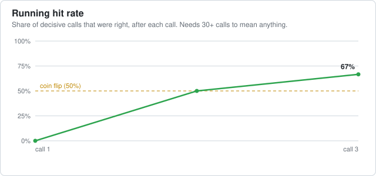

# Agent dashboard

Last updated 2026-11-17 03:24 New York time. Everything here is written by software and AI agents. It can be wrong, so check anything you plan to act on.

**[🪙 Open the Crypto Dashboard →](CRYPTO-DASHBOARD.md)** · **[𝕏 Open the X Brief Dashboard →](X-DASHBOARD.md)**

## Reminders

- ⏰ When your broker is connected: log every trade in trade-journal.md with a heading like `### Trade #1 | 2026-10-16` (swap the `__` in the template for the trade number) and keep the `- **Session:**` line, so the post-session reviewer can see your trades. Or ask Claude to build automatic trade logging into the paper trading agent.
- ⏰ Before trading real money: make this repo private (GitHub → Settings → Danger Zone → Change visibility). First run `git cherry-pick 0f7e3a2` so the paper trader checks less often and stays under GitHub's 2,000 free Actions minutes a month for private repos (it is public now to keep Actions free and unlimited).
- ⏰ 𝕏 **Turn on X auto-posting once @cashflowbrief00 gets traction:** 500+ followers, OR any post with 10,000+ views, OR 1,000+ views a day for a week (check the account's Analytics). Then tell Claude "turn on X auto-posting". It needs X API keys from developer.x.com (about $2.50-3/month for 5-6 posts a day, within the $25 AI budget) and X's "automated account" label.

[Edit reminders](REMINDERS.md)

## Agent status

| | Agent | What it does | Last ran | Runs |
|---|---|---|---|---|
| 🟢 | Market brief: nasdaq | Writes the brief before the New York session | 18 hours ago | weekdays about 7-8 AM New York time |
| 🟢 | Market brief: gold | Writes the brief before the Asia session | 3 hours ago | Sun-Thu evenings about 6-7 PM New York time |
| 🟢 | World news brief | Overnight news and today's events: politics, economy, war, trade | 14 hours ago | daily about 5-6 AM New York time |
| 🟢 | Crypto research brief | Pumping coins, whales, government and adoption news | 14 hours ago | daily about 5:30-6:30 AM New York time |
| 🟢 | Stock research brief | Movers, AI, nuclear, minerals, earnings dates and estimates | 22 hours ago | Mon, Wed, Fri about 6-7 AM New York time |
| 🟢 | Paper trader | Paper trades every session with your rules and runs a practice prop challenge | 4 hours ago | after each session ends |
| 🟢 | Scorer | Checks each lean against what price did | 4 hours ago | after each session ends |

🟢 ran recently  🟡 a bit late  🔴 check it  ⚪ never ran

## 📒 Trade journal (paper)

- **Tradeify 50K evaluation: balance $50,740**, $1,615 above the drawdown floor, $2,260 to pass; today -$385, $865 left before the daily loss limit. [Details](paper-trading/summary.md)
- 📐 Opening range (9:30-10:00, tracked, not traded): $1,975 over 10 trades in 11 sessions since 2026-11-02, vs -$2,075 for the real Nasdaq rule (ahead). [Details](paper-trading/summary.md)

Newest first. Times are New York time. Each sale shows contracts @ price, time. The 📈 link opens a chart of the trade; TV opens the same market on TradingView (add [the strategy](tradingview/breakout_strategy.pine) to see each trade marked).

| Date | Market | Side | Lots | Entry | Target 1 | Target 2 | Target 3 / out | Result | What could have gone better | See it |
|---|---|---|---|---|---|---|---|---|---|---|
| 2026-11-17 | Gold | short | 5 | 3849.2 @ 20:20<br>stop 3856.8 | – | – | stop: 5 @ 3856.8, 20:35 (-$380) | ❌ **-$385**<br>out 20:35 | • Price never reached Target 1: the best it did was +3.30 points, and Target 1 needed 6.<br>• The breakout failed and price kept going the other way, so the stop did its job and kept the loss small.<br>• The entry was 5.00 points past the key level, chasing a stretched move. Waiting for a pullback toward the level would have meant a better price and a smaller risk. | [📈 chart](paper-trading/charts/2026-11-16-gold.svg) · [TV](https://www.tradingview.com/chart/?symbol=COMEX_MINI%3AMGC1%21&interval=5) |
| 2026-11-16 | Nasdaq | short | 3 | 27437.0 @ 10:00<br>stop 27644.75 | 1 @ 27407.0, 10:05 ($60) | 1 @ 27377.0, 10:05 ($120) | stop: 1 @ 27407.0, 10:10 ($60) | ✅ **$237**<br>out 10:10 | • The last contracts were stopped at Target 1, then price reached Target 3 by 13:35. A looser stop after Target 2 would have caught it. | [📈 chart](paper-trading/charts/2026-11-16-nasdaq.svg) · [TV](https://www.tradingview.com/chart/?symbol=CME_MINI%3AMNQ1%21&interval=5) |
| 2026-11-16 | Gold | short | 5 | 3875.3 @ 20:05<br>stop 3893.1 | 1 @ 3869.3, 21:00 ($60) | 2 @ 3863.3, 00:45 ($240) | 2 @ 3857.3, 00:45 ($360) | ✅ **$655**<br>out 00:45 | • Price kept going 22.10 points past Target 3 (by 00:55). Letting the last 2 contract(s) run with a trailing stop could have made up to $442 more. | [📈 chart](paper-trading/charts/2026-11-15-gold.svg) · [TV](https://www.tradingview.com/chart/?symbol=COMEX_MINI%3AMGC1%21&interval=5) |
| 2026-11-13 | Nasdaq | short | 3 | 28266.0 @ 09:35<br>stop 28399.0 | 1 @ 28236.0, 09:40 ($60) | 1 @ 28206.0, 09:40 ($120) | stop: 1 @ 28236.0, 09:45 ($60) | ✅ **$237**<br>out 09:45 | • The last contracts were stopped at Target 1, then price reached Target 3 by 10:00. A looser stop after Target 2 would have caught it. | [📈 chart](paper-trading/charts/2026-11-13-nasdaq.svg) · [TV](https://www.tradingview.com/chart/?symbol=CME_MINI%3AMNQ1%21&interval=5) |
| 2026-11-13 | Gold | long | 5 | 3886.5 @ 18:50<br>stop 3882.3 | 1 @ 3892.5, 19:05 ($60) | 2 @ 3898.5, 20:15 ($240) | 2 @ 3904.5, 20:15 ($360) | ✅ **$655**<br>out 20:15 | • Price kept going 15.90 points past Target 3 (by 20:20). Letting the last 2 contract(s) run with a trailing stop could have made up to $318 more. | [📈 chart](paper-trading/charts/2026-11-12-gold.svg) · [TV](https://www.tradingview.com/chart/?symbol=COMEX_MINI%3AMGC1%21&interval=5) |
| 2026-11-12 | Nasdaq | – | 0 | skipped: risk too big | | | | $0 | Breakout long at 09:40, but even the small size risked $808 and only $589 could be lost today without breaking the daily loss limit or the drawdown, so it was skipped. | [TV](https://www.tradingview.com/chart/?symbol=CME_MINI%3AMNQ1%21&interval=5) |
| 2026-11-12 | Gold | long | 5 | 4004.4 @ 20:15<br>stop 3997.4 | – | – | stop: 5 @ 3997.4, 20:30 (-$350) | ❌ **-$355**<br>out 20:30 | • Price never reached Target 1: the best it did was +0.70 points, and Target 1 needed 6.<br>• The breakout failed and price kept going the other way, so the stop did its job and kept the loss small.<br>• The entry was 3.70 points past the key level, chasing a stretched move. Waiting for a pullback toward the level would have meant a better price and a smaller risk. | [📈 chart](paper-trading/charts/2026-11-11-gold.svg) · [TV](https://www.tradingview.com/chart/?symbol=COMEX_MINI%3AMGC1%21&interval=5) |
| 2026-11-11 | Nasdaq | short | 5 | 28246.75 @ 09:45<br>stop 28362.0 | 1 @ 28216.75, 09:50 ($60) | – | stop: 4 @ 28362.0, 10:25 (-$922) | ❌ **-$867**<br>out 10:25 | • Target 1 paid $60, but the stop stayed at the start. Moving it to breakeven after Target 1 would have ended this trade at about $60 instead of -$862.<br>• The entry was 65.00 points past the key level, chasing a stretched move. Waiting for a pullback toward the level would have meant a better price and a smaller risk. | [📈 chart](paper-trading/charts/2026-11-11-nasdaq.svg) · [TV](https://www.tradingview.com/chart/?symbol=CME_MINI%3AMNQ1%21&interval=5) |
| 2026-11-11 | Gold | long | 5 | 4055.3 @ 20:35<br>stop 4043.7 | 1 @ 4061.3, 00:10 ($60) | 2 @ 4067.3, 00:30 ($240) | 2 @ 4073.3, 00:30 ($360) | ✅ **$655**<br>out 00:30 | • Clean trade: price stalled near Target 3, so taking the full profit there was right. | [📈 chart](paper-trading/charts/2026-11-10-gold.svg) · [TV](https://www.tradingview.com/chart/?symbol=COMEX_MINI%3AMGC1%21&interval=5) |
| 2026-11-10 | Nasdaq | long | 3 | 28049.75 @ 10:00<br>stop 27868.75 | 1 @ 28079.75, 10:05 ($60) | – | stop: 2 @ 27868.75, 10:35 (-$724) | ❌ **-$667**<br>out 10:35 | • Target 1 paid $60, but the stop stayed at the start. Moving it to breakeven after Target 1 would have ended this trade at about $60 instead of -$664.<br>• The entry was 52.25 points past the key level, chasing a stretched move. Waiting for a pullback toward the level would have meant a better price and a smaller risk. | [📈 chart](paper-trading/charts/2026-11-10-nasdaq.svg) · [TV](https://www.tradingview.com/chart/?symbol=CME_MINI%3AMNQ1%21&interval=5) |
| 2026-11-10 | Gold | – | 0 | no breakout, no trade | | | | $0 | No confirmed breakout in the first 60 minutes. Key high 4156.20, low 4130.80. | [TV](https://www.tradingview.com/chart/?symbol=COMEX_MINI%3AMGC1%21&interval=5) |
| 2026-11-09 | Nasdaq | – | 0 | skipped: risk too big | | | | $0 | Breakout long at 09:35, but even the small size risked $1,467 and only $1,073 could be lost today without breaking the daily loss limit or the drawdown, so it was skipped. | [TV](https://www.tradingview.com/chart/?symbol=CME_MINI%3AMNQ1%21&interval=5) |
| 2026-11-09 | Gold | long | 5 | 4115.0 @ 20:15<br>stop 4111.7 | 1 @ 4121.0, 20:25 ($60) | – | stop: 4 @ 4111.7, 20:30 (-$132) | ❌ **-$77**<br>out 20:30 | • Target 1 paid $60, but the stop stayed at the start. Moving it to breakeven after Target 1 would have ended this trade at about $60 instead of -$72.<br>• Fakeout re-entry (switched off): price closed back beyond the entry at 20:35; re-entering 3 contracts at 4119.3 (stop 4112.9) would have made $357. | [📈 chart](paper-trading/charts/2026-11-08-gold.svg) · [TV](https://www.tradingview.com/chart/?symbol=COMEX_MINI%3AMGC1%21&interval=5) |
| 2026-11-06 | Nasdaq | – | 0 | skipped: daily profit cap | | | | $0 | Not taken: this trading day was already up $600, the daily profit cap that keeps the biggest day small for the 35% consistency rule. | [TV](https://www.tradingview.com/chart/?symbol=CME_MINI%3AMNQ1%21&interval=5) |
| 2026-11-06 | Gold | short | 5 | 4072.7 @ 20:45<br>stop 4085.0 | 1 @ 4066.7, 20:55 ($60) | 2 @ 4060.7, 22:05 ($240) | 2 @ 4054.7, 22:30 ($360) | ✅ **$655**<br>out 22:30 | • Price kept going 6.30 points past Target 3 (by 23:05). Letting the last 2 contract(s) run with a trailing stop could have made up to $126 more. | [📈 chart](paper-trading/charts/2026-11-05-gold.svg) · [TV](https://www.tradingview.com/chart/?symbol=COMEX_MINI%3AMGC1%21&interval=5) |

**Latest trade:**



[Full journal with every fill](paper-trading/paper-journal.md)

## 👔 CEO check

**❌ 2 broken rule(s)** ([read the full check](reports/ceo/latest.md))

<details>
<summary><b>What the CEO checked</b></summary>

##### Futures paper trader

- ❌ Tradeify practice evaluation failed: reset on 2026-10-28: only $96 above the floor, too close for any trade.
- ❌ Tradeify practice evaluation failed: reset on 2026-11-02: only $299 above the floor, too close for any trade.
- ✅ Tradeify practice evaluation: $1,615 above the $2,000 trailing drawdown floor.

##### Your trade journal

- ✅ No trades logged yet, nothing to check.

##### Crypto bots

- ✅ Rotation bot: 8 trades, buys only at weekly checks, never more than 4 coins at once.
- ✅ Buy-and-hold bot has never sold.

##### Alpaca copy

- ✅ All 10 Alpaca orders were for the bot's coins and within the limit.

##### Costs

- ✅ Spent $9.92 so far this month on 90 AI runs; on pace for about $18 (budget $50).

##### Agent health

- ✅ Every research brief worked on its last run.

##### Ready to run on its own?

- ✅ 22 of 15 trading days on the paper record
- ⏳ 2 rule problem(s) in the paper trader above
- ⏳ the Tradeify practice account never failed
- ⏳ the Tradeify practice evaluation has not passed yet
- ⏳ profit factor 0.91 (needs 1.3 or more), total $-620 over 28 trades
- ✅ worst trading day $-1,071 (needs $-1,250 or better)
- ⏳ You: Tradeify confirms in writing that TradersPost automation is allowed on the Select 50K
- ⏳ You: 2+ weeks of the live 50K alerts traded by hand with no rule broken
- ⏳ You + Claude: 2-3 sessions on a TradersPost paper account matching the chart

</details>

## 📅 Weekly report

<details>
<summary><b>Week ending 2026-11-15</b></summary>

#### The week in one look

- **Futures paper:** -$419 this week
- **Rotation bot:** $0.00 this week
- **Buy-and-hold bot:** -$145.27 this week
- **AI costs:** $4.14 this week

#### Futures paper trading

- **This week:** -$419 after fees, 7 trades (3 wins, 4 losses), 3 sessions with no trade
- **Since paper trading began:** -$1,128 over 25 trades
- Nasdaq (MNQ): -$1,297 over 3 trades
- Gold (MGC): +$878 over 4 trades

| Day | Market | Side | Entry | Result |
|---|---|---|---|---|
| 2026-11-09 | gold | long | 4115.0 at 20:15 | -$77 |
| 2026-11-10 | nasdaq | long | 28049.75 at 10:00 | -$667 |
| 2026-11-11 | gold | long | 4055.3 at 20:35 | +$655 |
| 2026-11-11 | nasdaq | short | 28246.75 at 09:45 | -$867 |
| 2026-11-12 | gold | long | 4004.4 at 20:15 | -$355 |
| 2026-11-13 | gold | long | 3886.5 at 18:50 | +$655 |
| 2026-11-13 | nasdaq | short | 28266.0 at 09:35 | +$237 |

#### TradingView strategy

| Market | Export date | Forward test (since paper start) | Whole export |
|---|---|---|---|
| Nasdaq (MNQ) | 2026-10-18 | 0 trades, $0 | 25 trades, +$3,684, 56% wins |
| Gold (MGC) | 2026-10-18 | 0 trades, $0 | 22 trades, +$699, 32% wins |

Export the List of trades from each chart and say "update TradingView" to refresh these numbers.

#### Crypto paper bots

| Bot | Start of week | End of week | Change | Since it started ($1,000) |
|---|---|---|---|---|
| Rotation bot | $979.35 | $979.35 | $0.00 (+0.0%) | -$20.65 |
| Buy-and-hold bot | $876.58 | $731.31 | -$145.27 (-16.6%) | -$268.69 |

**Alpaca copy:** 0 order(s) this week.

#### Market briefs (Nasdaq and gold)

- 7 briefs scored; 3 gave a direction, 1 of those were right.
- 4 were Neutral.

#### CEO check

**❌ Rules were broken this week.** 17 checks ran. [Latest CEO check](../ceo/latest.md)

#### AI costs this week

| Agent | Runs | Cost |
|---|---|---|
| crypto-brief | 7 | $1.78 |
| market-brief-nasdaq | 6 | $0.72 |
| world-brief | 7 | $0.61 |
| stock-brief | 3 | $0.54 |
| market-brief-gold | 4 | $0.43 |
| x-posts | 12 | $0.06 |
| **Total** | 39 | **$4.14** |

At this pace: about $18 a month.

[Main dashboard](../../DASHBOARD.md) · [Crypto dashboard](../../CRYPTO-DASHBOARD.md)

</details>

[All weekly reports](reports/weekly/)

## Paper trading

- Total after fees: **-$620** over 28 trades (42 sessions watched)
- Trading days with a trade: **21**, profitable: **8**, losing: 13
- Win rate: 46%
- Profit factor: 0.91
- Biggest drop from a high (max drawdown): $4,620
- Room left before the $4,000 max drawdown: **$1,135**
- Progress toward a prop demo: **21 of 20** trading days


*Your three TradingView scripts on Nasdaq and gold from Nov 15 on, read from TradingView's Strategy Tester (saved in `tradingview/script-trades/`). Ask Claude to refresh them.*

**Results so far (Sep 20 - Nov 15):**




<details>
<summary><b>Challenge simulation, results by market, and daily results</b></summary>

#### By market

| Market | Trades | Wins | Total after fees |
|---|---|---|---|
| nasdaq | 12 | 5 | -$2,776 |
| gold | 16 | 8 | $2,156 |


#### Daily results

| Trading day | Sessions | Result after fees |
|---|---|---|
| 2026-11-17 | gold short | -$385 |
| 2026-11-16 | gold short, nasdaq short | $892 |
| 2026-11-13 | gold long, nasdaq short | $892 |
| 2026-11-12 | gold long, nasdaq skipped, risk too big for today's limits | -$355 |
| 2026-11-11 | gold long, nasdaq short | -$212 |
| 2026-11-10 | gold no trade, nasdaq long | -$667 |
| 2026-11-09 | gold long, nasdaq skipped, risk too big for today's limits | -$77 |
| 2026-11-06 | gold short, nasdaq skipped, daily profit cap reached | $655 |
| 2026-11-05 | gold long, nasdaq skipped, daily profit cap reached | $655 |
| 2026-11-04 | gold long, nasdaq skipped, risk too big for today's limits | $357 |
| 2026-11-03 | gold no trade, nasdaq no trade | $0 |
| 2026-11-02 | nasdaq long | -$1,015 |
| 2026-10-30 | gold short, nasdaq skipped, risk too big for today's limits | -$265 |
| 2026-10-29 | gold short, nasdaq skipped, risk too big for today's limits | -$365 |
| 2026-10-28 | gold long, nasdaq short | -$1,071 |
| 2026-10-27 | gold no trade, nasdaq long | -$688 |
| 2026-10-26 | gold short, nasdaq no trade | -$329 |
| 2026-10-23 | gold short, nasdaq long | -$888 |
| 2026-10-22 | gold short, nasdaq short | $1,070 |
| 2026-10-21 | gold no trade, nasdaq short | -$252 |
| 2026-10-20 | gold short, nasdaq long | $1,070 |
| 2026-10-19 | gold no trade, nasdaq long | $357 |

[Every paper trade](paper-journal.md) · [Raw data](trades.csv)


</details>

[Paper trading journal](paper-trading/paper-journal.md) · [TradingView strategy](tradingview/breakout_strategy.pine)

## 🎡 Options wheel (paper)

Two paper accounts run side by side: **ours** ($10K CAD, cheaper stocks) and a **Ryan-style** copy (Options With Ryan's rules, pretend $200K USD on his stocks). Compare them by **%**, since the sizes differ. [Rules and research](experiments/wheel-strategy-research.md)



*Live paper results, updated every weekday after the 2:37 PM run.*

<details>
<summary><b>Past-year backtest of all three accounts</b></summary>


*Backtest with estimated option prices. Rebuild it with `PYTHONPATH=agents:experiments python3 experiments/options_accounts_chart.py`.*

</details>

| Account | Up / down % | Wins / losses | Open | Since |
|---|---|---|---|---|
| Ours ($10K CAD) | **+0.0%** | 0 / 0 | 4 | 2026-11-16 |
| Ryan-style ($200K USD) | **+0.0%** | 0 / 0 | 3 | 2026-11-16 |

### Ours ($10K CAD)

Updated 2026-11-16 21:35 New York. Started 2026-11-16.

| | |
|---|---|
| Account value | **$9,996 CAD** ($6,984 USD) |
| Up / down | **-4 CAD** (+0.0%) |
| Closed trades | 0 wins, 0 losses |
| Cash | $10,217 CAD, of which $6,011 CAD is set aside to cover the puts |




| Stock | Holding | Sold put on | Bought shares on | Got / paid | Option worth now | Stock now | Expiry | Up / down CAD | Up / down % |
|---|---|---|---|---|---|---|---|---|---|
| NU | 1 put $12 | 2026-11-16 | - | got $0.37 | $0.37 | $12.68 | 2026-12-18 | 🔴 -1 | -0.1% |
| RIG | 1 put $5 | 2026-11-16 | - | got $0.18 | $0.18 | $5.22 | 2026-12-18 | 🔴 -1 | -0.1% |
| RIVN | 1 put $11 | 2026-11-16 | - | got $0.44 | $0.44 | $12.10 | 2026-12-18 | 🔴 -1 | -0.1% |
| SOFI | 1 put $14 | 2026-11-16 | - | got $0.55 | $0.55 | $14.85 | 2026-12-18 | 🔴 -1 | -0.0% |

[Account](paper-trading/wheel/summary.md) · [Every move](paper-trading/wheel/journal.md)

### Ryan-style ($200K USD, his stocks)

Updated 2026-11-16 21:35 New York. Started 2026-11-16.

| | |
|---|---|
| Account value | **$199,997 USD** |
| Up / down | **-3 USD** (+0.0%) |
| Closed trades | 0 wins, 0 losses |
| Cash | $202,343 USD, of which $44,200 USD is set aside to cover the puts |


| Stock | Holding | Sold put on | Bought shares on | Got / paid | Option worth now | Stock now | Expiry | Up / down USD | Up / down % |
|---|---|---|---|---|---|---|---|---|---|
| CRDO | 1 put $105 | 2026-11-16 | - | got $8.90 | $8.90 | $120.71 | 2026-12-18 | 🔴 -1 | -0.0% |
| HOOD | 3 puts $65 | 2026-11-16 | - | got $3.02 | $3.02 | $72.06 | 2026-12-18 | 🔴 -2 | -0.0% |
| NVDA | 1 put $142 | 2026-11-16 | - | got $5.49 | $5.49 | $156.14 | 2026-12-18 | 🔴 -1 | -0.0% |

[Account](paper-trading/wheel-ryan/summary.md) · [Every move](paper-trading/wheel-ryan/journal.md)

## 💰 Iron condor income account (paper, $10K CAD)

A separate cash-flow test: SPY/QQQ iron condors, about 30 days out. Backtest: about $100-250 CAD a month, with drops of 16-30% along the way.

Updated 2026-11-16 21:35 New York. Started 2026-11-16. Goal: steady monthly cash flow from SPY/QQQ iron condors.

| | |
|---|---|
| Account value | **$9,993 CAD** ($6,982 USD) |
| Up / down | **-7 CAD** (-0.1%) |
| Closed this month (2026-11) | **+0 CAD** |
| Closed trades | 0 wins, 0 losses |
| Money at risk now | $3,154 CAD (limit 36% of the account) |


| Underlying | Condor | Opened | Price then / now | Credit | Worth now | Up / down CAD | Max loss CAD |
|---|---|---|---|---|---|---|---|
| QQQ | 1x 600/615 puts + 708/721 calls exp 2026-12-18 | 2026-11-16 | $661.75 / $661.75 | $4.31 | $4.31 | 🔴 -4 | 1,534 |
| SPY | 1x 690/703 puts + 772/787 calls exp 2026-12-18 | 2026-11-16 | $739.95 / $739.95 | $3.71 | $3.71 | 🔴 -4 | 1,620 |

| Month | Profit / loss |
|---|---|
| (no closed trades yet) | |

[Account](paper-trading/condor/summary.md) · [Every move](paper-trading/condor/journal.md)

## 📈 TradingView strategy results

From the latest **List of trades** export of each chart. One trade = one entry (TradingView counts each target as a separate trade). Forward test = trades from 2026-10-19 on.

| Market | Export date | Trades | Wins / losses | Win rate | Total | Profit factor | Max drawdown | Forward test |
|---|---|---|---|---|---|---|---|---|
| Nasdaq (MNQ) | 2026-10-18 (trades since 2026-08-25) | 25 | 14 / 11 | 56% | **$3,684** | 1.99 | $1,066 | 0 trades, $0 |
| Gold (MGC) | 2026-10-18 (trades since 2026-08-24) | 22 | 7 / 15 | 32% | **$699** | 1.30 | $1,559 | 0 trades, $0 |
| **Both** | | 47 | 21 / 26 | 45% | **$4,384** | 1.72 | | |

<details>
<summary><b>Latest 10 TradingView trades</b></summary>

| Entry (New York) | Market | Side | Entry price | Contracts | Result |
|---|---|---|---|---|---|
| 2026-10-15 09:35 | Nasdaq (MNQ) | short | 29,830.00 | 5 | ❌ -$68 |
| 2026-10-14 20:05 | Gold (MGC) | short | 4,138.90 | 5 | ❌ -$105 |
| 2026-10-14 09:35 | Nasdaq (MNQ) | short | 30,578.50 | 5 | ❌ -$192 |
| 2026-10-13 09:35 | Nasdaq (MNQ) | short | 30,757.25 | 5 | ❌ -$20 |
| 2026-10-12 20:05 | Gold (MGC) | short | 4,187.60 | 5 | ✅ $420 |
| 2026-10-12 09:45 | Nasdaq (MNQ) | short | 30,969.50 | 5 | ✅ $660 |
| 2026-10-08 20:05 | Gold (MGC) | long | 4,168.70 | 5 | ❌ -$20 |
| 2026-10-07 20:05 | Gold (MGC) | short | 4,131.60 | 5 | ❌ -$250 |
| 2026-10-07 09:35 | Nasdaq (MNQ) | short | 31,180.50 | 5 | ❌ -$704 |
| 2026-10-06 20:05 | Gold (MGC) | long | 4,191.20 | 5 | ❌ -$8 |

</details>

To refresh: export the List of trades from each chart in TradingView, double-click `tradingview/update-exports.command`, then push in GitHub Desktop.

## Latest briefs

Click a brief to read it here. The summary is at the top of each.

<details>
<summary><b>🌍 World news brief, 2026-11-16, event risk High</b></summary>

#### Top things for today
1. **Trump's Asia trip and the Xi/Putin meetings.** Trump's trip has stops in the Philippines and China, where he is expected to meet Xi and Putin. Time reports he is due to arrive in China Wednesday for the APEC summit sidelines. Officials expect no concrete agreement and call the three-way meeting an initial conversation on denuclearization (ABC News). Why it matters: US-China trade ties, risk appetite, and the dollar.
2. **New AI chip rule.** The administration moved Monday to limit Chinese firms' remote access to advanced AI chips, closing what many saw as an export-control loophole (Washington Post). The rule gives Commerce Secretary Lutnick more discretion over AI chip sales to certain countries (Time). Why it matters: tech export controls and the US-China trade backdrop.
3. **Nvidia scandal.** Jensen Huang resigned from Nvidia's board and as CEO on Nov. 12 (ABC). A White House official told NPR that Trump is not expected to raise the affair with Xi. Why it matters: US-China tech tensions and risk appetite.
4. **Fed Chair Warsh speaks at 12:00 PM.** MarketWatch says Warsh is discussing how the Fed is working through AI's effect on the economy (headline only). Crypto Briefing also mentions potential rate hikes (headline only). Why it matters: rate expectations and the dollar.
5. **Canada CPI at 8:30 AM.** The forecast is for a rise in inflation. Why it matters: Bank of Canada policy and the Canadian dollar.

#### Today's schedule (New York time)
| Time | Event | Who or where | Confirmed? |
|---|---|---|---|
| 8:30 AM | CPI m/m (forecast 0.3%, previous 0.1%) | Canada | Yes |
| 8:30 AM | Median CPI y/y (forecast 2.0%, previous 1.9%) | Canada | Yes |
| 8:30 AM | Trimmed CPI y/y (forecast 1.9%, previous 1.8%) | Canada | Yes |
| 12:00 PM | Fed Chairman Warsh speaks | US | Yes |
| Time (unconfirmed) | Trump departing for Asia; he left the White House this morning | Philippines, then China | Unconfirmed |

Coming up this week: Tue 8:30 AM US Retail Sales m/m (forecast 0.2%, previous 0.8%) and Core Retail Sales m/m (forecast 0.4%, previous 0.9%). Wed 2:00 AM UK CPI y/y (forecast 3.6%, previous 3.5%). Wed 2:30 AM and 10:00 AM BOE Gov Bailey speaks. Wed 2:00 PM FOMC Minutes.

#### Event risk today
High - Fed Chair Warsh speaks, Canadian CPI is released, and Trump is heading into Xi and Putin meetings amid new chip curbs.

#### Politics and policy
- Leaving the White House Monday morning, Trump said he "may" meet North Korea's Kim Jong Un in China, though it would be Xi's decision (ABC).
- Elon Musk will join Trump for parts of the China travel (ABC).
- C-SPAN: Trump said the US is not at risk because of the Nvidia scandal (headline only).
- The Guardian: several companies are using Trump tariff refunds for corporate bonuses (headline only).
- Federal News Network: Congress must decide whether to keep blocking the administration's planned federal grantmaking rules (headline only).
- Los Angeles Times: allies and aides will urge Trump to push back against Beijing (headline only).
- Federal Reserve: see Warsh at 12:00 PM above (MarketWatch, headline only).

#### Economics
Nothing found. No major data was released overnight in the calendar.
- Financial Post asks whether the Bank of Canada moved too soon on its inflation "smoking gun" (headline only).
- INDIA New England News: fewer international students could cost the US economy $2.4 billion and 31,000 jobs (headline only).

#### SEC, CFTC and hearings
- The SEC and CFTC issued no official press releases in the last 2 days.
- Tokenpost: the CFTC registered Backpack Clearing as a derivatives clearing organization (headline only).
- Cryptonews.net: Democratic senators urged the CFTC to stay out of state lawsuits over prediction markets (headline only).
- CoinGape: Hyperliquid's policy center backs the CFTC approach of separating prediction markets from gambling (headline only).
- No congressional hearings found.

#### War, trade and tariffs
- Trump is expected to discuss the war in Iran with Xi and Putin (ABC). The Economist asks whether America or Iran will blink first (headline only).
- Nikkei Asia: the EU set tariffs on steel from India, Japan, Taiwan, Turkey and Vietnam (headline only).
- Al Jazeera: a cargo ship capsized off Bulgaria's Black Sea coast (headline only).
- Why it matters: energy and shipping risk, and trade policy.

#### Country briefs
- **China:** The US chip rule and the Nvidia scandal come before Trump's visit (Time, PBS). Trump's bilateral meeting and working lunch with Xi is Thursday afternoon, local time (ABC).
- **European Union:** Nikkei Asia: new steel tariffs on five countries (headline only).
- **United Kingdom:** No news in the headlines. UK CPI is due Wednesday at 2:00 AM.
- **Japan:** Japan is among the countries facing the EU steel tariffs (Nikkei Asia, headline only).
- **India:** India is among the countries facing the EU steel tariffs (Nikkei Asia, headline only).
- **Russia:** Putin will join the first-ever US-China-Russia trilateral meeting at APEC in China (ABC). The Washington Post ran an opinion piece on the Russian Orthodox Church (headline only).
- **Canada:** CPI is due at 8:30 AM. Financial Post questions the timing of the Bank of Canada's latest move (headline only).

[Read the full brief with all the details](reports/news/2026-11-16-world-brief.md) · [All news briefs](reports/news/)

</details>

<details>
<summary><b>🪙 Crypto brief, 2026-11-16</b></summary>

#### Top things today

1. **Extreme fear persists.** The Fear and Greed Index is at 10, unchanged from the prior session and well below 29 a week earlier. Bitcoin is about 49% below its peak. Why it matters: it shows heavy risk-off mood, but a low reading alone does not mean sellers are done (Cointelegraph via SpendNode, TokenPost).
2. **ETF outflows are steady.** November outflows had reached $1.58B for Bitcoin ETFs and $551M for Ethereum ETFs as of a few days ago. Spot Bitcoin ETFs saw a net outflow of $187.29M on Nov 14. Why it matters: institutional demand is still leaving (KuCoin News, CoinGabbar).
3. **Fed speech and minutes.** Fed Chair Kevin Warsh speaks at noon ET today. Wednesday brings the Fed minutes, and the December 9 rate decision follows. Why it matters: rate-hike worries are weighing on risk assets (CoinGabbar).
4. **CLARITY Act is stalled.** The Senate vote to end debate failed 49–50 on September 15. Democrats won both chambers in the November 3 midterms. Why it matters: market-structure rules will likely come from agencies, not Congress (crypto.news).
5. **Treasury companies are under strain.** MSCI's review will remove Strategy and Metaplanet from the MSCI USA Index. Strategy's bitcoin stack is reported $6.85B underwater. Why it matters: forced index selling and weak treasury balance sheets add pressure (U.Today, SpendNode).

#### Coins to research

| Coin | 24h move | Why it is moving | Red flags |
|---|---|---|---|
| Rain (RAIN) | +72.2% (7d +50.2%) | No news found for today's move (unconfirmed cause). Earlier rallies followed foundation liquidity injections and token burns (Invezz, Mainstream Crypto News). | Pump with no news found. Huge supply: 1.15 trillion max supply. Volume ($23M) is small against a $4.6B market cap. |
| Internet Computer (ICP) | +15.7% | No clear catalyst found. It bounced along with BTC's weekend move from $62k to $65k (AMBCrypto). | Bearish bias across timeframes. The bounce hit a former demand zone around $2.20–$2.25, which now acts as supply. |
| Pieverse (PIEVERSE) | +20.2% | No news found. | Pump with no news. Small cap ($577.6M) and thin volume ($19M). |
| EVAA Protocol (EVAA) | +30.3% | No news found. | Rank 699. Small cap. Pump with no news. |
| Macca the Gator (MACCA) | +31.8% | No news found. Trending on CoinGecko. | Rank 783. Meme coin. Tiny cap. No news. |
| Gato The Cat (GATO) | +19.5% | No news found. Trending on CoinGecko. | Rank 787. Meme coin. Tiny cap. No news. |

Holder concentration was not checked for any of these coins.

#### Whale watch

| When | Coin | Amount (USD) | Who | Direction |
|---|---|---|---|---|
| Nov 14 (some tallies cumulative) | ETH | $125.27M (63,540 ETH) | Wallets Arkham labels "Erik Voorhees-linked" (unverified) (Lookonchain) | Bought. Lookonchain's tally also counts exchange withdrawals, so not all of it is new buying. |
| Nov 14 (some tallies cumulative) | ETH | $60.88M (31,484 ETH) | "7 Siblings" (Lookonchain) | Bought |
| Past 24h (unconfirmed timing) | BTC, ETH, SOL | $143.89M in positions liquidated | Four large traders (Lookonchain) | Forced selling (liquidations) |

Timing for some of these is approximate, and the search snippets did not give New York times. Another report said whales send a net $55M a day to exchanges (SpendNode).

#### Government and regulation

- **CLARITY Act (market structure):** The House passed it in July 2025. The Senate is stuck after the failed vote. On Nov 15, Sen. Cynthia Lummis criticized Democrats over it. The dispute centers on an SEC registration step for token issuers. Industry expects little progress before the new Congress in January (crypto.news, TronWeekly).
- **Nominees:** Trump nominated two SEC and two CFTC commissioners, one Democrat in each pair. The Senate Banking Committee has scheduled a hearing for the SEC nominees. Senate Agriculture plans a CFTC hearing soon. I found no hearing date (TokenPost).
- **Data-center permitting bill:** A bipartisan bill affecting data centers and miners cleared an initial Senate hurdle. (TokenPost)
- **GENIUS Act rules:** The OCC issued a final rule for payment stablecoin issuers on Oct. 21. It takes effect Jan. 18, 2027. The Fed separately sought comment on proposals for the issuers it supervises. (TokenPost)
- **SEC and CFTC:** The SEC has proposed "Regulation Crypto Assets," with two exemptions that let some crypto firms raise capital without full registration. The CFTC has opened an advance notice of proposed rulemaking on retail crypto commodity transactions. (American Banker, TokenPost)
- **Other countries:** Nothing found.

#### Who is buying and adopting

- Nothing found on new government or country bitcoin purchases.
- Strategy and Metaplanet face removal from the MSCI USA Index (see above). U.Today also lists a headline that "Nakamoto Sells More Bitcoin." I did not open the details.
- Stablecoin payment adoption: nothing found.

#### Next 7 days

| Date | Event | Coin or topic |
|---|---|---|
| Mon Nov 16, noon ET | Fed Chair Warsh speaks in San Francisco | Macro (CoinGabbar) |
| Wed Nov 18 | Fed minutes | Macro (CoinGabbar) |
| Date not found | Senate Banking hearing for SEC nominees | Regulation (TokenPost) |

No token unlocks or ETF deadlines were found. The Fed's December 9 decision falls outside this window.

[Read the full brief with all the details](reports/crypto/2026-11-16-crypto-brief.md) · [All crypto briefs](reports/crypto/)

</details>

<details>
<summary><b>📈 Stocks brief, 2026-11-16</b></summary>

#### Top things today
1. **Nvidia reports Tuesday after the close, its first report since CEO Jensen Huang resigned.** Huang stepped down a day before Friday's drop. The stock fell 13% last week, its biggest weekly slide since April 2025 (CNBC). Why it matters: it is the main test for the whole AI chip group.
2. **Anthropic's IPO prices Wednesday, Nov. 18, and trades Thursday, Nov. 19.** The Nasdaq ticker is "ANT" (Yahoo Finance). The range is $70 to $78 for 825 million shares. Why it matters: it is a big test of AI demand and could affect AI names and the OpenAI IPO.
3. **Money rotated out of Nvidia, then partly reversed on Friday.** AMD fell 8.8% and Broadcom fell 4.8% (live data). The Philadelphia semiconductor index fell 3.4% (Reuters). Why it matters: the rotation trade reversed hard.
4. **Copper is weak.** Copper hit a near four-month low and was heading for a fifth straight weekly loss. The decline was tied to unwinding AI-linked positions, not physical supply (The Doctor's Daily, a newsletter). Why it matters: miners are trading with AI sentiment.
5. **Nvidia-adjacent AI infrastructure names jumped on company news.** Cerebras, Modine and Fermi all rose strongly. Why it matters: the market is still rewarding concrete AI demand.

Note: the "gainers" and move data are from Friday, Nov. 13, the last completed session.

#### Stocks to research
| Ticker | Theme | Move | Why | Red flags |
|---|---|---|---|---|
| NVDA | AI | -2.0% day, -12.7% 5d | Earnings Tuesday after the close; CEO exit; HSBC downgrade | Event risk. Huge volume. |
| AMD | AI | -8.8% day, +18.9% 5d | Fell after a rally driven by the Nvidia turmoil | Very sharp swings. One writer cites a P/E of about 202. |
| CBRS | AI IPO | +11.2%, $108.72 | Record Q3 revenue and a raised outlook. Core revenue rose 70% to $230.9M. Microsoft signed as a customer (Reuters). | Still about 47% below its May IPO price of $185 as of Thursday. Recent IPO. |
| MOD | AI data center cooling | +27.9%, $135.66 | Bloomberg reported Samsung is in talks to buy it, possibly within weeks. | Deal talk only (unconfirmed). Could fade if talks fail. |
| FRMI | AI power/data centers | +26.7%, $2.61 | A $200M customer prepayment for Project Matador, but no lease is signed. | Q3 loss of 22 cents vs. a 9-cent loss expected. Heavy stock-based pay and stock-paid fees. Friday's extra move: no news found. |
| MP | Rare earths | +3.5% day, +9.5% 5d | Rose while most miners fell | No news found for Friday's move. |

#### AI and tech
- **Nvidia leadership and earnings.** HSBC cut Nvidia to Hold with a $170 target, citing succession uncertainty and U.S. chip export limits (TradingKey). It was Nvidia's sixth straight weekly decline, the longest since 2012 (CNBC via Gotrade). Analysts expect nearly 100% year-over-year earnings and revenue growth (CNBC).
- **Challengers rallied, then reversed.** AMD and Broadcom had gained 30% and 24% as money moved to other chipmakers. Then both sold off Friday (live data).
- **Cerebras beat and raised.** It guided Q4 revenue to about $320M, above the $271.2M estimate (Bloomberg). It raised its 2026 revenue forecast to $940M–$960M (JournalArta).
- **Anthropic IPO.** Reuters reported the book was about six times oversubscribed after three roadshow days. It also plans $26B in private placements to Google, Nvidia, Microsoft and others (The Conversation).

#### Nuclear and critical minerals
- **Nuclear fuel demand.** Advanced reactor developers are pre-paying for U.S. high-assay low-enriched uranium capacity that does not exist yet. Centrus's orders far exceed its near-term output (newsletter, medium confidence). That is relevant to LEU.
- **Government financing.** The U.S. is to lend $4.2B to Vistra to boost nuclear output, a source said (Mining.com, Oct. 4). This is older news but still relevant to VST.
- **Rare earths and the Pentagon.** A first commercial-scale rare earth shipment from a Brazilian mine went to a U.S. buyer. The newsletter says this shows the Defense Department acting as a price-setter through guaranteed offtake. The producer was not named.
- **Copper.** Three-month LME copper was down 0.5% at $13,519 a ton on Friday. Nothing found today on new export limits. LAC fell 8.6% Friday with no news found.

#### Earnings
**Since yesterday:** Nothing found for Sunday or Monday. The most relevant recent report was Cerebras on Nov. 12 (see above). It beat expectations, and the stock rose 11.2% Friday.

| Date | Ticker | Timing | EPS estimate | Revenue estimate |
|---|---|---|---|---|
| 2026-11-17 | NVDA | After the close (Reuters) | $2.47 | $108.7B |
| 2026-11-17 | SQM | Not found | $2.08 | $2.2B |
| 2026-11-30 | NNE | Not found | $-0.26 | $1.5M |

#### Smart money
- **HSBC** downgraded Nvidia to Hold from Buy on Nov. 13, with a $170 target. Barclays trimmed its target from $275 to $210 and kept Overweight (TradingKey).
- Insider buying: Nothing found.
- Congress trades: Nothing found.
- Other analyst changes in nuclear or minerals: Nothing found.

[Read the full brief with all the details](reports/stocks/2026-11-16-stock-brief.md) · [All stocks briefs](reports/stocks/)

</details>

<details>
<summary><b>📊 Nasdaq 100 futures market brief, 2026-11-16</b></summary>

### Nasdaq 100 Futures Brief for Monday, Nov 16, 2026 (New York session)

#### 1. What is driving futures
Tech is leading a risk-off start to the week.
- Nasdaq 100 and S&P 500 futures slid as AI-related stocks came under pressure before Nvidia's earnings later this week. Nvidia's turbulent run since CEO Jensen Huang's exit is also weighing on sentiment.
- Intel and AMD each fell 5.2%, Broadcom fell 3.7% and Micron fell 5.3% in premarket.
- A selloff in Asian chip stocks deepened overnight.
- Rates are also a pressure point. The market has more than fully priced a 25 basis point Fed hike in December. One source reports a stronger-than-expected October core PPI. I found this in only one source.
- Anthropic's market debut is also a focus later this week. I could not verify the exact date.

#### 2. Scheduled events (New York time)
- **9:05 AM:** Fed's Williams speaks. This is already past.
- **12:00 PM:** Fed Chair Warsh gives opening remarks. This is the main event today.
- **About 2:15 PM:** Fed's Hammack (a voter). This comes from a GMT listing that I converted to New York time. Another source says only "this afternoon."
- **After the session:** Barkin speaks in the evening. Sources give 5:00 PM and 6:10 PM.
- **Tomorrow, Tuesday:** Retail sales and industrial production are due. I did not verify the release time.
- **Tuesday after the close:** Nvidia reports on Nov 17 after the close. The expected time is 4:20 PM ET. Options price about a ±9.2% move.
- **Wednesday:** FOMC minutes.

Nvidia's report is not in today's session. Traders may still position ahead of it.

#### 3. Key levels (from price data)
- Previous session high: **28399.00**
- Previous session low: **27695.25**
- Previous close: **28038.25**
- Overnight range since that close: high **28279.25**, low **27485.75**
- 5-session high: **28697.00**
- 5-session low: **27316.25**

The latest price is **27600.50**. That is **94.75 below the previous session low**, so price is sitting at or under support. The prior low is now the nearest overhead level, and the overnight low is just below. The 5-session low is the next level further down.

#### 4. Volume
The previous session traded **1.18x** the average of the five sessions before it. That is slightly above average, so participation was moderate. It was not a strong surge. Friday's selling had a little extra weight behind it, but this is not a high-conviction volume signal. Today's volume is not in the data.

#### 5. Directional lean
**Bearish, Medium confidence.**

Price is below the previous session low. Volume was modestly above average on the prior session. News is risk-off, with chip weakness, rate-hike pricing and Nvidia uncertainty. Those three signals point the same way. Confidence is not higher because volume was only mildly elevated, and Warsh's noon speech and Nvidia's report can cause sharp reversals.

I would change the lean to Neutral if price reclaims 27695.25 and holds. I would change it to Bullish if price reclaims and holds well above that, for example back toward the previous close. A calmer-than-feared Warsh speech could trigger that. A move below the 5-session low with fast selling would raise my bearish confidence. This is a probability-based lean, not a prediction or a trade instruction.

#### 6. Event

[Open the file](reports/2026-11-16-nasdaq-brief.md)

</details>

<details>
<summary><b>📊 Gold futures market brief, 2026-11-16</b></summary>

#### Price data used

```
PRICE DATA (Gold futures, Yahoo Finance, New York time, may be delayed)
Latest price: 3874.10 at 2026-11-16 23:40
Previous Asia session (2026-11-15 20:00 to 04:00): high 3892.60, low 3835.20, close 3863.40, volume 57,377
Highest high of the last 5 Asia sessions: 4150.70
Lowest low of the last 5 Asia sessions: 3835.20
Since that session closed: high 3892.60, low 3843.70.
Latest price is INSIDE the previous range (18.50 below the high, 38.90 above the low).
Volume: the previous session traded 1.53x the average of the 5 session(s) before it.
```

**Gold futures brief: Asia session, 2026-11-16**

**1. What is driving gold**
- Gold opened Monday at its lowest in over a year. A strong dollar and high 10-year yields are driving it, and a December Fed rate hike looks near certain.
- CME FedWatch showed a 93.4% chance of a hike after the December 8-9 meeting.
- Spot gold fell to $3,832 in early Asian trade, its lowest since October 2025, then recovered to about $3,872.
- Kitco reports gold fell back below $4,000 last week.
- Gold is down 6.64% over the past month.
- FXStreet says momentum is weak, and recovery attempts are likely to be capped by nearby resistance.
- I could not verify what Fed Chair Warsh said in his 12:00 PM ET speech today, or how gold reacted.

**2. Scheduled events (New York time)**
- Mon 6:10 PM: Fed's Barr and Barkin speak.
- Mon 9:00 PM: NZD inflation expectations.
- Tue 8:30 AM: US retail sales, forecast 0.2% against 0.8% before. This is after the session ends at 4:00 AM, but positioning may build ahead of it.
- Tue 9:10 AM: Fed's Waller speaks.
- Wed 2:00 PM: FOMC minutes.
- I did not find any other scheduled Asia-hours releases. Unscheduled headlines are still possible.

**3. Key levels (from the price data)**
- Previous session high: 3892.60.
- Previous session low: 3835.20.
- Low since that session closed: 3843.70.
- Previous session close: 3863.40.
- Highest high of the last 5 Asia sessions: 4150.70. This is far above current price, and it shows how much gold has dropped.
- The latest price is 3874.10. That is 18.50 below the high and 38.90 above the low, so it is in the upper part of the range. It is closer to resistance (the 3892.60 high) than to support (the 3835.20 low), but it is not at either.
- The data's timestamp is 23:40 on Nov 16, so the session may already be under way.

**4. Volume**
The previous session traded 1.53x the average of the 5 sessions before it. That is strong participation. It happened on a selloff to a 13-month low, so the heavy volume sits with the sellers. Participation was strong, but the data does not show whether buyers or sellers will win next.

**5. Directional lean: Neutral | Confidence: Low**
The news and trend are bearish. The dollar is firm, rate-hike bets are high, and gold is at multi-month lows. Price has bounced off the low and sits inside the previous range, with no breakout in either direction. Volume was heavy, but it does not show who will win from here. Because these signals conflict, I stay Neutral with Low confidence. I also could not verify the market's reaction to Warsh's speech.

The lean would turn Bearish if price breaks below 3835.20 with strong volume, or if hawkish Fed talk lifts the dollar further. It would turn Bullish if price breaks above 3892.60 and holds, especially if retail sales or Fed comments soften hike expectations. This is a probability-based lean, not a prediction or a trade instruction.

**6. Event risk: Medium**
Few scheduled releases fall inside the session. The market is very sensitive to Fed headlines, though, and gold is at a 13-month low, so surprises can move it quickly.

**7. Sources**
Yahoo Finance, FinanceFeeds (citing FXStreet and Reuters), FXStreet, Trading Economics, Kitco, Newsquawk, Investing.com, TradeDupe, FedRateCalc, Fortune, MetalsDaily.

BIAS: Neutral | CONFIDENCE: Low

[Open the file](reports/2026-11-16-gold-brief.md)

</details>

## Latest lean for each market

| Market | Brief written | Lean | Confidence | Event risk | Price then | Full brief |
|---|---|---|---|---|---|---|
| nasdaq | 2026-11-16 09:51 | ? Unknown | Unknown | n/a | 27600.50 | [read it](reports/2026-11-16-nasdaq-brief.md) |
| gold | 2026-11-16 23:56 | ◆ Neutral | Low | Medium | 3874.10 | [read it](reports/2026-11-16-gold-brief.md) |

A lean is a probability-based view, not a prediction. ▲ Bullish  ▼ Bearish  ◆ Neutral

## Scorecard

- Briefs scored: **31** (Bullish or Bearish calls: 6)
- Right: 3, Wrong: 3, Session ended flat: 0
- Hit rate when the session was decisive: **50%**
- For comparison, price went up in 48% of decisive sessions
- ⚠️ Only 6 directional calls so far. Treat the numbers as noise until there are at least 30.

By confidence:

| Confidence | Right | Wrong | Flat | Hit rate |
|---|---|---|---|---|
| High | 0 | 0 | 0 | n/a |
| Medium | 2 | 2 | 0 | 50% |
| Low | 1 | 1 | 0 | 50% |

[Full scorecard](reports/scorecard.md)

## Charts





## Recent results

| Brief | Market | Lean | Confidence | Session moved | Result |
|---|---|---|---|---|---|
| 2026-11-14 | nasdaq | ◆ Neutral | Low | Down (-1.36%) | Moved |
| 2026-11-13 | nasdaq | ◆ Neutral | Low | Down (-1.24%) | Moved |
| 2026-11-12 | gold | ▼ Bearish | Medium | Up (0.29%) | Wrong |
| 2026-11-11 | gold | ▼ Bearish | Medium | Down (-1.65%) | Right |
| 2026-11-11 | nasdaq | ◆ Neutral | Low | Up (0.46%) | Moved |
| 2026-11-10 | gold | ▼ Bearish | Medium | Up (0.64%) | Wrong |
| 2026-11-10 | nasdaq | ◆ Neutral | Low | Up (0.33%) | Moved |
| 2026-11-09 | gold | ◆ Neutral | Low | Down (-0.26%) | Moved |
| 2026-11-06 | nasdaq | ◆ Neutral | Low | Down (-0.34%) | Moved |
| 2026-11-05 | gold | ◆ Neutral | Low | Down (-0.38%) | Moved |

## Your journals

- Trades logged: **0**. [Open the trade journal](trade-journal.md)
- No-trade sessions explained: **3**. [Open the no-trade journal](no-trade-journal.md)

<details>
<summary><b>Latest no-trade sessions</b></summary>

##### No-trade session | 2026-10-18 | Asia
- **Instrument:** Gold futures
- **What happened:** No signal. The rules gave no entry.
- **Why:** No 5-minute candle closed above the previous high (4211.20) or below the previous low (4167.50) in the first 30 minutes after the 20:00 open. (Previous Asia session was 2026-10-15.)
- **First 30 minutes, candle by candle:**
  - 20:00 candle: close 4205.50, closed inside the range (5.70 below the high, 38.00 above the low).
  - 20:05 candle: close 4204.40, closed inside the range (6.80 below the high, 36.90 above the low).
  - 20:10 candle: close 4201.70, closed inside the range (9.50 below the high, 34.20 above the low).
  - 20:15 candle: close 4199.00, closed inside the range (12.20 below the high, 31.50 above the low).
  - 20:20 candle: close 4196.40, closed inside the range (14.80 below the high, 28.90 above the low).
  - 20:25 candle: close 4196.00, closed inside the range (15.20 below the high, 28.50 above the low).
- **Closest call:** Price got within 2.80 of the previous high (its highest point was 4208.40) but never reached it.
- **After the window:** No candle closed beyond either level for the rest of the session.
- **What the market was showing:** The session range was 25.60 points, 60% of the average of the last 5 (a quiet session). Open to close it moved -12.30 points (-0.29%).
- **The morning brief said:** Neutral (Low confidence), event risk Medium.
- **Verdict:** Consistent with your rules. There was no setup, so staying out was correct under the rules.
- **Your notes:**

##### No-trade session | 2026-10-16 | New York
- **Instrument:** Nasdaq 100 futures
- **What happened:** No signal. The rules gave no entry.
- **Why:** No 5-minute candle closed above the previous high (30196.75) or below the previous low (29622.50) in the first 15 minutes after the 09:30 open. (Previous New York session was 2026-10-15.)
- **First 15 minutes, candle by candle:**
  - 09:30 candle: close 29969.75, closed inside the range (227.00 below the high, 347.25 above the low).
  - 09:35 candle: close 29895.25, closed inside the range (301.50 below the high, 272.75 above the low).
  - 09:40 candle: close 29936.25, closed inside the range (260.50 below the high, 313.75 above the low).
- **Closest call:** Price got within 151.00 of the previous high (its highest point was 30045.75) but never reached it.
- **After the window:** A candle first closed below the previous low at 12:45, but that was after the 15-minute window, so the rules did not allow an entry.
- **What the market was showing:** The session range was 777.00 points, 219% of the average of the last 5 (a busy session). Open to close it moved -644.75 points (-2.15%).
- **The morning brief said:** Neutral (Low confidence), event risk Medium.
- **Verdict:** Consistent with your rules. There was no setup, so staying out was correct under the rules.
- **Your notes:**

##### No-trade session | 2026-10-15 | Asia
- **Instrument:** Gold futures
- **What happened:** No signal. The rules gave no entry.
- **Why:** No 5-minute candle closed above the previous high (4183.30) or below the previous low (4152.70) in the first 15 minutes after the 21:00 open. (Previous Asia session was 2026-10-14.)
- **First 15 minutes, candle by candle:**
  - 21:00 candle: close 4176.50, closed inside the range (6.80 below the high, 23.80 above the low).
  - 21:05 candle: close 4178.00, closed inside the range (5.30 below the high, 25.30 above the low).
  - 21:10 candle: close 4178.50, closed inside the range (4.80 below the high, 25.80 above the low).
- **Closest call:** Price got within 1.60 of the previous high (its highest point was 4181.70) but never reached it.
- **After the window:** A candle first closed above the previous high at 22:30, but that was after the 15-minute window, so the rules did not allow an entry.
- **What the market was showing:** The session range was 43.70 points, 98% of the average of the last 5 (a normal session). Open to close it moved +33.70 points (+0.81%).
- **The morning brief said:** Neutral (Low confidence), event risk High.
- **Verdict:** Consistent with your rules. There was no setup, so staying out was correct under the rules.
- **Your notes:**

</details>

## Still to build

| Agent | Purpose | Status |
|---|---|---|
| Product selling agent (separate repo) | Main Agent from your Obsidian notes: what to sell, sourcing, advertising | ⚪ not built yet |
| Live demo trading | Sends the TradingView strategy's orders to a Tradovate demo or prop challenge account, behind a risk gatekeeper | ⚪ not built yet |

## Links

- [All reports](reports/)
- [Trading rules](trading-rules.md)
- [Bias log](reports/bias-log.csv)
