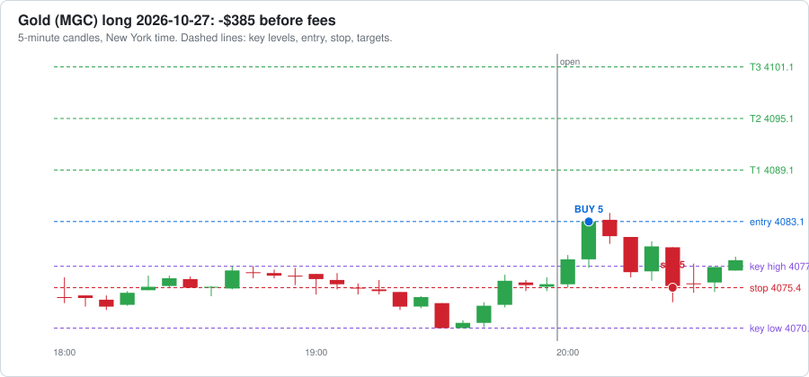

# Agent dashboard

Last updated 2026-10-27 21:32 New York time. Everything here is written by software and AI agents. It can be wrong, so check anything you plan to act on.

**[🪙 Open the Crypto Dashboard →](CRYPTO-DASHBOARD.md)** · **[𝕏 Open the X Brief Dashboard →](X-DASHBOARD.md)**

## Reminders

- ⏰ When your broker is connected: log every trade in trade-journal.md with a heading like `### Trade #1 | 2026-10-16` (swap the `__` in the template for the trade number) and keep the `- **Session:**` line, so the post-session reviewer can see your trades. Or ask Claude to build automatic trade logging into the paper trading agent.
- ⏰ Before trading real money: make this repo private (GitHub → Settings → Danger Zone → Change visibility). First run `git cherry-pick 0f7e3a2` so the paper trader checks less often and stays under GitHub's 2,000 free Actions minutes a month for private repos (it is public now to keep Actions free and unlimited).
- ⏰ 𝕏 **Turn on X auto-posting once @cashflowbrief00 gets traction:** 500+ followers, OR any post with 10,000+ views, OR 1,000+ views a day for a week (check the account's Analytics). Then tell Claude "turn on X auto-posting". It needs X API keys from developer.x.com (about $2.50-3/month for 5-6 posts a day, within the $25 AI budget) and X's "automated account" label.

[Edit reminders](REMINDERS.md)

## Agent status

| | Agent | What it does | Last ran | Runs |
|---|---|---|---|---|
| 🟢 | Market brief: nasdaq | Writes the brief before the New York session | 13 hours ago | weekdays about 7-8 AM New York time |
| 🟢 | Market brief: gold | Writes the brief before the Asia session | 2 hours ago | Sun-Thu evenings about 6-7 PM New York time |
| 🟢 | World news brief | Overnight news and today's events: politics, economy, war, trade | 17 hours ago | daily about 5-6 AM New York time |
| 🟢 | Crypto research brief | Pumping coins, whales, government and adoption news | 17 hours ago | daily about 5:30-6:30 AM New York time |
| 🟢 | Stock research brief | Movers, AI, nuclear, minerals, earnings dates and estimates | 38 hours ago | Mon, Wed, Fri about 6-7 AM New York time |
| 🟢 | Paper trader | Paper trades every session with your rules and runs a practice prop challenge | under an hour ago | after each session ends |
| 🟢 | Scorer | Checks each lean against what price did | 4 hours ago | after each session ends |

🟢 ran recently  🟡 a bit late  🔴 check it  ⚪ never ran

## 📒 Trade journal (paper)

- **Tradeify 50K evaluation: balance $49,610**, $1,610 above the drawdown floor, $3,390 to pass; today -$390, $860 left before the daily loss limit. [Details](paper-trading/summary.md)

Newest first. Times are New York time. Each sale shows contracts @ price, time. The 📈 link opens a chart of the trade; TV opens the same market on TradingView (add [the strategy](tradingview/breakout_strategy.pine) to see each trade marked).

| Date | Market | Side | Lots | Entry | Target 1 | Target 2 | Target 3 / out | Result | What could have gone better | See it |
|---|---|---|---|---|---|---|---|---|---|---|
| 2026-10-28 | Gold | long | 5 | 4083.1 @ 20:05 stop 4075.4 | – | – | stop: 5 @ 4075.4, 20:25 (-$385) | ❌ **-$390** out 20:25 | • Price never reached Target 1: the best it did was +1.00 points, and Target 1 needed 6. • The breakout failed and price kept going the other way, so the stop did its job and kept the loss small. • The entry was 5.20 points past the key level, chasing a stretched move. Waiting for a pullback toward the level would have meant a better price and a smaller risk. | [📈 chart](paper-trading/charts/2026-10-27-gold.svg) · [TV](https://www.tradingview.com/chart/?symbol=COMEX_MINI%3AMGC1%21&interval=5) |
| 2026-10-27 | Nasdaq | long | 5 | 29649.5 @ 09:40 stop 29581.25 | – | – | stop: 5 @ 29581.25, 09:45 (-$682) | ❌ **-$688** out 09:45 | • Price never reached Target 1: the best it did was +28.25 points, and Target 1 needed 30. • The breakout failed and price kept going the other way, so the stop did its job and kept the loss small. • The entry was 20.75 points past the key level, chasing a stretched move. Waiting for a pullback toward the level would have meant a better price and a smaller risk. • Fakeout re-entry (switched off): price closed back beyond the entry at 10:30; re-entering 3 contracts at 29652.0 (stop 29606.75) would have made $8. | [📈 chart](paper-trading/charts/2026-10-27-nasdaq.svg) · [TV](https://www.tradingview.com/chart/?symbol=CME_MINI%3AMNQ1%21&interval=5) |
| 2026-10-27 | Gold | – | 0 | no breakout, no trade | | | | $0 | No confirmed breakout in the first 60 minutes. Key high 4032.90, low 4017.30. | [TV](https://www.tradingview.com/chart/?symbol=COMEX_MINI%3AMGC1%21&interval=5) |
| 2026-10-26 | Nasdaq | – | 0 | no breakout, no trade | | | | $0 | No confirmed breakout in the first 60 minutes. Key high 29354.00, low 29156.75. | [TV](https://www.tradingview.com/chart/?symbol=CME_MINI%3AMNQ1%21&interval=5) |
| 2026-10-26 | Gold | short | 5 | 4001.5 @ 20:05 stop 4011.1 | 1 @ 3995.5, 21:00 ($60) | – | stop: 4 @ 4011.1, 21:15 (-$384) | ❌ **-$329** out 21:15 | • Target 1 paid $60, but the stop stayed at the start. Moving it to breakeven after Target 1 would have ended this trade at about $60 instead of -$324. | [📈 chart](paper-trading/charts/2026-10-25-gold.svg) · [TV](https://www.tradingview.com/chart/?symbol=COMEX_MINI%3AMGC1%21&interval=5) |
| 2026-10-23 | Nasdaq | long | 5 | 29169.25 @ 10:00 stop 29095.0 | – | – | stop: 5 @ 29095.0, 10:15 (-$742) | ❌ **-$748** out 10:15 | • Price never reached Target 1: the best it did was +16.75 points, and Target 1 needed 30. • After the stop, price turned and reached +156.75 points by 10:50. The stop (74.25 points from entry) was too tight: a stop just past the key level (29145.0) would have kept you in. • The entry was 24.25 points past the key level, chasing a stretched move. Waiting for a pullback toward the level would have meant a better price and a smaller risk. • Fakeout re-entry (switched off): price closed back beyond the entry at 10:35; re-entering 3 contracts at 29225.0 (stop 29141.75) would have made $357. | [📈 chart](paper-trading/charts/2026-10-23-nasdaq.svg) · [TV](https://www.tradingview.com/chart/?symbol=CME_MINI%3AMNQ1%21&interval=5) |
| 2026-10-23 | Gold | short | 5 | 4034.4 @ 20:30 stop 4037.1 | – | – | stop: 5 @ 4037.1, 20:45 (-$135) | ❌ **-$140** out 20:45 | • Price never reached Target 1: the best it did was +2.80 points, and Target 1 needed 6. • After the stop, price turned and reached +33.50 points by 22:00. The stop (2.70 points from entry) was too tight: a stop just past the key level (4036.0) would have kept you in. • Fakeout re-entry (switched off): price closed back beyond the entry at 21:00; re-entering 3 contracts at 4034.1 (stop 4045.5) would have made $357. | [📈 chart](paper-trading/charts/2026-10-22-gold.svg) · [TV](https://www.tradingview.com/chart/?symbol=COMEX_MINI%3AMGC1%21&interval=5) |
| 2026-10-22 | Nasdaq | short | 5 | 29359.0 @ 10:25 stop 29455.5 | 1 @ 29329.0, 10:30 ($60) | 2 @ 29299.0, 10:30 ($240) | 2 @ 29269.0, 10:45 ($360) | ✅ **$655** out 10:45 | • Price kept going 236.00 points past Target 3 (by 15:45). Letting the last 2 contract(s) run with a trailing stop could have made up to $944 more. | [📈 chart](paper-trading/charts/2026-10-22-nasdaq.svg) · [TV](https://www.tradingview.com/chart/?symbol=CME_MINI%3AMNQ1%21&interval=5) |
| 2026-10-22 | Gold | short | 5 | 4137.2 @ 20:15 stop 4143.1 | 1 @ 4131.2, 20:35 ($60) | 2 @ 4125.2, 21:25 ($240) | stop: 2 @ 4131.2, 21:30 ($120) | ✅ **$415** out 21:30 | • The last contracts were stopped at Target 1, then price reached Target 3 by 01:45. A looser stop after Target 2 would have caught it. | [📈 chart](paper-trading/charts/2026-10-21-gold.svg) · [TV](https://www.tradingview.com/chart/?symbol=COMEX_MINI%3AMGC1%21&interval=5) |
| 2026-10-21 | Nasdaq | short | 5 | 29818.5 @ 10:15 stop 29843.25 | – | – | stop: 5 @ 29843.25, 10:20 (-$248) | ❌ **-$252** out 10:20 | • Price never reached Target 1: the best it did was +25.75 points, and Target 1 needed 30. • The breakout failed and price kept going the other way, so the stop did its job and kept the loss small. | [📈 chart](paper-trading/charts/2026-10-21-nasdaq.svg) · [TV](https://www.tradingview.com/chart/?symbol=CME_MINI%3AMNQ1%21&interval=5) |
| 2026-10-21 | Gold | – | 0 | no breakout, no trade | | | | $0 | No confirmed breakout in the first 60 minutes. Key high 4149.80, low 4132.00. | [TV](https://www.tradingview.com/chart/?symbol=COMEX_MINI%3AMGC1%21&interval=5) |
| 2026-10-20 | Nasdaq | long | 5 | 29717.75 @ 10:05 stop 29604.0 | 1 @ 29747.75, 10:15 ($60) | 2 @ 29777.75, 10:15 ($240) | 2 @ 29807.75, 10:25 ($360) | ✅ **$655** out 10:25 | • Price kept going 95.75 points past Target 3 (by 10:30). Letting the last 2 contract(s) run with a trailing stop could have made up to $383 more. | [📈 chart](paper-trading/charts/2026-10-20-nasdaq.svg) · [TV](https://www.tradingview.com/chart/?symbol=CME_MINI%3AMNQ1%21&interval=5) |
| 2026-10-20 | Gold | short | 5 | 4150.6 @ 20:55 stop 4152.4 | 1 @ 4144.6, 21:00 ($60) | 2 @ 4138.6, 21:15 ($240) | stop: 2 @ 4144.6, 21:40 ($120) | ✅ **$415** out 21:40 | • Moving the stop to Target 1 after Target 2 locked in the profit; price never reached Target 3 afterwards. | [📈 chart](paper-trading/charts/2026-10-19-gold.svg) · [TV](https://www.tradingview.com/chart/?symbol=COMEX_MINI%3AMGC1%21&interval=5) |
| 2026-10-19 | Nasdaq | long | 3 | 29841.25 @ 10:15 stop 29694.0 | 1 @ 29871.25, 11:00 ($60) | 1 @ 29901.25, 11:15 ($120) | 1 @ 29931.25, 11:20 ($180) | ✅ **$357** out 11:20 | • Price kept going 52.25 points past Target 3 (by 11:35). Letting the last 1 contract(s) run with a trailing stop could have made up to $104 more. | [📈 chart](paper-trading/charts/2026-10-19-nasdaq.svg) · [TV](https://www.tradingview.com/chart/?symbol=CME_MINI%3AMNQ1%21&interval=5) |
| 2026-10-19 | Gold | – | 0 | no breakout, no trade | | | | $0 | No confirmed breakout in the first 60 minutes. Key high 4207.10, low 4191.10. | [TV](https://www.tradingview.com/chart/?symbol=COMEX_MINI%3AMGC1%21&interval=5) |

**Latest trade:**

[Full journal with every fill](paper-trading/paper-journal.md)

## 👔 CEO check

**❌ 1 broken rule(s)** ([read the full check](reports/ceo/latest.md))

<b>What the CEO checked</b>

##### Futures paper trader

- ❌ Tradeify practice evaluation failed: reset on 2026-10-28: only $96 above the floor, too close for any trade.
- ✅ Tradeify practice evaluation: $1,610 above the $2,000 trailing drawdown floor.

##### Your trade journal

- ✅ No trades logged yet, nothing to check.

##### Crypto bots

- ✅ Rotation bot: 8 trades, buys only at weekly checks, never more than 4 coins at once.
- ✅ Buy-and-hold bot has never sold.

##### Alpaca copy

- ✅ All 10 Alpaca orders were for the bot's coins and within the limit.

##### Costs

- ✅ Spent $5.33 so far this month on 44 AI runs; on pace for about $6 (budget $50).

##### Agent health

- ✅ Every research brief worked on its last run.

##### Ready to run on its own?

- ⏳ 8 of 15 trading days on the paper record
- ⏳ 1 rule problem(s) in the paper trader above
- ⏳ the Tradeify practice account never failed
- ⏳ the Tradeify practice evaluation has not passed yet
- ⏳ profit factor 0.98 (needs 1.3 or more), total $-50 over 11 trades
- ✅ worst trading day $-888 (needs $-1,250 or better)
- ⏳ You: Tradeify confirms in writing that TradersPost automation is allowed on the Select 50K
- ⏳ You: 2+ weeks of the live 50K alerts traded by hand with no rule broken
- ⏳ You + Claude: 2-3 sessions on a TradersPost paper account matching the chart

## 📅 Weekly report

<b>Week ending 2026-10-25</b>

#### The week in one look

- **Futures paper:** +$1,357 this week
- **Rotation bot:** -$23.91 this week
- **Buy-and-hold bot:** -$17.66 this week
- **AI costs:** $3.48 this week

#### Futures paper trading

- **This week:** +$1,357 after fees, 8 trades (5 wins, 3 losses), 2 sessions with no trade
- **Since paper trading began:** +$1,357 over 8 trades
- Nasdaq (MNQ): +$667 over 5 trades
- Gold (MGC): +$690 over 3 trades

| Day | Market | Side | Entry | Result |
|---|---|---|---|---|
| 2026-10-19 | nasdaq | long | 29841.25 at 10:15 | +$357 |
| 2026-10-20 | gold | short | 4150.6 at 20:55 | +$415 |
| 2026-10-20 | nasdaq | long | 29717.75 at 10:05 | +$655 |
| 2026-10-21 | nasdaq | short | 29818.5 at 10:15 | -$252 |
| 2026-10-22 | gold | short | 4137.2 at 20:15 | +$415 |
| 2026-10-22 | nasdaq | short | 29359.0 at 10:25 | +$655 |
| 2026-10-23 | gold | short | 4034.4 at 20:30 | -$140 |
| 2026-10-23 | nasdaq | long | 29169.25 at 10:00 | -$748 |

#### TradingView strategy

| Market | Export date | Forward test (since paper start) | Whole export |
|---|---|---|---|
| Nasdaq (MNQ) | 2026-10-18 | 0 trades, $0 | 25 trades, +$3,684, 56% wins |
| Gold (MGC) | 2026-10-18 | 0 trades, $0 | 22 trades, +$699, 32% wins |

Export the List of trades from each chart and say "update TradingView" to refresh these numbers.

#### Crypto paper bots

| Bot | Start of week | End of week | Change | Since it started ($1,000) |
|---|---|---|---|---|
| Rotation bot | $1,003.26 | $979.35 | -$23.91 (-2.4%) | -$20.65 |
| Buy-and-hold bot | $1,001.63 | $983.97 | -$17.66 (-1.8%) | -$16.03 |

Trades this week:

| Day | Bot | | Coin | Amount | Profit / loss |
|---|---|---|---|---|---|
| 2026-10-22 | Rotation bot | 🔴 Sell | AVAX | $186.17 | -$14.58 |
| 2026-10-22 | Rotation bot | 🔴 Sell | BCH | $198.91 | -$1.88 |
| 2026-10-22 | Rotation bot | 🔴 Sell | BTC | $199.02 | -$1.78 |
| 2026-10-22 | Rotation bot | 🔴 Sell | SUI | $198.38 | -$2.41 |

**Alpaca copy:** 3 order(s) this week: sell AVAX, sell BCH, sell BTC

#### Market briefs (Nasdaq and gold)

- 7 briefs scored; 2 gave a direction, 1 of those were right.
- 5 were Neutral.

#### CEO check

**❌ Rules were broken this week.** 25 checks ran. [Latest CEO check](../ceo/latest.md)

#### AI costs this week

| Agent | Runs | Cost |
|---|---|---|
| world-brief | 8 | $1.01 |
| crypto-brief | 7 | $0.81 |
| market-brief-nasdaq | 5 | $0.62 |
| market-brief-gold | 4 | $0.55 |
| stock-brief | 3 | $0.46 |
| review-gold | 1 | $0.03 |
| x-posts | 2 | $0.01 |
| **Total** | 30 | **$3.48** |

At this pace: about $15 a month.

[Main dashboard](../../DASHBOARD.md) · [Crypto dashboard](../../CRYPTO-DASHBOARD.md)

[All weekly reports](reports/weekly/)

## Paper trading

- Total after fees: **-$50** over 11 trades (15 sessions watched)
- Trading days with a trade: **8**, profitable: **3**, losing: 5
- Win rate: 45%
- Profit factor: 0.98
- Biggest drop from a high (max drawdown): $2,294
- Room left before the $4,000 max drawdown: **$1,706**
- Progress toward a prop demo: **8 of 20** trading days

<b>Challenge simulation, results by market, and daily results</b>

#### By market

| Market | Trades | Wins | Total after fees |
|---|---|---|---|
| nasdaq | 6 | 3 | -$20 |
| gold | 5 | 2 | -$29 |

#### Daily results

| Trading day | Sessions | Result after fees |
|---|---|---|
| 2026-10-28 | gold long | -$390 |
| 2026-10-27 | gold no trade, nasdaq long | -$688 |
| 2026-10-26 | gold short, nasdaq no trade | -$329 |
| 2026-10-23 | gold short, nasdaq long | -$888 |
| 2026-10-22 | gold short, nasdaq short | $1,070 |
| 2026-10-21 | gold no trade, nasdaq short | -$252 |
| 2026-10-20 | gold short, nasdaq long | $1,070 |
| 2026-10-19 | gold no trade, nasdaq long | $357 |

[Every paper trade](paper-journal.md) · [Raw data](trades.csv)

[Paper trading journal](paper-trading/paper-journal.md) · [TradingView strategy](tradingview/breakout_strategy.pine)

## 📈 TradingView strategy results

From the latest **List of trades** export of each chart. One trade = one entry (TradingView counts each target as a separate trade). Forward test = trades from 2026-10-19 on.

| Market | Export date | Trades | Wins / losses | Win rate | Total | Profit factor | Max drawdown | Forward test |
|---|---|---|---|---|---|---|---|---|
| Nasdaq (MNQ) | 2026-10-18 (trades since 2026-08-25) | 25 | 14 / 11 | 56% | **$3,684** | 1.99 | $1,066 | 0 trades, $0 |
| Gold (MGC) | 2026-10-18 (trades since 2026-08-24) | 22 | 7 / 15 | 32% | **$699** | 1.30 | $1,559 | 0 trades, $0 |
| **Both** | | 47 | 21 / 26 | 45% | **$4,384** | 1.72 | | |

<b>Latest 10 TradingView trades</b>

| Entry (New York) | Market | Side | Entry price | Contracts | Result |
|---|---|---|---|---|---|
| 2026-10-15 09:35 | Nasdaq (MNQ) | short | 29,830.00 | 5 | ❌ -$68 |
| 2026-10-14 20:05 | Gold (MGC) | short | 4,138.90 | 5 | ❌ -$105 |
| 2026-10-14 09:35 | Nasdaq (MNQ) | short | 30,578.50 | 5 | ❌ -$192 |
| 2026-10-13 09:35 | Nasdaq (MNQ) | short | 30,757.25 | 5 | ❌ -$20 |
| 2026-10-12 20:05 | Gold (MGC) | short | 4,187.60 | 5 | ✅ $420 |
| 2026-10-12 09:45 | Nasdaq (MNQ) | short | 30,969.50 | 5 | ✅ $660 |
| 2026-10-08 20:05 | Gold (MGC) | long | 4,168.70 | 5 | ❌ -$20 |
| 2026-10-07 20:05 | Gold (MGC) | short | 4,131.60 | 5 | ❌ -$250 |
| 2026-10-07 09:35 | Nasdaq (MNQ) | short | 31,180.50 | 5 | ❌ -$704 |
| 2026-10-06 20:05 | Gold (MGC) | long | 4,191.20 | 5 | ❌ -$8 |

To refresh: export the List of trades from each chart in TradingView, double-click `tradingview/update-exports.command`, then push in GitHub Desktop.

## Latest briefs

Click a brief to read it here. The summary is at the top of each.

<b>🌍 World news brief, 2026-10-27, event risk Medium</b>

#### Top things for today
1. **Iran diplomacy and oil.** Saudi, Pakistani and Turkish officials met Iranian leaders in Tehran on Monday and agreed to keep talking. Oil fell for a second day on hopes that the US-Iran war won't widen. Brent was near $114.81 early Tuesday. Houthi attacks on Saudi Arabia have continued in recent weeks. (CNBC, Bloomberg, Reuters via others) Why it matters: energy prices, inflation expectations and safe-haven demand.
2. **Trump and Rubio at a Venezuelan crude tanker.** The visit is in Port Arthur, Texas, the same day Trump campaigns in the state. He has rallies set for Corpus Christi and Lubbock. (AP) Why it matters: any Trump remarks on oil, Iran or Venezuela could move energy and the dollar.
3. **Fed decision is tomorrow, 2:00 PM.** The calendar forecast is no change at 4.00%. A Globe and Mail/Yahoo Finance headline says a new source of inflation has put Fed Chair Kevin Warsh and the FOMC in a bind (headline only). Why it matters: rates, the dollar and gold.
4. **CB Consumer Confidence at 10:00 AM.** The forecast is 81.2, down from 81.9. Why it matters: growth and rate expectations ahead of the Fed.
5. **Israel election.** The Jerusalem Post reports Netanyahu and Eisenkot are battling for power, and CBS News calls the race wide open (headline only). Why it matters: Middle East risk and safe-haven demand.

#### Today's schedule (New York time)
| Time | Event | Who or where | Confirmed? |
|---|---|---|---|
| Not announced | Trump and Rubio show off a Venezuelan crude tanker | Port Arthur, Texas | Reported by AP from anonymous officials; time (unconfirmed) |
| Not announced | Trump campaign rallies | Corpus Christi and Lubbock, Texas | Reported by AP; times (unconfirmed) |
| 10:00 AM | CB Consumer Confidence (forecast 81.2, previous 81.9) | USD | Yes |

Coming up this week:
- **Wed Oct 28:**
  - 8:30 AM: UK Annual Budget.
  - 9:45 AM: Bank of Canada Monetary Policy Report and rate statement. The overnight rate forecast is 2.50%, previous 2.25%.
  - 10:30 AM: BOC press conference.
  - 2:00 PM: FOMC rate decision and statement. The forecast is 4.00%, previous 4.00%.
  - 2:30 PM: FOMC press conference.
- **Thu Oct 29:**
  - 8:30 AM: Advance GDP, forecast 3.2% (previous 1.5%), and Core PCE m/m, forecast 0.3% (previous 0.2%).
  - 9:15 AM: ECB rate decision, forecast 2.65% (previous 2.65%), and policy statement.
  - 9:45 AM: ECB press conference.
  - 10:30 PM: BOJ policy rate (forecast below 1.25%, same as previous) and statement.
  - 10:31 PM: BOJ Outlook Report.
- **Fri Oct 30, 1:30 AM:** BOJ press conference.

#### Event risk today
Medium - Only one medium-impact US data release is scheduled, but Iran headlines and Trump's Texas appearances could move energy, and the Fed, BOC and UK Budget follow tomorrow.

#### Politics and policy
- **Trump and Rubio:** Rubio is also national security adviser. It is highly unusual for the top diplomat to join political travel. Trump is trying to shore up support for Senate candidate Ken Paxton, who is in a tight race with Democrat James Talarico. (AP)
- **Fed:** The Seattle Times ran "5 things to watch" from the Fed's next meeting (headline only). The Globe and Mail/Yahoo Finance piece on Warsh and inflation is noted above.
- **Midterms and courts:** The Washington Post says California ballots Trump targeted can be counted for now under a court ruling (headline only, Washington Post). The Post also reports a judge halted tree removal and set new limits on Trump's golf project (headline only).
- **Congress:** Bloomberg Government says a changing Congress threatens to challenge corporate leadership (headline only).
- **Overnight Trump remarks:** Nothing found in the sources.

#### Economics
Nothing found. The calendar lists no data released overnight. The World Economic Forum published "5 major challenges facing the global economy" (headline only).

#### SEC, CFTC and hearings
- **SEC:** Nothing in the last 2 days (official press releases).
- **CFTC:** The CFTC and the NBA signed an MOU on protecting the integrity of professional basketball (CFTC press release, Mon Oct 26, 10:00 AM). Gaming Intelligence says the NBA also signed integrity deals with Kalshi and Polymarket (headline only).
- **Crypto registration:** Crypto Economy says the CFTC is pushing its crypto exchange registration plan forward after the CLARITY Act stalled (headline only).
- **Kraken parent Payward:** FinanceFeeds says Payward plans to become the first CFTC-regulated HIP-3 deployer on Hyperliquid (headline only).
- **Hearings:** No Fed, Treasury, SEC or bank-official hearings found for today.

#### War, trade and tariffs
- **US-Iran war (ninth month):** Trump continues to weigh stepping up military operations against Tehran. (CNBC) Monday's settlements: Brent at $115.81 and WTI at $101.76. (CNBC) Brent's Friday close of $116.72 was its highest since April. October was the worst month for attacks on shipping in and near the Strait of Hormuz since 2017, per a think-tank cited by the source. Why it matters: oil, shipping costs and inflation.
- **Tehran talks:** Saudi Arabia said the visit aimed to open negotiating channels and prevent a return to military escalation. (Reuters via Oil & Gas Middle East) Al Jazeera reports the four countries agreed to continue talks (headline only).
- **Venezuela:** The Port Arthur event is tied to Venezuelan crude headed to Texas refineries. Why it matters: US crude supply and sanctions policy.
- **Trade:** TBS News carries a headline that Carney says the US is moving closer to Canada's trade demands as the midterms approach (headline only). I found no new tariff deadlines.

#### Country briefs
- **China:** TBS News headline: countries are caught between the US and China as AI rivalry intensifies (headline only).
- **European Union:** Reuters: European shares fell as HSBC weighed and France protests kept investors wary (headline only). The ECB decides Thursday.
- **United Kingdom:** The Annual Budget is due Wednesday at 8:30 AM (calendar). No other UK news found.
- **Japan:** The BOJ decision is Thursday at 10:30 PM, with the press conference Friday at 1:30 AM (calendar). The forecast is no change in the policy rate.
- **India:** Nothing found.
- **Russia:** Nothing found.
- **Canada:** The BOC decides Wednesday at 9:45 AM, with a forecast of 2.50% against 2.25% before (calendar). The Carney trade headline is noted above (headline only).

[Read the full brief with all the details](reports/news/2026-10-27-world-brief.md) · [All news briefs](reports/news/)

<b>🪙 Crypto brief, 2026-10-27</b>

#### Top things today
1. **Quack AI (Q) is up sharply with no confirmed catalyst.** The live data shows +66.6%. One report put the 24h gain near 261%, and I couldn't reconcile the two figures. Another report said no project announcement or listing could be verified (Finwire/Coincu). Why it matters: it is the biggest mover and looks like a supply-driven pump.
2. **Q has a token unlock coming.** An unlock of 241.28 million tokens is due on November 2, 2026. (Pluang) Why it matters: new supply is landing just after the spike.
3. **The CFTC is moving ahead without Congress.** Chairman Selig says a voluntary federal registration path for crypto exchanges is advancing, since no market-structure law has passed. (crypto.news, Oct 26) Why it matters: regulators are setting the rules while the CLARITY Act is stalled.
4. **The market is quiet and slightly lower.** BTC is $79,704 (-0.6% in 24h), and the Fear and Greed Index is 48 (neutral). Why it matters: there is no broad panic or euphoria behind the alt moves.
5. **Several unlocks hit this week.** About $211 million in unlocks is scheduled, with roughly $67 million on the busiest day. (TokenPost) Why it matters: supply pressure is concentrated on a few dates.

#### Coins to research
| Coin | 24h move | Why it is moving | Red flags |
|---|---|---|---|
| Quack AI (Q) | +66.6% | No confirmed catalyst. An earlier-October analysis pointed to a short squeeze. (AMBCrypto) | One report flagged 78% of volume as suspected wash trading and two accumulating wallets. (Pluang) The contract is mintable. Unlock on Nov 2. |
| Cap (CAP) | +30.1% | No news found | Pump with no news. $99.5M volume against a $154.8M market cap. |
| Infinity Ground (AIN) | +230.2% | No news found. It is an AI app-building token. (CoinMarketCap) | Rank 725, so a small cap. A pump with no news. |
| Provenance (HASH) | +15.1% | No news found | 24h volume is only $54.4K against a $442.8M market cap. |
| Osmosis (OSMO) | +10.8% | No news found | Rank 488, so a small cap. Trending, with no known catalyst. |
| Nillion (NIL) | +9.3% | No news found | Rank 427, so a small cap. Trending, with no known catalyst. |

#### Whale watch
No whale moves found. I found no moves of $10M or more within the last day.

For context, the most recent ones were older:
- Arkham said the Bitget hacker moved $19.48M in 52 transfers between Oct 21 and Oct 24.
- A dormant whale moved $377.6M of BTC on Oct 12. (The Block)

#### Government and regulation
- **CLARITY Act (US Senate):** Its cloture vote failed. (Cointelegraph) House Financial Services Chair French Hill hopes a bill can pass before the next Congress session in 2027. (Oct 7)
- **SEC and CFTC staffing:** Seven leadership seats are empty across both agencies. The SEC has only Atkins and Uyeda, and Selig is the CFTC's sole commissioner. (Cointelegraph, Oct 7)
- **SEC:** It proposed a rule that could remove a custody hurdle for advisers offering crypto. (Cointelegraph, date unclear)
- **CFTC:** The registration pathway would cover exchanges offering leveraged or financed retail crypto trading. A critic, Better Markets, says the CFTC is the "wrong agency" for retail crypto (Cointelegraph).
- **Other countries:** Cointelegraph headlines list Russia clearing its first crypto exchanges and custodians under a new law, and German regulators rejecting Bitcoin.de's MiCA application, which halted its trading. I didn't confirm dates or details.
- I found no low-profile bills or amendments.

#### Who is buying and adopting
Nothing found.

#### Next 7 days
Times in the sources weren't clearly in New York time, so I list dates only.

| Date | Event | Coin or topic |
|---|---|---|
| Oct 28 | Unlock worth $4.33M, 12.63% of circulating supply | SIGN |
| Oct 29 | 59.26M CARDS unlock, worth $17.57M | Collector Crypt (CARDS) |
| Oct 29 | Unlock of about $2.54M (BeInCrypto-style schedule, unconfirmed) | Midnight (NIGHT) |
| Oct 29 | Falcon Finance unlock of about $19.65M, 8.44% of market value (the TokenPost figure is $20.10M) | FF |
| Nov 1 | 13.15M SUI unlock (about $12.11M) | SUI |
| Nov 1 | Busiest unlock day of the week at $66.88M | Multiple tokens |
| Nov 2 | 241.28M token unlock (Pluang) | Quack AI (Q) |

I found no ETF deadlines or hearings.

[Read the full brief with all the details](reports/crypto/2026-10-27-crypto-brief.md) · [All crypto briefs](reports/crypto/)

<b>📈 Stocks brief, 2026-10-26</b>

#### Top things today
1. **Earnings and the Fed this week.** Futures were rising and oil was sliding as Wall Street prepared for big earnings and a Fed meeting on Tuesday and Wednesday (TheStreet). Markets see only a 10% chance of a hike at this meeting. Traders are watching for hints about December (TheStreet). Why it matters: it sets the tone for every name on your list.
2. **Big tech reports Wednesday and Thursday.** GOOGL and MSFT report Oct 28, and AMZN reports Oct 29. Investors are focused on capital spending plans (TheStreet). Why it matters: AI spending worries drove last week's losses.
3. **Neocloud stocks are under pressure.** Musk said more than 200 neocloud companies could collapse, and CoreWeave, Nebius and Iren fell (CNBC via TheStreet). CRWV is down 11.7% over 5 days. Why it matters: debt costs are the main worry in AI infrastructure.
4. **AT&T fell 8% on Friday on a SpaceX report.** News linked the drop to a report that SpaceX wants access to at least 80,000 US cell sites. T-Mobile fell 7.7% (Trefis). Why it matters: SpaceX (SPCX, $2.0T market cap) is now moving telecom stocks.
5. **Nuclear, uranium and miners all fell over 5 days.** CEG, VST, LEU, BWXT, SCCO and NEM each lost 6–11% (live data). Gold had its worst week since June as oil rose and rate-hike bets grew (Mining.com). Why it matters: the weakness is broad, not tied to one stock.

#### Stocks to research
| Ticker | Theme | Move | Why | Red flags |
|---|---|---|---|---|
| CRWV | AI | -2.5% 1D, -11.7% 5D | Debt worries, analyst target cuts (Bernstein, UBS, Morgan Stanley). Goldman upgraded it on Oct 19. | Leveraged and unprofitable. Insiders sold more than $470M over three months (MarketBeat). |
| NEM | Gold | -4.6% 1D, -8.2% 5D | Freedom Broker cut it to Hold on Oct 22, and gold fell about 4% on the week. | The 1-day drop is bigger than the news I found. |
| LEU | Nuclear | -10.9% 5D | Reports Nov 4. | Large drop with no news found. Revenue estimate is only $57.2M. |
| USAR | Rare earths | -3.1% 1D, -11.5% 5D | Reports Nov 5. | Small company with a tiny revenue estimate ($13.6M) and a loss expected. No news found. |
| RHI | Staffing | +21.7% | Q3 EPS of $0.49 beat the $0.47 estimate. Staffing revenue grew for the first time since 2022 (TIKR). | Q4 EPS guidance midpoint is below consensus. Valuation is higher after the jump. |
| SPCX | New stock (SpaceX) | +1.9% | Most active by volume, $2.0T market cap. Its Starlink plans are hitting telecom stocks (Trefis). | Newly listed. I found no listing details. |

#### AI and tech
- **Neocloud debt fears.** Bernstein cut its CoreWeave target to $51 and estimated it needs about $85B to fund its backlog. The stock closed down 10.1% on Oct 22 (Motley Fool). HSBC kept a $39 target. Goldman called the drop a buying chance (The Wealth Advisor).
- **Asia AI doubts.** South Korean stocks are down more than 40% from their June high on doubts about AI spending. SK Hynix and Samsung report this week (Kaohoon). Goldman cut its Kospi target to 9,000. Why it matters: it is a read-through for MU.
- **Mega-cap tech lagged.** META is down 9.4% and GOOGL down 6.0% over 5 days (live data). Both are hit by capital spending concerns (TheStreet).

#### Nuclear and critical minerals
- **Uranium supply news.** Namibia approved Bannerman's $353M Etango mine, with first production targeted for 2028 (Mining.com). The US also backed Global Atomic's Niger mine with a conditional $414M loan, reported Sept 25 (Northern Miner).
- **Gold weakness.** Bullion fell 4% last week, as oil-driven rate-hike bets built (Mining.com). NEM fell 4.6% on Friday.
- **Power demand.** On Oct 7, Google agreed to buy power from Constellation Energy, which lifted Australian uranium miners (Reuters via Mining Weekly). CEG reports Nov 9.
- Nothing new found on export limits or new US government deals today.

#### Earnings
**Results since yesterday:** Nothing found for the watchlist. Notable earlier reports:
- **RHI** (reported after the close Thursday): EPS of $0.49 vs. $0.47 expected, and revenue of $1.36B matched estimates. Shares jumped about 22% (Seeking Alpha, Investing.com).
- **T** (reported Wednesday): EPS of $0.65 vs. $0.60 expected, and revenue of $32.3B vs. $31.7B. It raised its 2026 outlook. Shares fell 6.4% that day on subscriber and competition worries, then fell 8% on Friday (Trefis).

| Date | Ticker | Timing | EPS est. | Revenue est. |
|---|---|---|---|---|
| 2026-10-27 | FCX | Not confirmed | $0.83 | $7.4B |
| 2026-10-28 | GOOGL | Not confirmed | $2.97 | $127.8B |
| 2026-10-28 | MSFT | Not confirmed | $4.72 | $90.8B |
| 2026-10-29 | AMZN | Not confirmed | $1.98 | $202.2B |
| 2026-10-30 | CCJ | Not confirmed | $0.27 | $753.9M |
| 2026-11-02 | AAPL | Not confirmed | $1.98 | $113.4B |
| 2026-11-02 | BWXT | Not confirmed | $1.19 | $972.3M |
| 2026-11-02 | PLTR | Not confirmed | $0.41 | $2.2B |
| 2026-11-03 | AMD | Not confirmed | $1.93 | $13.1B |
| 2026-11-03 | SMCI | Not confirmed | $1.20 | $16.3B |
| 2026-11-04 | ALB | Not confirmed | $2.52 | $1.5B |
| 2026-11-04 | ARM | Not confirmed | $0.48 | $1.4B |
| 2026-11-04 | LEU | Not confirmed | -$0.07 | $57.2M |
| 2026-11-05 | MP | Not confirmed | -$0.01 | $119.0M |
| 2026-11-05 | SMR | Not confirmed | -$0.12 | $3.8M |
| 2026-11-05 | USAR | Not confirmed | -$0.15 | $13.6M |
| 2026-11-06 | OKLO | Not confirmed | -$0.26 | $1.1M |
| 2026-11-06 | VST | Not confirmed | $3.01 | $6.9B |
| 2026-11-09 | CEG | Not confirmed | $3.74 | $9.3B |

#### Smart money
- **CRWV:** Morgan Stanley kept Equal-Weight and cut its target to $70 from $99 (GuruFocus). UBS cut its target to $105 and kept Buy (MarketBeat). Goldman upgraded it to Buy on Oct 19 (Briefs).
- **NEM:** Freedom Broker cut it from Buy to Hold on Oct 22 and lowered its target to $116 from $130 (GuruFocus).
- **CoreWeave insiders** sold about $472M of stock over three months, per MarketBeat. GuruFocus puts the figure at about $922M. The sources differ.
- No insider buying or congressional trades found in these themes.

[Read the full brief with all the details](reports/stocks/2026-10-26-stock-brief.md) · [All stocks briefs](reports/stocks/)

<b>📊 Nasdaq 100 futures market brief, 2026-10-27</b>

### Nasdaq 100 Futures Brief: Tuesday, Oct 27, 2026 (New York session)

#### 1. What is driving the market
- Futures rose Tuesday morning, with the AI trade, earnings and an upcoming Fed decision in focus. Nasdaq-100 contracts were up about 0.3%.
- Monday, the Nasdaq Composite gained 0.8% on strength in AI names. Chips bounced, with 57 of 60 stocks in a Yahoo Finance chip basket rising.
- The mood is cautious. On October 22 the Nasdaq had its worst day since June, as chip and tech stocks sold off. Meta fell nearly 7% on one day after its results, and the Philadelphia Semiconductor Index dropped 6.7%. The worry is AI spending.
- Futures got support from reports that Iran's supreme leader called for conditions to end the war.
- The Fed raised rates in September. It lifted the range by 25 basis points to 3.75%–4.00%.

#### 2. Scheduled events (New York time)
**Today:**
- 8:30 AM: September Durable Goods Orders (estimate +1.7%). This comes out before the open.
- 10:00 AM: Consumer Confidence (estimate 81.0), New Home Sales (estimate 650K) and the Richmond Fed Index. Some calendars list slightly different times for these. I used the most common ones.
- The Fed meeting starts today. No decision comes today.
- After the close: Visa, Seagate, Robinhood and NXP Semiconductors report.

**Tomorrow (Oct 28), just after this session:**
- The Fed decision is due at 2:00 PM ET. The chair's press conference usually follows at 2:30 PM. As of Oct 22, CME FedWatch showed about a 90.6% chance of no change.
- Microsoft and Alphabet report after the close on Wednesday. Amazon follows on Thursday.

#### 3. Key levels (from the price data)
- Latest price: 29602.75.
- Previous session high: 29572.00. Price is 30.75 above it.
- Previous session low: 29165.25. Close: 29439.50.
- Since that close: high 29613.00, low 29288.00.
- Highest high of the last 5 sessions: 30113.00.
- Lowest low of the last 5 sessions: 28987.00.

Price is sitting near resistance, 10.25 below the post-close high of 29613.00. It is just above the previous session high, which could now act as support. The upper range sits above price. The 5-session high of 30113.00 is the next reference.

#### 4. Volume
The previous session traded at 0.94x the average of the 5 sessions before it. That is slightly below average. Participation was a bit light, so the bounce was not backed by strong volume. The gap to average is small, so I would not read much into it.

#### 5. Directional lean
**Neutral, Low confidence.**
Price is above the previous high, which leans positive. Volume was slightly light, and price is pressed against the overnight high. The news also conflicts. Tech is bouncing, but traders are nervous about AI spending ahead of the Fed and big earnings. With signals mixed, Neutral is the fair call.

**What would change it:**
- *More bullish:* price holds above 29572.00 after the data and pushes through 29613.00 with rising volume.
- *More bearish:* price falls back below 29572.00 and then loses the 29288.00 overnight low.
- *Other triggers:* a surprise in the 8:30 AM data, or fresh headlines on Iran or AI spending.

This is a probability-based lean, not a prediction or a trade instruction.

#### 6. Event risk
**Medium.** Today has second-tier data and the first day of the Fed meeting. The biggest risks (the Fed decision and Microsoft and Alphabet earnings) land after today's close. They may still make traders cautious.

#### 7. Sources
- Yahoo Finance (market news and live blog)
- Quartz
- Investrade
- Kiplinger
- Saxo
- Spreadex
- Stock Titan
- Blofin
- TheStreet Pro
- Investing.com
- TradingKey
- Newsquawk
- fedratecalc.com

**Not verified:** exact release times for some data differ between calendars. I could not confirm the Fed's final decision, because it has not happened yet.

BIAS: Neutral | CONFIDENCE: Low

[Open the file](reports/2026-10-27-nasdaq-brief.md)

<b>📊 Gold futures market brief, 2026-10-27</b>

### Gold Futures Brief: Asia Session, Oct 27–28, 2026

#### 1. What is driving gold
- Gold fell below $4,000 on Friday, its lowest since mid-July, as rising oil lifted expectations that US rates stay higher for longer.
- US consumer and producer inflation both came in hotter than expected, mostly on energy costs.
- CFTC data show eight straight weeks of speculative selling in Comex gold.
- Gold bounced on Tuesday. Kitco reported a session high near $4,048 after consumer confidence rose to 91.7.
- Traders are positioning before the Fed. Standard Chartered said gold needs to establish a floor, with higher oil and possible further rate tightening weighing on it.

#### 2. Scheduled events (New York time)
- **Tonight, during the Asia session:** I found no verified major release or central bank speaker. I could not confirm any Tokyo-hours data.
- **Wed Oct 28, 2:00 PM:** The Fed is expected to hold at 3.75%–4.00%. Chair Warsh's press conference follows at 2:30 PM. This is after the session ends at 4:00 AM, so it is a risk the market may position for, not one inside your window.
- FedWatch showed an 88% chance of no change. The Fed has said it plans to raise rates again in 2026. The tone on December matters more than the hold.
- **Thu Oct 29, 8:30 AM:** Q3 GDP and September PCE and core PCE.
- **Fri Oct 30:** The Bank of Japan decision is likely a hold, but a December hike is in play. The BoJ gives no set time. The decision usually comes around midday Tokyo.

#### 3. Key levels (from price data)
- Latest price: **4075.50**.
- Previous Asia session high: **4038.90**. Low: **4009.60**. Close: **4010.80**.
- Since that close: high **4079.40**, low **4001.60**.
- Highest high of the last 5 Asia sessions: **4147.70**. Lowest low: **3990.90**.
- Price is **36.60 above** the previous session high. It sits about 3.90 below the 4079.40 post-close high, so it is **near resistance**. The nearest support is the previous session high at 4038.90, which price is now above.

#### 4. Volume
The previous session traded **0.69x** the average of the five sessions before it. That is weak participation. The quiet session ended near its lows. The later bounce did not come from heavy Asia-session buying. Moves in thin conditions may not hold.

#### 5. Directional lean
**Neutral, Low confidence.** Price is above the previous high, which leans bullish. But it is pressing against the 4079.40 post-close high. The last Asia session had weak volume, so there is little proof of buyer commitment. The news is mixed. Oil and inflation pressure still weigh on gold, and a Fed decision is due hours after the session ends. These signals conflict, so I stay neutral. I would turn more bullish if price holds above 4038.90 and pushes through 4079.40 with stronger volume. I would turn more bearish if price falls back below 4038.90 and then 4009.60. Hawkish Fed news from this week would also push me that way. This is a probability-based lean, not a prediction or a trade instruction.

#### 6. Event risk
**Medium.** No major release is verified inside the session, but the Fed decision comes about ten hours after it closes, and the BoJ decision is also this week.

#### 7. Sources
- Yahoo Finance (price data and gold news)
- Kitco
- Kiplinger
- Trading Economics
- BullionVault
- Techyorker (Fed expectations)
- Rio Times
- TradersWeek (BoJ timing)

I could not verify any Tokyo-hours data releases for tonight.

BIAS: Neutral | CONFIDENCE: Low

[Open the file](reports/2026-10-27-gold-brief.md)

## Latest lean for each market

| Market | Brief written | Lean | Confidence | Event risk | Price then | Full brief |
|---|---|---|---|---|---|---|
| nasdaq | 2026-10-27 08:34 | ◆ Neutral | Low | Medium | 29602.75 | [read it](reports/2026-10-27-nasdaq-brief.md) |
| gold | 2026-10-27 19:22 | ◆ Neutral | Low | Medium | 4075.50 | [read it](reports/2026-10-27-gold-brief.md) |

A lean is a probability-based view, not a prediction. ▲ Bullish  ▼ Bearish  ◆ Neutral

## Scorecard

- Briefs scored: **13** (Bullish or Bearish calls: 2)
- Right: 1, Wrong: 1, Session ended flat: 0
- Hit rate when the session was decisive: **50%**
- For comparison, price went up in 58% of decisive sessions
- ⚠️ Only 2 directional calls so far. Treat the numbers as noise until there are at least 30.

By confidence:

| Confidence | Right | Wrong | Flat | Hit rate |
|---|---|---|---|---|
| High | 0 | 0 | 0 | n/a |
| Medium | 1 | 0 | 0 | 100% |
| Low | 0 | 1 | 0 | 0% |

[Full scorecard](reports/scorecard.md)

## Charts

## Recent results

| Brief | Market | Lean | Confidence | Session moved | Result |
|---|---|---|---|---|---|
| 2026-10-27 | nasdaq | ◆ Neutral | Low | Up (0.85%) | Moved |
| 2026-10-26 | nasdaq | ◆ Neutral | Low | Up (0.85%) | Moved |
| 2026-10-23 | nasdaq | ◆ Neutral | Low | Up (0.32%) | Moved |
| 2026-10-22 | gold | ▼ Bearish | Medium | Down (-0.31%) | Right |
| 2026-10-21 | gold | ◆ Neutral | Low | Down (-0.94%) | Moved |
| 2026-10-21 | nasdaq | ◆ Neutral | Low | Up (0.41%) | Moved |
| 2026-10-20 | gold | ◆ Neutral | Low | Up (0.24%) | Moved |
| 2026-10-20 | nasdaq | ▼ Bearish | Low | Up (0.32%) | Wrong |
| 2026-10-19 | nasdaq | ◆ Neutral | Low | Flat (-0.19%) | Calm |
| 2026-10-18 | gold | ◆ Neutral | Low | Down (-0.29%) | Moved |

## Your journals

- Trades logged: **0**. [Open the trade journal](trade-journal.md)
- No-trade sessions explained: **3**. [Open the no-trade journal](no-trade-journal.md)

<b>Latest no-trade sessions</b>

##### No-trade session | 2026-10-18 | Asia
- **Instrument:** Gold futures
- **What happened:** No signal. The rules gave no entry.
- **Why:** No 5-minute candle closed above the previous high (4211.20) or below the previous low (4167.50) in the first 30 minutes after the 20:00 open. (Previous Asia session was 2026-10-15.)
- **First 30 minutes, candle by candle:**
  - 20:00 candle: close 4205.50, closed inside the range (5.70 below the high, 38.00 above the low).
  - 20:05 candle: close 4204.40, closed inside the range (6.80 below the high, 36.90 above the low).
  - 20:10 candle: close 4201.70, closed inside the range (9.50 below the high, 34.20 above the low).
  - 20:15 candle: close 4199.00, closed inside the range (12.20 below the high, 31.50 above the low).
  - 20:20 candle: close 4196.40, closed inside the range (14.80 below the high, 28.90 above the low).
  - 20:25 candle: close 4196.00, closed inside the range (15.20 below the high, 28.50 above the low).
- **Closest call:** Price got within 2.80 of the previous high (its highest point was 4208.40) but never reached it.
- **After the window:** No candle closed beyond either level for the rest of the session.
- **What the market was showing:** The session range was 25.60 points, 60% of the average of the last 5 (a quiet session). Open to close it moved -12.30 points (-0.29%).
- **The morning brief said:** Neutral (Low confidence), event risk Medium.
- **Verdict:** Consistent with your rules. There was no setup, so staying out was correct under the rules.
- **Your notes:**

##### No-trade session | 2026-10-16 | New York
- **Instrument:** Nasdaq 100 futures
- **What happened:** No signal. The rules gave no entry.
- **Why:** No 5-minute candle closed above the previous high (30196.75) or below the previous low (29622.50) in the first 15 minutes after the 09:30 open. (Previous New York session was 2026-10-15.)
- **First 15 minutes, candle by candle:**
  - 09:30 candle: close 29969.75, closed inside the range (227.00 below the high, 347.25 above the low).
  - 09:35 candle: close 29895.25, closed inside the range (301.50 below the high, 272.75 above the low).
  - 09:40 candle: close 29936.25, closed inside the range (260.50 below the high, 313.75 above the low).
- **Closest call:** Price got within 151.00 of the previous high (its highest point was 30045.75) but never reached it.
- **After the window:** A candle first closed below the previous low at 12:45, but that was after the 15-minute window, so the rules did not allow an entry.
- **What the market was showing:** The session range was 777.00 points, 219% of the average of the last 5 (a busy session). Open to close it moved -644.75 points (-2.15%).
- **The morning brief said:** Neutral (Low confidence), event risk Medium.
- **Verdict:** Consistent with your rules. There was no setup, so staying out was correct under the rules.
- **Your notes:**

##### No-trade session | 2026-10-15 | Asia
- **Instrument:** Gold futures
- **What happened:** No signal. The rules gave no entry.
- **Why:** No 5-minute candle closed above the previous high (4183.30) or below the previous low (4152.70) in the first 15 minutes after the 21:00 open. (Previous Asia session was 2026-10-14.)
- **First 15 minutes, candle by candle:**
  - 21:00 candle: close 4176.50, closed inside the range (6.80 below the high, 23.80 above the low).
  - 21:05 candle: close 4178.00, closed inside the range (5.30 below the high, 25.30 above the low).
  - 21:10 candle: close 4178.50, closed inside the range (4.80 below the high, 25.80 above the low).
- **Closest call:** Price got within 1.60 of the previous high (its highest point was 4181.70) but never reached it.
- **After the window:** A candle first closed above the previous high at 22:30, but that was after the 15-minute window, so the rules did not allow an entry.
- **What the market was showing:** The session range was 43.70 points, 98% of the average of the last 5 (a normal session). Open to close it moved +33.70 points (+0.81%).
- **The morning brief said:** Neutral (Low confidence), event risk High.
- **Verdict:** Consistent with your rules. There was no setup, so staying out was correct under the rules.
- **Your notes:**

## Still to build

| Agent | Purpose | Status |
|---|---|---|
| Product selling agent (separate repo) | Main Agent from your Obsidian notes: what to sell, sourcing, advertising | ⚪ not built yet |
| Live demo trading | Sends the TradingView strategy's orders to a Tradovate demo or prop challenge account, behind a risk gatekeeper | ⚪ not built yet |

## Links

- [All reports](reports/)
- [Trading rules](trading-rules.md)
- [Bias log](reports/bias-log.csv)
