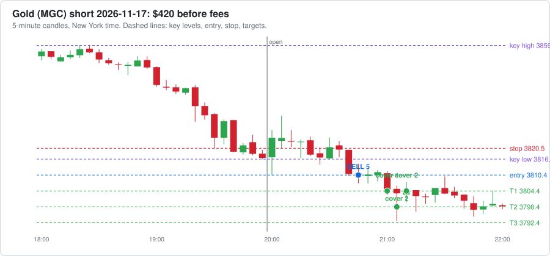
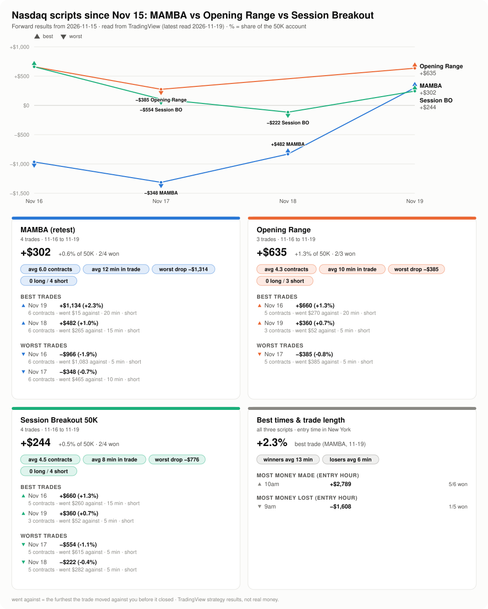
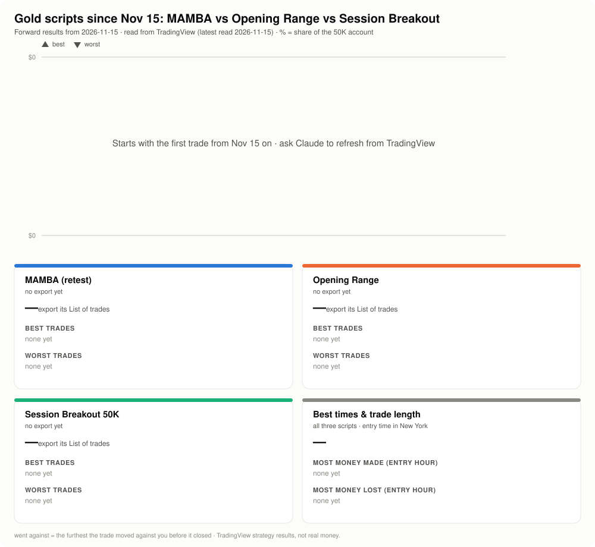
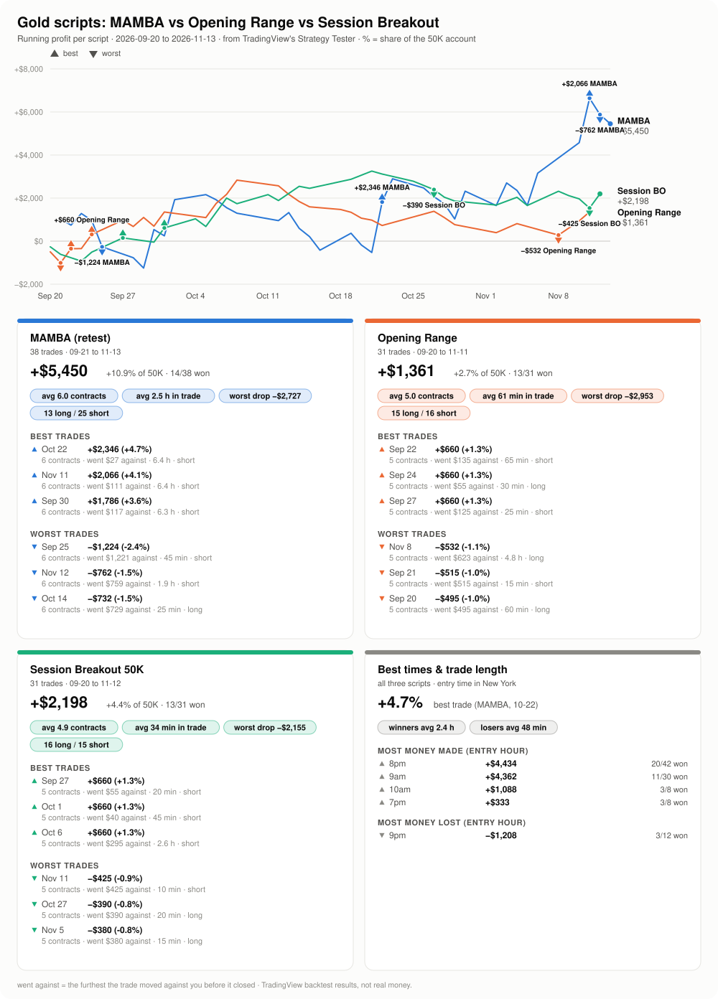
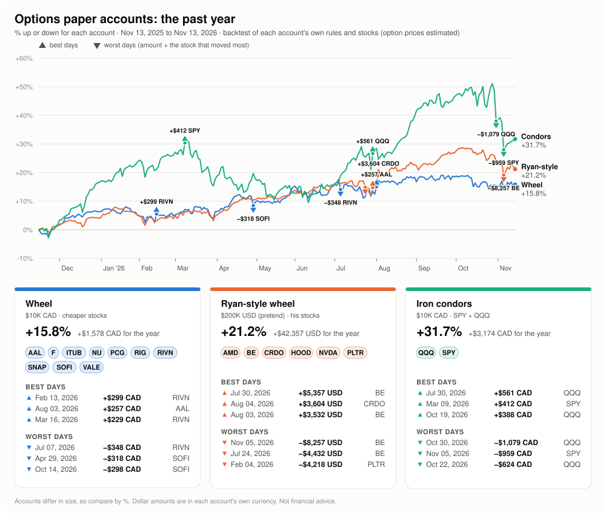
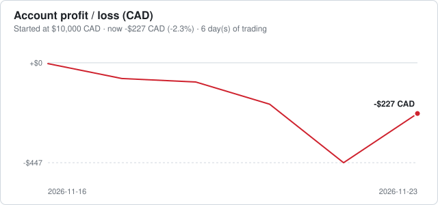
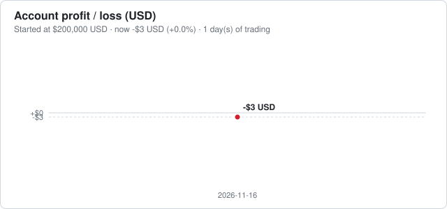
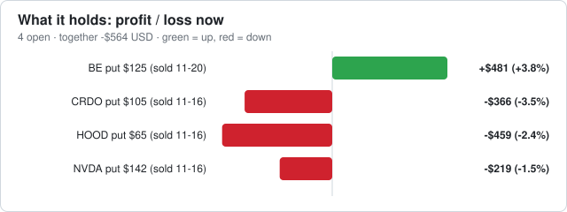
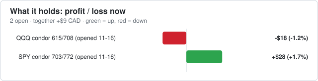
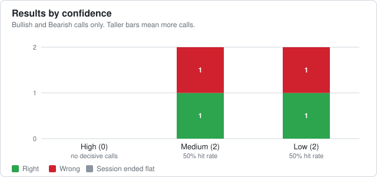

# Agent dashboard

Last updated 2026-11-17 22:42 New York time. Everything here is written by software and AI agents. It can be wrong, so check anything you plan to act on.

**[🪙 Open the Crypto Dashboard →](CRYPTO-DASHBOARD.md)** · **[𝕏 Open the X Brief Dashboard →](X-DASHBOARD.md)**

## Reminders

- ⏰ When your broker is connected: log every trade in trade-journal.md with a heading like `### Trade #1 | 2026-10-16` (swap the `__` in the template for the trade number) and keep the `- **Session:**` line, so the post-session reviewer can see your trades. Or ask Claude to build automatic trade logging into the paper trading agent.
- ⏰ Before trading real money: make this repo private (GitHub → Settings → Danger Zone → Change visibility). First run `git cherry-pick 0f7e3a2` so the paper trader checks less often and stays under GitHub's 2,000 free Actions minutes a month for private repos (it is public now to keep Actions free and unlimited).
- ⏰ 𝕏 **Turn on X auto-posting once @cashflowbrief00 gets traction:** 500+ followers, OR any post with 10,000+ views, OR 1,000+ views a day for a week (check the account's Analytics). Then tell Claude "turn on X auto-posting". It needs X API keys from developer.x.com (about $2.50-3/month for 5-6 posts a day, within the $25 AI budget) and X's "automated account" label.

[Edit reminders](REMINDERS.md)

## Agent status

| | Agent | What it does | Last ran | Runs |
|---|---|---|---|---|
| 🟢 | Market brief: nasdaq | Writes the brief before the New York session | 7 hours ago | weekdays about 7-8 AM New York time |
| 🟢 | Market brief: gold | Writes the brief before the Asia session | 23 hours ago | Sun-Thu evenings about 6-7 PM New York time |
| 🟢 | World news brief | Overnight news and today's events: politics, economy, war, trade | 10 hours ago | daily about 5-6 AM New York time |
| 🟢 | Crypto research brief | Pumping coins, whales, government and adoption news | 10 hours ago | daily about 5:30-6:30 AM New York time |
| 🟢 | Stock research brief | Movers, AI, nuclear, minerals, earnings dates and estimates | 41 hours ago | Mon, Wed, Fri about 6-7 AM New York time |
| 🟢 | Paper trader | Paper trades every session with your rules and runs a practice prop challenge | under an hour ago | after each session ends |
| 🟢 | Scorer | Checks each lean against what price did | under an hour ago | after each session ends |

🟢 ran recently  🟡 a bit late  🔴 check it  ⚪ never ran

## 📒 Trade journal (paper)

- **Tradeify 50K evaluation: balance $50,392**, $1,268 above the drawdown floor, $2,608 to pass; today $415, $1,665 left before the daily loss limit. [Details](paper-trading/summary.md)
- 📐 Opening range (9:30-10:00, tracked, not traded): $1,605 over 11 trades in 12 sessions since 2026-11-02, vs -$2,838 for the real Nasdaq rule (ahead). [Details](paper-trading/summary.md)

Newest first. Times are New York time. Each sale shows contracts @ price, time. The 📈 link opens a chart of the trade; TV opens the same market on TradingView (add [the strategy](tradingview/breakout_strategy.pine) to see each trade marked).

| Date | Market | Side | Lots | Entry | Target 1 | Target 2 | Target 3 / out | Result | What could have gone better | See it |
|---|---|---|---|---|---|---|---|---|---|---|
| 2026-11-18 | Gold | short | 5 | 3810.4 @ 20:45<br>stop 3820.5 | 1 @ 3804.4, 21:00 ($60) | 2 @ 3798.4, 21:05 ($240) | stop: 2 @ 3804.4, 21:10 ($120) | ✅ **$415**<br>out 21:10 | • Moving the stop to Target 1 after Target 2 locked in the profit; price never reached Target 3 afterwards. | [📈 chart](paper-trading/charts/2026-11-17-gold.svg) · [TV](https://www.tradingview.com/chart/?symbol=COMEX_MINI%3AMGC1%21&interval=5) |
| 2026-11-17 | Nasdaq | short | 5 | 27266.75 @ 09:35<br>stop 27342.5 | – | – | stop: 5 @ 27342.5, 09:40 (-$758) | ❌ **-$762**<br>out 09:40 | • Price never reached Target 1: the best it did was +46.00 points, and Target 1 needed 30.<br>• After the stop, price turned and reached +608.25 points by 10:50. The stop (75.75 points from entry) was too tight: a stop just past the key level (27319.0) would have kept you in.<br>• The entry was 52.25 points past the key level, chasing a stretched move. Waiting for a pullback toward the level would have meant a better price and a smaller risk.<br>• Fakeout re-entry (switched off): price closed back beyond the entry at 09:50; re-entering 3 contracts at 27247.25 (stop 27278.25) would have made -$189. | [📈 chart](paper-trading/charts/2026-11-17-nasdaq.svg) · [TV](https://www.tradingview.com/chart/?symbol=CME_MINI%3AMNQ1%21&interval=5) |
| 2026-11-17 | Gold | short | 5 | 3849.2 @ 20:20<br>stop 3856.8 | – | – | stop: 5 @ 3856.8, 20:35 (-$380) | ❌ **-$385**<br>out 20:35 | • Price never reached Target 1: the best it did was +3.30 points, and Target 1 needed 6.<br>• The breakout failed and price kept going the other way, so the stop did its job and kept the loss small.<br>• The entry was 5.00 points past the key level, chasing a stretched move. Waiting for a pullback toward the level would have meant a better price and a smaller risk. | [📈 chart](paper-trading/charts/2026-11-16-gold.svg) · [TV](https://www.tradingview.com/chart/?symbol=COMEX_MINI%3AMGC1%21&interval=5) |
| 2026-11-16 | Nasdaq | short | 3 | 27437.0 @ 10:00<br>stop 27644.75 | 1 @ 27407.0, 10:05 ($60) | 1 @ 27377.0, 10:05 ($120) | stop: 1 @ 27407.0, 10:10 ($60) | ✅ **$237**<br>out 10:10 | • The last contracts were stopped at Target 1, then price reached Target 3 by 13:35. A looser stop after Target 2 would have caught it. | [📈 chart](paper-trading/charts/2026-11-16-nasdaq.svg) · [TV](https://www.tradingview.com/chart/?symbol=CME_MINI%3AMNQ1%21&interval=5) |
| 2026-11-16 | Gold | short | 5 | 3875.3 @ 20:05<br>stop 3893.1 | 1 @ 3869.3, 21:00 ($60) | 2 @ 3863.3, 00:45 ($240) | 2 @ 3857.3, 00:45 ($360) | ✅ **$655**<br>out 00:45 | • Price kept going 22.10 points past Target 3 (by 00:55). Letting the last 2 contract(s) run with a trailing stop could have made up to $442 more. | [📈 chart](paper-trading/charts/2026-11-15-gold.svg) · [TV](https://www.tradingview.com/chart/?symbol=COMEX_MINI%3AMGC1%21&interval=5) |
| 2026-11-13 | Nasdaq | short | 3 | 28266.0 @ 09:35<br>stop 28399.0 | 1 @ 28236.0, 09:40 ($60) | 1 @ 28206.0, 09:40 ($120) | stop: 1 @ 28236.0, 09:45 ($60) | ✅ **$237**<br>out 09:45 | • The last contracts were stopped at Target 1, then price reached Target 3 by 10:00. A looser stop after Target 2 would have caught it. | [📈 chart](paper-trading/charts/2026-11-13-nasdaq.svg) · [TV](https://www.tradingview.com/chart/?symbol=CME_MINI%3AMNQ1%21&interval=5) |
| 2026-11-13 | Gold | long | 5 | 3886.5 @ 18:50<br>stop 3882.3 | 1 @ 3892.5, 19:05 ($60) | 2 @ 3898.5, 20:15 ($240) | 2 @ 3904.5, 20:15 ($360) | ✅ **$655**<br>out 20:15 | • Price kept going 15.90 points past Target 3 (by 20:20). Letting the last 2 contract(s) run with a trailing stop could have made up to $318 more. | [📈 chart](paper-trading/charts/2026-11-12-gold.svg) · [TV](https://www.tradingview.com/chart/?symbol=COMEX_MINI%3AMGC1%21&interval=5) |
| 2026-11-12 | Nasdaq | – | 0 | skipped: risk too big | | | | $0 | Breakout long at 09:40, but even the small size risked $808 and only $589 could be lost today without breaking the daily loss limit or the drawdown, so it was skipped. | [TV](https://www.tradingview.com/chart/?symbol=CME_MINI%3AMNQ1%21&interval=5) |
| 2026-11-12 | Gold | long | 5 | 4004.4 @ 20:15<br>stop 3997.4 | – | – | stop: 5 @ 3997.4, 20:30 (-$350) | ❌ **-$355**<br>out 20:30 | • Price never reached Target 1: the best it did was +0.70 points, and Target 1 needed 6.<br>• The breakout failed and price kept going the other way, so the stop did its job and kept the loss small.<br>• The entry was 3.70 points past the key level, chasing a stretched move. Waiting for a pullback toward the level would have meant a better price and a smaller risk. | [📈 chart](paper-trading/charts/2026-11-11-gold.svg) · [TV](https://www.tradingview.com/chart/?symbol=COMEX_MINI%3AMGC1%21&interval=5) |
| 2026-11-11 | Nasdaq | short | 5 | 28246.75 @ 09:45<br>stop 28362.0 | 1 @ 28216.75, 09:50 ($60) | – | stop: 4 @ 28362.0, 10:25 (-$922) | ❌ **-$867**<br>out 10:25 | • Target 1 paid $60, but the stop stayed at the start. Moving it to breakeven after Target 1 would have ended this trade at about $60 instead of -$862.<br>• The entry was 65.00 points past the key level, chasing a stretched move. Waiting for a pullback toward the level would have meant a better price and a smaller risk. | [📈 chart](paper-trading/charts/2026-11-11-nasdaq.svg) · [TV](https://www.tradingview.com/chart/?symbol=CME_MINI%3AMNQ1%21&interval=5) |
| 2026-11-11 | Gold | long | 5 | 4055.3 @ 20:35<br>stop 4043.7 | 1 @ 4061.3, 00:10 ($60) | 2 @ 4067.3, 00:30 ($240) | 2 @ 4073.3, 00:30 ($360) | ✅ **$655**<br>out 00:30 | • Clean trade: price stalled near Target 3, so taking the full profit there was right. | [📈 chart](paper-trading/charts/2026-11-10-gold.svg) · [TV](https://www.tradingview.com/chart/?symbol=COMEX_MINI%3AMGC1%21&interval=5) |
| 2026-11-10 | Nasdaq | long | 3 | 28049.75 @ 10:00<br>stop 27868.75 | 1 @ 28079.75, 10:05 ($60) | – | stop: 2 @ 27868.75, 10:35 (-$724) | ❌ **-$667**<br>out 10:35 | • Target 1 paid $60, but the stop stayed at the start. Moving it to breakeven after Target 1 would have ended this trade at about $60 instead of -$664.<br>• The entry was 52.25 points past the key level, chasing a stretched move. Waiting for a pullback toward the level would have meant a better price and a smaller risk. | [📈 chart](paper-trading/charts/2026-11-10-nasdaq.svg) · [TV](https://www.tradingview.com/chart/?symbol=CME_MINI%3AMNQ1%21&interval=5) |
| 2026-11-10 | Gold | – | 0 | no breakout, no trade | | | | $0 | No confirmed breakout in the first 60 minutes. Key high 4156.20, low 4130.80. | [TV](https://www.tradingview.com/chart/?symbol=COMEX_MINI%3AMGC1%21&interval=5) |
| 2026-11-09 | Nasdaq | – | 0 | skipped: risk too big | | | | $0 | Breakout long at 09:35, but even the small size risked $1,467 and only $1,073 could be lost today without breaking the daily loss limit or the drawdown, so it was skipped. | [TV](https://www.tradingview.com/chart/?symbol=CME_MINI%3AMNQ1%21&interval=5) |
| 2026-11-09 | Gold | long | 5 | 4115.0 @ 20:15<br>stop 4111.7 | 1 @ 4121.0, 20:25 ($60) | – | stop: 4 @ 4111.7, 20:30 (-$132) | ❌ **-$77**<br>out 20:30 | • Target 1 paid $60, but the stop stayed at the start. Moving it to breakeven after Target 1 would have ended this trade at about $60 instead of -$72.<br>• Fakeout re-entry (switched off): price closed back beyond the entry at 20:35; re-entering 3 contracts at 4119.3 (stop 4112.9) would have made $357. | [📈 chart](paper-trading/charts/2026-11-08-gold.svg) · [TV](https://www.tradingview.com/chart/?symbol=COMEX_MINI%3AMGC1%21&interval=5) |

**Latest trade:**



[Full journal with every fill](paper-trading/paper-journal.md)

## 👔 CEO check

**❌ 2 broken rule(s)** ([read the full check](reports/ceo/latest.md))

<details>
<summary><b>What the CEO checked</b></summary>

##### Futures paper trader

- ❌ Tradeify practice evaluation failed: reset on 2026-10-28: only $96 above the floor, too close for any trade.
- ❌ Tradeify practice evaluation failed: reset on 2026-11-02: only $299 above the floor, too close for any trade.
- ✅ Tradeify practice evaluation: $1,268 above the $2,000 trailing drawdown floor.

##### Your trade journal

- ✅ No trades logged yet, nothing to check.

##### Crypto bots

- ✅ Rotation bot: 8 trades, buys only at weekly checks, never more than 4 coins at once.
- ✅ Buy-and-hold bot has never sold.

##### Alpaca copy

- ✅ All 10 Alpaca orders were for the bot's coins and within the limit.

##### Costs

- ✅ Spent $10.46 so far this month on 93 AI runs; on pace for about $18 (budget $50).

##### Agent health

- ✅ Every research brief worked on its last run.

##### Ready to run on its own?

- ✅ 23 of 15 trading days on the paper record
- ⏳ 2 rule problem(s) in the paper trader above
- ⏳ the Tradeify practice account never failed
- ⏳ the Tradeify practice evaluation has not passed yet
- ⏳ profit factor 0.88 (needs 1.3 or more), total $-968 over 30 trades
- ✅ worst trading day $-1,148 (needs $-1,250 or better)
- ⏳ You: Tradeify confirms in writing that TradersPost automation is allowed on the Select 50K
- ⏳ You: 2+ weeks of the live 50K alerts traded by hand with no rule broken
- ⏳ You + Claude: 2-3 sessions on a TradersPost paper account matching the chart

</details>

## 📅 Weekly report

<details>
<summary><b>Week ending 2026-11-15</b></summary>

#### The week in one look

- **Futures paper:** -$419 this week
- **Rotation bot:** $0.00 this week
- **Buy-and-hold bot:** -$145.27 this week
- **AI costs:** $4.14 this week

#### Futures paper trading

- **This week:** -$419 after fees, 7 trades (3 wins, 4 losses), 3 sessions with no trade
- **Since paper trading began:** -$1,128 over 25 trades
- Nasdaq (MNQ): -$1,297 over 3 trades
- Gold (MGC): +$878 over 4 trades

| Day | Market | Side | Entry | Result |
|---|---|---|---|---|
| 2026-11-09 | gold | long | 4115.0 at 20:15 | -$77 |
| 2026-11-10 | nasdaq | long | 28049.75 at 10:00 | -$667 |
| 2026-11-11 | gold | long | 4055.3 at 20:35 | +$655 |
| 2026-11-11 | nasdaq | short | 28246.75 at 09:45 | -$867 |
| 2026-11-12 | gold | long | 4004.4 at 20:15 | -$355 |
| 2026-11-13 | gold | long | 3886.5 at 18:50 | +$655 |
| 2026-11-13 | nasdaq | short | 28266.0 at 09:35 | +$237 |

#### TradingView strategy

| Market | Export date | Forward test (since paper start) | Whole export |
|---|---|---|---|
| Nasdaq (MNQ) | 2026-10-18 | 0 trades, $0 | 25 trades, +$3,684, 56% wins |
| Gold (MGC) | 2026-10-18 | 0 trades, $0 | 22 trades, +$699, 32% wins |

Export the List of trades from each chart and say "update TradingView" to refresh these numbers.

#### Crypto paper bots

| Bot | Start of week | End of week | Change | Since it started ($1,000) |
|---|---|---|---|---|
| Rotation bot | $979.35 | $979.35 | $0.00 (+0.0%) | -$20.65 |
| Buy-and-hold bot | $876.58 | $731.31 | -$145.27 (-16.6%) | -$268.69 |

**Alpaca copy:** 0 order(s) this week.

#### Market briefs (Nasdaq and gold)

- 7 briefs scored; 3 gave a direction, 1 of those were right.
- 4 were Neutral.

#### CEO check

**❌ Rules were broken this week.** 17 checks ran. [Latest CEO check](../ceo/latest.md)

#### AI costs this week

| Agent | Runs | Cost |
|---|---|---|
| crypto-brief | 7 | $1.78 |
| market-brief-nasdaq | 6 | $0.72 |
| world-brief | 7 | $0.61 |
| stock-brief | 3 | $0.54 |
| market-brief-gold | 4 | $0.43 |
| x-posts | 12 | $0.06 |
| **Total** | 39 | **$4.14** |

At this pace: about $18 a month.

[Main dashboard](../../DASHBOARD.md) · [Crypto dashboard](../../CRYPTO-DASHBOARD.md)

</details>

[All weekly reports](reports/weekly/)

## Paper trading

- Total after fees: **-$968** over 30 trades (44 sessions watched)
- Trading days with a trade: **22**, profitable: **9**, losing: 13
- Win rate: 47%
- Profit factor: 0.88
- Biggest drop from a high (max drawdown): $4,620
- Room left before the $4,000 max drawdown: **$788**
- Progress toward a prop demo: **22 of 20** trading days





*Your three TradingView scripts on Nasdaq and gold from Nov 15 on, read from TradingView's Strategy Tester (saved in `tradingview/script-trades/`). Ask Claude to refresh them.*

**Results so far (Sep 20 - Nov 15):**




<details>
<summary><b>Challenge simulation, results by market, and daily results</b></summary>

#### By market

| Market | Trades | Wins | Total after fees |
|---|---|---|---|
| nasdaq | 13 | 5 | -$3,539 |
| gold | 17 | 9 | $2,571 |


#### Daily results

| Trading day | Sessions | Result after fees |
|---|---|---|
| 2026-11-18 | gold short | $415 |
| 2026-11-17 | gold short, nasdaq short | -$1,148 |
| 2026-11-16 | gold short, nasdaq short | $892 |
| 2026-11-13 | gold long, nasdaq short | $892 |
| 2026-11-12 | gold long, nasdaq skipped, risk too big for today's limits | -$355 |
| 2026-11-11 | gold long, nasdaq short | -$212 |
| 2026-11-10 | gold no trade, nasdaq long | -$667 |
| 2026-11-09 | gold long, nasdaq skipped, risk too big for today's limits | -$77 |
| 2026-11-06 | gold short, nasdaq skipped, daily profit cap reached | $655 |
| 2026-11-05 | gold long, nasdaq skipped, daily profit cap reached | $655 |
| 2026-11-04 | gold long, nasdaq skipped, risk too big for today's limits | $357 |
| 2026-11-03 | gold no trade, nasdaq no trade | $0 |
| 2026-11-02 | nasdaq long | -$1,015 |
| 2026-10-30 | gold short, nasdaq skipped, risk too big for today's limits | -$265 |
| 2026-10-29 | gold short, nasdaq skipped, risk too big for today's limits | -$365 |
| 2026-10-28 | gold long, nasdaq short | -$1,071 |
| 2026-10-27 | gold no trade, nasdaq long | -$688 |
| 2026-10-26 | gold short, nasdaq no trade | -$329 |
| 2026-10-23 | gold short, nasdaq long | -$888 |
| 2026-10-22 | gold short, nasdaq short | $1,070 |
| 2026-10-21 | gold no trade, nasdaq short | -$252 |
| 2026-10-20 | gold short, nasdaq long | $1,070 |
| 2026-10-19 | gold no trade, nasdaq long | $357 |

[Every paper trade](paper-journal.md) · [Raw data](trades.csv)


</details>

[Paper trading journal](paper-trading/paper-journal.md) · [TradingView strategy](tradingview/breakout_strategy.pine)

## 🎡 Options wheel (paper)

Two paper accounts run side by side: **ours** ($10K CAD, cheaper stocks) and a **Ryan-style** copy (Options With Ryan's rules, pretend $200K USD on his stocks). Compare them by **%**, since the sizes differ. [Rules and research](experiments/wheel-strategy-research.md)


*Live paper results, updated every weekday after the 2:37 PM run.*

<details>
<summary><b>Past-year backtest of all three accounts</b></summary>



*Backtest with estimated option prices. Rebuild it with `PYTHONPATH=agents:experiments python3 experiments/options_accounts_chart.py`.*

</details>

| Account | Up / down % | Wins / losses | Open | Since |
|---|---|---|---|---|
| Ours ($10K CAD) | **-0.7%** | 0 / 0 | 4 | 2026-11-16 |
| Ryan-style ($200K USD) | **-0.2%** | 0 / 0 | 3 | 2026-11-16 |

### Ours ($10K CAD)

Updated 2026-11-17 20:50 New York. Started 2026-11-16.

| | |
|---|---|
| Account value | **$9,930 CAD** ($6,938 USD) |
| Up / down | **-70 CAD** (-0.7%) |
| Closed trades | 0 wins, 0 losses |
| Cash | $10,217 CAD, of which $6,011 CAD is set aside to cover the puts |




| Stock | Holding | Sold put on | Bought shares on | Got / paid | Option worth now | Stock now | Expiry | Up / down CAD | Up / down % |
|---|---|---|---|---|---|---|---|---|---|
| NU | 1 put $12 | 2026-11-16 | - | got $0.37 | $0.48 | $12.68 | 2026-12-18 | 🔴 -18 | -1.0% |
| RIG | 1 put $5 | 2026-11-16 | - | got $0.18 | $0.26 | $5.22 | 2026-12-18 | 🔴 -11 | -1.5% |
| RIVN | 1 put $11 | 2026-11-16 | - | got $0.44 | $0.49 | $12.10 | 2026-12-18 | 🔴 -9 | -0.6% |
| SOFI | 1 put $14 | 2026-11-16 | - | got $0.55 | $0.77 | $14.85 | 2026-12-18 | 🔴 -32 | -1.6% |

[Account](paper-trading/wheel/summary.md) · [Every move](paper-trading/wheel/journal.md)

### Ryan-style ($200K USD, his stocks)

Updated 2026-11-17 20:50 New York. Started 2026-11-16.

| | |
|---|---|
| Account value | **$199,683 USD** |
| Up / down | **-317 USD** (-0.2%) |
| Closed trades | 0 wins, 0 losses |
| Cash | $202,343 USD, of which $44,200 USD is set aside to cover the puts |





| Stock | Holding | Sold put on | Bought shares on | Got / paid | Option worth now | Stock now | Expiry | Up / down USD | Up / down % |
|---|---|---|---|---|---|---|---|---|---|
| CRDO | 1 put $105 | 2026-11-16 | - | got $8.90 | $8.90 | $120.71 | 2026-12-18 | 🔴 -1 | -0.0% |
| HOOD | 3 puts $65 | 2026-11-16 | - | got $3.02 | $3.92 | $72.06 | 2026-12-18 | 🔴 -272 | -1.4% |
| NVDA | 1 put $142 | 2026-11-16 | - | got $5.49 | $5.93 | $156.14 | 2026-12-18 | 🔴 -44 | -0.3% |

[Account](paper-trading/wheel-ryan/summary.md) · [Every move](paper-trading/wheel-ryan/journal.md)

## 💰 Iron condor income account (paper, $10K CAD)

A separate cash-flow test: SPY/QQQ iron condors, about 30 days out. Backtest: about $100-250 CAD a month, with drops of 16-30% along the way.

Updated 2026-11-17 20:50 New York. Started 2026-11-16. Goal: steady monthly cash flow from SPY/QQQ iron condors.

| | |
|---|---|
| Account value | **$9,974 CAD** ($6,969 USD) |
| Up / down | **-26 CAD** (-0.3%) |
| Closed this month (2026-11) | **+0 CAD** |
| Closed trades | 0 wins, 0 losses |
| Money at risk now | $3,154 CAD (limit 36% of the account) |




| Underlying | Condor | Opened | Price then / now | Credit | Worth now | Up / down CAD | Max loss CAD |
|---|---|---|---|---|---|---|---|
| QQQ | 1x 600/615 puts + 708/721 calls exp 2026-12-18 | 2026-11-16 | $661.75 / $661.75 | $4.31 | $4.44 | 🔴 -23 | 1,534 |
| SPY | 1x 690/703 puts + 772/787 calls exp 2026-12-18 | 2026-11-16 | $739.95 / $739.95 | $3.71 | $3.70 | 🔴 -3 | 1,620 |

| Month | Profit / loss |
|---|---|
| (no closed trades yet) | |

[Account](paper-trading/condor/summary.md) · [Every move](paper-trading/condor/journal.md)

## 📈 TradingView strategy results

From the latest **List of trades** export of each chart. One trade = one entry (TradingView counts each target as a separate trade). Forward test = trades from 2026-10-19 on.

| Market | Export date | Trades | Wins / losses | Win rate | Total | Profit factor | Max drawdown | Forward test |
|---|---|---|---|---|---|---|---|---|
| Nasdaq (MNQ) | 2026-10-18 (trades since 2026-08-25) | 25 | 14 / 11 | 56% | **$3,684** | 1.99 | $1,066 | 0 trades, $0 |
| Gold (MGC) | 2026-10-18 (trades since 2026-08-24) | 22 | 7 / 15 | 32% | **$699** | 1.30 | $1,559 | 0 trades, $0 |
| **Both** | | 47 | 21 / 26 | 45% | **$4,384** | 1.72 | | |

<details>
<summary><b>Latest 10 TradingView trades</b></summary>

| Entry (New York) | Market | Side | Entry price | Contracts | Result |
|---|---|---|---|---|---|
| 2026-10-15 09:35 | Nasdaq (MNQ) | short | 29,830.00 | 5 | ❌ -$68 |
| 2026-10-14 20:05 | Gold (MGC) | short | 4,138.90 | 5 | ❌ -$105 |
| 2026-10-14 09:35 | Nasdaq (MNQ) | short | 30,578.50 | 5 | ❌ -$192 |
| 2026-10-13 09:35 | Nasdaq (MNQ) | short | 30,757.25 | 5 | ❌ -$20 |
| 2026-10-12 20:05 | Gold (MGC) | short | 4,187.60 | 5 | ✅ $420 |
| 2026-10-12 09:45 | Nasdaq (MNQ) | short | 30,969.50 | 5 | ✅ $660 |
| 2026-10-08 20:05 | Gold (MGC) | long | 4,168.70 | 5 | ❌ -$20 |
| 2026-10-07 20:05 | Gold (MGC) | short | 4,131.60 | 5 | ❌ -$250 |
| 2026-10-07 09:35 | Nasdaq (MNQ) | short | 31,180.50 | 5 | ❌ -$704 |
| 2026-10-06 20:05 | Gold (MGC) | long | 4,191.20 | 5 | ❌ -$8 |

</details>

To refresh: export the List of trades from each chart in TradingView, double-click `tradingview/update-exports.command`, then push in GitHub Desktop.

## Latest briefs

Click a brief to read it here. The summary is at the top of each.

<details>
<summary><b>🌍 World news brief, 2026-11-17, event risk High</b></summary>

#### Top things for today
1. **US-Iran fighting around Hormuz.** An Iranian official said the US struck Iran's Qeshm Island on Tuesday. This came hours after Iran said it targeted a US radar in Bahrain. US Central Command said the attack drones were all intercepted. There was no immediate US confirmation of the Qeshm strike. (CBS News) Why it matters: energy prices, shipping risk and gold safe-haven demand.
2. **Ships hit near Hormuz.** Al Jazeera's live blog reports at least five vessels hit in and around the strait. Iran warned ships off "fake American routes." Why it matters: oil flows and tanker insurance costs.
3. **US retail sales at 8:30 AM.** Forecasts are 0.2% for headline and 0.4% for core. Previous readings were 0.8% and 0.9%. Why it matters: rate expectations and the dollar.
4. **Fed governor Lisa Cook will skip the White House tribunal on her firing** (Axios, headline only). Why it matters: Fed independence and rates.
5. **FOMC minutes Wednesday at 2:00 PM, and UK CPI Wednesday at 2:00 AM.** Why it matters: the rate path and the dollar.

#### Today's schedule (New York time)
| Time | Event | Who or where | Confirmed? |
|---|---|---|---|
| 8:30 AM | Retail Sales m/m (forecast 0.2%, previous 0.8%) | USD, US data | Yes |
| 8:30 AM | Core Retail Sales m/m (forecast 0.4%, previous 0.9%) | USD, US data | Yes |
| Time not given | Senate hearing on Navy secretary nominee Hung Cao (The Washington Post, headline only) | Senate | Time (unconfirmed) |

Coming up this week: Wed Nov 18 – UK CPI y/y at 2:00 AM (forecast 3.6%, previous 3.5%). BOE Gov Bailey speaks at 2:30 AM and 10:00 AM. FOMC Meeting Minutes at 2:00 PM.

I found no scheduled Trump events for today.

#### Event risk today
High - Retail sales are a high-impact release, and US-Iran clashes around Hormuz are still active.

#### Politics and policy
- **Fed and the White House:** A White House official downplayed a CNN report that Iran might plan a dirty bomb or chemical attack on administration officials in Washington. (CBS News)
- **Fed:** Lisa Cook will skip the White House tribunal on her firing (Axios, headline only). Tech leaders told Fed chairman Warsh how AI could change the economy (Axios, headline only).
- **Trump:** He arrived as a Southeast Asian summit was ending but still looms over the talks (The Washington Post, headline only).
- **Trump and Iran:** Earlier this week Trump called the war "effectively over" and "won." He said he was unlikely to order fresh attacks while talks go well. (The Hill)
- **Courts:** A US judge blocked a Trump policy limiting foreign student work options (Reuters, headline only).
- **Congress:**
  - House Republicans threaten to cut the defense bill's Ukraine provisions to block stronger Pentagon oversight (NBC News, headline only).
  - Senate Democrats want answers on what caused the grounding of planes (Monterey Herald, headline only).
  - A Democratic senator urges quick passage of the farm bill after the midterms (Civil Eats, headline only).
- **Prediction markets:** Kalshi will halt bets based on Trump's remarks (WSJ, headline only).
- **Trump, other:** Maryland and Virginia are competing to host Trump's new space academy (Axios, headline only).

#### Economics
Nothing found. The calendar shows no results yet for overnight releases. Retail sales are due at 8:30 AM. StoneX says the Canadian dollar remains under pressure after inflation data (headline only).

#### SEC, CFTC and hearings
- **SEC:** Nothing in the last 2 days.
- **CFTC:** It announced the agenda for a December roundtable on 24/7 trading (CFTC press release, Nov 17, 10:18 AM). The date and time were not given.
- **CFTC and crypto:** A CFTC approval opens the US crypto futures market to Backpack Copy (CryptoRank, headline only).
- **CFTC and Kalshi:** Kalshi pauses Trump mention markets amid CFTC manipulation concerns (Traders Union, headline only).
- **Hearings:**
  - Jensen Huang agreed to testify before Congress (UPI, South China Morning Post, headline only).
  - The Washington Examiner says he will appear before three committees. The headlines give no date.
  - Hung Cao, the Navy secretary nominee, faced tough questions in a Senate hearing (The Washington Post, headline only).

#### War, trade and tariffs
- **Iran:**
  - The US struck Qeshm Island in the Strait of Hormuz on Tuesday, according to an Iranian official. (CBS News)
  - The Iranian official said the strikes caused no damage to residential, commercial or infrastructure sites.
  - Diplomatic attempts to end the conflict have stalled. (The Hill)
  - The Atlantic says the war has slipped into a "dangerous limbo" (headline only).
- **Bahrain:** Iran stepped up attacks on Hormuz and Bahrain (Al-Monitor, headline only).
- **Ukraine:** Ukrainian drones and missiles struck the Kerch Bridge linking Russia and Crimea (WCAX, headline only). Aviation Week says the strikes closed the bridge (headline only).
- **Tariffs:** Medical Economics argues that medical device tariffs would hurt US manufacturers (headline only).

#### Country briefs
- **China:** Nothing found.
- **European Union:** Nothing found.
- **United Kingdom:**
  - UK CPI is due Wednesday at 2:00 AM, with a forecast of 3.6% against 3.5% before.
  - Goldman Sachs asks whether the UK economy will beat expectations again in 2027 (headline only).
- **Japan:** Nothing found.
- **India:** Nothing found.
- **Russia:**
  - Ukrainian strikes hit the Kerch Bridge to Crimea (WCAX, headline only).
  - A mother described sheltering during Russian strikes on a Kyiv bridge (BBC, headline only).
- **Canada:** The Canadian dollar remains under pressure after inflation data (StoneX, headline only).

[Read the full brief with all the details](reports/news/2026-11-17-world-brief.md) · [All news briefs](reports/news/)

</details>

<details>
<summary><b>🪙 Crypto brief, 2026-11-17</b></summary>

#### Top things today
1. **Market is deep in fear.** The Fear and Greed Index is 12, and BTC is down 13.1% over 7 days. CoinDesk reported Bitcoin hit a 3-month low below $63,000 a few days ago. Why it matters: sentiment is at a washed-out extreme.
2. **Rates are the driver.** Traders see over an 86% chance of a December Fed rate hike (U.Today). Wintermute says it stays defensive until BTC reclaims $68,000 and ETF inflows return. Why it matters: macro, not crypto news, is setting direction.
3. **ETF money keeps leaving.** US spot Bitcoin ETFs lost $1.065B on Nov 9–13, a third straight week of outflows (CoinMarketCap). Why it matters: the institutional bid is weak.
4. **Backpack (BP) leads gainers on a US licence.** The CFTC approved Backpack's US derivatives exchange and clearing operations on Nov 16 (CoinCentral). Why it matters: it is a real catalyst in a down market.
5. **Senate hearings on SEC and CFTC nominees this week.** The CFTC nominees are first, on Tuesday (Crypto In America). Why it matters: both agencies are thinly staffed and are writing the crypto rules.

#### Coins to research
| Coin | 24h move | Why it is moving | Red flags |
|---|---|---|---|
| Backpack (BP) | +21.8% | CFTC approval gives it a base to run a US derivatives exchange (Cryptonews). No US launch date yet. | Already ran hard in past months. Reports of the size of the move vary. |
| Ozone Chain (OZO) | +18.3% | No news found. | Pump with no news. Only $330K daily volume against a $245M cap. Up 88.6% in 7 days. |
| Lighter (LIT) | +8.1% | No news found. Trending on CoinGecko. | No clear catalyst. Still down 14.3% over 7 days. |
| Injective (INJ) | +6.1% | No news found. Trending. | No catalyst found. Down 6.9% over 7 days. |
| Brevis (BREV) | +86.1% | Cause not found. Trending, rank 627. | Small cap. Huge pump with no news found. |
| Provenance (HASH) | +9.6% | No news found. | Only $133K volume against a $452.7M cap. |

I found no other new alt or meme coin pumping hard.

#### Whale watch
Times are not confirmed for these items. Details are from Nov 17 reports.

| When | Coin | Amount (USD) | Who | Direction |
|---|---|---|---|---|
| Nov 17 (time unconfirmed) | XRP | $127M | Whales (U.Today) | Off an exchange (Binance) |
| Nov 17 (time unconfirmed) | ETH | $16.67M (9,256 ETH) | An Ethereum whale (Phemex) | Staked on the Beacon Chain, not a buy or sell |

#### Government and regulation
- **SEC and CFTC nominees.** Trump announced four nominations on Nov 12. Nathan Anonick (R) and Matthew Rowland (D) face the Senate Agriculture Committee Tuesday. SEC nominees Kristin Johnson (D) and Steven Levine (R) face the Senate Banking Committee Thursday. Republicans hold the Senate only until January 3.
- **CLARITY Act.** It remains stuck after failing to advance in the Senate (Coinpedia). CoinDesk says narrower options are being discussed. They include crypto tax treatment, new CFTC spot-market powers, and illicit-finance and stablecoin-yield terms.
- **Prediction markets.** Senate Democrats told the CFTC to back off its demand on prediction markets (CoinDesk).
- **Custodia.** The Supreme Court rejected Custodia's appeal for a Fed master account (Eleanor Terrett).
- **CFTC approvals.** Chairman Selig approved Backpack and tZERO to run regulated derivatives exchanges and clearinghouses on blockchain rails (Decrypt).
- **Other countries.** Nothing found, apart from Hong Kong and Swift testing tokenized deposits (CoinDesk).

#### Who is buying and adopting
- **Strategy.** It disclosed a 485 BTC purchase, taking holdings to 850,849 BTC as of Nov 15 (CoinMarketCap). Its removal from MSCI indexes is due Nov 30 (U.Today).
- **Banks.** Wells Fargo doubled its BlackRock IBIT position to $2.35B. Goldman Sachs raised its stake to $1.28B and Brevan Howard to $1.06B (13F filings).
- **Canada's PSP Investments.** It newly added 1.01M Strategy shares, worth about $154M (Phemex).
- **Governments or stablecoin payments.** Nothing found.

#### Next 7 days
| Date | Event | Coin or topic |
|---|---|---|
| Nov 17, 3:00 PM ET | Senate Agriculture hearing on CFTC nominees | Regulation |
| Nov 18, 2:00 PM ET | Fed minutes from the Oct 27–28 meeting | Macro, BTC |
| Nov 19, 10:00 AM ET | Senate Banking hearing on SEC nominees | Regulation |
| Nov 30 | Strategy's MSCI index removal (just outside the 7-day window) | MSTR, BTC |

I found no token unlocks or ETF deadlines.

[Read the full brief with all the details](reports/crypto/2026-11-17-crypto-brief.md) · [All crypto briefs](reports/crypto/)

</details>

<details>
<summary><b>📈 Stocks brief, 2026-11-16</b></summary>

#### Top things today
1. **Nvidia reports Tuesday after the close, its first report since CEO Jensen Huang resigned.** Huang stepped down a day before Friday's drop. The stock fell 13% last week, its biggest weekly slide since April 2025 (CNBC). Why it matters: it is the main test for the whole AI chip group.
2. **Anthropic's IPO prices Wednesday, Nov. 18, and trades Thursday, Nov. 19.** The Nasdaq ticker is "ANT" (Yahoo Finance). The range is $70 to $78 for 825 million shares. Why it matters: it is a big test of AI demand and could affect AI names and the OpenAI IPO.
3. **Money rotated out of Nvidia, then partly reversed on Friday.** AMD fell 8.8% and Broadcom fell 4.8% (live data). The Philadelphia semiconductor index fell 3.4% (Reuters). Why it matters: the rotation trade reversed hard.
4. **Copper is weak.** Copper hit a near four-month low and was heading for a fifth straight weekly loss. The decline was tied to unwinding AI-linked positions, not physical supply (The Doctor's Daily, a newsletter). Why it matters: miners are trading with AI sentiment.
5. **Nvidia-adjacent AI infrastructure names jumped on company news.** Cerebras, Modine and Fermi all rose strongly. Why it matters: the market is still rewarding concrete AI demand.

Note: the "gainers" and move data are from Friday, Nov. 13, the last completed session.

#### Stocks to research
| Ticker | Theme | Move | Why | Red flags |
|---|---|---|---|---|
| NVDA | AI | -2.0% day, -12.7% 5d | Earnings Tuesday after the close; CEO exit; HSBC downgrade | Event risk. Huge volume. |
| AMD | AI | -8.8% day, +18.9% 5d | Fell after a rally driven by the Nvidia turmoil | Very sharp swings. One writer cites a P/E of about 202. |
| CBRS | AI IPO | +11.2%, $108.72 | Record Q3 revenue and a raised outlook. Core revenue rose 70% to $230.9M. Microsoft signed as a customer (Reuters). | Still about 47% below its May IPO price of $185 as of Thursday. Recent IPO. |
| MOD | AI data center cooling | +27.9%, $135.66 | Bloomberg reported Samsung is in talks to buy it, possibly within weeks. | Deal talk only (unconfirmed). Could fade if talks fail. |
| FRMI | AI power/data centers | +26.7%, $2.61 | A $200M customer prepayment for Project Matador, but no lease is signed. | Q3 loss of 22 cents vs. a 9-cent loss expected. Heavy stock-based pay and stock-paid fees. Friday's extra move: no news found. |
| MP | Rare earths | +3.5% day, +9.5% 5d | Rose while most miners fell | No news found for Friday's move. |

#### AI and tech
- **Nvidia leadership and earnings.** HSBC cut Nvidia to Hold with a $170 target, citing succession uncertainty and U.S. chip export limits (TradingKey). It was Nvidia's sixth straight weekly decline, the longest since 2012 (CNBC via Gotrade). Analysts expect nearly 100% year-over-year earnings and revenue growth (CNBC).
- **Challengers rallied, then reversed.** AMD and Broadcom had gained 30% and 24% as money moved to other chipmakers. Then both sold off Friday (live data).
- **Cerebras beat and raised.** It guided Q4 revenue to about $320M, above the $271.2M estimate (Bloomberg). It raised its 2026 revenue forecast to $940M–$960M (JournalArta).
- **Anthropic IPO.** Reuters reported the book was about six times oversubscribed after three roadshow days. It also plans $26B in private placements to Google, Nvidia, Microsoft and others (The Conversation).

#### Nuclear and critical minerals
- **Nuclear fuel demand.** Advanced reactor developers are pre-paying for U.S. high-assay low-enriched uranium capacity that does not exist yet. Centrus's orders far exceed its near-term output (newsletter, medium confidence). That is relevant to LEU.
- **Government financing.** The U.S. is to lend $4.2B to Vistra to boost nuclear output, a source said (Mining.com, Oct. 4). This is older news but still relevant to VST.
- **Rare earths and the Pentagon.** A first commercial-scale rare earth shipment from a Brazilian mine went to a U.S. buyer. The newsletter says this shows the Defense Department acting as a price-setter through guaranteed offtake. The producer was not named.
- **Copper.** Three-month LME copper was down 0.5% at $13,519 a ton on Friday. Nothing found today on new export limits. LAC fell 8.6% Friday with no news found.

#### Earnings
**Since yesterday:** Nothing found for Sunday or Monday. The most relevant recent report was Cerebras on Nov. 12 (see above). It beat expectations, and the stock rose 11.2% Friday.

| Date | Ticker | Timing | EPS estimate | Revenue estimate |
|---|---|---|---|---|
| 2026-11-17 | NVDA | After the close (Reuters) | $2.47 | $108.7B |
| 2026-11-17 | SQM | Not found | $2.08 | $2.2B |
| 2026-11-30 | NNE | Not found | $-0.26 | $1.5M |

#### Smart money
- **HSBC** downgraded Nvidia to Hold from Buy on Nov. 13, with a $170 target. Barclays trimmed its target from $275 to $210 and kept Overweight (TradingKey).
- Insider buying: Nothing found.
- Congress trades: Nothing found.
- Other analyst changes in nuclear or minerals: Nothing found.

[Read the full brief with all the details](reports/stocks/2026-11-16-stock-brief.md) · [All stocks briefs](reports/stocks/)

</details>

<details>
<summary><b>📊 Nasdaq 100 futures market brief, 2026-11-17</b></summary>

### Nasdaq 100 Futures Brief, Nov 17, 2026

**Timing note:** The latest price is stamped 3:20 PM ET on Nov 17. That means today's cash session is nearly over. The next full New York session is Wednesday, Nov 18, and the "previous session" levels below are from Monday, Nov 16.

#### 1. What is driving the market
- Monday's Nasdaq Composite fell 2.5% and closed more than 10% below its October high, which is correction territory. Chip stocks led, with the Philadelphia Semiconductor Index down 5.3%.
- Tuesday brought more selling. Stocks dropped on renewed chip selling as traders braced for Nvidia's earnings. The Dow fell about 1,000 points.
- Strategists cited several worries for tech and AI, including Nvidia's CEO resignation and the upcoming Anthropic IPO.
- Core retail sales for October rose 0.6%, twice the estimate. Strong data can keep rate worries alive. I could not verify how rates reacted.

#### 2. Scheduled events (New York time)
- **Tonight, Tue:** Nvidia reports around 4:20 PM, with its call at 5:00 PM. Revenue is expected near $109 billion.
- **Wed, Nov 18, before and during the session:**
  - Housing Starts at 8:30 AM.
  - Fed's Barr at 1:35 PM and Williams at 2:30 PM.
  - FOMC minutes at 2:00 PM.
  - Kashkari at 4:15 PM.
- **Wed evening:** Anthropic is set to price its IPO. Trading is expected to start Thursday, Nov 19. Dates could move.
- Williams spoke Tuesday at 2:25 PM. I did not find what he said.

#### 3. Key levels (from the price data)
- Previous session (Nov 16) high: **27,716.25**
- Previous session low: **27,234.75**. This is also the lowest low of the last 5 sessions.
- Previous close: **27,291.75**
- Highest high of the last 5 sessions: **28,697.00**
- Since the Nov 16 close: high **27,498.00**, low **26,658.50**
- Latest price: **26,940.25**. It is 294.50 below the previous low. It sits closer to support (the 26,658.50 low) than to any high.
- The broken 27,234.75 low is the nearest overhead reference.

#### 4. Volume
Monday traded 648,959 contracts, **1.27x** the average of the prior 5 sessions. That is above-average participation, and it came on a big down day. The selling looks real, not thin. I do not have volume for Tuesday.

#### 5. Directional lean
**Bearish, Low confidence.**
Price is below the previous session's low and below its close, so the structure is weak. Monday's volume was strong on the decline, and the news flow is negative for tech. The Nvidia report comes after the bell, though, so tomorrow's open could gap sharply either way. That limits my confidence. A strong Nvidia report, or a quick recovery above 27,234.75 that holds, would weaken the bearish lean. A weak report with no bounce would strengthen it. This is a probability-based lean, not a prediction or a trade instruction

[Open the file](reports/2026-11-17-nasdaq-brief.md)

</details>

<details>
<summary><b>📊 Gold futures market brief, 2026-11-16</b></summary>

#### Price data used

```
PRICE DATA (Gold futures, Yahoo Finance, New York time, may be delayed)
Latest price: 3874.10 at 2026-11-16 23:40
Previous Asia session (2026-11-15 20:00 to 04:00): high 3892.60, low 3835.20, close 3863.40, volume 57,377
Highest high of the last 5 Asia sessions: 4150.70
Lowest low of the last 5 Asia sessions: 3835.20
Since that session closed: high 3892.60, low 3843.70.
Latest price is INSIDE the previous range (18.50 below the high, 38.90 above the low).
Volume: the previous session traded 1.53x the average of the 5 session(s) before it.
```

**Gold futures brief: Asia session, 2026-11-16**

**1. What is driving gold**
- Gold opened Monday at its lowest in over a year. A strong dollar and high 10-year yields are driving it, and a December Fed rate hike looks near certain.
- CME FedWatch showed a 93.4% chance of a hike after the December 8-9 meeting.
- Spot gold fell to $3,832 in early Asian trade, its lowest since October 2025, then recovered to about $3,872.
- Kitco reports gold fell back below $4,000 last week.
- Gold is down 6.64% over the past month.
- FXStreet says momentum is weak, and recovery attempts are likely to be capped by nearby resistance.
- I could not verify what Fed Chair Warsh said in his 12:00 PM ET speech today, or how gold reacted.

**2. Scheduled events (New York time)**
- Mon 6:10 PM: Fed's Barr and Barkin speak.
- Mon 9:00 PM: NZD inflation expectations.
- Tue 8:30 AM: US retail sales, forecast 0.2% against 0.8% before. This is after the session ends at 4:00 AM, but positioning may build ahead of it.
- Tue 9:10 AM: Fed's Waller speaks.
- Wed 2:00 PM: FOMC minutes.
- I did not find any other scheduled Asia-hours releases. Unscheduled headlines are still possible.

**3. Key levels (from the price data)**
- Previous session high: 3892.60.
- Previous session low: 3835.20.
- Low since that session closed: 3843.70.
- Previous session close: 3863.40.
- Highest high of the last 5 Asia sessions: 4150.70. This is far above current price, and it shows how much gold has dropped.
- The latest price is 3874.10. That is 18.50 below the high and 38.90 above the low, so it is in the upper part of the range. It is closer to resistance (the 3892.60 high) than to support (the 3835.20 low), but it is not at either.
- The data's timestamp is 23:40 on Nov 16, so the session may already be under way.

**4. Volume**
The previous session traded 1.53x the average of the 5 sessions before it. That is strong participation. It happened on a selloff to a 13-month low, so the heavy volume sits with the sellers. Participation was strong, but the data does not show whether buyers or sellers will win next.

**5. Directional lean: Neutral | Confidence: Low**
The news and trend are bearish. The dollar is firm, rate-hike bets are high, and gold is at multi-month lows. Price has bounced off the low and sits inside the previous range, with no breakout in either direction. Volume was heavy, but it does not show who will win from here. Because these signals conflict, I stay Neutral with Low confidence. I also could not verify the market's reaction to Warsh's speech.

The lean would turn Bearish if price breaks below 3835.20 with strong volume, or if hawkish Fed talk lifts the dollar further. It would turn Bullish if price breaks above 3892.60 and holds, especially if retail sales or Fed comments soften hike expectations. This is a probability-based lean, not a prediction or a trade instruction.

**6. Event risk: Medium**
Few scheduled releases fall inside the session. The market is very sensitive to Fed headlines, though, and gold is at a 13-month low, so surprises can move it quickly.

**7. Sources**
Yahoo Finance, FinanceFeeds (citing FXStreet and Reuters), FXStreet, Trading Economics, Kitco, Newsquawk, Investing.com, TradeDupe, FedRateCalc, Fortune, MetalsDaily.

BIAS: Neutral | CONFIDENCE: Low

[Open the file](reports/2026-11-16-gold-brief.md)

</details>

## Latest lean for each market

| Market | Brief written | Lean | Confidence | Event risk | Price then | Full brief |
|---|---|---|---|---|---|---|
| nasdaq | 2026-11-17 15:32 | ? Unknown | Unknown | n/a | 26940.25 | [read it](reports/2026-11-17-nasdaq-brief.md) |
| gold | 2026-11-16 23:56 | ◆ Neutral | Low | Medium | 3874.10 | [read it](reports/2026-11-16-gold-brief.md) |

A lean is a probability-based view, not a prediction. ▲ Bullish  ▼ Bearish  ◆ Neutral

## Scorecard

- Briefs scored: **31** (Bullish or Bearish calls: 6)
- Right: 3, Wrong: 3, Session ended flat: 0
- Hit rate when the session was decisive: **50%**
- For comparison, price went up in 48% of decisive sessions
- ⚠️ Only 6 directional calls so far. Treat the numbers as noise until there are at least 30.

By confidence:

| Confidence | Right | Wrong | Flat | Hit rate |
|---|---|---|---|---|
| High | 0 | 0 | 0 | n/a |
| Medium | 2 | 2 | 0 | 50% |
| Low | 1 | 1 | 0 | 50% |

[Full scorecard](reports/scorecard.md)

## Charts




## Recent results

| Brief | Market | Lean | Confidence | Session moved | Result |
|---|---|---|---|---|---|
| 2026-11-14 | nasdaq | ◆ Neutral | Low | Down (-1.36%) | Moved |
| 2026-11-13 | nasdaq | ◆ Neutral | Low | Down (-1.24%) | Moved |
| 2026-11-12 | gold | ▼ Bearish | Medium | Up (0.29%) | Wrong |
| 2026-11-11 | gold | ▼ Bearish | Medium | Down (-1.65%) | Right |
| 2026-11-11 | nasdaq | ◆ Neutral | Low | Up (0.46%) | Moved |
| 2026-11-10 | gold | ▼ Bearish | Medium | Up (0.64%) | Wrong |
| 2026-11-10 | nasdaq | ◆ Neutral | Low | Up (0.33%) | Moved |
| 2026-11-09 | gold | ◆ Neutral | Low | Down (-0.26%) | Moved |
| 2026-11-06 | nasdaq | ◆ Neutral | Low | Down (-0.34%) | Moved |
| 2026-11-05 | gold | ◆ Neutral | Low | Down (-0.38%) | Moved |

## Your journals

- Trades logged: **0**. [Open the trade journal](trade-journal.md)
- No-trade sessions explained: **3**. [Open the no-trade journal](no-trade-journal.md)

<details>
<summary><b>Latest no-trade sessions</b></summary>

##### No-trade session | 2026-10-18 | Asia
- **Instrument:** Gold futures
- **What happened:** No signal. The rules gave no entry.
- **Why:** No 5-minute candle closed above the previous high (4211.20) or below the previous low (4167.50) in the first 30 minutes after the 20:00 open. (Previous Asia session was 2026-10-15.)
- **First 30 minutes, candle by candle:**
  - 20:00 candle: close 4205.50, closed inside the range (5.70 below the high, 38.00 above the low).
  - 20:05 candle: close 4204.40, closed inside the range (6.80 below the high, 36.90 above the low).
  - 20:10 candle: close 4201.70, closed inside the range (9.50 below the high, 34.20 above the low).
  - 20:15 candle: close 4199.00, closed inside the range (12.20 below the high, 31.50 above the low).
  - 20:20 candle: close 4196.40, closed inside the range (14.80 below the high, 28.90 above the low).
  - 20:25 candle: close 4196.00, closed inside the range (15.20 below the high, 28.50 above the low).
- **Closest call:** Price got within 2.80 of the previous high (its highest point was 4208.40) but never reached it.
- **After the window:** No candle closed beyond either level for the rest of the session.
- **What the market was showing:** The session range was 25.60 points, 60% of the average of the last 5 (a quiet session). Open to close it moved -12.30 points (-0.29%).
- **The morning brief said:** Neutral (Low confidence), event risk Medium.
- **Verdict:** Consistent with your rules. There was no setup, so staying out was correct under the rules.
- **Your notes:**

##### No-trade session | 2026-10-16 | New York
- **Instrument:** Nasdaq 100 futures
- **What happened:** No signal. The rules gave no entry.
- **Why:** No 5-minute candle closed above the previous high (30196.75) or below the previous low (29622.50) in the first 15 minutes after the 09:30 open. (Previous New York session was 2026-10-15.)
- **First 15 minutes, candle by candle:**
  - 09:30 candle: close 29969.75, closed inside the range (227.00 below the high, 347.25 above the low).
  - 09:35 candle: close 29895.25, closed inside the range (301.50 below the high, 272.75 above the low).
  - 09:40 candle: close 29936.25, closed inside the range (260.50 below the high, 313.75 above the low).
- **Closest call:** Price got within 151.00 of the previous high (its highest point was 30045.75) but never reached it.
- **After the window:** A candle first closed below the previous low at 12:45, but that was after the 15-minute window, so the rules did not allow an entry.
- **What the market was showing:** The session range was 777.00 points, 219% of the average of the last 5 (a busy session). Open to close it moved -644.75 points (-2.15%).
- **The morning brief said:** Neutral (Low confidence), event risk Medium.
- **Verdict:** Consistent with your rules. There was no setup, so staying out was correct under the rules.
- **Your notes:**

##### No-trade session | 2026-10-15 | Asia
- **Instrument:** Gold futures
- **What happened:** No signal. The rules gave no entry.
- **Why:** No 5-minute candle closed above the previous high (4183.30) or below the previous low (4152.70) in the first 15 minutes after the 21:00 open. (Previous Asia session was 2026-10-14.)
- **First 15 minutes, candle by candle:**
  - 21:00 candle: close 4176.50, closed inside the range (6.80 below the high, 23.80 above the low).
  - 21:05 candle: close 4178.00, closed inside the range (5.30 below the high, 25.30 above the low).
  - 21:10 candle: close 4178.50, closed inside the range (4.80 below the high, 25.80 above the low).
- **Closest call:** Price got within 1.60 of the previous high (its highest point was 4181.70) but never reached it.
- **After the window:** A candle first closed above the previous high at 22:30, but that was after the 15-minute window, so the rules did not allow an entry.
- **What the market was showing:** The session range was 43.70 points, 98% of the average of the last 5 (a normal session). Open to close it moved +33.70 points (+0.81%).
- **The morning brief said:** Neutral (Low confidence), event risk High.
- **Verdict:** Consistent with your rules. There was no setup, so staying out was correct under the rules.
- **Your notes:**

</details>

## Still to build

| Agent | Purpose | Status |
|---|---|---|
| Product selling agent (separate repo) | Main Agent from your Obsidian notes: what to sell, sourcing, advertising | ⚪ not built yet |
| Live demo trading | Sends the TradingView strategy's orders to a Tradovate demo or prop challenge account, behind a risk gatekeeper | ⚪ not built yet |

## Links

- [All reports](reports/)
- [Trading rules](trading-rules.md)
- [Bias log](reports/bias-log.csv)
