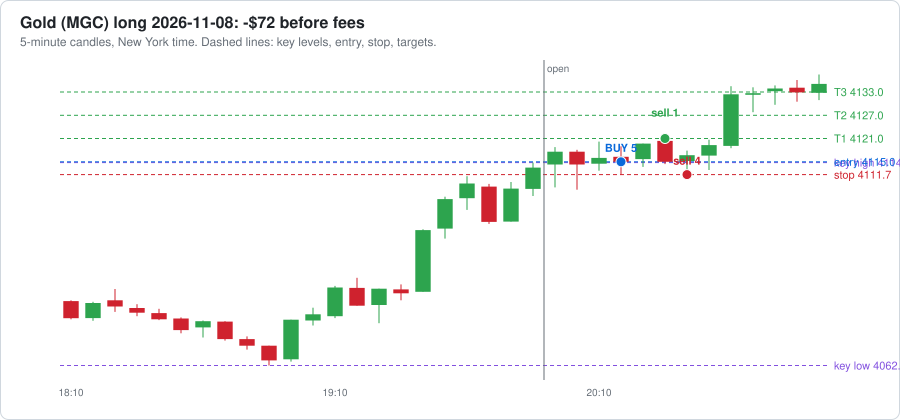

# Agent dashboard

Last updated 2026-11-10 04:11 New York time. Everything here is written by software and AI agents. It can be wrong, so check anything you plan to act on.

**[🪙 Open the Crypto Dashboard →](CRYPTO-DASHBOARD.md)** · **[𝕏 Open the X Brief Dashboard →](X-DASHBOARD.md)**

## Reminders

- ⏰ When your broker is connected: log every trade in trade-journal.md with a heading like `### Trade #1 | 2026-10-16` (swap the `__` in the template for the trade number) and keep the `- **Session:**` line, so the post-session reviewer can see your trades. Or ask Claude to build automatic trade logging into the paper trading agent.
- ⏰ Before trading real money: make this repo private (GitHub → Settings → Danger Zone → Change visibility). First run `git cherry-pick 0f7e3a2` so the paper trader checks less often and stays under GitHub's 2,000 free Actions minutes a month for private repos (it is public now to keep Actions free and unlimited).
- ⏰ 𝕏 **Turn on X auto-posting once @cashflowbrief00 gets traction:** 500+ followers, OR any post with 10,000+ views, OR 1,000+ views a day for a week (check the account's Analytics). Then tell Claude "turn on X auto-posting". It needs X API keys from developer.x.com (about $2.50-3/month for 5-6 posts a day, within the $25 AI budget) and X's "automated account" label.

[Edit reminders](REMINDERS.md)

## Agent status

| | Agent | What it does | Last ran | Runs |
|---|---|---|---|---|
| 🟢 | Market brief: nasdaq | Writes the brief before the New York session | 20 hours ago | weekdays about 7-8 AM New York time |
| 🟢 | Market brief: gold | Writes the brief before the Asia session | 10 hours ago | Sun-Thu evenings about 6-7 PM New York time |
| 🟢 | World news brief | Overnight news and today's events: politics, economy, war, trade | under an hour ago | daily about 5-6 AM New York time |
| 🟢 | Crypto research brief | Pumping coins, whales, government and adoption news | under an hour ago | daily about 5:30-6:30 AM New York time |
| 🟢 | Stock research brief | Movers, AI, nuclear, minerals, earnings dates and estimates | 24 hours ago | Mon, Wed, Fri about 6-7 AM New York time |
| 🟢 | Paper trader | Paper trades every session with your rules and runs a practice prop challenge | 6 hours ago | after each session ends |
| 🟢 | Scorer | Checks each lean against what price did | 11 hours ago | after each session ends |

🟢 ran recently  🟡 a bit late  🔴 check it  ⚪ never ran

## 📒 Trade journal (paper)

- **Tradeify 50K evaluation: balance $50,575**, $1,923 above the drawdown floor, $2,425 to pass; today $0, $1,250 left before the daily loss limit. [Details](paper-trading/summary.md)
- 📐 Opening range (9:30-10:00, tracked, not traded): $140 over 5 trades in 6 sessions since 2026-11-02, vs -$1,015 for the real Nasdaq rule (ahead). [Details](paper-trading/summary.md)

Newest first. Times are New York time. Each sale shows contracts @ price, time. The 📈 link opens a chart of the trade; TV opens the same market on TradingView (add [the strategy](tradingview/breakout_strategy.pine) to see each trade marked).

| Date | Market | Side | Lots | Entry | Target 1 | Target 2 | Target 3 / out | Result | What could have gone better | See it |
|---|---|---|---|---|---|---|---|---|---|---|
| 2026-11-10 | Gold | – | 0 | no breakout, no trade | | | | $0 | No confirmed breakout in the first 60 minutes. Key high 4156.20, low 4130.80. | [TV](https://www.tradingview.com/chart/?symbol=COMEX_MINI%3AMGC1%21&interval=5) |
| 2026-11-09 | Nasdaq | – | 0 | skipped: risk too big | | | | $0 | Breakout long at 09:35, but even the small size risked $1,467 and only $1,073 could be lost today without breaking the daily loss limit or the drawdown, so it was skipped. | [TV](https://www.tradingview.com/chart/?symbol=CME_MINI%3AMNQ1%21&interval=5) |
| 2026-11-09 | Gold | long | 5 | 4115.0 @ 20:15<br>stop 4111.7 | 1 @ 4121.0, 20:25 ($60) | – | stop: 4 @ 4111.7, 20:30 (-$132) | ❌ **-$77**<br>out 20:30 | • Target 1 paid $60, but the stop stayed at the start. Moving it to breakeven after Target 1 would have ended this trade at about $60 instead of -$72.<br>• Fakeout re-entry (switched off): price closed back beyond the entry at 20:35; re-entering 3 contracts at 4119.3 (stop 4112.9) would have made $357. | [📈 chart](paper-trading/charts/2026-11-08-gold.svg) · [TV](https://www.tradingview.com/chart/?symbol=COMEX_MINI%3AMGC1%21&interval=5) |
| 2026-11-06 | Nasdaq | – | 0 | skipped: daily profit cap | | | | $0 | Not taken: this trading day was already up $600, the daily profit cap that keeps the biggest day small for the 35% consistency rule. | [TV](https://www.tradingview.com/chart/?symbol=CME_MINI%3AMNQ1%21&interval=5) |
| 2026-11-06 | Gold | short | 5 | 4072.7 @ 20:45<br>stop 4085.0 | 1 @ 4066.7, 20:55 ($60) | 2 @ 4060.7, 22:05 ($240) | 2 @ 4054.7, 22:30 ($360) | ✅ **$655**<br>out 22:30 | • Price kept going 6.30 points past Target 3 (by 23:05). Letting the last 2 contract(s) run with a trailing stop could have made up to $126 more. | [📈 chart](paper-trading/charts/2026-11-05-gold.svg) · [TV](https://www.tradingview.com/chart/?symbol=COMEX_MINI%3AMGC1%21&interval=5) |
| 2026-11-05 | Nasdaq | – | 0 | skipped: daily profit cap | | | | $0 | Not taken: this trading day was already up $600, the daily profit cap that keeps the biggest day small for the 35% consistency rule. | [TV](https://www.tradingview.com/chart/?symbol=CME_MINI%3AMNQ1%21&interval=5) |
| 2026-11-05 | Gold | long | 5 | 4118.4 @ 20:15<br>stop 4104.3 | 1 @ 4124.4, 20:20 ($60) | 2 @ 4130.4, 20:35 ($240) | 2 @ 4136.4, 20:45 ($360) | ✅ **$655**<br>out 20:45 | • Price kept going 8.00 points past Target 3 (by 20:50). Letting the last 2 contract(s) run with a trailing stop could have made up to $160 more. | [📈 chart](paper-trading/charts/2026-11-04-gold.svg) · [TV](https://www.tradingview.com/chart/?symbol=COMEX_MINI%3AMGC1%21&interval=5) |
| 2026-11-04 | Nasdaq | – | 0 | skipped: risk too big | | | | $0 | Breakout long at 09:40, but even the small size risked $2,352 and only $1,242 could be lost today without breaking the daily loss limit or the drawdown, so it was skipped. | [TV](https://www.tradingview.com/chart/?symbol=CME_MINI%3AMNQ1%21&interval=5) |
| 2026-11-04 | Gold | long | 3 | 3963.4 @ 20:15<br>stop 3936.5 | 1 @ 3969.4, 20:25 ($60) | 1 @ 3975.4, 00:30 ($120) | 1 @ 3981.4, 00:30 ($180) | ✅ **$357**<br>out 00:30 | • Price kept going 51.00 points past Target 3 (by 01:20). Letting the last 1 contract(s) run with a trailing stop could have made up to $510 more. | [📈 chart](paper-trading/charts/2026-11-03-gold.svg) · [TV](https://www.tradingview.com/chart/?symbol=COMEX_MINI%3AMGC1%21&interval=5) |
| 2026-11-03 | Nasdaq | – | 0 | no breakout, no trade | | | | $0 | No confirmed breakout in the first 60 minutes. Key high 28426.50, low 28197.00. | [TV](https://www.tradingview.com/chart/?symbol=CME_MINI%3AMNQ1%21&interval=5) |
| 2026-11-03 | Gold | – | 0 | no breakout, no trade | | | | $0 | No confirmed breakout in the first 60 minutes. Key high 3974.50, low 3952.80. | [TV](https://www.tradingview.com/chart/?symbol=COMEX_MINI%3AMGC1%21&interval=5) |
| 2026-11-02 | Nasdaq | long | 5 | 28886.75 @ 10:25<br>stop 28785.75 | – | – | stop: 5 @ 28785.75, 10:45 (-$1,010) | ❌ **-$1,015**<br>out 10:45 | • Price never reached Target 1: the best it did was +2.50 points, and Target 1 needed 30.<br>• The breakout failed and price kept going the other way, so the stop did its job and kept the loss small.<br>• The entry was 42.75 points past the key level, chasing a stretched move. Waiting for a pullback toward the level would have meant a better price and a smaller risk. | [📈 chart](paper-trading/charts/2026-11-02-nasdaq.svg) · [TV](https://www.tradingview.com/chart/?symbol=CME_MINI%3AMNQ1%21&interval=5) |
| 2026-10-30 | Nasdaq | – | 0 | skipped: risk too big | | | | $0 | Breakout short at 09:45, but even the small size risked $296 and only $199 could be lost today without breaking the daily loss limit or the drawdown, so it was skipped. | [TV](https://www.tradingview.com/chart/?symbol=CME_MINI%3AMNQ1%21&interval=5) |
| 2026-10-30 | Gold | short | 5 | 4015.3 @ 21:00<br>stop 4023.3 | 1 @ 4009.3, 21:05 ($60) | – | stop: 4 @ 4023.3, 21:25 (-$320) | ❌ **-$265**<br>out 21:25 | • Target 1 paid $60, but the stop stayed at the start. Moving it to breakeven after Target 1 would have ended this trade at about $60 instead of -$260.<br>• Fakeout re-entry (switched off): price closed back beyond the entry at 21:35; re-entering 3 contracts at 4012.9 (stop 4018.0) would have made $111. | [📈 chart](paper-trading/charts/2026-10-29-gold.svg) · [TV](https://www.tradingview.com/chart/?symbol=COMEX_MINI%3AMGC1%21&interval=5) |
| 2026-10-29 | Nasdaq | – | 0 | skipped: risk too big | | | | $0 | Breakout short at 09:35, but even the small size risked $1,101 and only $464 could be lost today without breaking the daily loss limit or the drawdown, so it was skipped. | [TV](https://www.tradingview.com/chart/?symbol=CME_MINI%3AMNQ1%21&interval=5) |

**Latest trade:**



[Full journal with every fill](paper-trading/paper-journal.md)

## 👔 CEO check

**❌ 2 broken rule(s)** ([read the full check](reports/ceo/latest.md))

<details>
<summary><b>What the CEO checked</b></summary>

##### Futures paper trader

- ❌ Tradeify practice evaluation failed: reset on 2026-10-28: only $96 above the floor, too close for any trade.
- ❌ Tradeify practice evaluation failed: reset on 2026-11-02: only $299 above the floor, too close for any trade.
- ✅ Tradeify practice evaluation: $1,923 above the $2,000 trailing drawdown floor.

##### Your trade journal

- ✅ No trades logged yet, nothing to check.

##### Crypto bots

- ✅ Rotation bot: 8 trades, buys only at weekly checks, never more than 4 coins at once.
- ✅ Buy-and-hold bot has never sold.

##### Alpaca copy

- ✅ All 10 Alpaca orders were for the bot's coins and within the limit.

##### Costs

- ✅ Spent $5.51 so far this month on 53 AI runs; on pace for about $18 (budget $50).

##### Agent health

- ✅ Every research brief worked on its last run.

##### Ready to run on its own?

- ✅ 16 of 15 trading days on the paper record
- ⏳ 2 rule problem(s) in the paper trader above
- ⏳ the Tradeify practice account never failed
- ⏳ the Tradeify practice evaluation has not passed yet
- ⏳ profit factor 0.84 (needs 1.3 or more), total $-786 over 19 trades
- ✅ worst trading day $-1,071 (needs $-1,250 or better)
- ⏳ You: Tradeify confirms in writing that TradersPost automation is allowed on the Select 50K
- ⏳ You: 2+ weeks of the live 50K alerts traded by hand with no rule broken
- ⏳ You + Claude: 2-3 sessions on a TradersPost paper account matching the chart

</details>

## 📅 Weekly report

<details>
<summary><b>Week ending 2026-11-08</b></summary>

#### The week in one look

- **Futures paper:** +$652 this week
- **Rotation bot:** $0.00 this week
- **Buy-and-hold bot:** -$30.12 this week
- **AI costs:** $4.21 this week

#### Futures paper trading

- **This week:** +$652 after fees, 4 trades (3 wins, 1 losses), 5 sessions with no trade
- **Since paper trading began:** -$708 over 18 trades
- Nasdaq (MNQ): -$1,015 over 1 trades
- Gold (MGC): +$1,667 over 3 trades

| Day | Market | Side | Entry | Result |
|---|---|---|---|---|
| 2026-11-02 | nasdaq | long | 28886.75 at 10:25 | -$1,015 |
| 2026-11-04 | gold | long | 3963.4 at 20:15 | +$357 |
| 2026-11-05 | gold | long | 4118.4 at 20:15 | +$655 |
| 2026-11-06 | gold | short | 4072.7 at 20:45 | +$655 |

#### TradingView strategy

| Market | Export date | Forward test (since paper start) | Whole export |
|---|---|---|---|
| Nasdaq (MNQ) | 2026-10-18 | 0 trades, $0 | 25 trades, +$3,684, 56% wins |
| Gold (MGC) | 2026-10-18 | 0 trades, $0 | 22 trades, +$699, 32% wins |

Export the List of trades from each chart and say "update TradingView" to refresh these numbers.

#### Crypto paper bots

| Bot | Start of week | End of week | Change | Since it started ($1,000) |
|---|---|---|---|---|
| Rotation bot | $979.35 | $979.35 | $0.00 (+0.0%) | -$20.65 |
| Buy-and-hold bot | $936.92 | $906.80 | -$30.12 (-3.2%) | -$93.20 |

**Alpaca copy:** 0 order(s) this week.

#### Market briefs (Nasdaq and gold)

- 7 briefs scored; 1 gave a direction, 1 of those were right.
- 6 were Neutral.

#### CEO check

**❌ Rules were broken this week.** 17 checks ran. [Latest CEO check](../ceo/latest.md)

#### AI costs this week

| Agent | Runs | Cost |
|---|---|---|
| crypto-brief | 7 | $1.74 |
| market-brief-nasdaq | 5 | $0.66 |
| stock-brief | 3 | $0.59 |
| world-brief | 7 | $0.58 |
| market-brief-gold | 4 | $0.57 |
| x-posts | 13 | $0.06 |
| **Total** | 39 | **$4.21** |

At this pace: about $18 a month.

[Main dashboard](../../DASHBOARD.md) · [Crypto dashboard](../../CRYPTO-DASHBOARD.md)

</details>

[All weekly reports](reports/weekly/)

## Paper trading

- Total after fees: **-$786** over 19 trades (32 sessions watched)
- Trading days with a trade: **15**, profitable: **6**, losing: 9
- Win rate: 42%
- Profit factor: 0.84
- Biggest drop from a high (max drawdown): $4,620
- Room left before the $4,000 max drawdown: **$970**
- Progress toward a prop demo: **15 of 20** trading days

<details>
<summary><b>Challenge simulation, results by market, and daily results</b></summary>

#### By market

| Market | Trades | Wins | Total after fees |
|---|---|---|---|
| nasdaq | 8 | 3 | -$1,716 |
| gold | 11 | 5 | $931 |


#### Daily results

| Trading day | Sessions | Result after fees |
|---|---|---|
| 2026-11-10 | gold no trade | $0 |
| 2026-11-09 | gold long, nasdaq skipped, risk too big for today's limits | -$77 |
| 2026-11-06 | gold short, nasdaq skipped, daily profit cap reached | $655 |
| 2026-11-05 | gold long, nasdaq skipped, daily profit cap reached | $655 |
| 2026-11-04 | gold long, nasdaq skipped, risk too big for today's limits | $357 |
| 2026-11-03 | gold no trade, nasdaq no trade | $0 |
| 2026-11-02 | nasdaq long | -$1,015 |
| 2026-10-30 | gold short, nasdaq skipped, risk too big for today's limits | -$265 |
| 2026-10-29 | gold short, nasdaq skipped, risk too big for today's limits | -$365 |
| 2026-10-28 | gold long, nasdaq short | -$1,071 |
| 2026-10-27 | gold no trade, nasdaq long | -$688 |
| 2026-10-26 | gold short, nasdaq no trade | -$329 |
| 2026-10-23 | gold short, nasdaq long | -$888 |
| 2026-10-22 | gold short, nasdaq short | $1,070 |
| 2026-10-21 | gold no trade, nasdaq short | -$252 |
| 2026-10-20 | gold short, nasdaq long | $1,070 |
| 2026-10-19 | gold no trade, nasdaq long | $357 |

[Every paper trade](paper-journal.md) · [Raw data](trades.csv)


</details>

[Paper trading journal](paper-trading/paper-journal.md) · [TradingView strategy](tradingview/breakout_strategy.pine)

## 📈 TradingView strategy results

From the latest **List of trades** export of each chart. One trade = one entry (TradingView counts each target as a separate trade). Forward test = trades from 2026-10-19 on.

| Market | Export date | Trades | Wins / losses | Win rate | Total | Profit factor | Max drawdown | Forward test |
|---|---|---|---|---|---|---|---|---|
| Nasdaq (MNQ) | 2026-10-18 (trades since 2026-08-25) | 25 | 14 / 11 | 56% | **$3,684** | 1.99 | $1,066 | 0 trades, $0 |
| Gold (MGC) | 2026-10-18 (trades since 2026-08-24) | 22 | 7 / 15 | 32% | **$699** | 1.30 | $1,559 | 0 trades, $0 |
| **Both** | | 47 | 21 / 26 | 45% | **$4,384** | 1.72 | | |

<details>
<summary><b>Latest 10 TradingView trades</b></summary>

| Entry (New York) | Market | Side | Entry price | Contracts | Result |
|---|---|---|---|---|---|
| 2026-10-15 09:35 | Nasdaq (MNQ) | short | 29,830.00 | 5 | ❌ -$68 |
| 2026-10-14 20:05 | Gold (MGC) | short | 4,138.90 | 5 | ❌ -$105 |
| 2026-10-14 09:35 | Nasdaq (MNQ) | short | 30,578.50 | 5 | ❌ -$192 |
| 2026-10-13 09:35 | Nasdaq (MNQ) | short | 30,757.25 | 5 | ❌ -$20 |
| 2026-10-12 20:05 | Gold (MGC) | short | 4,187.60 | 5 | ✅ $420 |
| 2026-10-12 09:45 | Nasdaq (MNQ) | short | 30,969.50 | 5 | ✅ $660 |
| 2026-10-08 20:05 | Gold (MGC) | long | 4,168.70 | 5 | ❌ -$20 |
| 2026-10-07 20:05 | Gold (MGC) | short | 4,131.60 | 5 | ❌ -$250 |
| 2026-10-07 09:35 | Nasdaq (MNQ) | short | 31,180.50 | 5 | ❌ -$704 |
| 2026-10-06 20:05 | Gold (MGC) | long | 4,191.20 | 5 | ❌ -$8 |

</details>

To refresh: export the List of trades from each chart in TradingView, double-click `tradingview/update-exports.command`, then push in GitHub Desktop.

## Latest briefs

Click a brief to read it here. The summary is at the top of each.

<details>
<summary><b>🌍 World news brief, 2026-11-10, event risk High</b></summary>

#### Top things for today
1. **US CPI at 8:30 AM.** Headline CPI is forecast at 0.3% m/m (previous 0.6%). Core CPI is forecast at 0.2% (previous 0.3%). Why it matters: rates, the dollar and the Fed path.
2. **Iran.** Trump told CNN a strike resumption is "highly unlikely" if talks progress and a strong deal is signed. He met Qatar's PM on Monday. Why it matters: oil, gold safe-haven demand, Gulf shipping.
3. **Russia-Ukraine talks in Abu Dhabi.** These are the first trilateral talks since February. They run for two days. Why it matters: energy and Europe risk.
4. **Waller speaks at 4:00 AM.** Why it matters: Fed rate expectations. The topic isn't given.
5. **Rate-hike talk.** ING says US inflation is likely "too hot" (headline only). A Futu headline says CPI could decide whether the Fed raises rates in December (headline only). Why it matters: rates and the dollar.

#### Today's schedule (New York time)
| Time | Event | Who or where | Confirmed? |
|---|---|---|---|
| 4:00 AM | FOMC Member Waller speaks (Medium impact) | USD | Yes |
| 8:30 AM | CPI m/m (forecast 0.3%, previous 0.6%) | USD | Yes |
| 8:30 AM | Core CPI m/m (forecast 0.2%, previous 0.3%) | USD | Yes |
| Day (time unconfirmed) | Russia-Ukraine-US talks, day 1 of 2 | Abu Dhabi | Talks confirmed; times (unconfirmed) |

Coming up this week: Thu Nov 12, 2:00 AM, UK GDP m/m (forecast 0.0%, previous 0.1%). Fri Nov 13, 8:30 AM, US Core PPI m/m (forecast 0.3%, previous 0.7%) and PPI m/m (forecast 0.4%, previous 1.3%). Wed Nov 11 has no major events.

#### Event risk today
High - CPI is a high-impact release. Inflation worries are already in the headlines, and Iran and Ukraine talks are running at the same time.

#### Politics and policy
- Trump signaled new Iran strikes look unnecessary after meeting Qatar's PM (Bloomberg, headline only). UPI says they discussed US-Iran negotiations (headline only).
- Trump has said he told Netanyahu a strike on Iran would be inappropriate while a solution is close. This is from an undated PBS page, so it may not be from last night.
- Trump said at a Monday White House briefing that Washington sees growing willingness to end the Ukraine war (CNBC).
- The Washington Post says Republicans, after losing Congress, have one last shot to pass their agenda (headline only).
- The Washington Post says the Supreme Court allowed a major part of Trump's Texas border project (headline only).
- Reuters says Musk is expected to join Trump at APEC, and Huang's participation is in doubt (headline only).

#### Economics
- No major US data was released overnight. Today's CPI is the main event.
- Investing.com says the dollar held its losses ahead of the data (headline only).
- WSJ says Treasury yields edged up ahead of the data (headline only).
- ING says US inflation is likely too hot for comfort (headline only).

#### SEC, CFTC and hearings
- The SEC and CFTC issued no press releases in the last 2 days.
- Several outlets say Coinbase, Kalshi, Kraken's parent and others back the CFTC in a lawsuit over stock perpetual contracts (The Defiant, Coin Edition, Crypto News; headline only).
- No congressional hearings were found.

#### War, trade and tariffs
- **Iran:** Gulf bourses opened higher as Trump held off on strikes (Reuters, headline only). Iranian media reported US strikes on Qeshm Island overnight, and Iran has attacked tankers in the Gulf and Strait of Hormuz this month. The NBC article doesn't say when the Qeshm strikes happened. Senior US and Gulf officials doubt an imminent deal. Why it matters: oil and shipping risk.
- **Russia-Ukraine:** Talks began Tuesday, according to Ukrainian state media and RIA Novosti. Witkoff and Kushner lead the US side. Russia demands the Donetsk areas it doesn't hold. Ukraine has ruled out withdrawing. Russia carried out one of its deadliest strikes yet before the talks. Why it matters: energy supply and risk appetite.
- No new tariff news was found.

#### Country briefs
- **China:** Reuters, citing SCMP, says Musk is expected at APEC with Trump (headline only).
- **European Union:** EU and NATO officials will hold separate talks with Kyiv's team in Abu Dhabi.
- **United Kingdom:** National security advisers from Britain, France and Germany are expected in Abu Dhabi. UK GDP is due Thursday at 2:00 AM.
- **Japan:** Nothing found.
- **India:** Nothing found.
- **Russia:** Moscow and Kyiv continue to attack each other's energy sites. Riddle Russia reports on a Russian financial bid to entrench control over occupied Ukraine (headline only).
- **Canada:** Nothing found.

[Read the full brief with all the details](reports/news/2026-11-10-world-brief.md) · [All news briefs](reports/news/)

</details>

<details>
<summary><b>🪙 Crypto brief, 2026-11-10</b></summary>

#### Top things today
1. **Bitcoin is under pressure near $74K.** Risk-off mood followed last week's Democratic midterm sweep, with worries about crypto rules and AI. A strong US jobs report also pushed rate expectations around. BTC is eyeing a fifth weekly loss (FXStreet). Why it matters: the Fear and Greed Index is 32, so the mood is cautious.
2. **ETF money is leaving.** Spot Bitcoin ETFs saw $1.177 billion in net outflows last week (SoSoValue via Analytics Insight). Other tallies put it at about $1.28B. Weekend liquidations topped $1 billion. Why it matters: institutional demand is weak.
3. **US inflation data is out today.** October CPI arrives Tuesday, and producer prices follow Friday, Nov 13 (crypto.news). Why it matters: it can move rate expectations and risk assets.
4. **Initia (INIT) is up sharply while its chain is halted.** INIT rose 80% over 24 hours on Nov. 10 while the Layer 1 stayed offline. The project paused it at 1:18 a.m. ET. (TokenPost). Why it matters: it is a pump during an active security incident.
5. **Large token unlocks are due this week.** About $620 million is scheduled for release this week. RAIN unlocks about $195M today, and Pieverse unlocks about $127M (31.4% of market cap) on Nov 14. (KuCoin/Tokenpost) Why it matters: supply could hit thin markets.

#### Coins to research
| Coin | 24h move | Why it is moving | Red flags |
|---|---|---|---|
| Pieverse (PIEVERSE) | +26.6% (+80.6% 7d) | One outlet credits the AI-altcoin narrative and positioning before the unlock (InteractiveCrypto). | RSI of 88.5, which is overbought. 25 whales held 96.73% of market cap as of Nov 3. Unlock on Nov 14. |
| Initia (INIT) | +57% (trending, rank 454) | Rebound while the Layer 1 is halted after an exploit (TokenPost). | Compromised rollup keys were used to forge IBC transfers. A separate $2.7M exploit hit on Oct 23. Small cap. |
| Provenance (HASH) | +23.9% | No news found. | $126.5K volume against a $444.6M market cap. Pump with no news. |
| Janction (JCT) | -28.1% (trending) | JCT is on today's unlock list (TokenPost). | Small rank (329). Falling, not pumping. |
| edgeX (EDGE) | +14.7% | No news found. | EDGE had an unlock on Nov 2. Cause of the move is unclear. |
| Pi Network (PI) | +9.1% (-5.9% 7d) | Bounce. FXStreet noted PI hit a record low. | Bounce inside a downtrend. |

Other gainers (CARDS, BR, STABLE, GRAM, JUP, ETHFI, PYTH, SPX) had no news found. STABLE had an unlock on Nov 7 (KuCoin).

#### Whale watch
No whale moves found for the last 24 hours. Older items for context:
- Lookonchain said a dormant whale bought 3,009 BTC (about $228M) on Nov 6. Another whale pulled 1,286 BTC from Binance the same day.
- Cardano whales sold about 50 million ADA (Analytics Insight). No USD value was given.
- BlackRock moved about $482.66M in BTC and ETH to Coinbase Prime (Cryptorank). The date was not stated.

#### Government and regulation
- **CLARITY Act (market structure):** It passed the House in July 2025, 294-134. It failed a Senate procedural vote 49-50 in September 2026. It could still pass in the lame-duck session, but one expert called that unlikely (CNBC).
- **Midterms:** Democrats retook both the Senate and House on Nov 3 (Four Pillars via TechFlow).
- **CFTC:** On Nov 3, Chair Selig said individual-stock perpetual futures can trade on CFTC-registered exchanges that also meet SEC rules. Coinbase, Kalshi, Payward and others asked a court to file a brief backing the CFTC. A lawsuit seeks to overturn the approval. (The Block) On Nov 5 the CFTC issued guidance on exchanges' equal-access duties. (Bitcoin.com)
- **SEC:** On Nov 2 it added three FAQs on its crypto framework. On Nov 3 it gave Canton Coin a no-action response. Its Regulation Crypto Assets proposal comment period closed Oct 20.
- **GENIUS Act rules:** Regulators missed the July 18 deadline. The OCC targets November for final rules. (crypto.news)
- **Bitcoin reserve bills:** The Senate BITCOIN Act has sat in committee since March 2025. The House bill reported Sept 16, 2026 orders a study, not purchases.
- Other countries: nothing found.

#### Who is buying and adopting
- **Strategy:** It bought 1,036 BTC for about $82M in the week of Nov 2-8, at an average of $79,012. Most of its raise ($188.3M) went to buying back STRC preferred shares. (Crypto Briefing)
- **BlackRock:** It said demand to swap held bitcoin for IBIT shares is at a record, driven by security fears. (Barron's via Bitcoin Magazine) These swaps are a custody shift, not new open-market buying.
- **US government:** As of October 2026, no open-market purchases had been announced.
- **Visa and Google:** headlines mention Visa expanding stablecoin payments and Google testing custody (Analytics Insight). I did not find details.

#### Next 7 days
All times New York. Exact hours were not found, so dates only.

| Date | Event | Coin or topic |
|---|---|---|
| Nov 10 (today) | US October CPI. RAIN unlock of about $195M (35.9B tokens). JCT, LAYER, BABY unlocks. | Macro, RAIN, JCT |
| Nov 11 | ALLO unlock of about $23M (65.5% of released supply). APT, IO unlocks. | ALLO, APT |
| Nov 12 | PEAQ, RAVE unlocks | Altcoins |
| Nov 13 | US producer prices. AZTEC unlock of about $10M (unconfirmed). | Macro, AZTEC |
| Nov 14 | PIEVERSE unlock of about $127M. PUMP unlock of about $25M. YZY unlock of about $8M. | PIEVERSE, PUMP |
| Nov 15 | CONX unlock of about $17.7M (unconfirmed) | CONX |
| This week | MARA, Bitdeer, Gemini earnings. Arbitrum DAO votes. | Miners, ARB |

Sources: KuCoin, TokenPost, crypto.news. Unlock sizes vary by tracker, and some are marked "pending verification."

[Read the full brief with all the details](reports/crypto/2026-11-10-crypto-brief.md) · [All crypto briefs](reports/crypto/)

</details>

<details>
<summary><b>📈 Stocks brief, 2026-11-09</b></summary>

#### Top things today
1. **China's rare earth pause ends Tomorrow, Nov. 10.** The legal text still ends the suspension on that date. China's commerce ministry said a wider US-China arrangement runs to Jan. 10, 2027, but it did not name rare earths (Carra Globe). Whether rare earths are covered is unconfirmed. Why it matters: it could hit MP, USAR and REMX quickly.
2. **CoreWeave reports on Nov. 10.** The market will watch whether AI infrastructure demand and memory price outlook stay solid for the chip rally to continue (BigGo Finance). Why it matters: it is the next test for AI infrastructure names.
3. **Chips bounced, but the week was ugly.** AMD gained 11.04% and Intel 7.71%, yet the Philadelphia Semiconductor Index fell 15% for the week. Many see the bounce as short covering and dip buying, not a confirmed bottom (BigGo Finance). Why it matters: the move may not hold.
4. **Constellation Energy reports before the open.** The report is at 7:00 a.m. Management has said it will revisit its 2026 guidance of $11.50 to $12.50 per share (TIKR). Why it matters: it sets the tone for nuclear power names.
5. **Nuclear stocks jumped on Friday.** Better results from Oklo and NuScale, strong Vistra earnings and a rebound after losses drove the rally (Seeking Alpha). Why it matters: it was a sector-wide move.

#### Stocks to research

| Ticker | Theme | Move | Why | Red flags |
|---|---|---|---|---|
| OKLO | Nuclear | +22.7% (5d -6.7%) | Narrower-than-expected Q3 loss. It also reserved capacity for large reactor parts at a planned factory. | About $2.3B raised through share offerings in nine months. Down about 68% this year. |
| AMD | AI chips | +11.0% (5d -11.0%) | Strong earnings and data-center outlook. | The bounce looks like short covering. |
| CEG | Nuclear power | +4.3% | Reports before the open today. EPS estimate $3.89. | Event risk. Shares fell about 17% in the month before (TIKR). |
| USAR | Rare earths | +10.8% (5d -14.5%) | Reports today. Rare earth pause ends Nov. 10. | Small company. Revenue estimate only $13.6M. Loss expected. |
| CRWV | AI cloud | +6.3% (5d -15.4%) | Reports Nov. 10. EPS estimate -$1.21. | Loss-making. Big swings around earnings. |
| LEU | Uranium fuel | +17.5% | Moved with the nuclear rally. No company-specific catalyst was established for NNE or X-Energy. I found none for LEU. | Move with no news. |
| SPCX | New stock | +8.6%, $134.27 | Space Exploration Technologies, $1.8T market cap, among the most active stocks. | I found no news on it. Limited trading history. |

#### AI and tech
- **Selloff and rebound.** Stocks closed sharply lower on Nov. 5, their worst day since April 2025, as chip selling spread (CNBC via StockTitan). Thursday's drop was tied to fears that Democratic control of Congress could bring tougher AI rules (Reuters via StockTitan). Friday brought a bounce.
- **Why the selling came.** The market blames hedge fund deleveraging and mechanical selling more than weaker AI fundamentals. Data center rules and lower Anthropic and OpenAI valuation hopes keep investors cautious (BigGo Finance).
- **Nvidia headline.** A Yahoo Finance item referenced Nvidia probing a case involving CEO Jensen Huang. I could not confirm details.
- **Weekly scoreboard.** Nvidia fell 8.8% on the week while Amazon rose 7.9%. Friday's bounce came on less than half the volume and faded through the session (Substack).

#### Nuclear and critical minerals
- **Nuclear rebound.** Oklo rose about 23% and NuScale 16% after their results (TradingView/Seeking Alpha). Meta's Ohio campus deal with Oklo is non-binding (24/7 Wall St.).
- **China export deadline.** Licences are still required for seven heavy rare earths, including dysprosium and terbium, because that regime was never suspended (Technology.org). The gallium, germanium and antimony suspension lapses Nov. 27 (CES Intelligence).
- **China buying mines abroad.** Beijing is pushing state-linked firms to take bigger stakes in overseas mines (CNBC).
- **Brazil.** Brazil approved a list of 27 critical minerals on Nov. 5 (Mattos Filho).
- I found no new US government deals today.

#### Earnings
**Recent results:**
- **Karman (KRMN):** EPS of 19 cents beat the 15-cent consensus, and sales of $201.6M beat $194.7M (Benzinga). It also raised its full-year sales guidance. The stock closed up 42.1%.
- **JFrog (FROG):** Adjusted EPS of $0.32 on $179.2M revenue beat estimates of $0.23 and $165.8M (Investing.com). The stock rose 35.3%.
- **Oklo:** the loss was narrower than expected, and the stock rose about 23%.
- **Snap:** Q3 revenue missed expectations, and the reaction was negative (Yahoo Finance).

| Date | Ticker | Timing | EPS est. | Revenue est. |
|---|---|---|---|---|
| 2026-11-09 | CEG | Before the open (7:00 a.m.) | $3.89 | $9.3B |
| 2026-11-09 | USAR | Not found | -$0.15 | $13.6M |
| 2026-11-10 | CRWV | Not found | -$1.21 | $3.5B |
| 2026-11-13 | LAC | Not found | -$0.03 | n/a |
| 2026-11-17 | NVDA | Not found | $2.47 | $109.0B |
| 2026-11-17 | SQM | Not found | $2.16 | $2.2B |

#### Smart money
- **Analysts and insiders:** nothing found in the three themes.
- **Congress trades:** nothing found.
- **Outside the themes:** after Karman's results, Piper Sandler raised its target to $60 and Needham cut its to $50 (Benzinga).

[Read the full brief with all the details](reports/stocks/2026-11-09-stock-brief.md) · [All stocks briefs](reports/stocks/)

</details>

<details>
<summary><b>📊 Nasdaq 100 futures market brief, 2026-11-09</b></summary>

#### Price data used

```
PRICE DATA (Nasdaq 100 futures, Yahoo Finance, New York time, may be delayed)
Latest price: 27267.00 at 2026-11-09 07:45
Previous New York session (2026-11-06 09:30 to 16:00): high 27425.00, low 26988.50, close 27077.75, volume 559,594
Highest high of the last 5 New York sessions: 28969.00
Lowest low of the last 5 New York sessions: 26718.00
Since that session closed: high 27319.00, low 26751.25.
Latest price is INSIDE the previous range (158.00 below the high, 278.50 above the low).
Volume: the previous session traded 0.85x the average of the 5 session(s) before it.
```

**Nasdaq 100 Futures Brief: Monday, Nov 9, 2026 (New York session)**

**1. What is driving the market**
- Wall Street is swinging day to day on how investors see tech stocks and the AI trade.
- Thursday's 4.4% S&P 500 plunge, its worst day since April 2025, came as investors weighed what a Democratic sweep of Congress means for the AI data center buildout.
- The Nasdaq closed Thursday nearly 12% below its Oct 6 record high, which confirms a correction.
- Friday brought a rebound. The S&P 500 gained 0.31% and the Nasdaq Composite gained 1.09%.
- Rate worries remain. Rate futures put the odds of another 25-basis-point Fed hike in December near 80%.
- Company news is also in play. Nvidia's board said it will launch an independent investigation into CEO Jensen Huang's alleged relationship with a suspected Chinese spy.
- Microsoft's decision not to renew a major Oracle cloud contract raises questions about external cloud spending.
- Overnight moves were choppy. One feed said Nasdaq futures opened nearly 1% lower on Monday. Another said the decline had narrowed to within 0.4%. I could not verify the exact path.

**2. Scheduled events (New York time)**
Sources differ slightly on timing, so check again before the open.
- 8:40 AM: Fed Governor Bowman speaks (per Kiplinger).
- 10:00 AM: Chicago Fed's Goolsbee speaks. U.S. wholesale inventories also come out at 10 a.m.
- 10:30 AM: Atlanta Fed GDPNow.
- 11:00 AM: NY Fed 1-year consumer inflation expectations (previous 3.9%).
- 12:15 PM: Richmond Fed's Barkin speaks. Bank of England Governor Bailey speaks at about 12:25 PM, from 17:25 UTC.
- No high-impact releases are scheduled today.
- No big tech earnings were found for today. The fxempire calendar lists no reports before the open or after the close.
- Coming up: October CPI on Tuesday and PPI on Friday. CPI is due at 8:30 AM Tuesday, with a forecast of 0.3% m/m headline and 0.2% core. CoreWeave, Cisco and Applied Materials report later this week. Ten Fed officials speak this week.

**3. Key levels (from the price data)**
- Previous session high: 27425.00. Previous session low: 26988.50. Close: 27077.75.
- Latest price: 27267.00, inside the previous range.
- Since Friday's close, the high is 27319.00 and the low is 26751.25.
- Five-session high is 28969.00 and five-session low is 26718.00.
- Price is 158.00 below the previous high and 278.50 above the previous low. It sits closer to resistance than support, but it is not at either level.

**4. Volume**
Friday's volume was 559,594, or 0.85x the average of the five sessions before it. That is somewhat light. It suggests weaker participation during the bounce, so the move has less conviction behind it.

**5. Directional lean: Neutral | Confidence: Low**
The signals conflict. Price is in the upper half of Friday's range and has bounced from a correction. But it is still well below the five-session high of 28969.00. Volume on the bounce was light. Fed speakers sound hawkish, and tomorrow's CPI is a risk. The AI-sector news is uncertain in both directions. What would change the lean:
- A move above 27425.00 on rising volume would lean me Bullish.
- A drop below 26988.50 on

[Open the file](reports/2026-11-09-nasdaq-brief.md)

</details>

<details>
<summary><b>📊 Gold futures market brief, 2026-11-09</b></summary>

### Gold futures brief: Asia session, Nov 9–10, 2026

#### 1. What is driving gold
- Gold is bouncing hard. It rose about 5% in the week of Nov 1–7, its strongest week in more than two months.
- Today's rally came from a weaker dollar and falling oil. Spot gold topped $4,100 as the dollar slid. Gold futures settled at $4,149.65.
- Rate-hike worries are still a headwind. Traders price 78% odds of a quarter-point Fed hike in December. That came after a strong October jobs report.
- The bigger picture is still a correction. Gold hit an all-time high near $5,600 at the end of January. One analyst said it is "too early to know" whether the bottom is in.

#### 2. Scheduled events (New York time)
- **Mon Nov 9, daytime:** Fed speakers Bowman (8:40 AM), Goolsbee (10:00 AM) and Barkin (12:15 PM). Those times are from The Weekend Spread.
- **Tue Nov 10, about 4:00 AM:** Fed Governor Waller speaks at 04:00 AM. That is right at the end of the session.
- **Tue Nov 10, 8:30 AM:** October CPI is released. It is the last inflation read before the December 8–9 FOMC. This falls after the Asia session ends.
- **Tue Nov 10, later:** Logan, Bowman and Schmid speak after CPI.
- **Not verified:** I could not confirm any Fed speaker between 8:00 PM and 4:00 AM tonight. The sources show different time zones and conflict with each other. Check a live calendar.

#### 3. Key levels (from your price data)
- Previous Asia session high: **4143.30**
- Previous Asia session low: **4092.30**
- Highest high of the last 5 Asia sessions: **4155.80**
- Highest high since the last session closed: **4157.70**
- Lowest low since the last session closed: **4074.90**
- Lowest low of the last 5 Asia sessions: **3905.00**
- Latest price is **4153.30**. It is 10.00 above the previous session high.
- Price is sitting **near resistance**. It is just under the 5-session high (4155.80) and the recent high (4157.70). It is not near support.

#### 4. Volume
Last session's volume was 0.74x the average of the five sessions before it. That is **weak participation**. The move up has not been backed by strong volume, so a breakout here is less convincing.

#### 5. Directional lean
**Neutral, Low confidence.**
- Price is above the previous session high. The news backs gold: the dollar is weaker, oil is lower, and the weekly trend is up.
- But price is pressed against the 5-session high and the recent high of 4157.70. Volume was light.
- CPI and the December hike odds could reverse the dollar move quickly.
- The signals conflict, so I stay neutral.
- **What would change the lean:**
  - A clean hold above 4157.70 with rising volume would move me toward Bullish.
  - A drop back below the previous session high of 4143.30, and then toward 4092.30, would move me toward Bearish.
  - A sharp dollar or yield move would also change it.

This is a probability-based lean, not a prediction or a trade instruction.

#### 6. Event risk
**Medium.** CPI comes after the session, but traders may position early, and Fed speakers around the session could move the dollar.

#### 7. Sources
Investing.com, FXStreet, Mitrade, Kitco, Fortune, Diamond Banc, Gold-Eagle, Kiplinger, CNBC, The Weekend Spread, Zerohedge, Trading Economics, Finobird, and Yahoo Finance (price data).

BIAS: Neutral | CONFIDENCE: Low

[Open the file](reports/2026-11-09-gold-brief.md)

</details>

## Latest lean for each market

| Market | Brief written | Lean | Confidence | Event risk | Price then | Full brief |
|---|---|---|---|---|---|---|
| nasdaq | 2026-11-09 07:56 | ? Unknown | Unknown | n/a | 27267.00 | [read it](reports/2026-11-09-nasdaq-brief.md) |
| gold | 2026-11-09 18:30 | ◆ Neutral | Low | Medium | 4153.30 | [read it](reports/2026-11-09-gold-brief.md) |

A lean is a probability-based view, not a prediction. ▲ Bullish  ▼ Bearish  ◆ Neutral

## Scorecard

- Briefs scored: **23** (Bullish or Bearish calls: 3)
- Right: 2, Wrong: 1, Session ended flat: 0
- Hit rate when the session was decisive: **67%**
- For comparison, price went up in 48% of decisive sessions
- ⚠️ Only 3 directional calls so far. Treat the numbers as noise until there are at least 30.

By confidence:

| Confidence | Right | Wrong | Flat | Hit rate |
|---|---|---|---|---|
| High | 0 | 0 | 0 | n/a |
| Medium | 1 | 0 | 0 | 100% |
| Low | 1 | 1 | 0 | 50% |

[Full scorecard](reports/scorecard.md)

## Charts


## Recent results

| Brief | Market | Lean | Confidence | Session moved | Result |
|---|---|---|---|---|---|
| 2026-11-06 | nasdaq | ◆ Neutral | Low | Down (-0.34%) | Moved |
| 2026-11-05 | gold | ◆ Neutral | Low | Down (-0.38%) | Moved |
| 2026-11-05 | nasdaq | ▼ Bearish | Low | Down (-5.16%) | Right |
| 2026-11-04 | nasdaq | ◆ Neutral | Low | Up (0.48%) | Moved |
| 2026-11-03 | gold | ◆ Neutral | Low | Up (2.63%) | Moved |
| 2026-11-03 | nasdaq | ◆ Neutral | Low | Flat (0.12%) | Calm |
| 2026-11-02 | nasdaq | ◆ Neutral | Low | Down (-2.04%) | Moved |
| 2026-10-28 | gold | ◆ Neutral | Low | Down (-0.80%) | Moved |
| 2026-10-28 | nasdaq | ◆ Neutral | Low | Up (0.20%) | Moved |
| 2026-10-27 | gold | ◆ Neutral | Low | Down (-0.44%) | Moved |

## Your journals

- Trades logged: **0**. [Open the trade journal](trade-journal.md)
- No-trade sessions explained: **3**. [Open the no-trade journal](no-trade-journal.md)

<details>
<summary><b>Latest no-trade sessions</b></summary>

##### No-trade session | 2026-10-18 | Asia
- **Instrument:** Gold futures
- **What happened:** No signal. The rules gave no entry.
- **Why:** No 5-minute candle closed above the previous high (4211.20) or below the previous low (4167.50) in the first 30 minutes after the 20:00 open. (Previous Asia session was 2026-10-15.)
- **First 30 minutes, candle by candle:**
  - 20:00 candle: close 4205.50, closed inside the range (5.70 below the high, 38.00 above the low).
  - 20:05 candle: close 4204.40, closed inside the range (6.80 below the high, 36.90 above the low).
  - 20:10 candle: close 4201.70, closed inside the range (9.50 below the high, 34.20 above the low).
  - 20:15 candle: close 4199.00, closed inside the range (12.20 below the high, 31.50 above the low).
  - 20:20 candle: close 4196.40, closed inside the range (14.80 below the high, 28.90 above the low).
  - 20:25 candle: close 4196.00, closed inside the range (15.20 below the high, 28.50 above the low).
- **Closest call:** Price got within 2.80 of the previous high (its highest point was 4208.40) but never reached it.
- **After the window:** No candle closed beyond either level for the rest of the session.
- **What the market was showing:** The session range was 25.60 points, 60% of the average of the last 5 (a quiet session). Open to close it moved -12.30 points (-0.29%).
- **The morning brief said:** Neutral (Low confidence), event risk Medium.
- **Verdict:** Consistent with your rules. There was no setup, so staying out was correct under the rules.
- **Your notes:**

##### No-trade session | 2026-10-16 | New York
- **Instrument:** Nasdaq 100 futures
- **What happened:** No signal. The rules gave no entry.
- **Why:** No 5-minute candle closed above the previous high (30196.75) or below the previous low (29622.50) in the first 15 minutes after the 09:30 open. (Previous New York session was 2026-10-15.)
- **First 15 minutes, candle by candle:**
  - 09:30 candle: close 29969.75, closed inside the range (227.00 below the high, 347.25 above the low).
  - 09:35 candle: close 29895.25, closed inside the range (301.50 below the high, 272.75 above the low).
  - 09:40 candle: close 29936.25, closed inside the range (260.50 below the high, 313.75 above the low).
- **Closest call:** Price got within 151.00 of the previous high (its highest point was 30045.75) but never reached it.
- **After the window:** A candle first closed below the previous low at 12:45, but that was after the 15-minute window, so the rules did not allow an entry.
- **What the market was showing:** The session range was 777.00 points, 219% of the average of the last 5 (a busy session). Open to close it moved -644.75 points (-2.15%).
- **The morning brief said:** Neutral (Low confidence), event risk Medium.
- **Verdict:** Consistent with your rules. There was no setup, so staying out was correct under the rules.
- **Your notes:**

##### No-trade session | 2026-10-15 | Asia
- **Instrument:** Gold futures
- **What happened:** No signal. The rules gave no entry.
- **Why:** No 5-minute candle closed above the previous high (4183.30) or below the previous low (4152.70) in the first 15 minutes after the 21:00 open. (Previous Asia session was 2026-10-14.)
- **First 15 minutes, candle by candle:**
  - 21:00 candle: close 4176.50, closed inside the range (6.80 below the high, 23.80 above the low).
  - 21:05 candle: close 4178.00, closed inside the range (5.30 below the high, 25.30 above the low).
  - 21:10 candle: close 4178.50, closed inside the range (4.80 below the high, 25.80 above the low).
- **Closest call:** Price got within 1.60 of the previous high (its highest point was 4181.70) but never reached it.
- **After the window:** A candle first closed above the previous high at 22:30, but that was after the 15-minute window, so the rules did not allow an entry.
- **What the market was showing:** The session range was 43.70 points, 98% of the average of the last 5 (a normal session). Open to close it moved +33.70 points (+0.81%).
- **The morning brief said:** Neutral (Low confidence), event risk High.
- **Verdict:** Consistent with your rules. There was no setup, so staying out was correct under the rules.
- **Your notes:**

</details>

## Still to build

| Agent | Purpose | Status |
|---|---|---|
| Product selling agent (separate repo) | Main Agent from your Obsidian notes: what to sell, sourcing, advertising | ⚪ not built yet |
| Live demo trading | Sends the TradingView strategy's orders to a Tradovate demo or prop challenge account, behind a risk gatekeeper | ⚪ not built yet |

## Links

- [All reports](reports/)
- [Trading rules](trading-rules.md)
- [Bias log](reports/bias-log.csv)
