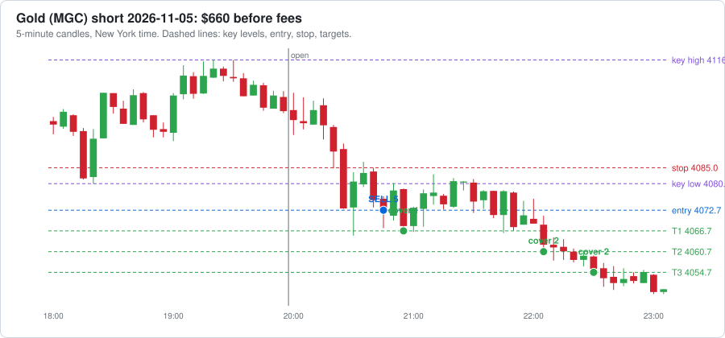

# Agent dashboard

Last updated 2026-11-08 20:46 New York time. Everything here is written by software and AI agents. It can be wrong, so check anything you plan to act on.

**[🪙 Open the Crypto Dashboard →](CRYPTO-DASHBOARD.md)** · **[𝕏 Open the X Brief Dashboard →](X-DASHBOARD.md)**

## Reminders

- ⏰ When your broker is connected: log every trade in trade-journal.md with a heading like `### Trade #1 | 2026-10-16` (swap the `__` in the template for the trade number) and keep the `- **Session:**` line, so the post-session reviewer can see your trades. Or ask Claude to build automatic trade logging into the paper trading agent.
- ⏰ Before trading real money: make this repo private (GitHub → Settings → Danger Zone → Change visibility). First run `git cherry-pick 0f7e3a2` so the paper trader checks less often and stays under GitHub's 2,000 free Actions minutes a month for private repos (it is public now to keep Actions free and unlimited).
- ⏰ 𝕏 **Turn on X auto-posting once @cashflowbrief00 gets traction:** 500+ followers, OR any post with 10,000+ views, OR 1,000+ views a day for a week (check the account's Analytics). Then tell Claude "turn on X auto-posting". It needs X API keys from developer.x.com (about $2.50-3/month for 5-6 posts a day, within the $25 AI budget) and X's "automated account" label.

[Edit reminders](REMINDERS.md)

## Agent status

| | Agent | What it does | Last ran | Runs |
|---|---|---|---|---|
| 🟢 | Market brief: nasdaq | Writes the brief before the New York session | 3 days ago | weekdays about 7-8 AM New York time |
| 🟢 | Market brief: gold | Writes the brief before the Asia session | 2 hours ago | Sun-Thu evenings about 6-7 PM New York time |
| 🟢 | World news brief | Overnight news and today's events: politics, economy, war, trade | 17 hours ago | daily about 5-6 AM New York time |
| 🟢 | Crypto research brief | Pumping coins, whales, government and adoption news | 17 hours ago | daily about 5:30-6:30 AM New York time |
| 🟢 | Stock research brief | Movers, AI, nuclear, minerals, earnings dates and estimates | 3 days ago | Mon, Wed, Fri about 6-7 AM New York time |
| 🟢 | Paper trader | Paper trades every session with your rules and runs a practice prop challenge | 2 days ago | after each session ends |
| 🟢 | Scorer | Checks each lean against what price did | 2 days ago | after each session ends |

🟢 ran recently  🟡 a bit late  🔴 check it  ⚪ never ran

## 📒 Trade journal (paper)

- **Tradeify 50K evaluation: balance $50,652**, $2,652 above the drawdown floor, $2,348 to pass; today $655, $1,905 left before the daily loss limit. [Details](paper-trading/summary.md)
- 📐 Opening range (9:30-10:00, tracked, not traded): -$515 over 4 trades in 5 sessions since 2026-11-02, vs -$1,015 for the real Nasdaq rule (ahead). [Details](paper-trading/summary.md)

Newest first. Times are New York time. Each sale shows contracts @ price, time. The 📈 link opens a chart of the trade; TV opens the same market on TradingView (add [the strategy](tradingview/breakout_strategy.pine) to see each trade marked).

| Date | Market | Side | Lots | Entry | Target 1 | Target 2 | Target 3 / out | Result | What could have gone better | See it |
|---|---|---|---|---|---|---|---|---|---|---|
| 2026-11-06 | Nasdaq | – | 0 | skipped: daily profit cap | | | | $0 | Not taken: this trading day was already up $600, the daily profit cap that keeps the biggest day small for the 35% consistency rule. | [TV](https://www.tradingview.com/chart/?symbol=CME_MINI%3AMNQ1%21&interval=5) |
| 2026-11-06 | Gold | short | 5 | 4072.7 @ 20:45<br>stop 4085.0 | 1 @ 4066.7, 20:55 ($60) | 2 @ 4060.7, 22:05 ($240) | 2 @ 4054.7, 22:30 ($360) | ✅ **$655**<br>out 22:30 | • Price kept going 6.30 points past Target 3 (by 23:05). Letting the last 2 contract(s) run with a trailing stop could have made up to $126 more. | [📈 chart](paper-trading/charts/2026-11-05-gold.svg) · [TV](https://www.tradingview.com/chart/?symbol=COMEX_MINI%3AMGC1%21&interval=5) |
| 2026-11-05 | Nasdaq | – | 0 | skipped: daily profit cap | | | | $0 | Not taken: this trading day was already up $600, the daily profit cap that keeps the biggest day small for the 35% consistency rule. | [TV](https://www.tradingview.com/chart/?symbol=CME_MINI%3AMNQ1%21&interval=5) |
| 2026-11-05 | Gold | long | 5 | 4118.4 @ 20:15<br>stop 4104.3 | 1 @ 4124.4, 20:20 ($60) | 2 @ 4130.4, 20:35 ($240) | 2 @ 4136.4, 20:45 ($360) | ✅ **$655**<br>out 20:45 | • Price kept going 8.00 points past Target 3 (by 20:50). Letting the last 2 contract(s) run with a trailing stop could have made up to $160 more. | [📈 chart](paper-trading/charts/2026-11-04-gold.svg) · [TV](https://www.tradingview.com/chart/?symbol=COMEX_MINI%3AMGC1%21&interval=5) |
| 2026-11-04 | Nasdaq | – | 0 | skipped: risk too big | | | | $0 | Breakout long at 09:40, but even the small size risked $2,352 and only $1,242 could be lost today without breaking the daily loss limit or the drawdown, so it was skipped. | [TV](https://www.tradingview.com/chart/?symbol=CME_MINI%3AMNQ1%21&interval=5) |
| 2026-11-04 | Gold | long | 3 | 3963.4 @ 20:15<br>stop 3936.5 | 1 @ 3969.4, 20:25 ($60) | 1 @ 3975.4, 00:30 ($120) | 1 @ 3981.4, 00:30 ($180) | ✅ **$357**<br>out 00:30 | • Price kept going 51.00 points past Target 3 (by 01:20). Letting the last 1 contract(s) run with a trailing stop could have made up to $510 more. | [📈 chart](paper-trading/charts/2026-11-03-gold.svg) · [TV](https://www.tradingview.com/chart/?symbol=COMEX_MINI%3AMGC1%21&interval=5) |
| 2026-11-03 | Nasdaq | – | 0 | no breakout, no trade | | | | $0 | No confirmed breakout in the first 60 minutes. Key high 28426.50, low 28197.00. | [TV](https://www.tradingview.com/chart/?symbol=CME_MINI%3AMNQ1%21&interval=5) |
| 2026-11-03 | Gold | – | 0 | no breakout, no trade | | | | $0 | No confirmed breakout in the first 60 minutes. Key high 3974.50, low 3952.80. | [TV](https://www.tradingview.com/chart/?symbol=COMEX_MINI%3AMGC1%21&interval=5) |
| 2026-11-02 | Nasdaq | long | 5 | 28886.75 @ 10:25<br>stop 28785.75 | – | – | stop: 5 @ 28785.75, 10:45 (-$1,010) | ❌ **-$1,015**<br>out 10:45 | • Price never reached Target 1: the best it did was +2.50 points, and Target 1 needed 30.<br>• The breakout failed and price kept going the other way, so the stop did its job and kept the loss small.<br>• The entry was 42.75 points past the key level, chasing a stretched move. Waiting for a pullback toward the level would have meant a better price and a smaller risk. | [📈 chart](paper-trading/charts/2026-11-02-nasdaq.svg) · [TV](https://www.tradingview.com/chart/?symbol=CME_MINI%3AMNQ1%21&interval=5) |
| 2026-10-30 | Nasdaq | – | 0 | skipped: risk too big | | | | $0 | Breakout short at 09:45, but even the small size risked $296 and only $199 could be lost today without breaking the daily loss limit or the drawdown, so it was skipped. | [TV](https://www.tradingview.com/chart/?symbol=CME_MINI%3AMNQ1%21&interval=5) |
| 2026-10-30 | Gold | short | 5 | 4015.3 @ 21:00<br>stop 4023.3 | 1 @ 4009.3, 21:05 ($60) | – | stop: 4 @ 4023.3, 21:25 (-$320) | ❌ **-$265**<br>out 21:25 | • Target 1 paid $60, but the stop stayed at the start. Moving it to breakeven after Target 1 would have ended this trade at about $60 instead of -$260.<br>• Fakeout re-entry (switched off): price closed back beyond the entry at 21:35; re-entering 3 contracts at 4012.9 (stop 4018.0) would have made $111. | [📈 chart](paper-trading/charts/2026-10-29-gold.svg) · [TV](https://www.tradingview.com/chart/?symbol=COMEX_MINI%3AMGC1%21&interval=5) |
| 2026-10-29 | Nasdaq | – | 0 | skipped: risk too big | | | | $0 | Breakout short at 09:35, but even the small size risked $1,101 and only $464 could be lost today without breaking the daily loss limit or the drawdown, so it was skipped. | [TV](https://www.tradingview.com/chart/?symbol=CME_MINI%3AMNQ1%21&interval=5) |
| 2026-10-29 | Gold | short | 5 | 4057.4 @ 20:05<br>stop 4067.9 | 1 @ 4051.4, 20:30 ($60) | – | stop: 4 @ 4067.9, 21:15 (-$420) | ❌ **-$365**<br>out 21:15 | • Target 1 paid $60, but the stop stayed at the start. Moving it to breakeven after Target 1 would have ended this trade at about $60 instead of -$360.<br>• The entry was 5.60 points past the key level, chasing a stretched move. Waiting for a pullback toward the level would have meant a better price and a smaller risk. | [📈 chart](paper-trading/charts/2026-10-28-gold.svg) · [TV](https://www.tradingview.com/chart/?symbol=COMEX_MINI%3AMGC1%21&interval=5) |
| 2026-10-28 | Nasdaq | short | 3 | 29787.5 @ 09:45<br>stop 29900.5 | – | – | stop: 3 @ 29900.5, 12:50 (-$678) | ❌ **-$681**<br>out 12:50 | • Price never reached Target 1: the best it did was +3.50 points, and Target 1 needed 30.<br>• The breakout failed and price kept going the other way, so the stop did its job and kept the loss small.<br>• The entry was 100.75 points past the key level, chasing a stretched move. Waiting for a pullback toward the level would have meant a better price and a smaller risk. | [📈 chart](paper-trading/charts/2026-10-28-nasdaq.svg) · [TV](https://www.tradingview.com/chart/?symbol=CME_MINI%3AMNQ1%21&interval=5) |
| 2026-10-28 | Gold | long | 5 | 4083.1 @ 20:05<br>stop 4075.4 | – | – | stop: 5 @ 4075.4, 20:25 (-$385) | ❌ **-$390**<br>out 20:25 | • Price never reached Target 1: the best it did was +1.00 points, and Target 1 needed 6.<br>• The breakout failed and price kept going the other way, so the stop did its job and kept the loss small.<br>• The entry was 5.20 points past the key level, chasing a stretched move. Waiting for a pullback toward the level would have meant a better price and a smaller risk. | [📈 chart](paper-trading/charts/2026-10-27-gold.svg) · [TV](https://www.tradingview.com/chart/?symbol=COMEX_MINI%3AMGC1%21&interval=5) |

**Latest trade:**



[Full journal with every fill](paper-trading/paper-journal.md)

## 👔 CEO check

**❌ 2 broken rule(s)** ([read the full check](reports/ceo/latest.md))

<details>
<summary><b>What the CEO checked</b></summary>

##### Futures paper trader

- ❌ Tradeify practice evaluation failed: reset on 2026-10-28: only $96 above the floor, too close for any trade.
- ❌ Tradeify practice evaluation failed: reset on 2026-11-02: only $299 above the floor, too close for any trade.
- ✅ Tradeify practice evaluation: $2,652 above the $2,000 trailing drawdown floor.

##### Your trade journal

- ✅ No trades logged yet, nothing to check.

##### Crypto bots

- ✅ Rotation bot: 8 trades, buys only at weekly checks, never more than 4 coins at once.
- ✅ Buy-and-hold bot has never sold.

##### Alpaca copy

- ✅ All 10 Alpaca orders were for the bot's coins and within the limit.

##### Costs

- ✅ Spent $4.85 so far this month on 46 AI runs; on pace for about $18 (budget $50).

##### Agent health

- ✅ Every research brief worked on its last run.

##### Ready to run on its own?

- ✅ 15 of 15 trading days on the paper record
- ⏳ 2 rule problem(s) in the paper trader above
- ⏳ the Tradeify practice account never failed
- ⏳ the Tradeify practice evaluation has not passed yet
- ⏳ profit factor 0.85 (needs 1.3 or more), total $-708 over 18 trades
- ✅ worst trading day $-1,071 (needs $-1,250 or better)
- ⏳ You: Tradeify confirms in writing that TradersPost automation is allowed on the Select 50K
- ⏳ You: 2+ weeks of the live 50K alerts traded by hand with no rule broken
- ⏳ You + Claude: 2-3 sessions on a TradersPost paper account matching the chart

</details>

## 📅 Weekly report

<details>
<summary><b>Week ending 2026-11-08</b></summary>

#### The week in one look

- **Futures paper:** +$652 this week
- **Rotation bot:** $0.00 this week
- **Buy-and-hold bot:** -$30.12 this week
- **AI costs:** $4.21 this week

#### Futures paper trading

- **This week:** +$652 after fees, 4 trades (3 wins, 1 losses), 5 sessions with no trade
- **Since paper trading began:** -$708 over 18 trades
- Nasdaq (MNQ): -$1,015 over 1 trades
- Gold (MGC): +$1,667 over 3 trades

| Day | Market | Side | Entry | Result |
|---|---|---|---|---|
| 2026-11-02 | nasdaq | long | 28886.75 at 10:25 | -$1,015 |
| 2026-11-04 | gold | long | 3963.4 at 20:15 | +$357 |
| 2026-11-05 | gold | long | 4118.4 at 20:15 | +$655 |
| 2026-11-06 | gold | short | 4072.7 at 20:45 | +$655 |

#### TradingView strategy

| Market | Export date | Forward test (since paper start) | Whole export |
|---|---|---|---|
| Nasdaq (MNQ) | 2026-10-18 | 0 trades, $0 | 25 trades, +$3,684, 56% wins |
| Gold (MGC) | 2026-10-18 | 0 trades, $0 | 22 trades, +$699, 32% wins |

Export the List of trades from each chart and say "update TradingView" to refresh these numbers.

#### Crypto paper bots

| Bot | Start of week | End of week | Change | Since it started ($1,000) |
|---|---|---|---|---|
| Rotation bot | $979.35 | $979.35 | $0.00 (+0.0%) | -$20.65 |
| Buy-and-hold bot | $936.92 | $906.80 | -$30.12 (-3.2%) | -$93.20 |

**Alpaca copy:** 0 order(s) this week.

#### Market briefs (Nasdaq and gold)

- 7 briefs scored; 1 gave a direction, 1 of those were right.
- 6 were Neutral.

#### CEO check

**❌ Rules were broken this week.** 17 checks ran. [Latest CEO check](../ceo/latest.md)

#### AI costs this week

| Agent | Runs | Cost |
|---|---|---|
| crypto-brief | 7 | $1.74 |
| market-brief-nasdaq | 5 | $0.66 |
| stock-brief | 3 | $0.59 |
| world-brief | 7 | $0.58 |
| market-brief-gold | 4 | $0.57 |
| x-posts | 13 | $0.06 |
| **Total** | 39 | **$4.21** |

At this pace: about $18 a month.

[Main dashboard](../../DASHBOARD.md) · [Crypto dashboard](../../CRYPTO-DASHBOARD.md)

</details>

[All weekly reports](reports/weekly/)

## Paper trading

- Total after fees: **-$708** over 18 trades (29 sessions watched)
- Trading days with a trade: **14**, profitable: **6**, losing: 8
- Win rate: 44%
- Profit factor: 0.85
- Biggest drop from a high (max drawdown): $4,620
- Room left before the $4,000 max drawdown: **$1,047**
- Progress toward a prop demo: **14 of 20** trading days

<details>
<summary><b>Challenge simulation, results by market, and daily results</b></summary>

#### By market

| Market | Trades | Wins | Total after fees |
|---|---|---|---|
| nasdaq | 8 | 3 | -$1,716 |
| gold | 10 | 5 | $1,008 |


#### Daily results

| Trading day | Sessions | Result after fees |
|---|---|---|
| 2026-11-06 | gold short, nasdaq skipped, daily profit cap reached | $655 |
| 2026-11-05 | gold long, nasdaq skipped, daily profit cap reached | $655 |
| 2026-11-04 | gold long, nasdaq skipped, risk too big for today's limits | $357 |
| 2026-11-03 | gold no trade, nasdaq no trade | $0 |
| 2026-11-02 | nasdaq long | -$1,015 |
| 2026-10-30 | gold short, nasdaq skipped, risk too big for today's limits | -$265 |
| 2026-10-29 | gold short, nasdaq skipped, risk too big for today's limits | -$365 |
| 2026-10-28 | gold long, nasdaq short | -$1,071 |
| 2026-10-27 | gold no trade, nasdaq long | -$688 |
| 2026-10-26 | gold short, nasdaq no trade | -$329 |
| 2026-10-23 | gold short, nasdaq long | -$888 |
| 2026-10-22 | gold short, nasdaq short | $1,070 |
| 2026-10-21 | gold no trade, nasdaq short | -$252 |
| 2026-10-20 | gold short, nasdaq long | $1,070 |
| 2026-10-19 | gold no trade, nasdaq long | $357 |

[Every paper trade](paper-journal.md) · [Raw data](trades.csv)


</details>

[Paper trading journal](paper-trading/paper-journal.md) · [TradingView strategy](tradingview/breakout_strategy.pine)

## 📈 TradingView strategy results

From the latest **List of trades** export of each chart. One trade = one entry (TradingView counts each target as a separate trade). Forward test = trades from 2026-10-19 on.

| Market | Export date | Trades | Wins / losses | Win rate | Total | Profit factor | Max drawdown | Forward test |
|---|---|---|---|---|---|---|---|---|
| Nasdaq (MNQ) | 2026-10-18 (trades since 2026-08-25) | 25 | 14 / 11 | 56% | **$3,684** | 1.99 | $1,066 | 0 trades, $0 |
| Gold (MGC) | 2026-10-18 (trades since 2026-08-24) | 22 | 7 / 15 | 32% | **$699** | 1.30 | $1,559 | 0 trades, $0 |
| **Both** | | 47 | 21 / 26 | 45% | **$4,384** | 1.72 | | |

<details>
<summary><b>Latest 10 TradingView trades</b></summary>

| Entry (New York) | Market | Side | Entry price | Contracts | Result |
|---|---|---|---|---|---|
| 2026-10-15 09:35 | Nasdaq (MNQ) | short | 29,830.00 | 5 | ❌ -$68 |
| 2026-10-14 20:05 | Gold (MGC) | short | 4,138.90 | 5 | ❌ -$105 |
| 2026-10-14 09:35 | Nasdaq (MNQ) | short | 30,578.50 | 5 | ❌ -$192 |
| 2026-10-13 09:35 | Nasdaq (MNQ) | short | 30,757.25 | 5 | ❌ -$20 |
| 2026-10-12 20:05 | Gold (MGC) | short | 4,187.60 | 5 | ✅ $420 |
| 2026-10-12 09:45 | Nasdaq (MNQ) | short | 30,969.50 | 5 | ✅ $660 |
| 2026-10-08 20:05 | Gold (MGC) | long | 4,168.70 | 5 | ❌ -$20 |
| 2026-10-07 20:05 | Gold (MGC) | short | 4,131.60 | 5 | ❌ -$250 |
| 2026-10-07 09:35 | Nasdaq (MNQ) | short | 31,180.50 | 5 | ❌ -$704 |
| 2026-10-06 20:05 | Gold (MGC) | long | 4,191.20 | 5 | ❌ -$8 |

</details>

To refresh: export the List of trades from each chart in TradingView, double-click `tradingview/update-exports.command`, then push in GitHub Desktop.

## Latest briefs

Click a brief to read it here. The summary is at the top of each.

<details>
<summary><b>🌍 World news brief, 2026-11-08, event risk High</b></summary>

#### Top things for today
1. **Iran decision pending.** Trump told reporters Thursday he will decide soon whether to attack Iran again. Gulf states are still bracing for escalation. (CNBC) Gulf markets fell as traders waited for his next move (Reuters, headline only). Why it matters: energy prices, gold safe-haven demand and risk appetite.
2. **US embassies warn of possible rapid Mideast escalation** (JNS.org, headline only). Why it matters: oil and shipping risk.
3. **Democrats won Congress.** Democrats took full control of Congress on Tuesday. Their options are limited until they take office in January. Why it matters: fiscal policy, war funding and the legislative agenda.
4. **US CPI is Tuesday at 8:30 AM.** Why it matters: rates and the dollar.
5. **Crude oil sold off last week.** Investors hoped the Democratic win would force an end to the war. (CNBC) Why it matters: inflation expectations.

#### Today's schedule (New York time)
| Time | Event | Who or where | Confirmed? |
|---|---|---|---|
| All day | No economic data or central bank events | Calendar | Yes |
| Not announced | Possible Trump decision on Iran | White House (unconfirmed) | No |

Coming up this week: Tue Nov 10, 8:30 AM: US CPI m/m (forecast 0.3%, previous 0.6%) and Core CPI m/m (forecast 0.2%, previous 0.3%). Thu Nov 12, 2:00 AM: UK GDP m/m (forecast 0.0%, previous 0.1%). Fri Nov 13, 8:30 AM: US PPI m/m (forecast 0.4%, previous 1.3%) and Core PPI m/m (forecast 0.3%, previous 0.7%).

#### Event risk today
High - Markets are closed, but a possible US decision on new Iran strikes and the embassy warnings could cause gaps at the open.

#### Politics and policy
- Democrats flipped deep-red states, including Texas and Kansas. (SCMP) The New York Times says Democrats seized control of Congress (headline only).
- Vance said the Iran conflict was "the reason we lost." Trump acknowledged that high gas prices contributed. (Asia Times)
- Schumer said Democrats "are going to end the war," citing Congress's spending power. A war powers resolution is unlikely before January, and Trump can veto one. (CNBC)
- Shattered.io says the Clarity Act stalled at 49-50 (headline only). Forbes Middle East says Democrats are preparing an affordability push (headline only). Al-Monitor asks whether Democrats will block Trump's push on Turkey F-35s and sanctions relief (headline only).
- AP says staff at the US AI safety center are reporting to the White House (headline only).
- No Fed or Treasury news found in the feeds.

#### Economics
Nothing found. No data was released overnight. The calendar lists no events.

#### SEC, CFTC and hearings
- GuruFocus, citing CFTC data, says gold prices dropped as speculative funds withdrew (headline only).
- Forex Crunch says the CFTC gave exchanges 30 days to drop access limits (headline only).
- njtoday.news says a watchdog group claims the CFTC told prediction markets to defy court orders (headline only).
- InsuranceNewsNet says Elizabeth Warren will lead the Senate Banking Committee (headline only).
- No SEC or CFTC press releases in the last 2 days. No hearing dates found.

#### War, trade and tariffs
- US officials acknowledged limited strikes on Iran's Qeshm Island, near the Strait of Hormuz, on November 2. (Asia Times)
- Trump repeated that Iran will not have a nuclear weapon. (CNBC) JNS.org says Iran's Rezaei told Trump "you lost the war and the election" (headline only).
- One analyst says the closure of the Strait of Hormuz has a large regional spillover. (SCMP)
- The Korea Times says potential US data center curbs pose risks to Korea's chip-driven growth (headline only).
- No new tariff news found.

#### Country briefs
- **China:** SCMP says China is urged to target sugar-rich drinks in its consumption tax overhaul (headline only).
- **European Union:** Al Jazeera maps how France's protest wave spread across Europe (headline only).
- **United Kingdom:** Nothing found. GDP is due Thursday at 2:00 AM.
- **Japan:** Nothing found.
- **India:** Nothing found.
- **Russia:** Nothing found.
- **Canada:** Nothing found.

[Read the full brief with all the details](reports/news/2026-11-08-world-brief.md) · [All news briefs](reports/news/)

</details>

<details>
<summary><b>🪙 Crypto brief, 2026-11-08</b></summary>

#### Top things today

1. **Democrats won Congress, and the CLARITY Act is stalled.** AP projections had Democrats winning the House and Senate on Nov 3. The CLARITY Act has passed the House but not the Senate, where a vote to start debate failed 49 to 50 on Sept 15. (CoinDesk via Tech-Insider; Align Labs) Why it matters: US market-structure rules are unlikely soon.
2. **A dormant whale bought BTC while ETFs saw outflows.** Lookonchain said a wallet idle for over a year bought 3,009 BTC on Nov 6. US spot Bitcoin ETFs had $430.2M in net outflows on Nov 5. (Blockonomi) Why it matters: big wallets and funds are moving in opposite directions.
3. **Sentiment is in Fear (28).** BTC is $75,849, down 2.7% on the week. SOL is weaker, down 6.6% on the week. (Live data) Why it matters: altcoins are lagging bitcoin.
4. **Democrats are drafting a CLARITY successor.** It could give the SEC more power and the CFTC less. Talks are preliminary and no formal bill has been released. (Crypto Times) Why it matters: the SEC-versus-CFTC split may flip.
5. **Several big unlocks fall in the next week and a half.** Pieverse (PIEVERSE), also a top gainer, has one on Nov 14. (Cryptolaxy) Why it matters: new supply can hit thin markets.

#### Coins to research

| Coin | 24h move | Why it is moving | Red flags |
|---|---|---|---|
| Yellow (YELLOW) | +10.4% | No news found. | Volume is only $1.3M on a $122.8M cap. The pump has no news. |
| edgeX (EDGE) | +8.5% | No news found. | EDGE had a token unlock on Nov 2. (TokenPost) It is down 5.2% on the week. Volume is low. |
| Meteora (MET) | +7.2% | No news found for today. Past rallies tracked protocol fees and rewards. (AMBCrypto) | Volume is good at $54.2M. A rally with no news today. |
| Cap (CAP) | +7.0% (+37.9% 7d) | No news found. | A 38% weekly run with no known cause. |
| Pieverse (PIEVERSE) | +3.0% (+38.1% 7d) | AMBCrypto said there was no clear coin-specific catalyst, and chatter pointed to a short squeeze. | A team and investor 12-month lockup ends Nov 14. (Cryptolaxy) |
| Kinetiq (KNTQ) | +3.8% (+4.6% on the trending list) | No news found. | A core contributor and investor cliff ends Nov 27. (Cryptolaxy) |

I found no new meme coin pumping hard. In the trending list, UnifAI (UAI) fell 40.1%, STONK fell 29.3% and Pons (PONS) fell 13.3%. These are very large drops in small coins.

#### Whale watch

| When | Coin | Amount (USD) | Who | Direction |
|---|---|---|---|---|
| Nov 6 (date only, exact time not given) | BTC | ~$228M (3,009 BTC) | Dormant wallet (Lookonchain) | Bought |
| Nov 6 (date only, exact time not given) | BTC | 1,286 BTC, USD value not stated | Whale (Lookonchain) | Off an exchange (Binance) |

These are from Nov 6, not the last 24 hours. I found no confirmed moves of $10M or more from the last day.

#### Government and regulation

- **CLARITY Act (H.R. 3633):** It is a market-structure bill that sets rules for exchanges and digital-asset firms and defines SEC and CFTC roles. The Senate adjourned on Nov 5 until Nov 9. No vote is scheduled. It expires Jan 3 unless the Senate passes it in the lame-duck session. (Align Labs; CryptoTicker)
- **Possible new House Democratic bill:** It would build on Maxine Waters' 2025 investor-rights amendment. There is no finalized draft or timetable. It is for the next Congress in January 2027. (Bitcoin Foundation; KuCoin News)
- **SEC:** 2026 actions include the August "Regulation Crypto Assets" proposal, the Sept 17 Innovation Exemption and the Oct 1 custody proposal. Comments on the custody proposal are due Dec 7. (Cryptonomist)
- **Committees:** Elizabeth Warren is in line to chair Senate Banking. Sherrod Brown could take a senior post on Senate Agriculture, which oversees the CFTC. (CryptoTicker; Crypto Times)
- **Other countries and CFTC actions:** Nothing found.

#### Who is buying and adopting

- **Whales:** one dormant wallet bought about $228M of BTC (see above). It is not a company or a government.
- **US government:** The Strategic Bitcoin Reserve is described as a passive vault of seized coins, about 198,000 BTC. The BITCOIN Act remains stalled. This is background from an older article (Tapbit).
- **Companies and other countries:** I found no new purchases or stablecoin-payment announcements in the last few days.

#### Next 7 days

| Date | Event | Coin or topic |
|---|---|---|
| Nov 8 | Avalanche unlock, about $14.33M (Tokenomist via Bittime) | AVAX |
| Nov 9 | Senate returns from adjournment (Align Labs) | CLARITY Act |
| Nov 11 | Pump unlock, $27.53M (DefiLlama) | PUMP |
| Nov 11 | Allora 160M ALLO cliff unlock (Cryptolaxy) | ALLO |
| Nov 13 | Sei unlock, $4.5M (DefiLlama) | SEI |
| Nov 13 | Aztec unlock, $14.3M (Tokenomist via Bittime) | AZTEC |
| Nov 14 | Team and investor lockup ends (Cryptolaxy) | PIEVERSE |

Unlock dates and dollar values differ between trackers. Treat them as unconfirmed. No ETF deadlines or hearings were found.

[Read the full brief with all the details](reports/crypto/2026-11-08-crypto-brief.md) · [All crypto briefs](reports/crypto/)

</details>

<details>
<summary><b>📈 Stocks brief, 2026-11-06</b></summary>

#### Top things today
1. **Chip rout.** The Philadelphia semiconductor index fell 12.3%, its worst day since March 2020. The Nasdaq 100 dropped 6.3% and the S&P 500 fell 4.4%. Why it matters: it sets the tone for every AI-linked name today.
2. **Trigger was politics plus AI worries.** Selling grew after Democrats won both the House and Senate, which raised fears of slower data center buildouts. Why it matters: the risk is policy, not weak earnings.
3. **Asia is falling too.** South Korea's KOSPI fell more than 8% on Friday and tripped its first circuit breaker before paring losses. Why it matters: the selling is global and may carry into the US open.
4. **AppLovin (APP) bucked the trend.** It rose 31.04% to $356.10 after a strong quarter and outlook. Why it matters: strong earnings still get rewarded in this tape.
5. **Nuclear, uranium and rare earths fell with AI.** OKLO and SMR dropped 13–15%, and VST fell 6.2% (live data). Why it matters: these names trade as AI-power plays. OKLO and VST report today.

#### Stocks to research
| Ticker | Theme | Move | Why | Red flags |
|---|---|---|---|---|
| APP | AI/ad tech | +31.0% | Q3 EPS was $4.30 against a $4.04 consensus. Q4 revenue guidance was well above expectations. | Still down about 47% year to date. Gap risk after a big one-day move. |
| MP | Rare earths | -6.0% (close) | Q3 revenue of $147.6M and adjusted EPS of $0.04 beat estimates. Shares were up 2.64% after hours. | Still loss-making. Government stake and possible congressional scrutiny weigh on sentiment. |
| AMD | AI chips | -17.3% | The drop came days after a record quarter. Lisa Su expects 2027 revenue growth above 80%. | Down 28.6% in 5 days. Policy fears could keep pressure on. |
| MU | Memory | -17.5% | The DRAM ETF sank almost 18%. | Down 29.7% in 5 days. Sector-wide selling, not company news. |
| OKLO | Nuclear | -13.2% | Reports earnings today (live data). | Pre-revenue. Estimated revenue is only $1.1M. High volatility. |
| VST | Nuclear/power | -6.2% | Reports earnings today. Estimates: EPS $3.08, revenue $6.0B (live data). | Down 19.9% in 5 days. |

I found no IPO or new-listing movers in my searches. SPCX (-9.0%, $1.7T market cap) is on the most-active list. I found no news on it.

#### AI and tech
- **Nvidia and chips.** Nvidia and Qualcomm each fell more than 9%. Nvidia lost almost $450B in market value. (CNBC) Nvidia reports on Nov 17.
- **Qualcomm guidance.** Qualcomm gave a weak forecast for the current quarter. Phone chip sales fell 26% and missed estimates. The stock closed 9.49% lower.
- **Policy fear.** Traders worry a Democratic Congress and state officials could tighten AI rules and slow data center construction. (Yahoo Finance)
- **Neoclouds.** CoreWeave and similar firms fell for a second day. CRWV reports Nov 10.

#### Nuclear and critical minerals
- **Rare earths.** MP's quarter beat, and it finished GM magnet qualification, with saleable deliveries starting in Q4. (SEC filing)
- **Uranium.** UEC's US Uranium unit signed long-term sales deals with two US nuclear utilities. (Mining Weekly) UEC still fell 9.9% on Thursday.
- **Uranium M&A.** Eagle Nuclear Energy signed a binding letter of intent to buy Noble Plains Uranium in an all-stock deal. (Mining.com)
- **Copper.** Resolution Copper approved a $144M investment in its next phase. (Mining Weekly) FCX and SCCO fell 7.5% and 6.5% on Thursday.

I found no new government deals or export limits this week.

#### Earnings
**Results since yesterday**
- **AppLovin (reported after the close Wednesday):** EPS of $4.30 beat the $4.03 consensus. Revenue of $2.18B beat the $2.07B estimate. The stock rose 31%.
- **MP Materials (reported after the close Thursday):** Revenue of $147.66M beat the $117.47M estimate. EPS of $0.04 beat a $0.02 loss estimate. Shares were up modestly after hours.
- **Qualcomm:** the forecast disappointed, and the stock fell 9.49%.

**Watchlist calendar** (Yahoo Finance consensus). Timing is not confirmed in my data, so I've marked it unconfirmed.

| Date | Ticker | Timing | EPS est. | Revenue est. |
|---|---|---|---|---|
| 2026-11-06 | OKLO | unconfirmed | $-0.26 | $1.1M |
| 2026-11-06 | VST | unconfirmed | $3.08 | $6.0B |
| 2026-11-09 | CEG | unconfirmed | $3.88 | $9.3B |
| 2026-11-09 | USAR | unconfirmed | $-0.15 | $13.6M |
| 2026-11-10 | CRWV | unconfirmed | $-1.21 | $3.5B |
| 2026-11-13 | LAC | unconfirmed | $-0.03 | n/a |
| 2026-11-17 | NVDA | unconfirmed | $2.47 | $109.0B |
| 2026-11-17 | SQM | unconfirmed | $2.08 | $2.2B |

#### Smart money
- **APP price targets:** RBC raised its target to $520 from $500 and kept Outperform. BTIG raised its target to $450 and kept Buy. Needham reiterated Buy with a $475 target. (TheStreet, AOL)
- Insider buying, Congress trades, and analyst actions on the nuclear and mining names: nothing found.

[Read the full brief with all the details](reports/stocks/2026-11-06-stock-brief.md) · [All stocks briefs](reports/stocks/)

</details>

<details>
<summary><b>📊 Nasdaq 100 futures market brief, 2026-11-06</b></summary>

#### Price data used

```
PRICE DATA (Nasdaq 100 futures, Yahoo Finance, New York time, may be delayed)
Latest price: 27183.50 at 2026-11-06 07:40
Previous New York session (2026-11-05 09:30 to 16:00): high 28228.25, low 26718.00, close 26746.25, volume 987,095
Highest high of the last 5 New York sessions: 29562.00
Lowest low of the last 5 New York sessions: 26718.00
Since that session closed: high 27251.50, low 26366.50.
Latest price is INSIDE the previous range (1044.75 below the high, 465.50 above the low).
Volume: the previous session traded 1.74x the average of the 5 session(s) before it.
```

**Nasdaq 100 futures brief for Friday, Nov 6, 2026 (New York session)**

**1. What is driving the market**
- Nasdaq futures rose Friday as chip stocks gained. A tech-led rout had wiped nearly $3 trillion off S&P 500 market value on fears that Democratic control of Congress could mean tougher AI regulation.
- The Nasdaq 100 fell 6.4% on Thursday, well into correction territory.
- Nvidia was up 3.6% in premarket trading after its biggest one-day fall since January 2025.
- A Jefferies strategist called the selloff "reactionary, not a fundamental reset." That is one opinion.
- Rates matter too. Reuters said traders priced a more than 65% chance of a December hike. Another source said fading December Fed hike bets. These conflict, and I could not reconcile them.

**2. Scheduled events (New York time)**
- **4:30 AM:** NY Fed President Williams joined the ECB's Lane for a discussion in Frankfurt. This is already done.
- **8:30 AM:** October jobs report. Economists expect 59,000 new jobs and unemployment at 4.2%. Other sources show forecasts of 63,000 to 70,000. Average hourly earnings are expected at 0.3% month on month.
- **9:10 AM:** St. Louis Fed's Musalem speaks.
- **12:15 PM:** Fed Vice Chair for Supervision Bowman speaks on supervision and regulation.
- **Michigan sentiment:** A preliminary November University of Michigan reading is due. I could not verify the time.
- **Earnings:** I found no major market-moving earnings after the close. Charter, Humana, Vistra and Moderna report before the open.

**3. Key levels (from the price data)**
- Previous session high: 28,228.25
- Previous session low: 26,718.00
- Previous session close: 26,746.25
- Overnight range since the close: low 26,366.50, high 27,251.50
- Highest high of the last 5 sessions: 29,562.00
- Lowest low of the last 5 sessions: 26,718.00 (same as the previous session low)

The latest price is 27,183.50. It is inside the previous range, 1,044.75 below the high and 465.50 above the low. It is closer to the low (support) than the high (resistance). It is also near the top of the overnight range, so it is not clearly at either one.

**4. Volume**
The previous session traded 987,095 contracts, which was 1.74x the average of the five sessions before it. That is strong participation, but it came on a heavy selling day. It shows many traders are active and moves may carry through. It does not show which way the next move goes.

**5. Directional lean: Neutral, Confidence: Low**
Price has bounced about 437 points above Thursday's close, which is a bullish sign. But it is still far below the previous high and sits inside a range set during a big selloff. Volume was heavy on that selloff day. The news is mixed: dip-buying in chips against AI-regulation worries and rate-hike uncertainty. The 8:30 AM jobs report can swing the market either way. Because these signals conflict, I stay Neutral.

I would lean Bullish if price holds above the overnight high of 27,251.50 after the jobs report, with solid volume. I would lean Bearish if price breaks below the previous session low of 26,718.00 and stays there. This is a probability-based lean, not a prediction or a trade instruction.

**6. Event risk: High**
The jobs report lands one hour before the open, after a historic selloff, with Fed speakers and unsettled rate-hike expectations on top. The VVIX jumped 49.3% to 134.99 on Thursday. That was its biggest one-day percentage gain since February 2007.

**7. Sources**
- CNBC
- Investing.com (Reuters)
- TradingView / Seeking Alpha
- Stocktwits
- TheStreet
- Kiplinger
- Trading Economics
- Market Daily
- Stock Titan
- Moneta Markets
- Substack macro notes

I could not verify the Michigan release time. I also could not verify which December hike probability is correct.

BIAS: Neutral | CONFIDENCE: Low

[Open the file](reports/2026-11-06-nasdaq-brief.md)

</details>

<details>
<summary><b>📊 Gold futures market brief, 2026-11-08</b></summary>

### Gold futures brief: Asia session, Sunday Nov 8 to Monday Nov 9, 2026

#### 1. What is driving gold
- **Hawkish Fed and a firm dollar:** Gold fell on Friday after a strong U.S. jobs report lifted Fed rate-hike bets. Kitco's headlines also say gold is holding $4,000 support, but strong jobs data and inflation risks threaten a recovery.
- **Midterm rally:** Gold rose above $4,120 on Thursday to a two-week high after the Democratic midterm win. It slipped below $4,050 on Friday but was still on track for a weekly gain of more than 4%. Kitco says the Fed's policy still dominates sentiment over politics.
- **Central banks:** China's central bank added to gold reserves for a 24th straight month in October.

#### 2. Scheduled events (New York time)
- **During the session (8 PM to 4 AM):** I found no confirmed U.S. releases. China CPI and PPI are due Monday (China CPI and producer prices), but I could not verify the release time.
- **Just after the session:** Fed speakers start Monday morning. Goolsbee speaks at 10:00 AM ET. Kiplinger lists Bowman at 8:40 AM.
- **Next big event:** U.S. CPI for October is Tuesday at 8:30 AM ET. One bank expects headline CPI of +0.4% month on month and core of +0.3%. Other sources expect +0.3% headline and +0.2% core, so forecasts differ.
- **Earnings:** none that matter for gold.

#### 3. Key levels (from the price data)
- Previous session high: **4106.70**. Low: **4044.50**. Close: 4085.60.
- Since that close, price has traded as high as **4090.70** and as low as **4035.10**. The low is below the previous session low.
- Five-session high: **4155.80**. Five-session low: **3900.00**.
- Latest price: **4076.60**. It is inside the previous range. It is 30.10 below the high and 32.10 above the low, so it is roughly in the middle and not near either edge.
- Kitco's headlines point to $4,000 as a watched round-number area. This is a news reference, not a level from the price data.

#### 4. Volume
The previous session traded 46,962, which is **0.88x** the average of the five sessions before it. That is slightly below average. It suggests mildly weak participation, so moves in that session had less conviction.

#### 5. Directional lean
**Neutral, Confidence: Low.**
- Price sits mid-range, away from both the previous high and low.
- Volume was a bit light, which does not support a strong move either way.
- The news conflicts. A strong jobs report and rate-hike bets weigh on gold. The post-election rally and central-bank buying support it.
- The session also comes ahead of Tuesday's CPI, so traders may stay cautious.

**What would change the lean:**
- A clean break and hold above 4106.70 on rising volume would shift it toward Bullish.
- A move below 4035.10 or 4044.50 on rising volume would shift it toward Bearish.
- A surprise in the China data, or in Fed comments on rate hikes, could also change it.

This is a probability-based lean, not a prediction or a trade instruction.

#### 6. Event risk
**Low.** I found no confirmed high-impact releases during the session. The main risks, Fed speakers and CPI, come after it ends, but headline surprises are still possible.

#### 7. Sources
- Price data block (Yahoo Finance)
- Investing.com
- Kitco
- Trading Economics
- U.S. Bank Weekly Economic Outlook
- Kiplinger
- The Globe and

[Open the file](reports/2026-11-08-gold-brief.md)

</details>

## Latest lean for each market

| Market | Brief written | Lean | Confidence | Event risk | Price then | Full brief |
|---|---|---|---|---|---|---|
| nasdaq | 2026-11-06 07:50 | ◆ Neutral | Low | High | 27183.50 | [read it](reports/2026-11-06-nasdaq-brief.md) |
| gold | 2026-11-08 18:26 | ? Unknown | Unknown | Low | 4076.60 | [read it](reports/2026-11-08-gold-brief.md) |

A lean is a probability-based view, not a prediction. ▲ Bullish  ▼ Bearish  ◆ Neutral

## Scorecard

- Briefs scored: **23** (Bullish or Bearish calls: 3)
- Right: 2, Wrong: 1, Session ended flat: 0
- Hit rate when the session was decisive: **67%**
- For comparison, price went up in 48% of decisive sessions
- ⚠️ Only 3 directional calls so far. Treat the numbers as noise until there are at least 30.

By confidence:

| Confidence | Right | Wrong | Flat | Hit rate |
|---|---|---|---|---|
| High | 0 | 0 | 0 | n/a |
| Medium | 1 | 0 | 0 | 100% |
| Low | 1 | 1 | 0 | 50% |

[Full scorecard](reports/scorecard.md)

## Charts


## Recent results

| Brief | Market | Lean | Confidence | Session moved | Result |
|---|---|---|---|---|---|
| 2026-11-06 | nasdaq | ◆ Neutral | Low | Down (-0.34%) | Moved |
| 2026-11-05 | gold | ◆ Neutral | Low | Down (-0.38%) | Moved |
| 2026-11-05 | nasdaq | ▼ Bearish | Low | Down (-5.16%) | Right |
| 2026-11-04 | nasdaq | ◆ Neutral | Low | Up (0.48%) | Moved |
| 2026-11-03 | gold | ◆ Neutral | Low | Up (2.63%) | Moved |
| 2026-11-03 | nasdaq | ◆ Neutral | Low | Flat (0.12%) | Calm |
| 2026-11-02 | nasdaq | ◆ Neutral | Low | Down (-2.04%) | Moved |
| 2026-10-28 | gold | ◆ Neutral | Low | Down (-0.80%) | Moved |
| 2026-10-28 | nasdaq | ◆ Neutral | Low | Up (0.20%) | Moved |
| 2026-10-27 | gold | ◆ Neutral | Low | Down (-0.44%) | Moved |

## Your journals

- Trades logged: **0**. [Open the trade journal](trade-journal.md)
- No-trade sessions explained: **3**. [Open the no-trade journal](no-trade-journal.md)

<details>
<summary><b>Latest no-trade sessions</b></summary>

##### No-trade session | 2026-10-18 | Asia
- **Instrument:** Gold futures
- **What happened:** No signal. The rules gave no entry.
- **Why:** No 5-minute candle closed above the previous high (4211.20) or below the previous low (4167.50) in the first 30 minutes after the 20:00 open. (Previous Asia session was 2026-10-15.)
- **First 30 minutes, candle by candle:**
  - 20:00 candle: close 4205.50, closed inside the range (5.70 below the high, 38.00 above the low).
  - 20:05 candle: close 4204.40, closed inside the range (6.80 below the high, 36.90 above the low).
  - 20:10 candle: close 4201.70, closed inside the range (9.50 below the high, 34.20 above the low).
  - 20:15 candle: close 4199.00, closed inside the range (12.20 below the high, 31.50 above the low).
  - 20:20 candle: close 4196.40, closed inside the range (14.80 below the high, 28.90 above the low).
  - 20:25 candle: close 4196.00, closed inside the range (15.20 below the high, 28.50 above the low).
- **Closest call:** Price got within 2.80 of the previous high (its highest point was 4208.40) but never reached it.
- **After the window:** No candle closed beyond either level for the rest of the session.
- **What the market was showing:** The session range was 25.60 points, 60% of the average of the last 5 (a quiet session). Open to close it moved -12.30 points (-0.29%).
- **The morning brief said:** Neutral (Low confidence), event risk Medium.
- **Verdict:** Consistent with your rules. There was no setup, so staying out was correct under the rules.
- **Your notes:**

##### No-trade session | 2026-10-16 | New York
- **Instrument:** Nasdaq 100 futures
- **What happened:** No signal. The rules gave no entry.
- **Why:** No 5-minute candle closed above the previous high (30196.75) or below the previous low (29622.50) in the first 15 minutes after the 09:30 open. (Previous New York session was 2026-10-15.)
- **First 15 minutes, candle by candle:**
  - 09:30 candle: close 29969.75, closed inside the range (227.00 below the high, 347.25 above the low).
  - 09:35 candle: close 29895.25, closed inside the range (301.50 below the high, 272.75 above the low).
  - 09:40 candle: close 29936.25, closed inside the range (260.50 below the high, 313.75 above the low).
- **Closest call:** Price got within 151.00 of the previous high (its highest point was 30045.75) but never reached it.
- **After the window:** A candle first closed below the previous low at 12:45, but that was after the 15-minute window, so the rules did not allow an entry.
- **What the market was showing:** The session range was 777.00 points, 219% of the average of the last 5 (a busy session). Open to close it moved -644.75 points (-2.15%).
- **The morning brief said:** Neutral (Low confidence), event risk Medium.
- **Verdict:** Consistent with your rules. There was no setup, so staying out was correct under the rules.
- **Your notes:**

##### No-trade session | 2026-10-15 | Asia
- **Instrument:** Gold futures
- **What happened:** No signal. The rules gave no entry.
- **Why:** No 5-minute candle closed above the previous high (4183.30) or below the previous low (4152.70) in the first 15 minutes after the 21:00 open. (Previous Asia session was 2026-10-14.)
- **First 15 minutes, candle by candle:**
  - 21:00 candle: close 4176.50, closed inside the range (6.80 below the high, 23.80 above the low).
  - 21:05 candle: close 4178.00, closed inside the range (5.30 below the high, 25.30 above the low).
  - 21:10 candle: close 4178.50, closed inside the range (4.80 below the high, 25.80 above the low).
- **Closest call:** Price got within 1.60 of the previous high (its highest point was 4181.70) but never reached it.
- **After the window:** A candle first closed above the previous high at 22:30, but that was after the 15-minute window, so the rules did not allow an entry.
- **What the market was showing:** The session range was 43.70 points, 98% of the average of the last 5 (a normal session). Open to close it moved +33.70 points (+0.81%).
- **The morning brief said:** Neutral (Low confidence), event risk High.
- **Verdict:** Consistent with your rules. There was no setup, so staying out was correct under the rules.
- **Your notes:**

</details>

## Still to build

| Agent | Purpose | Status |
|---|---|---|
| Product selling agent (separate repo) | Main Agent from your Obsidian notes: what to sell, sourcing, advertising | ⚪ not built yet |
| Live demo trading | Sends the TradingView strategy's orders to a Tradovate demo or prop challenge account, behind a risk gatekeeper | ⚪ not built yet |

## Links

- [All reports](reports/)
- [Trading rules](trading-rules.md)
- [Bias log](reports/bias-log.csv)
