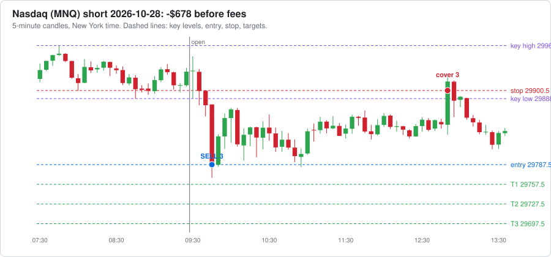

# Agent dashboard

Last updated 2026-10-28 18:48 New York time. Everything here is written by software and AI agents. It can be wrong, so check anything you plan to act on.

**[🪙 Open the Crypto Dashboard →](CRYPTO-DASHBOARD.md)** · **[𝕏 Open the X Brief Dashboard →](X-DASHBOARD.md)**

## Reminders

- ⏰ When your broker is connected: log every trade in trade-journal.md with a heading like `### Trade #1 | 2026-10-16` (swap the `__` in the template for the trade number) and keep the `- **Session:**` line, so the post-session reviewer can see your trades. Or ask Claude to build automatic trade logging into the paper trading agent.
- ⏰ Before trading real money: make this repo private (GitHub → Settings → Danger Zone → Change visibility). First run `git cherry-pick 0f7e3a2` so the paper trader checks less often and stays under GitHub's 2,000 free Actions minutes a month for private repos (it is public now to keep Actions free and unlimited).
- ⏰ 𝕏 **Turn on X auto-posting once @cashflowbrief00 gets traction:** 500+ followers, OR any post with 10,000+ views, OR 1,000+ views a day for a week (check the account's Analytics). Then tell Claude "turn on X auto-posting". It needs X API keys from developer.x.com (about $2.50-3/month for 5-6 posts a day, within the $25 AI budget) and X's "automated account" label.

[Edit reminders](REMINDERS.md)

## Agent status

| | Agent | What it does | Last ran | Runs |
|---|---|---|---|---|
| 🟢 | Market brief: nasdaq | Writes the brief before the New York session | 10 hours ago | weekdays about 7-8 AM New York time |
| 🟢 | Market brief: gold | Writes the brief before the Asia session | 23 hours ago | Sun-Thu evenings about 6-7 PM New York time |
| 🟢 | World news brief | Overnight news and today's events: politics, economy, war, trade | 14 hours ago | daily about 5-6 AM New York time |
| 🟢 | Crypto research brief | Pumping coins, whales, government and adoption news | 14 hours ago | daily about 5:30-6:30 AM New York time |
| 🟢 | Stock research brief | Movers, AI, nuclear, minerals, earnings dates and estimates | 13 hours ago | Mon, Wed, Fri about 6-7 AM New York time |
| 🟢 | Paper trader | Paper trades every session with your rules and runs a practice prop challenge | 5 hours ago | after each session ends |
| 🟢 | Scorer | Checks each lean against what price did | under an hour ago | after each session ends |

🟢 ran recently  🟡 a bit late  🔴 check it  ⚪ never ran

## 📒 Trade journal (paper)

- **Tradeify 50K evaluation: balance $48,929**, $929 above the drawdown floor, $4,071 to pass; today -$1,071, $179 left before the daily loss limit. [Details](paper-trading/summary.md)

Newest first. Times are New York time. Each sale shows contracts @ price, time. The 📈 link opens a chart of the trade; TV opens the same market on TradingView (add [the strategy](tradingview/breakout_strategy.pine) to see each trade marked).

| Date | Market | Side | Lots | Entry | Target 1 | Target 2 | Target 3 / out | Result | What could have gone better | See it |
|---|---|---|---|---|---|---|---|---|---|---|
| 2026-10-28 | Nasdaq | short | 3 | 29787.5 @ 09:45<br>stop 29900.5 | – | – | stop: 3 @ 29900.5, 12:50 (-$678) | ❌ **-$681**<br>out 12:50 | • Price never reached Target 1: the best it did was +3.50 points, and Target 1 needed 30.<br>• The breakout failed and price kept going the other way, so the stop did its job and kept the loss small.<br>• The entry was 100.75 points past the key level, chasing a stretched move. Waiting for a pullback toward the level would have meant a better price and a smaller risk. | [📈 chart](paper-trading/charts/2026-10-28-nasdaq.svg) · [TV](https://www.tradingview.com/chart/?symbol=CME_MINI%3AMNQ1%21&interval=5) |
| 2026-10-28 | Gold | long | 5 | 4083.1 @ 20:05<br>stop 4075.4 | – | – | stop: 5 @ 4075.4, 20:25 (-$385) | ❌ **-$390**<br>out 20:25 | • Price never reached Target 1: the best it did was +1.00 points, and Target 1 needed 6.<br>• The breakout failed and price kept going the other way, so the stop did its job and kept the loss small.<br>• The entry was 5.20 points past the key level, chasing a stretched move. Waiting for a pullback toward the level would have meant a better price and a smaller risk. | [📈 chart](paper-trading/charts/2026-10-27-gold.svg) · [TV](https://www.tradingview.com/chart/?symbol=COMEX_MINI%3AMGC1%21&interval=5) |
| 2026-10-27 | Nasdaq | long | 5 | 29649.5 @ 09:40<br>stop 29581.25 | – | – | stop: 5 @ 29581.25, 09:45 (-$682) | ❌ **-$688**<br>out 09:45 | • Price never reached Target 1: the best it did was +28.25 points, and Target 1 needed 30.<br>• The breakout failed and price kept going the other way, so the stop did its job and kept the loss small.<br>• The entry was 20.75 points past the key level, chasing a stretched move. Waiting for a pullback toward the level would have meant a better price and a smaller risk.<br>• Fakeout re-entry (switched off): price closed back beyond the entry at 10:30; re-entering 3 contracts at 29652.0 (stop 29606.75) would have made $8. | [📈 chart](paper-trading/charts/2026-10-27-nasdaq.svg) · [TV](https://www.tradingview.com/chart/?symbol=CME_MINI%3AMNQ1%21&interval=5) |
| 2026-10-27 | Gold | – | 0 | no breakout, no trade | | | | $0 | No confirmed breakout in the first 60 minutes. Key high 4032.90, low 4017.30. | [TV](https://www.tradingview.com/chart/?symbol=COMEX_MINI%3AMGC1%21&interval=5) |
| 2026-10-26 | Nasdaq | – | 0 | no breakout, no trade | | | | $0 | No confirmed breakout in the first 60 minutes. Key high 29354.00, low 29156.75. | [TV](https://www.tradingview.com/chart/?symbol=CME_MINI%3AMNQ1%21&interval=5) |
| 2026-10-26 | Gold | short | 5 | 4001.5 @ 20:05<br>stop 4011.1 | 1 @ 3995.5, 21:00 ($60) | – | stop: 4 @ 4011.1, 21:15 (-$384) | ❌ **-$329**<br>out 21:15 | • Target 1 paid $60, but the stop stayed at the start. Moving it to breakeven after Target 1 would have ended this trade at about $60 instead of -$324. | [📈 chart](paper-trading/charts/2026-10-25-gold.svg) · [TV](https://www.tradingview.com/chart/?symbol=COMEX_MINI%3AMGC1%21&interval=5) |
| 2026-10-23 | Nasdaq | long | 5 | 29169.25 @ 10:00<br>stop 29095.0 | – | – | stop: 5 @ 29095.0, 10:15 (-$742) | ❌ **-$748**<br>out 10:15 | • Price never reached Target 1: the best it did was +16.75 points, and Target 1 needed 30.<br>• After the stop, price turned and reached +156.75 points by 10:50. The stop (74.25 points from entry) was too tight: a stop just past the key level (29145.0) would have kept you in.<br>• The entry was 24.25 points past the key level, chasing a stretched move. Waiting for a pullback toward the level would have meant a better price and a smaller risk.<br>• Fakeout re-entry (switched off): price closed back beyond the entry at 10:35; re-entering 3 contracts at 29225.0 (stop 29141.75) would have made $357. | [📈 chart](paper-trading/charts/2026-10-23-nasdaq.svg) · [TV](https://www.tradingview.com/chart/?symbol=CME_MINI%3AMNQ1%21&interval=5) |
| 2026-10-23 | Gold | short | 5 | 4034.4 @ 20:30<br>stop 4037.1 | – | – | stop: 5 @ 4037.1, 20:45 (-$135) | ❌ **-$140**<br>out 20:45 | • Price never reached Target 1: the best it did was +2.80 points, and Target 1 needed 6.<br>• After the stop, price turned and reached +33.50 points by 22:00. The stop (2.70 points from entry) was too tight: a stop just past the key level (4036.0) would have kept you in.<br>• Fakeout re-entry (switched off): price closed back beyond the entry at 21:00; re-entering 3 contracts at 4034.1 (stop 4045.5) would have made $357. | [📈 chart](paper-trading/charts/2026-10-22-gold.svg) · [TV](https://www.tradingview.com/chart/?symbol=COMEX_MINI%3AMGC1%21&interval=5) |
| 2026-10-22 | Nasdaq | short | 5 | 29359.0 @ 10:25<br>stop 29455.5 | 1 @ 29329.0, 10:30 ($60) | 2 @ 29299.0, 10:30 ($240) | 2 @ 29269.0, 10:45 ($360) | ✅ **$655**<br>out 10:45 | • Price kept going 236.00 points past Target 3 (by 15:45). Letting the last 2 contract(s) run with a trailing stop could have made up to $944 more. | [📈 chart](paper-trading/charts/2026-10-22-nasdaq.svg) · [TV](https://www.tradingview.com/chart/?symbol=CME_MINI%3AMNQ1%21&interval=5) |
| 2026-10-22 | Gold | short | 5 | 4137.2 @ 20:15<br>stop 4143.1 | 1 @ 4131.2, 20:35 ($60) | 2 @ 4125.2, 21:25 ($240) | stop: 2 @ 4131.2, 21:30 ($120) | ✅ **$415**<br>out 21:30 | • The last contracts were stopped at Target 1, then price reached Target 3 by 01:45. A looser stop after Target 2 would have caught it. | [📈 chart](paper-trading/charts/2026-10-21-gold.svg) · [TV](https://www.tradingview.com/chart/?symbol=COMEX_MINI%3AMGC1%21&interval=5) |
| 2026-10-21 | Nasdaq | short | 5 | 29818.5 @ 10:15<br>stop 29843.25 | – | – | stop: 5 @ 29843.25, 10:20 (-$248) | ❌ **-$252**<br>out 10:20 | • Price never reached Target 1: the best it did was +25.75 points, and Target 1 needed 30.<br>• The breakout failed and price kept going the other way, so the stop did its job and kept the loss small. | [📈 chart](paper-trading/charts/2026-10-21-nasdaq.svg) · [TV](https://www.tradingview.com/chart/?symbol=CME_MINI%3AMNQ1%21&interval=5) |
| 2026-10-21 | Gold | – | 0 | no breakout, no trade | | | | $0 | No confirmed breakout in the first 60 minutes. Key high 4149.80, low 4132.00. | [TV](https://www.tradingview.com/chart/?symbol=COMEX_MINI%3AMGC1%21&interval=5) |
| 2026-10-20 | Nasdaq | long | 5 | 29717.75 @ 10:05<br>stop 29604.0 | 1 @ 29747.75, 10:15 ($60) | 2 @ 29777.75, 10:15 ($240) | 2 @ 29807.75, 10:25 ($360) | ✅ **$655**<br>out 10:25 | • Price kept going 95.75 points past Target 3 (by 10:30). Letting the last 2 contract(s) run with a trailing stop could have made up to $383 more. | [📈 chart](paper-trading/charts/2026-10-20-nasdaq.svg) · [TV](https://www.tradingview.com/chart/?symbol=CME_MINI%3AMNQ1%21&interval=5) |
| 2026-10-20 | Gold | short | 5 | 4150.6 @ 20:55<br>stop 4152.4 | 1 @ 4144.6, 21:00 ($60) | 2 @ 4138.6, 21:15 ($240) | stop: 2 @ 4144.6, 21:40 ($120) | ✅ **$415**<br>out 21:40 | • Moving the stop to Target 1 after Target 2 locked in the profit; price never reached Target 3 afterwards. | [📈 chart](paper-trading/charts/2026-10-19-gold.svg) · [TV](https://www.tradingview.com/chart/?symbol=COMEX_MINI%3AMGC1%21&interval=5) |
| 2026-10-19 | Nasdaq | long | 3 | 29841.25 @ 10:15<br>stop 29694.0 | 1 @ 29871.25, 11:00 ($60) | 1 @ 29901.25, 11:15 ($120) | 1 @ 29931.25, 11:20 ($180) | ✅ **$357**<br>out 11:20 | • Price kept going 52.25 points past Target 3 (by 11:35). Letting the last 1 contract(s) run with a trailing stop could have made up to $104 more. | [📈 chart](paper-trading/charts/2026-10-19-nasdaq.svg) · [TV](https://www.tradingview.com/chart/?symbol=CME_MINI%3AMNQ1%21&interval=5) |

**Latest trade:**



[Full journal with every fill](paper-trading/paper-journal.md)

## 👔 CEO check

**❌ 1 broken rule(s)** ([read the full check](reports/ceo/latest.md))

<details>
<summary><b>What the CEO checked</b></summary>

##### Futures paper trader

- ❌ Tradeify practice evaluation failed: reset on 2026-10-28: only $96 above the floor, too close for any trade.
- ✅ Tradeify practice evaluation: $929 above the $2,000 trailing drawdown floor.

##### Your trade journal

- ✅ No trades logged yet, nothing to check.

##### Crypto bots

- ✅ Rotation bot: 8 trades, buys only at weekly checks, never more than 4 coins at once.
- ✅ Buy-and-hold bot has never sold.

##### Alpaca copy

- ✅ All 10 Alpaca orders were for the bot's coins and within the limit.

##### Costs

- ✅ Spent $6.00 so far this month on 49 AI runs; on pace for about $7 (budget $50).

##### Agent health

- ✅ Every research brief worked on its last run.

##### Ready to run on its own?

- ⏳ 8 of 15 trading days on the paper record
- ⏳ 1 rule problem(s) in the paper trader above
- ⏳ the Tradeify practice account never failed
- ⏳ the Tradeify practice evaluation has not passed yet
- ⏳ profit factor 0.77 (needs 1.3 or more), total $-730 over 12 trades
- ✅ worst trading day $-1,071 (needs $-1,250 or better)
- ⏳ You: Tradeify confirms in writing that TradersPost automation is allowed on the Select 50K
- ⏳ You: 2+ weeks of the live 50K alerts traded by hand with no rule broken
- ⏳ You + Claude: 2-3 sessions on a TradersPost paper account matching the chart

</details>

## 📅 Weekly report

<details>
<summary><b>Week ending 2026-10-25</b></summary>

#### The week in one look

- **Futures paper:** +$1,357 this week
- **Rotation bot:** -$23.91 this week
- **Buy-and-hold bot:** -$17.66 this week
- **AI costs:** $3.48 this week

#### Futures paper trading

- **This week:** +$1,357 after fees, 8 trades (5 wins, 3 losses), 2 sessions with no trade
- **Since paper trading began:** +$1,357 over 8 trades
- Nasdaq (MNQ): +$667 over 5 trades
- Gold (MGC): +$690 over 3 trades

| Day | Market | Side | Entry | Result |
|---|---|---|---|---|
| 2026-10-19 | nasdaq | long | 29841.25 at 10:15 | +$357 |
| 2026-10-20 | gold | short | 4150.6 at 20:55 | +$415 |
| 2026-10-20 | nasdaq | long | 29717.75 at 10:05 | +$655 |
| 2026-10-21 | nasdaq | short | 29818.5 at 10:15 | -$252 |
| 2026-10-22 | gold | short | 4137.2 at 20:15 | +$415 |
| 2026-10-22 | nasdaq | short | 29359.0 at 10:25 | +$655 |
| 2026-10-23 | gold | short | 4034.4 at 20:30 | -$140 |
| 2026-10-23 | nasdaq | long | 29169.25 at 10:00 | -$748 |

#### TradingView strategy

| Market | Export date | Forward test (since paper start) | Whole export |
|---|---|---|---|
| Nasdaq (MNQ) | 2026-10-18 | 0 trades, $0 | 25 trades, +$3,684, 56% wins |
| Gold (MGC) | 2026-10-18 | 0 trades, $0 | 22 trades, +$699, 32% wins |

Export the List of trades from each chart and say "update TradingView" to refresh these numbers.

#### Crypto paper bots

| Bot | Start of week | End of week | Change | Since it started ($1,000) |
|---|---|---|---|---|
| Rotation bot | $1,003.26 | $979.35 | -$23.91 (-2.4%) | -$20.65 |
| Buy-and-hold bot | $1,001.63 | $983.97 | -$17.66 (-1.8%) | -$16.03 |

Trades this week:

| Day | Bot | | Coin | Amount | Profit / loss |
|---|---|---|---|---|---|
| 2026-10-22 | Rotation bot | 🔴 Sell | AVAX | $186.17 | -$14.58 |
| 2026-10-22 | Rotation bot | 🔴 Sell | BCH | $198.91 | -$1.88 |
| 2026-10-22 | Rotation bot | 🔴 Sell | BTC | $199.02 | -$1.78 |
| 2026-10-22 | Rotation bot | 🔴 Sell | SUI | $198.38 | -$2.41 |

**Alpaca copy:** 3 order(s) this week: sell AVAX, sell BCH, sell BTC

#### Market briefs (Nasdaq and gold)

- 7 briefs scored; 2 gave a direction, 1 of those were right.
- 5 were Neutral.

#### CEO check

**❌ Rules were broken this week.** 25 checks ran. [Latest CEO check](../ceo/latest.md)

#### AI costs this week

| Agent | Runs | Cost |
|---|---|---|
| world-brief | 8 | $1.01 |
| crypto-brief | 7 | $0.81 |
| market-brief-nasdaq | 5 | $0.62 |
| market-brief-gold | 4 | $0.55 |
| stock-brief | 3 | $0.46 |
| review-gold | 1 | $0.03 |
| x-posts | 2 | $0.01 |
| **Total** | 30 | **$3.48** |

At this pace: about $15 a month.

[Main dashboard](../../DASHBOARD.md) · [Crypto dashboard](../../CRYPTO-DASHBOARD.md)

</details>

[All weekly reports](reports/weekly/)

## Paper trading

- Total after fees: **-$730** over 12 trades (16 sessions watched)
- Trading days with a trade: **8**, profitable: **3**, losing: 5
- Win rate: 42%
- Profit factor: 0.77
- Biggest drop from a high (max drawdown): $2,975
- Room left before the $4,000 max drawdown: **$1,025**
- Progress toward a prop demo: **8 of 20** trading days

<details>
<summary><b>Challenge simulation, results by market, and daily results</b></summary>

#### By market

| Market | Trades | Wins | Total after fees |
|---|---|---|---|
| nasdaq | 7 | 3 | -$702 |
| gold | 5 | 2 | -$29 |


#### Daily results

| Trading day | Sessions | Result after fees |
|---|---|---|
| 2026-10-28 | gold long, nasdaq short | -$1,071 |
| 2026-10-27 | gold no trade, nasdaq long | -$688 |
| 2026-10-26 | gold short, nasdaq no trade | -$329 |
| 2026-10-23 | gold short, nasdaq long | -$888 |
| 2026-10-22 | gold short, nasdaq short | $1,070 |
| 2026-10-21 | gold no trade, nasdaq short | -$252 |
| 2026-10-20 | gold short, nasdaq long | $1,070 |
| 2026-10-19 | gold no trade, nasdaq long | $357 |

[Every paper trade](paper-journal.md) · [Raw data](trades.csv)


</details>

[Paper trading journal](paper-trading/paper-journal.md) · [TradingView strategy](tradingview/breakout_strategy.pine)

## 📈 TradingView strategy results

From the latest **List of trades** export of each chart. One trade = one entry (TradingView counts each target as a separate trade). Forward test = trades from 2026-10-19 on.

| Market | Export date | Trades | Wins / losses | Win rate | Total | Profit factor | Max drawdown | Forward test |
|---|---|---|---|---|---|---|---|---|
| Nasdaq (MNQ) | 2026-10-18 (trades since 2026-08-25) | 25 | 14 / 11 | 56% | **$3,684** | 1.99 | $1,066 | 0 trades, $0 |
| Gold (MGC) | 2026-10-18 (trades since 2026-08-24) | 22 | 7 / 15 | 32% | **$699** | 1.30 | $1,559 | 0 trades, $0 |
| **Both** | | 47 | 21 / 26 | 45% | **$4,384** | 1.72 | | |

<details>
<summary><b>Latest 10 TradingView trades</b></summary>

| Entry (New York) | Market | Side | Entry price | Contracts | Result |
|---|---|---|---|---|---|
| 2026-10-15 09:35 | Nasdaq (MNQ) | short | 29,830.00 | 5 | ❌ -$68 |
| 2026-10-14 20:05 | Gold (MGC) | short | 4,138.90 | 5 | ❌ -$105 |
| 2026-10-14 09:35 | Nasdaq (MNQ) | short | 30,578.50 | 5 | ❌ -$192 |
| 2026-10-13 09:35 | Nasdaq (MNQ) | short | 30,757.25 | 5 | ❌ -$20 |
| 2026-10-12 20:05 | Gold (MGC) | short | 4,187.60 | 5 | ✅ $420 |
| 2026-10-12 09:45 | Nasdaq (MNQ) | short | 30,969.50 | 5 | ✅ $660 |
| 2026-10-08 20:05 | Gold (MGC) | long | 4,168.70 | 5 | ❌ -$20 |
| 2026-10-07 20:05 | Gold (MGC) | short | 4,131.60 | 5 | ❌ -$250 |
| 2026-10-07 09:35 | Nasdaq (MNQ) | short | 31,180.50 | 5 | ❌ -$704 |
| 2026-10-06 20:05 | Gold (MGC) | long | 4,191.20 | 5 | ❌ -$8 |

</details>

To refresh: export the List of trades from each chart in TradingView, double-click `tradingview/update-exports.command`, then push in GitHub Desktop.

## Latest briefs

Click a brief to read it here. The summary is at the top of each.

<details>
<summary><b>🌍 World news brief, 2026-10-28, event risk High</b></summary>

#### Top things for today
1. **FOMC decision, 2:00 PM, press conference 2:30 PM.** The calendar forecast is no change at 4.00%. Headlines from Yahoo Finance and The Globe and Mail say rates should hold, with at least three hikes expected by September 2027 (headline only). Why it matters: rates, the dollar and gold.
2. **Bank of Canada decision, 9:45 AM.** The calendar forecast is 2.50%, up from 2.25%. The Monetary Policy Report comes out at the same time, and the press conference is at 10:30 AM. Why it matters: Canadian rates and the dollar.
3. **Iran war costs and risk of renewed fighting.** The US military has spent over $47 billion on the Iran war, more than 25% above the Pentagon's July estimate (Reuters). Trump has imposed a naval blockade on Iran to cut its oil export income. He has also kept open restarting combat after the midterms. Why it matters: energy prices and safe-haven demand.
4. **Israel's election has no clear winner.** Partial results show Netanyahu's bloc at 56 seats and Eisenkot's at 48. A coalition needs 61. (CNBC) Why it matters: Middle East risk and war policy.
5. **UK Budget at 8:30 AM.** The calendar lists the Annual Budget Release as high impact. I found no detail on its contents. Why it matters: gilts and sterling.

#### Today's schedule (New York time)
| Time | Event | Who or where | Confirmed? |
|---|---|---|---|
| 8:30 AM | Annual Budget Release (high impact) | UK (GBP) | Yes |
| 9:45 AM | BOC Overnight Rate, forecast 2.50%, previous 2.25% | Canada | Yes |
| 9:45 AM | BOC Rate Statement and Monetary Policy Report | Canada | Yes |
| 10:30 AM | BOC Press Conference | Canada | Yes |
| 2:00 PM | Federal Funds Rate, forecast 4.00%, previous 4.00% | US Fed | Yes |
| 2:00 PM | FOMC Statement | US Fed | Yes |
| 2:30 PM | FOMC Press Conference | US Fed | Yes |
| Not stated | Trump campaign push in Texas, with Talarico also campaigning (wandtv.com headline) | Texas | (unconfirmed) |

Coming up this week:
- Thu 8:30 AM: US Advance GDP (forecast 3.2%, previous 1.5%).
- Thu 8:30 AM: Core PCE (forecast 0.3%, previous 0.2%).
- Thu 8:30 AM: Unemployment Claims (forecast 198K, previous 194K).
- Thu 9:15 AM: ECB rate (forecast 2.65%, previous 2.65%). The ECB press conference follows at 9:45 AM.
- Thu 10:30 PM: BOJ policy rate (forecast below 1.25%, previous below 1.25%). The Outlook Report follows at 10:31 PM.
- Fri 1:30 AM: BOJ press conference.

#### Event risk today
High - The Fed and Bank of Canada decisions both come today, along with the UK Budget. The Iran war and Israel's unsettled election add geopolitical risk.

#### Politics and policy
- **Fed:** The 2:00 PM decision is still ahead. A GuruFocus headline says the Fed maintains rates, but the calendar shows the decision comes at 2:00 PM (headline only). Don't treat that as a result.
- **Trump overnight:** Headlines say Trump and Talarico made a final push in Texas (wandtv.com, headline only). A Kansas Reflector opinion piece says Trump spoke in Kansas (headline only). I found no Trump quotes on the economy.
- **Midterms:** Al Jazeera and Euronews carry midterm pieces (headline only). I found no headlines on bills or Treasury action.
- **War funding:** More than $29 billion is projected to replace munitions used in the conflict. (Reuters via Business Standard) Why it matters: deficits and Treasury supply.

#### Economics
Nothing found on US data released overnight. The calendar's data releases today are the BOC, the UK Budget and the Fed. The Money Talks News and NDTV headlines are consumer inflation features, not data releases (headline only).

#### SEC, CFTC and hearings
- **SEC:** Nothing in the last two days.
- **CFTC and Utah:** The CFTC sued Utah on Tuesday to block state enforcement against prediction markets (CFTC release).
- **COT report:** The CFTC announced the COT report will be published twice a week. Quantum Commodity Intelligence says this covers oil positioning data (headline only).
- **NBA agreement:** The CFTC and the NBA signed an MOU on Monday to protect the integrity of professional basketball (CFTC release).
- **Polymarket:** Yahoo Finance runs a story headed "The Soldier, VPN and $400K Test To CFTC's Reach as Polymarket Probe Returns" (headline only).
- **Hearings:** No congressional hearings found.

#### War, trade and tariffs
- **Iran:** Trump launched the war jointly with Israel in February. An April ceasefire gave Iran time to restore some defenses, missiles and drones. US officials say the Pentagon has been planning to restart heavy fighting if ordered. (Reuters) CBS also reports a Saudi-Houthi fight, with Egypt getting involved (headline only). Why it matters: oil, shipping and gold.
- **Israel:** Times of Israel's live blog notes the shekel weakened against the dollar. Democrats chairman Yair Golan urged the opposition to form a government backed by Arab parties. (Ynet)
- **Tariffs and trade:** Nothing found.

#### Country briefs
- **China:**
  - Volkswagen plans to take its China-developed technology global (Reuters, headline only).
  - Bloomberg reports Mbappé apologized after a China backlash (headline only).
- **European Union:** Nothing found in headlines. The ECB decision is Thursday at 9:15 AM.
- **United Kingdom:** The Budget is released at 8:30 AM. I found no headlines on its contents.
- **Japan:** Nothing found in headlines. The BOJ decision is Thursday at 10:30 PM.
- **India:** NDTV reports a survey in which 62% of Indians say salary growth can't keep up with inflation (headline only).
- **Russia:** Nothing found.
- **Canada:** The BOC decision is at 9:45 AM and the forecast is a hike to 2.50%. The press conference is at 10:30 AM.

[Read the full brief with all the details](reports/news/2026-10-28-world-brief.md) · [All news briefs](reports/news/)

</details>

<details>
<summary><b>🪙 Crypto brief, 2026-10-28</b></summary>

#### Top things today
1. **Fed decision today.** Bitcoin dipped below $80,000 on risk-off mood ahead of the Fed decision on Oct 28 (CoinStats). BTC has since bounced to $81,393. Why it matters: the rate decision is the main macro risk for every coin today.
2. **Whales are turning bearish on derivatives.** Glassnode says Bitcoin whales on Hyperliquid are net short for the first time since March (crypto.news). Glassnode says both a deeper pullback and a short squeeze are possible. Why it matters: crowded shorts can fuel a sharp move either way.
3. **Quack AI (Q) is down 31.8% after a huge pump.** It jumped 261% on Oct 27, and 78% of its volume was flagged as wash trading (Pluang). No verified catalyst was found (Coincu). Why it matters: it is a clear example of a manipulated move.
4. **The CLARITY Act is still stuck.** A Sept 15 Senate cloture vote failed 49 to 50 (CoinStats, citing FluidRWA). Why it matters: the industry is leaning on the SEC and CFTC for rules instead.
5. **ETF outflows and liquidations are weighing on the market.** Bitcoin's recent decline has coincided with large US spot ETF withdrawals and leveraged liquidations (crypto.news). Why it matters: ETF flows are a key demand signal.

#### Coins to research
| Coin | 24h move | Why it is moving | Red flags |
|---|---|---|---|
| Bitway (BTW) | +27.5% | An earlier rally was explained by a short squeeze, with no announcement found (CoinStats). I found no news for today's move. | One wallet reportedly holds over 72% of supply. 101.63M BTW unlock is due Nov 2. Volume is only $14.5M against a $2.7B market cap. 7d is -15.8%. |
| Quack AI (Q) | -31.8% | Reversal after the 261% pump. | Wash trading flagged. The contract is mintable. Retail float is near zero. No news. |
| Pepe (PEPE) | +15.2% | No catalyst found. It is trending and sits at +8.5% over 7d. | Meme coin. Pump with no news found. |
| Pons (PONS) | +15.3% | No news found. | Small cap ($191M). Volume is high relative to cap. Pump with no news. |
| MemeCore (M) | +13.0% | No news found. It is +45% over 7d. | Only $3.2M volume on a $2.5B cap. Meme-style asset. |
| STONK | +11.4% | No news found. Trending, rank 257. | Small cap, meme-type, no news. |

#### Whale watch
| When | Coin | Amount (USD) | Who | Direction |
|---|---|---|---|---|
| Oct 27 (time unconfirmed) | BTC (11,330) | ~$903M | Whale dormant 5 months (Bitbase report) | Off an exchange (Binance to two new cold addresses) |
| Overnight Oct 27–28 (time unconfirmed) | BTC | ~$500M | Unidentified whale(s) (Arkham, via crypto.news) | Onto an exchange (Coinbase Prime). Arkham did not confirm a sale. |

Background: Lookonchain tracked 9,458 BTC ($771.5M) withdrawn from Wintermute to 40 new wallets since Oct. 1. That is a month-long total, not a one-day move.

#### Government and regulation
- **CLARITY Act (Senate):** It is not law. It would split SEC and CFTC jurisdiction and create a "digital commodity" category (Holland & Knight). Sen. Lummis says it now includes Democratic requests to cut the Regulation Crypto fundraising cap from $75M to $50M, with a $200M lifetime limit (CoinStats, citing Hokanews).
- **CFTC:** It sued Utah as the prediction-market fight reaches 10 states, and Polymarket faces renewed scrutiny over a $1.4M settlement (crypto.news). It has also proposed Regulation CTX and Regulation CAM for crypto trading (CoinStats).
- **OCC/banking:** Ripple got final OCC approval for a national trust bank. Kraken launched CFTC-regulated perpetuals on Hyperliquid (Bitbase).
- **Other countries:** Nothing found.

#### Who is buying and adopting
- Governments buying bitcoin: Nothing found.
- BlackRock joined SBI and Startale to link tokenized funds with a yen stablecoin (crypto.news).
- Hong Kong Gold Exchange is using Chainlink for gold token transfers (crypto.news).
- The OCC is encouraging community banks to become payment stablecoin issuers (Coincu headline).

#### Next 7 days
| Date | Event | Coin or topic |
|---|---|---|
| Oct 28 | Fed policy decision (release time unconfirmed) | Macro / all crypto |
| Oct 29 | 59.26M CARDS unlock, about $17.6M (BeInCrypto) | Collector Crypt (CARDS) |
| Oct 29 | Falcon Finance unlock of about $19.65M, 8.44% of market value (cryptonews.net; time zone unconfirmed) | FF |
| Oct 30–31 | Monthly unlocks (CryptoUniversity) | OP, TIA |
| Nov 1 | 13.15M SUI unlock (BeInCrypto). Largest daily unlock total of the week, $66.88M (TokenPost). | SUI |
| Nov 2 | 101.63M BTW unlock (CoinStats) | Bitway (BTW) |

I found no scheduled hearings or ETF deadlines.

[Read the full brief with all the details](reports/crypto/2026-10-28-crypto-brief.md) · [All crypto briefs](reports/crypto/)

</details>

<details>
<summary><b>📈 Stocks brief, 2026-10-28</b></summary>

#### Top things today
1. Alphabet and Microsoft report after the close, and the Fed decision comes at 2:00 p.m. ET. Futures were near flat as investors prepared for big tech earnings and the Fed decision. Why it matters: cloud growth and AI spending plans will set the tone for chips.
2. Anthropic's IPO filing lifted chips. Chip stocks rallied again on the filing. That fits yesterday's gains in AMD, AVGO and SMCI. (CNBC/Capp Notes) Why it matters: a new AI listing can pull money into AI hardware.
3. Chip stocks are rebounding after a rough stretch. The chip index was down about 20% from its June peak as of Oct. 15, when rate and AI-financing worries hit (CNN). Why it matters: the bounce is still young.
4. Nuclear fuel names jumped. LEU rose 11.2% and URA 4.4%. I found no company-specific cause for LEU. Why it matters: the group is oversold and moving as one trade.
5. Rare earth stocks rallied. USAR rose 16.7% and MP 9.1%. I found no specific news today. Why it matters: these names have swung on US-China headlines.

#### Stocks to research
| Ticker | Theme | Move | Why | Red flags |
|---|---|---|---|---|
| LEU | Nuclear fuel | +11.2% | Reports Nov. 4. It runs the only NRC-licensed HALEU facility. It has a $4.5B backlog. | Down more than 52% this year. No news found for the move. |
| USAR | Rare earths | +16.7% | Reports Nov. 5. The company is building a $1.2B magnet plant in South Carolina. (Yahoo Finance) | Revenue estimate is only $13.6M. No news found for the move. First plant output is targeted for 2028. |
| MP | Rare earths | +9.1% | Reports Nov. 5. Mountain Pass is the only large-scale US rare earth mine. | EPS estimate is negative. The group trades on US-China headlines. |
| SMCI | AI servers | +7.3% | Reports Nov. 3. Rode the Anthropic-driven chip rally. | Gain came with no company news found. |
| SMR | Small reactors | +8.2% | Reports Nov. 5. Moved with the nuclear group. | Very small revenue ($3.8M estimate). Down 62% this year. |
| SOFI | Fintech (outside the three themes) | +13.4% | Record $1.4B adjusted revenue, raised 2026 guidance. | Already moved sharply on earnings. |

New listings: SPCX (Space Exploration Technologies) is a new stock with a $2.0T market cap. It rose 1.1% on heavy volume. I found no details on its listing.

#### AI and tech
- **Anthropic IPO filing.** Markets rose Monday, helped in part by the filing. Chip names like AMD and Broadcom led. (Yahoo Finance)
- **Meta's equity raise.** One summary cites a "historic $97.5B equity raise" at Meta. I couldn't confirm this elsewhere (unconfirmed). Meta is down 10.7% over five days.
- **Memory and Korea.** SK Hynix reported a sharp jump in quarterly operating profit (Investing.com). Micron is up about 200% this year. (24/7 Wall St.)
- **Rate worries.** Higher borrowing costs have raised concern about funding AI buildouts. (CNBC, Oct. 15)

#### Nuclear and critical minerals
- **Nuclear fuel rally.** LEU, SMR and OKLO all rose. OKLO is down 63% this year, with no commercial revenue and dilution risk. TD Cowen has a Hold. (24/7 Wall St.)
- **Centrus deals.** Centrus picked Fluor to help expand its Ohio plant and signed a HALEU supply agreement with Oklo. (Cameco SEC filing)
- **Rare earth policy.** In June, China cut off dual-use item supplies to MP and USA Rare Earth. Phoenix Tailings plans a $375M separation plant in New York. (Asia Times)
- **Copper.** Freeport's Q3 adjusted EPS was 88 cents, and realized copper averaged $6.54 a pound. I found no new gold or lithium news.

#### Earnings
**Results since yesterday**
- FCX: EPS $0.88 on $7.55B revenue, versus $0.80 and $7.09B expected. Shares rose 1%.
- SoFi: beat estimates and rose 13.4%.
- HRI: Adjusted EPS $3.91 versus $2.96, and raised EBITDA guidance. Shares rose 22.8%.
- KNSA: Arcalyst revenue up 58%, guidance raised. Shares rose 22.2%.
- PNR: beat and rose 12.8%.
- XYL: Missed and cut guidance. Shares fell 12%.
- Chip-related: Ultra Clean beat by 21 cents and rose 11%.

**Today's after-close context:** Options imply about a 4.7% move for Microsoft. Alphabet's call is at 4:30 PM ET. Microsoft's webcast is at 5:30 PM ET.

| Date | Ticker | Timing | EPS est. | Revenue est. |
|---|---|---|---|---|
| 10/28 | GOOGL | After the close | $2.97 | $127.9B |
| 10/28 | MSFT | After the close | $4.72 | $90.7B |
| 10/29 | AMZN | After the close (per one calendar) | $1.99 | $202.2B |
| 10/30 | CCJ | Not confirmed | $0.27 | $753.9M |
| 11/02 | AAPL | Not confirmed | $1.98 | $113.3B |
| 11/02 | BWXT | Not confirmed | $1.19 | $972.4M |
| 11/02 | PLTR | Not confirmed | $0.41 | $2.2B |
| 11/03 | AMD | Not confirmed | $1.93 | $13.1B |
| 11/03 | SMCI | Not confirmed | $1.20 | $16.3B |
| 11/04 | ALB | Not confirmed | $2.53 | $1.6B |
| 11/04 | ARM | Not confirmed | $0.48 | $1.4B |
| 11/04 | LEU | Not confirmed | -$0.16 | $56.9M |
| 11/05 | MP | Not confirmed | -$0.01 | $119.0M |
| 11/05 | SMR | Not confirmed | -$0.12 | $3.8M |
| 11/05 | USAR | Not confirmed | -$0.15 | $13.6M |
| 11/06 | OKLO | Not confirmed | -$0.26 | $1.1M |
| 11/06 | VST | Not confirmed | $3.01 | $6.4B |
| 11/09 | CEG | Not confirmed | $3.84 | $9.3B |
| 11/10 | CRWV | Not confirmed | -$1.21 | $3.5B |

#### Smart money
- Oklo: TD Cowen set a Hold rating with a target near $26 (24/7 Wall St.).
- Alphabet: Citizens cut its target to $450 from $515 but kept Market Outperform. Needham reiterated Buy at $450 (Investing.com).
- Broadcom: Four firms reiterated Buy, with targets from $470 to $600. (Everhint)
- Insider buying and congressional trades: Nothing found.

[Read the full brief with all the details](reports/stocks/2026-10-28-stock-brief.md) · [All stocks briefs](reports/stocks/)

</details>

<details>
<summary><b>📊 Nasdaq 100 futures market brief, 2026-10-28</b></summary>

#### Price data used

```
PRICE DATA (Nasdaq 100 futures, Yahoo Finance, New York time, may be delayed)
Latest price: 29933.75 at 2026-10-28 08:25
Previous New York session (2026-10-27 09:30 to 16:00): high 29881.25, low 29494.50, close 29813.25, volume 400,620
Highest high of the last 5 New York sessions: 30113.00
Lowest low of the last 5 New York sessions: 28987.00
Since that session closed: high 29989.25, low 29780.25.
Latest price is ABOVE the previous session high by 52.50.
Volume: the previous session traded 0.81x the average of the 5 session(s) before it.
```

**Nasdaq 100 futures brief for the New York session, Wednesday 2026-10-28**

**1. What is driving futures**
- U.S. equity futures were higher as investors awaited the Fed decision and mega-cap tech earnings.
- Chipmakers rose premarket after SK Hynix posted record quarterly profit. Micron was up 4%.
- The Nasdaq Composite closed up 1.18% on Tuesday.
- Oil is still high. WTI settled near $99.90 and Brent near $113.88.
- There is an AI spending worry. Wall Street already punished Microsoft and Meta for their AI spending numbers. I could not verify what drove those earlier sell-offs beyond that.

**2. Scheduled events (New York time)**
- **8:30 AM:** Trade balance and wholesale inventories.
- **10:30 AM:** EIA crude oil inventories.
- **2:00 PM:** The Fed announces its rate decision. Futures priced about a 90% chance of a hold at 3.75%–4.00%. There is no new economic projections release this meeting. One calendar site listed a different current rate, but most sources say 3.75%–4.00%.
- **2:30 PM:** Chair Kevin Warsh holds a press conference. Investors will look for clues on December. Close to an 80% chance of a December hike is priced in.
- **After the 4:00 PM close:** Alphabet's call is at 4:30 PM and Microsoft's at 5:30 PM. This falls outside the cash session but can affect positioning during it.
- **Also today:** The Bank of Canada decision and the UK budget are listed. Both are dated October 28. I did not find times for them.
- **Tomorrow, 8:30 AM:** GDP advance estimate and PCE inflation. Amazon reports after Thursday's close.

**3. Key levels (from the price data)**
- Latest price: 29933.75.
- Previous session high: 29881.25. Price is 52.50 above it.
- Previous session low: 29494.50.
- Previous close: 29813.25.
- Since-close range: high 29989.25, low 29780.25.
- 5-session high: 30113.00. 5-session low: 28987.00.

Price is sitting nearer resistance. It is about 55 points below the post-close high (29989.25) and about 179 points below the 5-session high (30113.00). The previous session high (29881.25) is now below price and could act as support. Price is far from the lows.

**4. Volume**
The previous session traded 0.81x the average of the 5 sessions before it. That is weak participation. The last push higher was not backed by heavy volume, so follow-through is less certain.

**5. Directional lean: Neutral | Confidence: Low**
Price is above the previous high and futures are up on a chip rally, which leans bullish. Against that, volume was light. The Fed decision and the press conference come at 2:00 and 2:30 PM, with a possible December hike in play. Big Tech earnings follow after the close, so traders may be cautious. These signals conflict, so I stay Neutral. This is a probability-based lean, not a prediction or a trade instruction.

What would change the lean:
- Toward bullish: price holds above 29881.25 and breaks the 5-session high with stronger volume.
- Toward bearish: price falls back below 29881.25 and then below the previous low, especially on a hawkish Fed tone.

**6. Event risk: High**
The Fed decision, the Warsh press conference and two mega-cap earnings reports all land on the same day.

**7. Sources**
CNBC, Yahoo Finance, Stocktwits, Kiplinger, fedratecalc.com, EBC, financecalendar.com, StockTitan, SentiSense, Startup Fortune, tradingcharts.com. Price levels come from the supplied Yahoo Finance data block.

BIAS: Neutral | CONFIDENCE: Low

[Open the file](reports/2026-10-28-nasdaq-brief.md)

</details>

<details>
<summary><b>📊 Gold futures market brief, 2026-10-27</b></summary>

### Gold Futures Brief: Asia Session, Oct 27–28, 2026

#### 1. What is driving gold
- Gold fell below $4,000 on Friday, its lowest since mid-July, as rising oil lifted expectations that US rates stay higher for longer.
- US consumer and producer inflation both came in hotter than expected, mostly on energy costs.
- CFTC data show eight straight weeks of speculative selling in Comex gold.
- Gold bounced on Tuesday. Kitco reported a session high near $4,048 after consumer confidence rose to 91.7.
- Traders are positioning before the Fed. Standard Chartered said gold needs to establish a floor, with higher oil and possible further rate tightening weighing on it.

#### 2. Scheduled events (New York time)
- **Tonight, during the Asia session:** I found no verified major release or central bank speaker. I could not confirm any Tokyo-hours data.
- **Wed Oct 28, 2:00 PM:** The Fed is expected to hold at 3.75%–4.00%. Chair Warsh's press conference follows at 2:30 PM. This is after the session ends at 4:00 AM, so it is a risk the market may position for, not one inside your window.
- FedWatch showed an 88% chance of no change. The Fed has said it plans to raise rates again in 2026. The tone on December matters more than the hold.
- **Thu Oct 29, 8:30 AM:** Q3 GDP and September PCE and core PCE.
- **Fri Oct 30:** The Bank of Japan decision is likely a hold, but a December hike is in play. The BoJ gives no set time. The decision usually comes around midday Tokyo.

#### 3. Key levels (from price data)
- Latest price: **4075.50**.
- Previous Asia session high: **4038.90**. Low: **4009.60**. Close: **4010.80**.
- Since that close: high **4079.40**, low **4001.60**.
- Highest high of the last 5 Asia sessions: **4147.70**. Lowest low: **3990.90**.
- Price is **36.60 above** the previous session high. It sits about 3.90 below the 4079.40 post-close high, so it is **near resistance**. The nearest support is the previous session high at 4038.90, which price is now above.

#### 4. Volume
The previous session traded **0.69x** the average of the five sessions before it. That is weak participation. The quiet session ended near its lows. The later bounce did not come from heavy Asia-session buying. Moves in thin conditions may not hold.

#### 5. Directional lean
**Neutral, Low confidence.** Price is above the previous high, which leans bullish. But it is pressing against the 4079.40 post-close high. The last Asia session had weak volume, so there is little proof of buyer commitment. The news is mixed. Oil and inflation pressure still weigh on gold, and a Fed decision is due hours after the session ends. These signals conflict, so I stay neutral. I would turn more bullish if price holds above 4038.90 and pushes through 4079.40 with stronger volume. I would turn more bearish if price falls back below 4038.90 and then 4009.60. Hawkish Fed news from this week would also push me that way. This is a probability-based lean, not a prediction or a trade instruction.

#### 6. Event risk
**Medium.** No major release is verified inside the session, but the Fed decision comes about ten hours after it closes, and the BoJ decision is also this week.

#### 7. Sources
- Yahoo Finance (price data and gold news)
- Kitco
- Kiplinger
- Trading Economics
- BullionVault
- Techyorker (Fed expectations)
- Rio Times
- TradersWeek (BoJ timing)

I could not verify any Tokyo-hours data releases for tonight.

BIAS: Neutral | CONFIDENCE: Low

[Open the file](reports/2026-10-27-gold-brief.md)

</details>

## Latest lean for each market

| Market | Brief written | Lean | Confidence | Event risk | Price then | Full brief |
|---|---|---|---|---|---|---|
| nasdaq | 2026-10-28 08:38 | ◆ Neutral | Low | High | 29933.75 | [read it](reports/2026-10-28-nasdaq-brief.md) |
| gold | 2026-10-27 19:22 | ◆ Neutral | Low | Medium | 4075.50 | [read it](reports/2026-10-27-gold-brief.md) |

A lean is a probability-based view, not a prediction. ▲ Bullish  ▼ Bearish  ◆ Neutral

## Scorecard

- Briefs scored: **15** (Bullish or Bearish calls: 2)
- Right: 1, Wrong: 1, Session ended flat: 0
- Hit rate when the session was decisive: **50%**
- For comparison, price went up in 57% of decisive sessions
- ⚠️ Only 2 directional calls so far. Treat the numbers as noise until there are at least 30.

By confidence:

| Confidence | Right | Wrong | Flat | Hit rate |
|---|---|---|---|---|
| High | 0 | 0 | 0 | n/a |
| Medium | 1 | 0 | 0 | 100% |
| Low | 0 | 1 | 0 | 0% |

[Full scorecard](reports/scorecard.md)

## Charts


## Recent results

| Brief | Market | Lean | Confidence | Session moved | Result |
|---|---|---|---|---|---|
| 2026-10-28 | nasdaq | ◆ Neutral | Low | Up (0.20%) | Moved |
| 2026-10-27 | gold | ◆ Neutral | Low | Down (-0.44%) | Moved |
| 2026-10-27 | nasdaq | ◆ Neutral | Low | Up (0.85%) | Moved |
| 2026-10-26 | nasdaq | ◆ Neutral | Low | Up (0.85%) | Moved |
| 2026-10-23 | nasdaq | ◆ Neutral | Low | Up (0.32%) | Moved |
| 2026-10-22 | gold | ▼ Bearish | Medium | Down (-0.31%) | Right |
| 2026-10-21 | gold | ◆ Neutral | Low | Down (-0.94%) | Moved |
| 2026-10-21 | nasdaq | ◆ Neutral | Low | Up (0.41%) | Moved |
| 2026-10-20 | gold | ◆ Neutral | Low | Up (0.24%) | Moved |
| 2026-10-20 | nasdaq | ▼ Bearish | Low | Up (0.32%) | Wrong |

## Your journals

- Trades logged: **0**. [Open the trade journal](trade-journal.md)
- No-trade sessions explained: **3**. [Open the no-trade journal](no-trade-journal.md)

<details>
<summary><b>Latest no-trade sessions</b></summary>

##### No-trade session | 2026-10-18 | Asia
- **Instrument:** Gold futures
- **What happened:** No signal. The rules gave no entry.
- **Why:** No 5-minute candle closed above the previous high (4211.20) or below the previous low (4167.50) in the first 30 minutes after the 20:00 open. (Previous Asia session was 2026-10-15.)
- **First 30 minutes, candle by candle:**
  - 20:00 candle: close 4205.50, closed inside the range (5.70 below the high, 38.00 above the low).
  - 20:05 candle: close 4204.40, closed inside the range (6.80 below the high, 36.90 above the low).
  - 20:10 candle: close 4201.70, closed inside the range (9.50 below the high, 34.20 above the low).
  - 20:15 candle: close 4199.00, closed inside the range (12.20 below the high, 31.50 above the low).
  - 20:20 candle: close 4196.40, closed inside the range (14.80 below the high, 28.90 above the low).
  - 20:25 candle: close 4196.00, closed inside the range (15.20 below the high, 28.50 above the low).
- **Closest call:** Price got within 2.80 of the previous high (its highest point was 4208.40) but never reached it.
- **After the window:** No candle closed beyond either level for the rest of the session.
- **What the market was showing:** The session range was 25.60 points, 60% of the average of the last 5 (a quiet session). Open to close it moved -12.30 points (-0.29%).
- **The morning brief said:** Neutral (Low confidence), event risk Medium.
- **Verdict:** Consistent with your rules. There was no setup, so staying out was correct under the rules.
- **Your notes:**

##### No-trade session | 2026-10-16 | New York
- **Instrument:** Nasdaq 100 futures
- **What happened:** No signal. The rules gave no entry.
- **Why:** No 5-minute candle closed above the previous high (30196.75) or below the previous low (29622.50) in the first 15 minutes after the 09:30 open. (Previous New York session was 2026-10-15.)
- **First 15 minutes, candle by candle:**
  - 09:30 candle: close 29969.75, closed inside the range (227.00 below the high, 347.25 above the low).
  - 09:35 candle: close 29895.25, closed inside the range (301.50 below the high, 272.75 above the low).
  - 09:40 candle: close 29936.25, closed inside the range (260.50 below the high, 313.75 above the low).
- **Closest call:** Price got within 151.00 of the previous high (its highest point was 30045.75) but never reached it.
- **After the window:** A candle first closed below the previous low at 12:45, but that was after the 15-minute window, so the rules did not allow an entry.
- **What the market was showing:** The session range was 777.00 points, 219% of the average of the last 5 (a busy session). Open to close it moved -644.75 points (-2.15%).
- **The morning brief said:** Neutral (Low confidence), event risk Medium.
- **Verdict:** Consistent with your rules. There was no setup, so staying out was correct under the rules.
- **Your notes:**

##### No-trade session | 2026-10-15 | Asia
- **Instrument:** Gold futures
- **What happened:** No signal. The rules gave no entry.
- **Why:** No 5-minute candle closed above the previous high (4183.30) or below the previous low (4152.70) in the first 15 minutes after the 21:00 open. (Previous Asia session was 2026-10-14.)
- **First 15 minutes, candle by candle:**
  - 21:00 candle: close 4176.50, closed inside the range (6.80 below the high, 23.80 above the low).
  - 21:05 candle: close 4178.00, closed inside the range (5.30 below the high, 25.30 above the low).
  - 21:10 candle: close 4178.50, closed inside the range (4.80 below the high, 25.80 above the low).
- **Closest call:** Price got within 1.60 of the previous high (its highest point was 4181.70) but never reached it.
- **After the window:** A candle first closed above the previous high at 22:30, but that was after the 15-minute window, so the rules did not allow an entry.
- **What the market was showing:** The session range was 43.70 points, 98% of the average of the last 5 (a normal session). Open to close it moved +33.70 points (+0.81%).
- **The morning brief said:** Neutral (Low confidence), event risk High.
- **Verdict:** Consistent with your rules. There was no setup, so staying out was correct under the rules.
- **Your notes:**

</details>

## Still to build

| Agent | Purpose | Status |
|---|---|---|
| Product selling agent (separate repo) | Main Agent from your Obsidian notes: what to sell, sourcing, advertising | ⚪ not built yet |
| Live demo trading | Sends the TradingView strategy's orders to a Tradovate demo or prop challenge account, behind a risk gatekeeper | ⚪ not built yet |

## Links

- [All reports](reports/)
- [Trading rules](trading-rules.md)
- [Bias log](reports/bias-log.csv)
