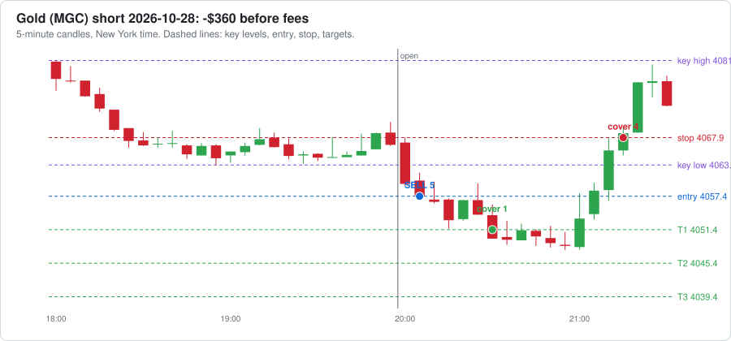
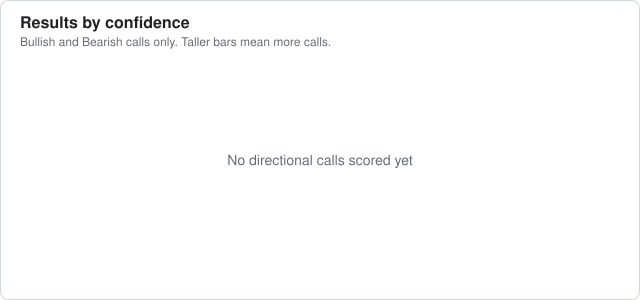
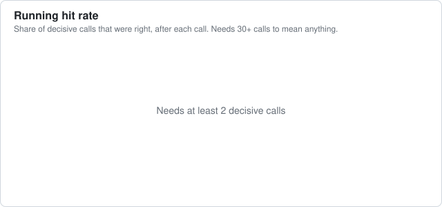
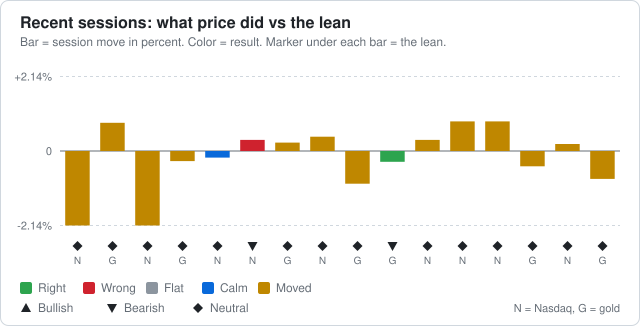

# Agent dashboard

Last updated 2026-10-29 18:03 New York time. Everything here is written by software and AI agents. It can be wrong, so check anything you plan to act on.

**[🪙 Open the Crypto Dashboard →](CRYPTO-DASHBOARD.md)** · **[𝕏 Open the X Brief Dashboard →](X-DASHBOARD.md)**

## Reminders

- ⏰ When your broker is connected: log every trade in trade-journal.md with a heading like `### Trade #1 | 2026-10-16` (swap the `__` in the template for the trade number) and keep the `- **Session:**` line, so the post-session reviewer can see your trades. Or ask Claude to build automatic trade logging into the paper trading agent.
- ⏰ Before trading real money: make this repo private (GitHub → Settings → Danger Zone → Change visibility). First run `git cherry-pick 0f7e3a2` so the paper trader checks less often and stays under GitHub's 2,000 free Actions minutes a month for private repos (it is public now to keep Actions free and unlimited).
- ⏰ 𝕏 **Turn on X auto-posting once @cashflowbrief00 gets traction:** 500+ followers, OR any post with 10,000+ views, OR 1,000+ views a day for a week (check the account's Analytics). Then tell Claude "turn on X auto-posting". It needs X API keys from developer.x.com (about $2.50-3/month for 5-6 posts a day, within the $25 AI budget) and X's "automated account" label.

[Edit reminders](REMINDERS.md)

## Agent status

| | Agent | What it does | Last ran | Runs |
|---|---|---|---|---|
| 🟢 | Market brief: nasdaq | Writes the brief before the New York session | 9 hours ago | weekdays about 7-8 AM New York time |
| 🟢 | Market brief: gold | Writes the brief before the Asia session | 23 hours ago | Sun-Thu evenings about 6-7 PM New York time |
| 🟢 | World news brief | Overnight news and today's events: politics, economy, war, trade | 13 hours ago | daily about 5-6 AM New York time |
| 🟢 | Crypto research brief | Pumping coins, whales, government and adoption news | 13 hours ago | daily about 5:30-6:30 AM New York time |
| 🟢 | Stock research brief | Movers, AI, nuclear, minerals, earnings dates and estimates | 37 hours ago | Mon, Wed, Fri about 6-7 AM New York time |
| 🟢 | Paper trader | Paper trades every session with your rules and runs a practice prop challenge | 8 hours ago | after each session ends |
| 🟢 | Scorer | Checks each lean against what price did | under an hour ago | after each session ends |

🟢 ran recently  🟡 a bit late  🔴 check it  ⚪ never ran

## 📒 Trade journal (paper)

- **Tradeify 50K evaluation: balance $48,564**, $564 above the drawdown floor, $4,436 to pass; today -$365, $885 left before the daily loss limit. [Details](paper-trading/summary.md)

Newest first. Times are New York time. Each sale shows contracts @ price, time. The 📈 link opens a chart of the trade; TV opens the same market on TradingView (add [the strategy](tradingview/breakout_strategy.pine) to see each trade marked).

| Date | Market | Side | Lots | Entry | Target 1 | Target 2 | Target 3 / out | Result | What could have gone better | See it |
|---|---|---|---|---|---|---|---|---|---|---|
| 2026-10-29 | Nasdaq | – | 0 | skipped: risk too big | | | | $0 | Breakout short at 09:35, but even the small size risked $1,101 and only $464 could be lost today without breaking the daily loss limit or the drawdown, so it was skipped. | [TV](https://www.tradingview.com/chart/?symbol=CME_MINI%3AMNQ1%21&interval=5) |
| 2026-10-29 | Gold | short | 5 | 4057.4 @ 20:05 stop 4067.9 | 1 @ 4051.4, 20:30 ($60) | – | stop: 4 @ 4067.9, 21:15 (-$420) | ❌ **-$365** out 21:15 | • Target 1 paid $60, but the stop stayed at the start. Moving it to breakeven after Target 1 would have ended this trade at about $60 instead of -$360. • The entry was 5.60 points past the key level, chasing a stretched move. Waiting for a pullback toward the level would have meant a better price and a smaller risk. | [📈 chart](paper-trading/charts/2026-10-28-gold.svg) · [TV](https://www.tradingview.com/chart/?symbol=COMEX_MINI%3AMGC1%21&interval=5) |
| 2026-10-28 | Nasdaq | short | 3 | 29787.5 @ 09:45 stop 29900.5 | – | – | stop: 3 @ 29900.5, 12:50 (-$678) | ❌ **-$681** out 12:50 | • Price never reached Target 1: the best it did was +3.50 points, and Target 1 needed 30. • The breakout failed and price kept going the other way, so the stop did its job and kept the loss small. • The entry was 100.75 points past the key level, chasing a stretched move. Waiting for a pullback toward the level would have meant a better price and a smaller risk. | [📈 chart](paper-trading/charts/2026-10-28-nasdaq.svg) · [TV](https://www.tradingview.com/chart/?symbol=CME_MINI%3AMNQ1%21&interval=5) |
| 2026-10-28 | Gold | long | 5 | 4083.1 @ 20:05 stop 4075.4 | – | – | stop: 5 @ 4075.4, 20:25 (-$385) | ❌ **-$390** out 20:25 | • Price never reached Target 1: the best it did was +1.00 points, and Target 1 needed 6. • The breakout failed and price kept going the other way, so the stop did its job and kept the loss small. • The entry was 5.20 points past the key level, chasing a stretched move. Waiting for a pullback toward the level would have meant a better price and a smaller risk. | [📈 chart](paper-trading/charts/2026-10-27-gold.svg) · [TV](https://www.tradingview.com/chart/?symbol=COMEX_MINI%3AMGC1%21&interval=5) |
| 2026-10-27 | Nasdaq | long | 5 | 29649.5 @ 09:40 stop 29581.25 | – | – | stop: 5 @ 29581.25, 09:45 (-$682) | ❌ **-$688** out 09:45 | • Price never reached Target 1: the best it did was +28.25 points, and Target 1 needed 30. • The breakout failed and price kept going the other way, so the stop did its job and kept the loss small. • The entry was 20.75 points past the key level, chasing a stretched move. Waiting for a pullback toward the level would have meant a better price and a smaller risk. • Fakeout re-entry (switched off): price closed back beyond the entry at 10:30; re-entering 3 contracts at 29652.0 (stop 29606.75) would have made $8. | [📈 chart](paper-trading/charts/2026-10-27-nasdaq.svg) · [TV](https://www.tradingview.com/chart/?symbol=CME_MINI%3AMNQ1%21&interval=5) |
| 2026-10-27 | Gold | – | 0 | no breakout, no trade | | | | $0 | No confirmed breakout in the first 60 minutes. Key high 4032.90, low 4017.30. | [TV](https://www.tradingview.com/chart/?symbol=COMEX_MINI%3AMGC1%21&interval=5) |
| 2026-10-26 | Nasdaq | – | 0 | no breakout, no trade | | | | $0 | No confirmed breakout in the first 60 minutes. Key high 29354.00, low 29156.75. | [TV](https://www.tradingview.com/chart/?symbol=CME_MINI%3AMNQ1%21&interval=5) |
| 2026-10-26 | Gold | short | 5 | 4001.5 @ 20:05 stop 4011.1 | 1 @ 3995.5, 21:00 ($60) | – | stop: 4 @ 4011.1, 21:15 (-$384) | ❌ **-$329** out 21:15 | • Target 1 paid $60, but the stop stayed at the start. Moving it to breakeven after Target 1 would have ended this trade at about $60 instead of -$324. | [📈 chart](paper-trading/charts/2026-10-25-gold.svg) · [TV](https://www.tradingview.com/chart/?symbol=COMEX_MINI%3AMGC1%21&interval=5) |
| 2026-10-23 | Nasdaq | long | 5 | 29169.25 @ 10:00 stop 29095.0 | – | – | stop: 5 @ 29095.0, 10:15 (-$742) | ❌ **-$748** out 10:15 | • Price never reached Target 1: the best it did was +16.75 points, and Target 1 needed 30. • After the stop, price turned and reached +156.75 points by 10:50. The stop (74.25 points from entry) was too tight: a stop just past the key level (29145.0) would have kept you in. • The entry was 24.25 points past the key level, chasing a stretched move. Waiting for a pullback toward the level would have meant a better price and a smaller risk. • Fakeout re-entry (switched off): price closed back beyond the entry at 10:35; re-entering 3 contracts at 29225.0 (stop 29141.75) would have made $357. | [📈 chart](paper-trading/charts/2026-10-23-nasdaq.svg) · [TV](https://www.tradingview.com/chart/?symbol=CME_MINI%3AMNQ1%21&interval=5) |
| 2026-10-23 | Gold | short | 5 | 4034.4 @ 20:30 stop 4037.1 | – | – | stop: 5 @ 4037.1, 20:45 (-$135) | ❌ **-$140** out 20:45 | • Price never reached Target 1: the best it did was +2.80 points, and Target 1 needed 6. • After the stop, price turned and reached +33.50 points by 22:00. The stop (2.70 points from entry) was too tight: a stop just past the key level (4036.0) would have kept you in. • Fakeout re-entry (switched off): price closed back beyond the entry at 21:00; re-entering 3 contracts at 4034.1 (stop 4045.5) would have made $357. | [📈 chart](paper-trading/charts/2026-10-22-gold.svg) · [TV](https://www.tradingview.com/chart/?symbol=COMEX_MINI%3AMGC1%21&interval=5) |
| 2026-10-22 | Nasdaq | short | 5 | 29359.0 @ 10:25 stop 29455.5 | 1 @ 29329.0, 10:30 ($60) | 2 @ 29299.0, 10:30 ($240) | 2 @ 29269.0, 10:45 ($360) | ✅ **$655** out 10:45 | • Price kept going 236.00 points past Target 3 (by 15:45). Letting the last 2 contract(s) run with a trailing stop could have made up to $944 more. | [📈 chart](paper-trading/charts/2026-10-22-nasdaq.svg) · [TV](https://www.tradingview.com/chart/?symbol=CME_MINI%3AMNQ1%21&interval=5) |
| 2026-10-22 | Gold | short | 5 | 4137.2 @ 20:15 stop 4143.1 | 1 @ 4131.2, 20:35 ($60) | 2 @ 4125.2, 21:25 ($240) | stop: 2 @ 4131.2, 21:30 ($120) | ✅ **$415** out 21:30 | • The last contracts were stopped at Target 1, then price reached Target 3 by 01:45. A looser stop after Target 2 would have caught it. | [📈 chart](paper-trading/charts/2026-10-21-gold.svg) · [TV](https://www.tradingview.com/chart/?symbol=COMEX_MINI%3AMGC1%21&interval=5) |
| 2026-10-21 | Nasdaq | short | 5 | 29818.5 @ 10:15 stop 29843.25 | – | – | stop: 5 @ 29843.25, 10:20 (-$248) | ❌ **-$252** out 10:20 | • Price never reached Target 1: the best it did was +25.75 points, and Target 1 needed 30. • The breakout failed and price kept going the other way, so the stop did its job and kept the loss small. | [📈 chart](paper-trading/charts/2026-10-21-nasdaq.svg) · [TV](https://www.tradingview.com/chart/?symbol=CME_MINI%3AMNQ1%21&interval=5) |
| 2026-10-21 | Gold | – | 0 | no breakout, no trade | | | | $0 | No confirmed breakout in the first 60 minutes. Key high 4149.80, low 4132.00. | [TV](https://www.tradingview.com/chart/?symbol=COMEX_MINI%3AMGC1%21&interval=5) |
| 2026-10-20 | Nasdaq | long | 5 | 29717.75 @ 10:05 stop 29604.0 | 1 @ 29747.75, 10:15 ($60) | 2 @ 29777.75, 10:15 ($240) | 2 @ 29807.75, 10:25 ($360) | ✅ **$655** out 10:25 | • Price kept going 95.75 points past Target 3 (by 10:30). Letting the last 2 contract(s) run with a trailing stop could have made up to $383 more. | [📈 chart](paper-trading/charts/2026-10-20-nasdaq.svg) · [TV](https://www.tradingview.com/chart/?symbol=CME_MINI%3AMNQ1%21&interval=5) |

**Latest trade:**

[Full journal with every fill](paper-trading/paper-journal.md)

## 👔 CEO check

**❌ 1 broken rule(s)** ([read the full check](reports/ceo/latest.md))

<b>What the CEO checked</b>

##### Futures paper trader

- ❌ Tradeify practice evaluation failed: reset on 2026-10-28: only $96 above the floor, too close for any trade.
- ✅ Tradeify practice evaluation: $564 above the $2,000 trailing drawdown floor.

##### Your trade journal

- ✅ No trades logged yet, nothing to check.

##### Crypto bots

- ✅ Rotation bot: 8 trades, buys only at weekly checks, never more than 4 coins at once.
- ✅ Buy-and-hold bot has never sold.

##### Alpaca copy

- ✅ All 10 Alpaca orders were for the bot's coins and within the limit.

##### Costs

- ✅ Spent $6.50 so far this month on 54 AI runs; on pace for about $7 (budget $50).

##### Agent health

- ✅ Every research brief worked on its last run.

##### Ready to run on its own?

- ⏳ 9 of 15 trading days on the paper record
- ⏳ 1 rule problem(s) in the paper trader above
- ⏳ the Tradeify practice account never failed
- ⏳ the Tradeify practice evaluation has not passed yet
- ⏳ profit factor 0.70 (needs 1.3 or more), total $-1,096 over 13 trades
- ✅ worst trading day $-1,071 (needs $-1,250 or better)
- ⏳ You: Tradeify confirms in writing that TradersPost automation is allowed on the Select 50K
- ⏳ You: 2+ weeks of the live 50K alerts traded by hand with no rule broken
- ⏳ You + Claude: 2-3 sessions on a TradersPost paper account matching the chart

## 📅 Weekly report

<b>Week ending 2026-10-25</b>

#### The week in one look

- **Futures paper:** +$1,357 this week
- **Rotation bot:** -$23.91 this week
- **Buy-and-hold bot:** -$17.66 this week
- **AI costs:** $3.48 this week

#### Futures paper trading

- **This week:** +$1,357 after fees, 8 trades (5 wins, 3 losses), 2 sessions with no trade
- **Since paper trading began:** +$1,357 over 8 trades
- Nasdaq (MNQ): +$667 over 5 trades
- Gold (MGC): +$690 over 3 trades

| Day | Market | Side | Entry | Result |
|---|---|---|---|---|
| 2026-10-19 | nasdaq | long | 29841.25 at 10:15 | +$357 |
| 2026-10-20 | gold | short | 4150.6 at 20:55 | +$415 |
| 2026-10-20 | nasdaq | long | 29717.75 at 10:05 | +$655 |
| 2026-10-21 | nasdaq | short | 29818.5 at 10:15 | -$252 |
| 2026-10-22 | gold | short | 4137.2 at 20:15 | +$415 |
| 2026-10-22 | nasdaq | short | 29359.0 at 10:25 | +$655 |
| 2026-10-23 | gold | short | 4034.4 at 20:30 | -$140 |
| 2026-10-23 | nasdaq | long | 29169.25 at 10:00 | -$748 |

#### TradingView strategy

| Market | Export date | Forward test (since paper start) | Whole export |
|---|---|---|---|
| Nasdaq (MNQ) | 2026-10-18 | 0 trades, $0 | 25 trades, +$3,684, 56% wins |
| Gold (MGC) | 2026-10-18 | 0 trades, $0 | 22 trades, +$699, 32% wins |

Export the List of trades from each chart and say "update TradingView" to refresh these numbers.

#### Crypto paper bots

| Bot | Start of week | End of week | Change | Since it started ($1,000) |
|---|---|---|---|---|
| Rotation bot | $1,003.26 | $979.35 | -$23.91 (-2.4%) | -$20.65 |
| Buy-and-hold bot | $1,001.63 | $983.97 | -$17.66 (-1.8%) | -$16.03 |

Trades this week:

| Day | Bot | | Coin | Amount | Profit / loss |
|---|---|---|---|---|---|
| 2026-10-22 | Rotation bot | 🔴 Sell | AVAX | $186.17 | -$14.58 |
| 2026-10-22 | Rotation bot | 🔴 Sell | BCH | $198.91 | -$1.88 |
| 2026-10-22 | Rotation bot | 🔴 Sell | BTC | $199.02 | -$1.78 |
| 2026-10-22 | Rotation bot | 🔴 Sell | SUI | $198.38 | -$2.41 |

**Alpaca copy:** 3 order(s) this week: sell AVAX, sell BCH, sell BTC

#### Market briefs (Nasdaq and gold)

- 7 briefs scored; 2 gave a direction, 1 of those were right.
- 5 were Neutral.

#### CEO check

**❌ Rules were broken this week.** 25 checks ran. [Latest CEO check](../ceo/latest.md)

#### AI costs this week

| Agent | Runs | Cost |
|---|---|---|
| world-brief | 8 | $1.01 |
| crypto-brief | 7 | $0.81 |
| market-brief-nasdaq | 5 | $0.62 |
| market-brief-gold | 4 | $0.55 |
| stock-brief | 3 | $0.46 |
| review-gold | 1 | $0.03 |
| x-posts | 2 | $0.01 |
| **Total** | 30 | **$3.48** |

At this pace: about $15 a month.

[Main dashboard](../../DASHBOARD.md) · [Crypto dashboard](../../CRYPTO-DASHBOARD.md)

[All weekly reports](reports/weekly/)

## Paper trading

- Total after fees: **-$1,096** over 13 trades (18 sessions watched)
- Trading days with a trade: **9**, profitable: **3**, losing: 6
- Win rate: 38%
- Profit factor: 0.70
- Biggest drop from a high (max drawdown): $3,340
- Room left before the $4,000 max drawdown: **$660**
- Progress toward a prop demo: **9 of 20** trading days

<b>Challenge simulation, results by market, and daily results</b>

#### By market

| Market | Trades | Wins | Total after fees |
|---|---|---|---|
| nasdaq | 7 | 3 | -$702 |
| gold | 6 | 2 | -$394 |

#### Daily results

| Trading day | Sessions | Result after fees |
|---|---|---|
| 2026-10-29 | gold short, nasdaq skipped, risk too big for today's limits | -$365 |
| 2026-10-28 | gold long, nasdaq short | -$1,071 |
| 2026-10-27 | gold no trade, nasdaq long | -$688 |
| 2026-10-26 | gold short, nasdaq no trade | -$329 |
| 2026-10-23 | gold short, nasdaq long | -$888 |
| 2026-10-22 | gold short, nasdaq short | $1,070 |
| 2026-10-21 | gold no trade, nasdaq short | -$252 |
| 2026-10-20 | gold short, nasdaq long | $1,070 |
| 2026-10-19 | gold no trade, nasdaq long | $357 |

[Every paper trade](paper-journal.md) · [Raw data](trades.csv)

[Paper trading journal](paper-trading/paper-journal.md) · [TradingView strategy](tradingview/breakout_strategy.pine)

## 📈 TradingView strategy results

From the latest **List of trades** export of each chart. One trade = one entry (TradingView counts each target as a separate trade). Forward test = trades from 2026-10-19 on.

| Market | Export date | Trades | Wins / losses | Win rate | Total | Profit factor | Max drawdown | Forward test |
|---|---|---|---|---|---|---|---|---|
| Nasdaq (MNQ) | 2026-10-18 (trades since 2026-08-25) | 25 | 14 / 11 | 56% | **$3,684** | 1.99 | $1,066 | 0 trades, $0 |
| Gold (MGC) | 2026-10-18 (trades since 2026-08-24) | 22 | 7 / 15 | 32% | **$699** | 1.30 | $1,559 | 0 trades, $0 |
| **Both** | | 47 | 21 / 26 | 45% | **$4,384** | 1.72 | | |

<b>Latest 10 TradingView trades</b>

| Entry (New York) | Market | Side | Entry price | Contracts | Result |
|---|---|---|---|---|---|
| 2026-10-15 09:35 | Nasdaq (MNQ) | short | 29,830.00 | 5 | ❌ -$68 |
| 2026-10-14 20:05 | Gold (MGC) | short | 4,138.90 | 5 | ❌ -$105 |
| 2026-10-14 09:35 | Nasdaq (MNQ) | short | 30,578.50 | 5 | ❌ -$192 |
| 2026-10-13 09:35 | Nasdaq (MNQ) | short | 30,757.25 | 5 | ❌ -$20 |
| 2026-10-12 20:05 | Gold (MGC) | short | 4,187.60 | 5 | ✅ $420 |
| 2026-10-12 09:45 | Nasdaq (MNQ) | short | 30,969.50 | 5 | ✅ $660 |
| 2026-10-08 20:05 | Gold (MGC) | long | 4,168.70 | 5 | ❌ -$20 |
| 2026-10-07 20:05 | Gold (MGC) | short | 4,131.60 | 5 | ❌ -$250 |
| 2026-10-07 09:35 | Nasdaq (MNQ) | short | 31,180.50 | 5 | ❌ -$704 |
| 2026-10-06 20:05 | Gold (MGC) | long | 4,191.20 | 5 | ❌ -$8 |

To refresh: export the List of trades from each chart in TradingView, double-click `tradingview/update-exports.command`, then push in GitHub Desktop.

## Latest briefs

Click a brief to read it here. The summary is at the top of each.

<b>🌍 World news brief, 2026-10-29, event risk High</b>

#### Top things for today
1. **US GDP and Core PCE at 8:30 AM.** The calendar forecasts advance GDP at 3.2% (previous 1.5%) and core PCE at 0.3% m/m (previous 0.2%). Why it matters: inflation data after a Fed hold with a hawkish tilt, so it bears on rate and gold pricing.
2. **Fed hold with a hawkish lean.** The Fed kept the range at 3.75% to 4% in a 10-2 vote, with Cook and Hammack dissenting. The dissents reinforced investor expectations of a December hike (Yahoo Finance). Why it matters: rate path and the dollar.
3. **ECB decision at 9:15 AM, press conference at 9:45 AM.** The forecast is a hold at 2.65%. Why it matters: euro and global yields.
4. **Iran war and energy prices.** The Iran war has kept pushing up energy costs (Yahoo Finance). Warsh said oil futures have climbed lately while market rates have rolled over (Admiral Markets, citing Newsquawk). Why it matters: oil, inflation and safe-haven demand.
5. **BOJ decision tonight at 10:30 PM.** The forecast is a hold below 1.25%. Why it matters: yen and global rates.

#### What the Fed said
- **Decision:** The FOMC held the rate at 3-3/4 to 4 percent (official statement). It also continues to maintain ample reserves.
- **Vote:** 10-2. Lisa Cook and Beth Hammack dissented. They preferred a quarter-point hike. CNBC noted Cook had never dissented since joining in 2022.
- **Economy:** The statement says activity is expanding at a strong pace and spending is resilient. It says job gains have kept pace with the workforce and unemployment has changed little. Uncertainty is elevated, partly from geopolitics.
- **Inflation:** The statement says inflation "remains elevated."
- **Warsh at the press conference:**
  - He said politics played no role in the decision (Yahoo Finance).
  - He said the Fed is not tolerating an inflation target above 2% (Yahoo Finance).
  - The Fed will hold one fewer rate vote a year from 2027 (Yahoo Finance).
  - The next decision is December 9, with new projections (Admiral Markets).
- **Headlines only:** "The Federal Reserve's hawkish hold" (Livemint). "Bracing For December Fed Rate Hike" (BusinessToday Malaysia). "The Fed Kept Rates Steady in October, but We See Cuts in 2027" (Morningstar). (headline only)

#### Today's schedule (New York time)
| Time | Event | Who or where | Confirmed? |
|---|---|---|---|
| 8:30 AM | Advance GDP q/q (forecast 3.2%, previous 1.5%) | US | Yes |
| 8:30 AM | Core PCE Price Index m/m (forecast 0.3%, previous 0.2%) | US | Yes |
| 8:30 AM | Advance GDP Price Index q/q (forecast 3.3%, previous 6.2%) | US | Yes |
| 8:30 AM | Unemployment Claims (forecast 198K, previous 194K) | US | Yes |
| 9:15 AM | ECB Main Refinancing Rate (forecast 2.65%, previous 2.65%) | ECB | Yes |
| 9:15 AM | ECB Monetary Policy Statement | ECB | Yes |
| 9:45 AM | ECB Press Conference | ECB | Yes |
| 10:30 PM | BOJ Policy Rate (forecast <1.25%, previous <1.25%) | Japan | Yes |
| 10:30 PM | BOJ Monetary Policy Statement | Japan | Yes |
| 10:31 PM | BOJ Outlook Report | Japan | Yes |

No Trump events or hearings with times were found for today.

Coming up this week: Fri Oct 30, 1:30 AM BOJ Press Conference (high impact). Fri Oct 30, 8:30 AM Employment Cost Index q/q (medium impact, forecast 0.8%, previous 0.9%).

#### Event risk today
High - US GDP and core PCE, the ECB decision and press conference, and the BOJ decision all land today, after a Fed hold with two hawkish dissents.

#### Politics and policy
- **Fed and the White House:** The Trump administration had warned the Fed against hiking before next week's midterms (Yahoo Finance). Warsh declined to respond to Trump's criticism that rates should be lower and that the committee is "political" (Yahoo Finance).
- **Fed AI task force:** Warsh said he would attend a hearing next month by the Fed task force on AI (Yahoo Finance). No date was given.
- **Midterms:** "As Trump Faces Down the Midterms, a Grim Mood Takes Over the White House" (The New York Times). (headline only)
- **Gallup:** Economy, health care and Iran top voter concerns ahead of the midterms (U.S. News & World Report). (headline only)
- **Other headlines:** Wisconsin Democrats sue Trump over taxpayer money used for campaign ads (The Daily Cardinal). (headline only) Alaska's governor ordered a criminal investigation into the Peltola campaign (The New York Times). (headline only)
- No overnight Trump quotes, executive orders, Treasury items or bills were found in the feed.

#### Economics
- No US data was released overnight, according to the calendar.
- Headline items: a new inflation forecast piece (The Motley Fool). PepsiCo's CEO is bracing for rising input cost inflation (Money Talks News). StoneX says falling coffee inflation is helping demand recover. (all headline only)
- Gold: "Why Are Gold Prices Still Falling After the Fed Pauses Rate Hikes? September PCE May Determine Gold's Direction" (TradingKey). (headline only)

#### SEC, CFTC and hearings
- **SEC:** Nothing in the last 2 days.
- **CFTC roundtable:** The CFTC announced it will host a roundtable on 24/7 trading (CFTC press release, Wed 1:00 PM). The date and time were not given (unconfirmed).
- **CFTC and states:** The CFTC sued in Utah to block state enforcement (CFTC press release, Tue). Kalshi and Polymarket US sued Missouri and Louisiana (ReadWrite). (headline only)
- **COT report:** The CFTC announced semiweekly publication of the COT report (CFTC press release, Tue).
- **AI remarks:** CFTC Chair Selig spoke about AI agents trading crypto and floated "know-your-agent" rules (BigGo Finance, KuCoin). (headline only)
- **Hearings:** No market-moving congressional hearings were found.

#### War, trade and tariffs
- **Iran war:** It continues to lift energy costs and inflation worries (Yahoo Finance, AP). Shell's profits doubled to $10.8bn as the Iran war lifted oil margins (The Guardian). (headline only) Why it matters: energy prices and inflation.
- **Hezbollah:** It says it does not care who governs Israel (Arab News). (headline only)
- **Israel's election:** The New York Times is asking when the winner will be known. (headline only)
- **Europe:** Destinus' monthly output is higher than Europe's pre-war annual cruise missile production (Reuters). (headline only)
- No new tariffs or trade deadlines were found.

#### Country briefs
- **China:** SCMP says China's industrial strength keeps it from "turning Japanese." (headline only)
- **European Union:** The EU backtracked on Canada becoming an "associate member" (Al Jazeera). (headline only)
- **United Kingdom:** Nothing found.
- **Japan:** The BOJ decision is at 10:30 PM tonight. The forecast is a hold below 1.25% (calendar).
- **India:** Nothing found.
- **Russia:** Al Jazeera asks what Russia really offers Africa, and says economic incentives are limited. (headline only)
- **Canada:** The EU backtracked on the "associate member" idea (Al Jazeera). (headline only)

[Read the full brief with all the details](reports/news/2026-10-29-world-brief.md) · [All news briefs](reports/news/)

<b>🪙 Crypto brief, 2026-10-29</b>

#### Top things today

1. **Bitcoin is back near $80,000 after the Fed held rates.** The Fed kept rates at 3.75%-4% on October 28 in a 10-2 vote. It said inflation is still elevated, so future hikes remain possible. (Motley Fool, Bitcoin Foundation) Why it matters: a December hike is still being debated.
2. **Strategy reports earnings today (Oct 29).** Last week it bought no bitcoin and held at 848,517 BTC. It spent about $204.9M buying back STRC preferred shares instead. (The Block) Why it matters: the biggest corporate buyer paused.
3. **Whales sent a lot of BTC to exchanges.** Lookonchain said three whales moved 6,168 BTC (about $498.5M) to Coinbase Prime overnight. (crypto.news) Why it matters: deposits can mean selling, but that is not confirmed.
4. **Bitcoin options expire Friday.** More than $11.1B in bitcoin options expire two days after the Fed decision. (Cryptoticker) Why it matters: expiry can add volatility.
5. **Two trending coins dropped hard.** Axis Robotics (AXIS) fell 38.3% and Quack AI (Q) fell 25.0% in 24 hours (CoinGecko trending data). I found no cause for either. Why it matters: sharp falls in thinly traded coins.

#### Coins to research

| Coin | 24h move | Why it is moving | Red flags |
|---|---|---|---|
| Pearl (PEARL) | +10.9% (7d -22.9%) | Coinbase added it to its listing roadmap on Oct 19. It is an AI-linked chain built around "proof of useful work." (Yahoo Finance, Cryptonews) | Still down 22.9% on the week. About 352.6M of 2.1B max tokens circulate, so more supply is due. A roadmap listing is not a confirmed listing. |
| Ape and Pepe (APEPE) | +15.6% | I found no news for today's move. | Pump with no news. Market cap is $292M. A past exchange suspension (Toobit, 2025) is noted on CoinMarketCap. |
| Axis Robotics (AXIS) | -38.3% | No cause found. A similarly named "Axis Labs (AXIS)" was on Coinbase's roadmap. I could not confirm it is the same token. (unconfirmed) | Rank 794. Very small. Sudden crash. |
| Quack AI (Q) | -25.0% | No cause found. | Trending for a sharp drop. No news found. |
| Kinetiq (KNTQ) | +2.1% (7d +15.0%) | No news found. | Moderate volume ($6.7M) against a $141.6M cap. Move is small today. |
| Quantus (QTC) | +4.0% | No news found. | Rank 760. Small cap. |

#### Whale watch

| When | Coin | Amount (USD) | Who | Direction |
|---|---|---|---|---|
| Overnight, Oct 28 (exact time not given) | BTC | ~$498.5M (6,168 BTC) | Three unnamed whales (Lookonchain) | Onto an exchange (Coinbase Prime) |
| Around Oct 28 (time not given) | BTC | ~$35.4M | Unnamed (Arkham) | Onto an exchange. Reports don't say whether it overlaps with the $498.5M above. (unconfirmed) |
| Since early Oct | BTC | ~$771.5M (9,458 BTC) | 40 wallets (Lookonchain) | Off an exchange (Wintermute). This is a month-to-date total, not a one-day move. |

AMBCrypto also headlined a $903M whale buy. I could not verify the details.

#### Government and regulation

- **CLARITY Act (market structure):** It is not law. A Sept 15 Senate cloture vote failed 49 to 50. Sen. Lummis says it now cuts the "Regulation Crypto" fundraising cap from $75M to $50M and adds a $200M lifetime limit. (CoinStats, citing Hokanews)
- **CFTC:** It has proposed rules for crypto trading called Regulation CTX and Regulation CAM. (CoinStats)
- **SEC:** It proposed Regulation Crypto Assets, with offering exemptions, and set temporary relief for tokenized stock venues on Sept 17. (Bitcoin Foundation) These are older than "the last few days."
- **UK:** The Admiral Markets source list shows an FCA headline about a ban, but the text was cut off. (unconfirmed)
- No new bills or amendments from the last few days were found beyond the above.

#### Who is buying and adopting

- **Strive (ASST):** Bought 6,182 BTC from Oct 17 to 23, taking holdings to about 43,000 BTC. (24/7 Wall St.)
- **Strategy:** Paused buying, as above.
- **US government:** It still hasn't bought any bitcoin for its reserve. The reserve holds only seized coins. (bit.com)
- **ETFs:** US spot Bitcoin ETFs took in $110.3M on Oct 26 and about $176M on Oct 27. (Admiral Markets)
- No new company stablecoin payment launches found.

#### Next 7 days

| Date | Event | Coin or topic |
|---|---|---|
| Thu Oct 29 | Strategy earnings | BTC / MSTR |
| Fri Oct 30 | Bitcoin options expiry (~$11.1B–$12.2B, sources differ) | BTC |
| Tue Nov 3 | US midterm elections | Policy / market mood |

No token unlocks, upgrades, hearings or ETF deadlines were found.

[Read the full brief with all the details](reports/crypto/2026-10-29-crypto-brief.md) · [All crypto briefs](reports/crypto/)

<b>📈 Stocks brief, 2026-10-28</b>

#### Top things today
1. Alphabet and Microsoft report after the close, and the Fed decision comes at 2:00 p.m. ET. Futures were near flat as investors prepared for big tech earnings and the Fed decision. Why it matters: cloud growth and AI spending plans will set the tone for chips.
2. Anthropic's IPO filing lifted chips. Chip stocks rallied again on the filing. That fits yesterday's gains in AMD, AVGO and SMCI. (CNBC/Capp Notes) Why it matters: a new AI listing can pull money into AI hardware.
3. Chip stocks are rebounding after a rough stretch. The chip index was down about 20% from its June peak as of Oct. 15, when rate and AI-financing worries hit (CNN). Why it matters: the bounce is still young.
4. Nuclear fuel names jumped. LEU rose 11.2% and URA 4.4%. I found no company-specific cause for LEU. Why it matters: the group is oversold and moving as one trade.
5. Rare earth stocks rallied. USAR rose 16.7% and MP 9.1%. I found no specific news today. Why it matters: these names have swung on US-China headlines.

#### Stocks to research
| Ticker | Theme | Move | Why | Red flags |
|---|---|---|---|---|
| LEU | Nuclear fuel | +11.2% | Reports Nov. 4. It runs the only NRC-licensed HALEU facility. It has a $4.5B backlog. | Down more than 52% this year. No news found for the move. |
| USAR | Rare earths | +16.7% | Reports Nov. 5. The company is building a $1.2B magnet plant in South Carolina. (Yahoo Finance) | Revenue estimate is only $13.6M. No news found for the move. First plant output is targeted for 2028. |
| MP | Rare earths | +9.1% | Reports Nov. 5. Mountain Pass is the only large-scale US rare earth mine. | EPS estimate is negative. The group trades on US-China headlines. |
| SMCI | AI servers | +7.3% | Reports Nov. 3. Rode the Anthropic-driven chip rally. | Gain came with no company news found. |
| SMR | Small reactors | +8.2% | Reports Nov. 5. Moved with the nuclear group. | Very small revenue ($3.8M estimate). Down 62% this year. |
| SOFI | Fintech (outside the three themes) | +13.4% | Record $1.4B adjusted revenue, raised 2026 guidance. | Already moved sharply on earnings. |

New listings: SPCX (Space Exploration Technologies) is a new stock with a $2.0T market cap. It rose 1.1% on heavy volume. I found no details on its listing.

#### AI and tech
- **Anthropic IPO filing.** Markets rose Monday, helped in part by the filing. Chip names like AMD and Broadcom led. (Yahoo Finance)
- **Meta's equity raise.** One summary cites a "historic $97.5B equity raise" at Meta. I couldn't confirm this elsewhere (unconfirmed). Meta is down 10.7% over five days.
- **Memory and Korea.** SK Hynix reported a sharp jump in quarterly operating profit (Investing.com). Micron is up about 200% this year. (24/7 Wall St.)
- **Rate worries.** Higher borrowing costs have raised concern about funding AI buildouts. (CNBC, Oct. 15)

#### Nuclear and critical minerals
- **Nuclear fuel rally.** LEU, SMR and OKLO all rose. OKLO is down 63% this year, with no commercial revenue and dilution risk. TD Cowen has a Hold. (24/7 Wall St.)
- **Centrus deals.** Centrus picked Fluor to help expand its Ohio plant and signed a HALEU supply agreement with Oklo. (Cameco SEC filing)
- **Rare earth policy.** In June, China cut off dual-use item supplies to MP and USA Rare Earth. Phoenix Tailings plans a $375M separation plant in New York. (Asia Times)
- **Copper.** Freeport's Q3 adjusted EPS was 88 cents, and realized copper averaged $6.54 a pound. I found no new gold or lithium news.

#### Earnings
**Results since yesterday**
- FCX: EPS $0.88 on $7.55B revenue, versus $0.80 and $7.09B expected. Shares rose 1%.
- SoFi: beat estimates and rose 13.4%.
- HRI: Adjusted EPS $3.91 versus $2.96, and raised EBITDA guidance. Shares rose 22.8%.
- KNSA: Arcalyst revenue up 58%, guidance raised. Shares rose 22.2%.
- PNR: beat and rose 12.8%.
- XYL: Missed and cut guidance. Shares fell 12%.
- Chip-related: Ultra Clean beat by 21 cents and rose 11%.

**Today's after-close context:** Options imply about a 4.7% move for Microsoft. Alphabet's call is at 4:30 PM ET. Microsoft's webcast is at 5:30 PM ET.

| Date | Ticker | Timing | EPS est. | Revenue est. |
|---|---|---|---|---|
| 10/28 | GOOGL | After the close | $2.97 | $127.9B |
| 10/28 | MSFT | After the close | $4.72 | $90.7B |
| 10/29 | AMZN | After the close (per one calendar) | $1.99 | $202.2B |
| 10/30 | CCJ | Not confirmed | $0.27 | $753.9M |
| 11/02 | AAPL | Not confirmed | $1.98 | $113.3B |
| 11/02 | BWXT | Not confirmed | $1.19 | $972.4M |
| 11/02 | PLTR | Not confirmed | $0.41 | $2.2B |
| 11/03 | AMD | Not confirmed | $1.93 | $13.1B |
| 11/03 | SMCI | Not confirmed | $1.20 | $16.3B |
| 11/04 | ALB | Not confirmed | $2.53 | $1.6B |
| 11/04 | ARM | Not confirmed | $0.48 | $1.4B |
| 11/04 | LEU | Not confirmed | -$0.16 | $56.9M |
| 11/05 | MP | Not confirmed | -$0.01 | $119.0M |
| 11/05 | SMR | Not confirmed | -$0.12 | $3.8M |
| 11/05 | USAR | Not confirmed | -$0.15 | $13.6M |
| 11/06 | OKLO | Not confirmed | -$0.26 | $1.1M |
| 11/06 | VST | Not confirmed | $3.01 | $6.4B |
| 11/09 | CEG | Not confirmed | $3.84 | $9.3B |
| 11/10 | CRWV | Not confirmed | -$1.21 | $3.5B |

#### Smart money
- Oklo: TD Cowen set a Hold rating with a target near $26 (24/7 Wall St.).
- Alphabet: Citizens cut its target to $450 from $515 but kept Market Outperform. Needham reiterated Buy at $450 (Investing.com).
- Broadcom: Four firms reiterated Buy, with targets from $470 to $600. (Everhint)
- Insider buying and congressional trades: Nothing found.

[Read the full brief with all the details](reports/stocks/2026-10-28-stock-brief.md) · [All stocks briefs](reports/stocks/)

<b>📊 Nasdaq 100 futures market brief, 2026-10-29</b>

### Nasdaq 100 Futures Brief – Thursday, Oct 29, 2026 (New York session)

#### 1. What is driving the market
- **Big Tech earnings are the main driver.** Nasdaq futures dropped as mixed Alphabet and Microsoft results left investors weighing the payoff from heavy AI spending.
- **Alphabet is weak.** It slid 10.5% in premarket trading after disappointing search advertising results and a big rise in cash burn.
- **Microsoft is strong.** It climbed 3.5% after a cash-flow beat and a forecast for strong cloud growth.
- **Software and chips are soft.** Fortinet fell 25.4% and ServiceNow fell 19%. The chip sector looked set to snap a 4-day win streak.
- **The Fed was not the shock.** The Fed held rates steady in a 10-2 vote on Wednesday.
- **The rest of the market is steadier.** Dow futures were near flat while Nasdaq-100 futures were down about 1%.

#### 2. Scheduled events (New York time)
- **8:30 AM:** Advance Q3 GDP, September PCE inflation, and weekly jobless claims. Kiplinger lists all of these at 8:30 am. One Investing.com preview says 7:30 AM ET, which conflicts with the others. I treat 8:30 as correct.
- **Forecasts:** GDP forecast is 3.2% vs 2.2% before. Core PCE forecast is 0.3%. Jobless claims forecast is 198K. Other sources show slightly different forecasts.
- **ECB decision:** 14:15 CET, with Lagarde's press conference at 14:45 CET. That is about 9:15 and 9:45 AM New York time, by my conversion.
- **Earnings:** Amazon reports after the close, with its call at 5:00 p.m. ET. That is after the session ends. Caterpillar, Eli Lilly and Intel also report. I could not verify their release times.
- **Fed speakers today:** I found none.
- **Tomorrow:** The Bank of Japan decision is Friday.

#### 3. Key levels (from the price data)
- **Previous session high:** 30009.00. This is also the highest high of the last 5 sessions.
- **Previous session low:** 29767.25.
- **Previous close:** 29990.75.
- **Since that close:** high 30178.00, low 29482.50.
- **5-session low:** 28987.00.
- **Latest price:** 29637.00. That is 130.25 below the previous session low, so price has broken under that low.
- **Where price sits:** It is not near the highs. It is below the previous low, which now acts as overhead resistance. The nearest support is the overnight low of 29482.50, about 154.5 points below.

#### 4. Volume
The previous session traded 0.92x the average of the 5 sessions before it. That is slightly below average. It suggests mild participation, not strong conviction. Yesterday's modest, slightly light volume doesn't confirm a strong trend either way.

#### 5. Directional lean
**Bearish, Low confidence.**
Price is below the previous session low and well off the overnight high of 30178.00. The news also leans negative, with AI-spending worries hitting Alphabet and software stocks. Volume is only slightly light, so it neither confirms nor weakens the move. Confidence is low because Microsoft's strong results offset Alphabet's, and the 8:30 AM GDP and PCE data can reverse the tone quickly. Price has also already dropped a lot overnight.

**What would change the lean:** a move back above the previous low of

[Open the file](reports/2026-10-29-nasdaq-brief.md)

<b>📊 Gold futures market brief, 2026-10-28</b>

### Gold Futures Brief: Asia Session, Oct 28–29, 2026

#### 1. What is driving gold now
- **Fed hold:** The Fed held rates at 3.75%-4% but rewrote one inflation line as 2 officials pushed for a hike. Gold held steady just under $4,050 afterward, a quiet reaction to a decision markets had already priced in.
- **Hawkish tone:** One analyst said Warsh's message was no cuts soon. The same piece cited the U.S. 10-year yield near 5.01%. It also described gold as waiting for a catalyst.
- **Rate-hike pricing:** One report said traders priced in an 84% probability of a December rate hike.
- **Geopolitics:** One morning note said WTI crude rose 1.7% to $101.62 after a WSJ report that the U.S. warned the Gulf of a possible short, intense renewal of the Iran war after the midterms. I could not verify how much this is moving gold.
- **Recent trend:** Gold touched an intraday low near $3,986 last week, its first dip under $4,000 since July.

#### 2. Scheduled events (New York time)
- **Already out:**
  - The Fed decision at 2:00 PM and Warsh's press conference at 2:30 PM.
  - Microsoft and Alphabet earnings after the closing bell on Wednesday. I did not find their results.
- **During the session (8 PM–4 AM):** I found no major scheduled US release. I could not verify any Tokyo-morning data or central bank speakers.
- **Just after the session:** GDP (advance estimate) for Q3 and PCE inflation for September are scheduled for Thursday, Oct 29 at 8:30 AM ET. That is 4.5 hours after the session ends, so positioning ahead of it could matter late in the session.

#### 3. Key levels (from price data)
- Previous session high: **4084.10**
- Previous session low: **4040.50**
- Previous session close: **4058.00**
- Since that close: high **4097.20**, low **4036.90**
- 5-session high: **4143.10**
- 5-session low: **3990.90**
- Latest price: **4067.60**. It is inside the previous range, 16.50 below the high and 27.10 above the low. It sits in the middle, slightly closer to resistance (the high) than to support (the low). The post-close high of 4097.20 is just above the prior high.

#### 4. Volume
The previous session traded **0.67x** the average of the five sessions before it. That is weak participation. Moves in a quiet session are less reliable, and breakouts may lack follow-through.

#### 5. Directional lean
**Neutral, Confidence: Low.**
Price is mid-range, inside the previous high and low. Volume was light, so neither buyers nor sellers showed strength. The news points both ways. The Fed was hawkish and yields are high, which weighs on gold. But the decision was already priced in, and gold barely moved. Because the signals conflict, I stay Neutral.

**What would change the lean:**
- A move above 4097.20 on stronger volume would shift it toward Bullish.
- A move below 4036.90 or 4040.50 on stronger volume would shift it toward Bearish.
- A sharp rise in oil or in Middle East tensions could also change it.

This is a probability-based lean, not a prediction or trade instruction.

#### 6. Event risk
**Medium.** No major event is scheduled inside the session. But US GDP and PCE come right after it, and the Iran headlines are a risk.

#### 7. Sources
- CNBC
- FXStreet
- Yahoo Finance
- GoldSilver
- Kiplinger
- Investrade
- fedratecalc.com
- Rallies.ai
- Top1Markets

Some outlets quote slightly different spot prices and vote counts. I used only the price block for levels.

BIAS: Neutral | CONFIDENCE: Low

[Open the file](reports/2026-10-28-gold-brief.md)

## Latest lean for each market

| Market | Brief written | Lean | Confidence | Event risk | Price then | Full brief |
|---|---|---|---|---|---|---|
| nasdaq | 2026-10-29 08:39 | ? Unknown | Unknown | n/a | 29637.00 | [read it](reports/2026-10-29-nasdaq-brief.md) |
| gold | 2026-10-28 19:25 | ◆ Neutral | Low | Medium | 4067.60 | [read it](reports/2026-10-28-gold-brief.md) |

A lean is a probability-based view, not a prediction. ▲ Bullish  ▼ Bearish  ◆ Neutral

## Scorecard

- Briefs scored: **16** (Bullish or Bearish calls: 2)
- Right: 1, Wrong: 1, Session ended flat: 0
- Hit rate when the session was decisive: **50%**
- For comparison, price went up in 53% of decisive sessions
- ⚠️ Only 2 directional calls so far. Treat the numbers as noise until there are at least 30.

By confidence:

| Confidence | Right | Wrong | Flat | Hit rate |
|---|---|---|---|---|
| High | 0 | 0 | 0 | n/a |
| Medium | 1 | 0 | 0 | 100% |
| Low | 0 | 1 | 0 | 0% |

[Full scorecard](reports/scorecard.md)

## Charts

## Recent results

| Brief | Market | Lean | Confidence | Session moved | Result |
|---|---|---|---|---|---|
| 2026-10-28 | gold | ◆ Neutral | Low | Down (-0.80%) | Moved |
| 2026-10-28 | nasdaq | ◆ Neutral | Low | Up (0.20%) | Moved |
| 2026-10-27 | gold | ◆ Neutral | Low | Down (-0.44%) | Moved |
| 2026-10-27 | nasdaq | ◆ Neutral | Low | Up (0.85%) | Moved |
| 2026-10-26 | nasdaq | ◆ Neutral | Low | Up (0.85%) | Moved |
| 2026-10-23 | nasdaq | ◆ Neutral | Low | Up (0.32%) | Moved |
| 2026-10-22 | gold | ▼ Bearish | Medium | Down (-0.31%) | Right |
| 2026-10-21 | gold | ◆ Neutral | Low | Down (-0.94%) | Moved |
| 2026-10-21 | nasdaq | ◆ Neutral | Low | Up (0.41%) | Moved |
| 2026-10-20 | gold | ◆ Neutral | Low | Up (0.24%) | Moved |

## Your journals

- Trades logged: **0**. [Open the trade journal](trade-journal.md)
- No-trade sessions explained: **3**. [Open the no-trade journal](no-trade-journal.md)

<b>Latest no-trade sessions</b>

##### No-trade session | 2026-10-18 | Asia
- **Instrument:** Gold futures
- **What happened:** No signal. The rules gave no entry.
- **Why:** No 5-minute candle closed above the previous high (4211.20) or below the previous low (4167.50) in the first 30 minutes after the 20:00 open. (Previous Asia session was 2026-10-15.)
- **First 30 minutes, candle by candle:**
  - 20:00 candle: close 4205.50, closed inside the range (5.70 below the high, 38.00 above the low).
  - 20:05 candle: close 4204.40, closed inside the range (6.80 below the high, 36.90 above the low).
  - 20:10 candle: close 4201.70, closed inside the range (9.50 below the high, 34.20 above the low).
  - 20:15 candle: close 4199.00, closed inside the range (12.20 below the high, 31.50 above the low).
  - 20:20 candle: close 4196.40, closed inside the range (14.80 below the high, 28.90 above the low).
  - 20:25 candle: close 4196.00, closed inside the range (15.20 below the high, 28.50 above the low).
- **Closest call:** Price got within 2.80 of the previous high (its highest point was 4208.40) but never reached it.
- **After the window:** No candle closed beyond either level for the rest of the session.
- **What the market was showing:** The session range was 25.60 points, 60% of the average of the last 5 (a quiet session). Open to close it moved -12.30 points (-0.29%).
- **The morning brief said:** Neutral (Low confidence), event risk Medium.
- **Verdict:** Consistent with your rules. There was no setup, so staying out was correct under the rules.
- **Your notes:**

##### No-trade session | 2026-10-16 | New York
- **Instrument:** Nasdaq 100 futures
- **What happened:** No signal. The rules gave no entry.
- **Why:** No 5-minute candle closed above the previous high (30196.75) or below the previous low (29622.50) in the first 15 minutes after the 09:30 open. (Previous New York session was 2026-10-15.)
- **First 15 minutes, candle by candle:**
  - 09:30 candle: close 29969.75, closed inside the range (227.00 below the high, 347.25 above the low).
  - 09:35 candle: close 29895.25, closed inside the range (301.50 below the high, 272.75 above the low).
  - 09:40 candle: close 29936.25, closed inside the range (260.50 below the high, 313.75 above the low).
- **Closest call:** Price got within 151.00 of the previous high (its highest point was 30045.75) but never reached it.
- **After the window:** A candle first closed below the previous low at 12:45, but that was after the 15-minute window, so the rules did not allow an entry.
- **What the market was showing:** The session range was 777.00 points, 219% of the average of the last 5 (a busy session). Open to close it moved -644.75 points (-2.15%).
- **The morning brief said:** Neutral (Low confidence), event risk Medium.
- **Verdict:** Consistent with your rules. There was no setup, so staying out was correct under the rules.
- **Your notes:**

##### No-trade session | 2026-10-15 | Asia
- **Instrument:** Gold futures
- **What happened:** No signal. The rules gave no entry.
- **Why:** No 5-minute candle closed above the previous high (4183.30) or below the previous low (4152.70) in the first 15 minutes after the 21:00 open. (Previous Asia session was 2026-10-14.)
- **First 15 minutes, candle by candle:**
  - 21:00 candle: close 4176.50, closed inside the range (6.80 below the high, 23.80 above the low).
  - 21:05 candle: close 4178.00, closed inside the range (5.30 below the high, 25.30 above the low).
  - 21:10 candle: close 4178.50, closed inside the range (4.80 below the high, 25.80 above the low).
- **Closest call:** Price got within 1.60 of the previous high (its highest point was 4181.70) but never reached it.
- **After the window:** A candle first closed above the previous high at 22:30, but that was after the 15-minute window, so the rules did not allow an entry.
- **What the market was showing:** The session range was 43.70 points, 98% of the average of the last 5 (a normal session). Open to close it moved +33.70 points (+0.81%).
- **The morning brief said:** Neutral (Low confidence), event risk High.
- **Verdict:** Consistent with your rules. There was no setup, so staying out was correct under the rules.
- **Your notes:**

## Still to build

| Agent | Purpose | Status |
|---|---|---|
| Product selling agent (separate repo) | Main Agent from your Obsidian notes: what to sell, sourcing, advertising | ⚪ not built yet |
| Live demo trading | Sends the TradingView strategy's orders to a Tradovate demo or prop challenge account, behind a risk gatekeeper | ⚪ not built yet |

## Links

- [All reports](reports/)
- [Trading rules](trading-rules.md)
- [Bias log](reports/bias-log.csv)
