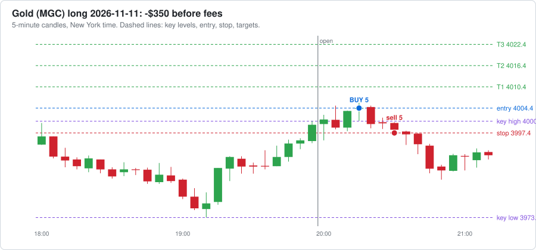
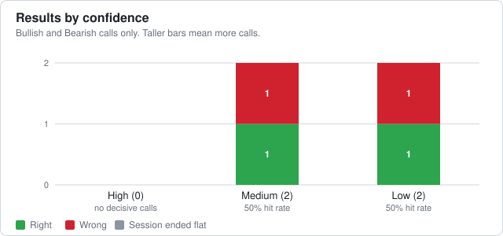
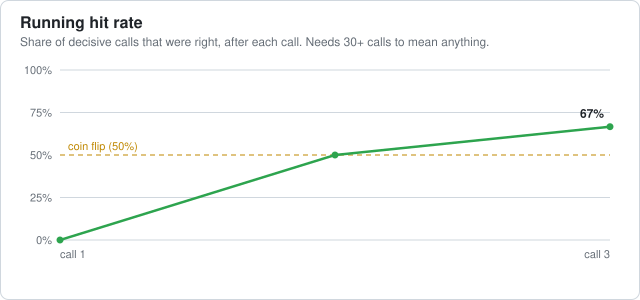
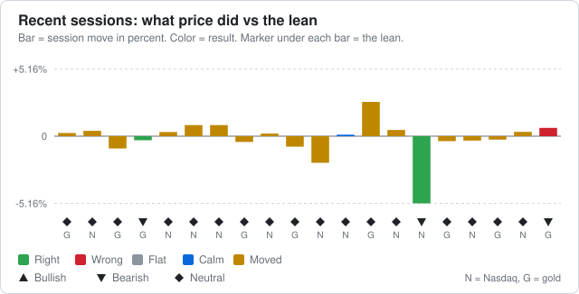

# Agent dashboard

Last updated 2026-11-12 17:10 New York time. Everything here is written by software and AI agents. It can be wrong, so check anything you plan to act on.

**[🪙 Open the Crypto Dashboard →](CRYPTO-DASHBOARD.md)** · **[𝕏 Open the X Brief Dashboard →](X-DASHBOARD.md)**

## Reminders

- ⏰ When your broker is connected: log every trade in trade-journal.md with a heading like `### Trade #1 | 2026-10-16` (swap the `__` in the template for the trade number) and keep the `- **Session:**` line, so the post-session reviewer can see your trades. Or ask Claude to build automatic trade logging into the paper trading agent.
- ⏰ Before trading real money: make this repo private (GitHub → Settings → Danger Zone → Change visibility). First run `git cherry-pick 0f7e3a2` so the paper trader checks less often and stays under GitHub's 2,000 free Actions minutes a month for private repos (it is public now to keep Actions free and unlimited).
- ⏰ 𝕏 **Turn on X auto-posting once @cashflowbrief00 gets traction:** 500+ followers, OR any post with 10,000+ views, OR 1,000+ views a day for a week (check the account's Analytics). Then tell Claude "turn on X auto-posting". It needs X API keys from developer.x.com (about $2.50-3/month for 5-6 posts a day, within the $25 AI budget) and X's "automated account" label.

[Edit reminders](REMINDERS.md)

## Agent status

| | Agent | What it does | Last ran | Runs |
|---|---|---|---|---|
| 🟢 | Market brief: nasdaq | Writes the brief before the New York session | 9 hours ago | weekdays about 7-8 AM New York time |
| 🟢 | Market brief: gold | Writes the brief before the Asia session | 23 hours ago | Sun-Thu evenings about 6-7 PM New York time |
| 🟢 | World news brief | Overnight news and today's events: politics, economy, war, trade | 13 hours ago | daily about 5-6 AM New York time |
| 🟢 | Crypto research brief | Pumping coins, whales, government and adoption news | 13 hours ago | daily about 5:30-6:30 AM New York time |
| 🟢 | Stock research brief | Movers, AI, nuclear, minerals, earnings dates and estimates | 37 hours ago | Mon, Wed, Fri about 6-7 AM New York time |
| 🟢 | Paper trader | Paper trades every session with your rules and runs a practice prop challenge | under an hour ago | after each session ends |
| 🟢 | Scorer | Checks each lean against what price did | under an hour ago | after each session ends |

🟢 ran recently  🟡 a bit late  🔴 check it  ⚪ never ran

## 📒 Trade journal (paper)

- **Tradeify 50K evaluation: balance $49,341**, $689 above the drawdown floor, $3,659 to pass; today -$355, $895 left before the daily loss limit. [Details](paper-trading/summary.md)
- 📐 Opening range (9:30-10:00, tracked, not traded): $665 over 8 trades in 9 sessions since 2026-11-02, vs -$2,549 for the real Nasdaq rule (ahead). [Details](paper-trading/summary.md)

Newest first. Times are New York time. Each sale shows contracts @ price, time. The 📈 link opens a chart of the trade; TV opens the same market on TradingView (add [the strategy](tradingview/breakout_strategy.pine) to see each trade marked).

| Date | Market | Side | Lots | Entry | Target 1 | Target 2 | Target 3 / out | Result | What could have gone better | See it |
|---|---|---|---|---|---|---|---|---|---|---|
| 2026-11-12 | Nasdaq | – | 0 | skipped: risk too big | | | | $0 | Breakout long at 09:40, but even the small size risked $808 and only $589 could be lost today without breaking the daily loss limit or the drawdown, so it was skipped. | [TV](https://www.tradingview.com/chart/?symbol=CME_MINI%3AMNQ1%21&interval=5) |
| 2026-11-12 | Gold | long | 5 | 4004.4 @ 20:15 stop 3997.4 | – | – | stop: 5 @ 3997.4, 20:30 (-$350) | ❌ **-$355** out 20:30 | • Price never reached Target 1: the best it did was +0.70 points, and Target 1 needed 6. • The breakout failed and price kept going the other way, so the stop did its job and kept the loss small. • The entry was 3.70 points past the key level, chasing a stretched move. Waiting for a pullback toward the level would have meant a better price and a smaller risk. | [📈 chart](paper-trading/charts/2026-11-11-gold.svg) · [TV](https://www.tradingview.com/chart/?symbol=COMEX_MINI%3AMGC1%21&interval=5) |
| 2026-11-11 | Nasdaq | short | 5 | 28246.75 @ 09:45 stop 28362.0 | 1 @ 28216.75, 09:50 ($60) | – | stop: 4 @ 28362.0, 10:25 (-$922) | ❌ **-$867** out 10:25 | • Target 1 paid $60, but the stop stayed at the start. Moving it to breakeven after Target 1 would have ended this trade at about $60 instead of -$862. • The entry was 65.00 points past the key level, chasing a stretched move. Waiting for a pullback toward the level would have meant a better price and a smaller risk. | [📈 chart](paper-trading/charts/2026-11-11-nasdaq.svg) · [TV](https://www.tradingview.com/chart/?symbol=CME_MINI%3AMNQ1%21&interval=5) |
| 2026-11-11 | Gold | long | 5 | 4055.3 @ 20:35 stop 4043.7 | 1 @ 4061.3, 00:10 ($60) | 2 @ 4067.3, 00:30 ($240) | 2 @ 4073.3, 00:30 ($360) | ✅ **$655** out 00:30 | • Clean trade: price stalled near Target 3, so taking the full profit there was right. | [📈 chart](paper-trading/charts/2026-11-10-gold.svg) · [TV](https://www.tradingview.com/chart/?symbol=COMEX_MINI%3AMGC1%21&interval=5) |
| 2026-11-10 | Nasdaq | long | 3 | 28049.75 @ 10:00 stop 27868.75 | 1 @ 28079.75, 10:05 ($60) | – | stop: 2 @ 27868.75, 10:35 (-$724) | ❌ **-$667** out 10:35 | • Target 1 paid $60, but the stop stayed at the start. Moving it to breakeven after Target 1 would have ended this trade at about $60 instead of -$664. • The entry was 52.25 points past the key level, chasing a stretched move. Waiting for a pullback toward the level would have meant a better price and a smaller risk. | [📈 chart](paper-trading/charts/2026-11-10-nasdaq.svg) · [TV](https://www.tradingview.com/chart/?symbol=CME_MINI%3AMNQ1%21&interval=5) |
| 2026-11-10 | Gold | – | 0 | no breakout, no trade | | | | $0 | No confirmed breakout in the first 60 minutes. Key high 4156.20, low 4130.80. | [TV](https://www.tradingview.com/chart/?symbol=COMEX_MINI%3AMGC1%21&interval=5) |
| 2026-11-09 | Nasdaq | – | 0 | skipped: risk too big | | | | $0 | Breakout long at 09:35, but even the small size risked $1,467 and only $1,073 could be lost today without breaking the daily loss limit or the drawdown, so it was skipped. | [TV](https://www.tradingview.com/chart/?symbol=CME_MINI%3AMNQ1%21&interval=5) |
| 2026-11-09 | Gold | long | 5 | 4115.0 @ 20:15 stop 4111.7 | 1 @ 4121.0, 20:25 ($60) | – | stop: 4 @ 4111.7, 20:30 (-$132) | ❌ **-$77** out 20:30 | • Target 1 paid $60, but the stop stayed at the start. Moving it to breakeven after Target 1 would have ended this trade at about $60 instead of -$72. • Fakeout re-entry (switched off): price closed back beyond the entry at 20:35; re-entering 3 contracts at 4119.3 (stop 4112.9) would have made $357. | [📈 chart](paper-trading/charts/2026-11-08-gold.svg) · [TV](https://www.tradingview.com/chart/?symbol=COMEX_MINI%3AMGC1%21&interval=5) |
| 2026-11-06 | Nasdaq | – | 0 | skipped: daily profit cap | | | | $0 | Not taken: this trading day was already up $600, the daily profit cap that keeps the biggest day small for the 35% consistency rule. | [TV](https://www.tradingview.com/chart/?symbol=CME_MINI%3AMNQ1%21&interval=5) |
| 2026-11-06 | Gold | short | 5 | 4072.7 @ 20:45 stop 4085.0 | 1 @ 4066.7, 20:55 ($60) | 2 @ 4060.7, 22:05 ($240) | 2 @ 4054.7, 22:30 ($360) | ✅ **$655** out 22:30 | • Price kept going 6.30 points past Target 3 (by 23:05). Letting the last 2 contract(s) run with a trailing stop could have made up to $126 more. | [📈 chart](paper-trading/charts/2026-11-05-gold.svg) · [TV](https://www.tradingview.com/chart/?symbol=COMEX_MINI%3AMGC1%21&interval=5) |
| 2026-11-05 | Nasdaq | – | 0 | skipped: daily profit cap | | | | $0 | Not taken: this trading day was already up $600, the daily profit cap that keeps the biggest day small for the 35% consistency rule. | [TV](https://www.tradingview.com/chart/?symbol=CME_MINI%3AMNQ1%21&interval=5) |
| 2026-11-05 | Gold | long | 5 | 4118.4 @ 20:15 stop 4104.3 | 1 @ 4124.4, 20:20 ($60) | 2 @ 4130.4, 20:35 ($240) | 2 @ 4136.4, 20:45 ($360) | ✅ **$655** out 20:45 | • Price kept going 8.00 points past Target 3 (by 20:50). Letting the last 2 contract(s) run with a trailing stop could have made up to $160 more. | [📈 chart](paper-trading/charts/2026-11-04-gold.svg) · [TV](https://www.tradingview.com/chart/?symbol=COMEX_MINI%3AMGC1%21&interval=5) |
| 2026-11-04 | Nasdaq | – | 0 | skipped: risk too big | | | | $0 | Breakout long at 09:40, but even the small size risked $2,352 and only $1,242 could be lost today without breaking the daily loss limit or the drawdown, so it was skipped. | [TV](https://www.tradingview.com/chart/?symbol=CME_MINI%3AMNQ1%21&interval=5) |
| 2026-11-04 | Gold | long | 3 | 3963.4 @ 20:15 stop 3936.5 | 1 @ 3969.4, 20:25 ($60) | 1 @ 3975.4, 00:30 ($120) | 1 @ 3981.4, 00:30 ($180) | ✅ **$357** out 00:30 | • Price kept going 51.00 points past Target 3 (by 01:20). Letting the last 1 contract(s) run with a trailing stop could have made up to $510 more. | [📈 chart](paper-trading/charts/2026-11-03-gold.svg) · [TV](https://www.tradingview.com/chart/?symbol=COMEX_MINI%3AMGC1%21&interval=5) |
| 2026-11-03 | Nasdaq | – | 0 | no breakout, no trade | | | | $0 | No confirmed breakout in the first 60 minutes. Key high 28426.50, low 28197.00. | [TV](https://www.tradingview.com/chart/?symbol=CME_MINI%3AMNQ1%21&interval=5) |

**Latest trade:**

[Full journal with every fill](paper-trading/paper-journal.md)

## 👔 CEO check

**❌ 2 broken rule(s)** ([read the full check](reports/ceo/latest.md))

<b>What the CEO checked</b>

##### Futures paper trader

- ❌ Tradeify practice evaluation failed: reset on 2026-10-28: only $96 above the floor, too close for any trade.
- ❌ Tradeify practice evaluation failed: reset on 2026-11-02: only $299 above the floor, too close for any trade.
- ✅ Tradeify practice evaluation: $689 above the $2,000 trailing drawdown floor.

##### Your trade journal

- ✅ No trades logged yet, nothing to check.

##### Crypto bots

- ✅ Rotation bot: 8 trades, buys only at weekly checks, never more than 4 coins at once.
- ✅ Buy-and-hold bot has never sold.

##### Alpaca copy

- ✅ All 10 Alpaca orders were for the bot's coins and within the limit.

##### Costs

- ✅ Spent $7.37 so far this month on 69 AI runs; on pace for about $18 (budget $50).

##### Agent health

- ✅ Every research brief worked on its last run.

##### Ready to run on its own?

- ✅ 19 of 15 trading days on the paper record
- ⏳ 2 rule problem(s) in the paper trader above
- ⏳ the Tradeify practice account never failed
- ⏳ the Tradeify practice evaluation has not passed yet
- ⏳ profit factor 0.70 (needs 1.3 or more), total $-2,020 over 23 trades
- ✅ worst trading day $-1,071 (needs $-1,250 or better)
- ⏳ You: Tradeify confirms in writing that TradersPost automation is allowed on the Select 50K
- ⏳ You: 2+ weeks of the live 50K alerts traded by hand with no rule broken
- ⏳ You + Claude: 2-3 sessions on a TradersPost paper account matching the chart

## 📅 Weekly report

<b>Week ending 2026-11-08</b>

#### The week in one look

- **Futures paper:** +$652 this week
- **Rotation bot:** $0.00 this week
- **Buy-and-hold bot:** -$30.12 this week
- **AI costs:** $4.21 this week

#### Futures paper trading

- **This week:** +$652 after fees, 4 trades (3 wins, 1 losses), 5 sessions with no trade
- **Since paper trading began:** -$708 over 18 trades
- Nasdaq (MNQ): -$1,015 over 1 trades
- Gold (MGC): +$1,667 over 3 trades

| Day | Market | Side | Entry | Result |
|---|---|---|---|---|
| 2026-11-02 | nasdaq | long | 28886.75 at 10:25 | -$1,015 |
| 2026-11-04 | gold | long | 3963.4 at 20:15 | +$357 |
| 2026-11-05 | gold | long | 4118.4 at 20:15 | +$655 |
| 2026-11-06 | gold | short | 4072.7 at 20:45 | +$655 |

#### TradingView strategy

| Market | Export date | Forward test (since paper start) | Whole export |
|---|---|---|---|
| Nasdaq (MNQ) | 2026-10-18 | 0 trades, $0 | 25 trades, +$3,684, 56% wins |
| Gold (MGC) | 2026-10-18 | 0 trades, $0 | 22 trades, +$699, 32% wins |

Export the List of trades from each chart and say "update TradingView" to refresh these numbers.

#### Crypto paper bots

| Bot | Start of week | End of week | Change | Since it started ($1,000) |
|---|---|---|---|---|
| Rotation bot | $979.35 | $979.35 | $0.00 (+0.0%) | -$20.65 |
| Buy-and-hold bot | $936.92 | $906.80 | -$30.12 (-3.2%) | -$93.20 |

**Alpaca copy:** 0 order(s) this week.

#### Market briefs (Nasdaq and gold)

- 7 briefs scored; 1 gave a direction, 1 of those were right.
- 6 were Neutral.

#### CEO check

**❌ Rules were broken this week.** 17 checks ran. [Latest CEO check](../ceo/latest.md)

#### AI costs this week

| Agent | Runs | Cost |
|---|---|---|
| crypto-brief | 7 | $1.74 |
| market-brief-nasdaq | 5 | $0.66 |
| stock-brief | 3 | $0.59 |
| world-brief | 7 | $0.58 |
| market-brief-gold | 4 | $0.57 |
| x-posts | 13 | $0.06 |
| **Total** | 39 | **$4.21** |

At this pace: about $18 a month.

[Main dashboard](../../DASHBOARD.md) · [Crypto dashboard](../../CRYPTO-DASHBOARD.md)

[All weekly reports](reports/weekly/)

## Paper trading

- Total after fees: **-$2,020** over 23 trades (37 sessions watched)
- Trading days with a trade: **18**, profitable: **6**, losing: 12
- Win rate: 39%
- Profit factor: 0.70
- Biggest drop from a high (max drawdown): $4,620
- Room left before the $4,000 max drawdown: **$0**
- Progress toward a prop demo: **18 of 20** trading days

<b>Challenge simulation, results by market, and daily results</b>

#### By market

| Market | Trades | Wins | Total after fees |
|---|---|---|---|
| nasdaq | 10 | 3 | -$3,250 |
| gold | 13 | 6 | $1,231 |

#### Daily results

| Trading day | Sessions | Result after fees |
|---|---|---|
| 2026-11-12 | gold long, nasdaq skipped, risk too big for today's limits | -$355 |
| 2026-11-11 | gold long, nasdaq short | -$212 |
| 2026-11-10 | gold no trade, nasdaq long | -$667 |
| 2026-11-09 | gold long, nasdaq skipped, risk too big for today's limits | -$77 |
| 2026-11-06 | gold short, nasdaq skipped, daily profit cap reached | $655 |
| 2026-11-05 | gold long, nasdaq skipped, daily profit cap reached | $655 |
| 2026-11-04 | gold long, nasdaq skipped, risk too big for today's limits | $357 |
| 2026-11-03 | gold no trade, nasdaq no trade | $0 |
| 2026-11-02 | nasdaq long | -$1,015 |
| 2026-10-30 | gold short, nasdaq skipped, risk too big for today's limits | -$265 |
| 2026-10-29 | gold short, nasdaq skipped, risk too big for today's limits | -$365 |
| 2026-10-28 | gold long, nasdaq short | -$1,071 |
| 2026-10-27 | gold no trade, nasdaq long | -$688 |
| 2026-10-26 | gold short, nasdaq no trade | -$329 |
| 2026-10-23 | gold short, nasdaq long | -$888 |
| 2026-10-22 | gold short, nasdaq short | $1,070 |
| 2026-10-21 | gold no trade, nasdaq short | -$252 |
| 2026-10-20 | gold short, nasdaq long | $1,070 |
| 2026-10-19 | gold no trade, nasdaq long | $357 |

[Every paper trade](paper-journal.md) · [Raw data](trades.csv)

[Paper trading journal](paper-trading/paper-journal.md) · [TradingView strategy](tradingview/breakout_strategy.pine)

## 📈 TradingView strategy results

From the latest **List of trades** export of each chart. One trade = one entry (TradingView counts each target as a separate trade). Forward test = trades from 2026-10-19 on.

| Market | Export date | Trades | Wins / losses | Win rate | Total | Profit factor | Max drawdown | Forward test |
|---|---|---|---|---|---|---|---|---|
| Nasdaq (MNQ) | 2026-10-18 (trades since 2026-08-25) | 25 | 14 / 11 | 56% | **$3,684** | 1.99 | $1,066 | 0 trades, $0 |
| Gold (MGC) | 2026-10-18 (trades since 2026-08-24) | 22 | 7 / 15 | 32% | **$699** | 1.30 | $1,559 | 0 trades, $0 |
| **Both** | | 47 | 21 / 26 | 45% | **$4,384** | 1.72 | | |

<b>Latest 10 TradingView trades</b>

| Entry (New York) | Market | Side | Entry price | Contracts | Result |
|---|---|---|---|---|---|
| 2026-10-15 09:35 | Nasdaq (MNQ) | short | 29,830.00 | 5 | ❌ -$68 |
| 2026-10-14 20:05 | Gold (MGC) | short | 4,138.90 | 5 | ❌ -$105 |
| 2026-10-14 09:35 | Nasdaq (MNQ) | short | 30,578.50 | 5 | ❌ -$192 |
| 2026-10-13 09:35 | Nasdaq (MNQ) | short | 30,757.25 | 5 | ❌ -$20 |
| 2026-10-12 20:05 | Gold (MGC) | short | 4,187.60 | 5 | ✅ $420 |
| 2026-10-12 09:45 | Nasdaq (MNQ) | short | 30,969.50 | 5 | ✅ $660 |
| 2026-10-08 20:05 | Gold (MGC) | long | 4,168.70 | 5 | ❌ -$20 |
| 2026-10-07 20:05 | Gold (MGC) | short | 4,131.60 | 5 | ❌ -$250 |
| 2026-10-07 09:35 | Nasdaq (MNQ) | short | 31,180.50 | 5 | ❌ -$704 |
| 2026-10-06 20:05 | Gold (MGC) | long | 4,191.20 | 5 | ❌ -$8 |

To refresh: export the List of trades from each chart in TradingView, double-click `tradingview/update-exports.command`, then push in GitHub Desktop.

## Latest briefs

Click a brief to read it here. The summary is at the top of each.

<b>🌍 World news brief, 2026-11-12, event risk Medium</b>

#### Top things for today
1. **US envoys meet Putin in Moscow.** Jared Kushner said he and Steve Witkoff would go to Moscow after the Abu Dhabi Ukraine talks ended with no clear breakthrough (CNN). They plan to work on humanitarian relief and prisoner swaps, and to push for European countries to join the talks. Why it matters: energy, risk appetite and sanctions expectations.
2. **Nvidia chip fallout ahead of a Trump–Xi meeting.** Bloomberg says the Nvidia fallout is testing the trade truce as Xi welcomes Trump (headline only). Axios reported Trump authorized a crackdown on firms suspected of diverting Nvidia AI chips to China. Axios also reported that Commerce Secretary Lutnick stalled that crackdown. Why it matters: US-China tariff risk and the dollar.
3. **Iran war diplomacy.** Crude futures fell after a report that VP Vance is considering face-to-face talks with Iran's security chief Rezaei (Newsquawk). Trump said the US has won in Iran and the conflict would end soon. A Jerusalem Center item says Iran denies talks and is hardening its stance (headline only). Why it matters: oil, gold safe-haven demand and shipping.
4. **US inflation above expectations.** Traders Union reports US inflation exceeded expectations and Treasury yields rose (headline only; the measure is not named). Why it matters: rate expectations and the dollar.
5. **Tariff refunds.** Fortune says importers are a step closer to receiving $166 billion in universal tariff refunds (headline only). Why it matters: Treasury cash needs and trade policy.

#### Today's schedule (New York time)
| Time | Event | Who or where | Confirmed? |
|---|---|---|---|
| 2:00 AM | GDP m/m (forecast 0.0%, previous 0.1%); already out, result not in my sources | UK (GBP) | Yes |
| 8:30 AM | Unemployment Claims (forecast 194K, previous 189K) | US (USD) | Yes |
| Time not announced | Kushner and Witkoff meet Putin | Moscow | Date confirmed by CNN; time (unconfirmed) |

No Trump public events or hearings were found for today.

Coming up this week: Fri Nov 13, 8:30 AM: Core PPI m/m (forecast 0.3%, previous 0.7%) and PPI m/m (forecast 0.4%, previous 1.3%).

#### Event risk today
Medium - Claims is the only US data today, but the Putin meeting, Iran diplomacy and the Nvidia/China dispute could all produce headlines.

#### Politics and policy
- Trump envoys are meeting Putin (see above). Trump has recently announced significant concessions to Moscow, which has worried European capitals (CNN).
- Nvidia export enforcement is unsettled (see above). Sen. Warren's office said the administration must preserve all records on Nvidia's chip exports to China (Newsquawk).
- Reuters: Democrats are planning how to challenge Trump's immigration agenda (headline only).
- Inside Higher Ed: a Trump official who cracked down on DEI will lead the DOJ's civil rights office (headline only).
- Midterm counts continue. Axios says Scott Colom ousted Cindy Hyde-Smith in Mississippi (headline only). The Nome Nugget says Peltola leads in the Alaska Senate race (headline only).
- Nothing found on the Fed or Treasury beyond the tariff-refund headline.

#### Economics
- Traders Union: US inflation exceeded expectations and Treasury yields rose (headline only).
- News On Japan: Japan's wholesale inflation topped 7% (headline only).
- Business Review: Romania's October inflation rose to 6.94% (headline only).
- TradingView: Turkey's central bank raised its end-2027 inflation forecast to 21% (headline only).
- Sky News: AI rollout is boosting the economy while slowdown fears mount (headline only).
- The UK GDP result was released at 2:00 AM, but it is not in my sources.

#### SEC, CFTC and hearings
- SEC: it announced fiscal 2026 enforcement annual results on Tue Nov 10, 11:15 AM.
- Court fight over perpetual futures on US stocks: Finance Magnates, Crypto Briefing and Traders Union report the SEC backed the CFTC (headline only).
- Kalshi: Bitcoin News says a judge said a CFTC Kalshi order "smacks of a collusive effort" in the Novig ruling (headline only). CryptoPotato says the CFTC threatened possible enforcement action (headline only). MyNorthwest says a Bellevue man is suing Kalshi for $580,000 as the CFTC investigates (headline only).
- CFTC press releases: nothing in the last 2 days.
- No congressional hearings were found.

#### War, trade and tariffs
- **Ukraine:** The Abu Dhabi talks ended without a breakthrough. Axios said it was the first time Russian and Ukrainian officials met with US mediators present since February, when talks were suspended because of the Iran war. EA WorldView quotes Zelensky calling this a "window of opportunity" (headline only).
- **Iran:** The Jerusalem Post says Iran's military industrial capacity is at 50% and it makes 50 ballistic missiles a month (headline only). See also the top items above.
- **US-China:** Trump is expected to go to Shenzhen to meet Xi for the third time this year; the fragile trade truce is set to expire in January (NBC). Disputes over tariffs, Chinese purchases, rare earths and tech restrictions remain unresolved (Jerusalem Post). Trump said he thought he would meet Xi and Putin in Shenzhen to discuss ending the Iran war.
- **Tariffs:** The $166 billion refund headline is above (Fortune, headline only).

#### Country briefs
- **China:** Al Jazeera says Xi said Taiwan "reunification" must happen (headline only). The State Department said Rubio and Wang Yi had a positive call and discussed a possible trilateral leaders' meeting with Russia.
- **European Union:** Axios reports Washington is seeking a Ukraine deal alongside a broader Russia–Europe security arrangement.
- **United Kingdom:** GDP m/m was due at 2:00 AM (forecast 0.0%), but the result is not in my sources. Nothing else found.
- **Japan:** Wholesale inflation topped 7% (News On Japan, headline only).
- **India:** Nothing found.
- **Russia:** Putin is due to meet US envoys in Moscow (Jerusalem Post, headline only; CNN confirms Thursday).
- **Canada:** Nothing found.

[Read the full brief with all the details](reports/news/2026-11-12-world-brief.md) · [All news briefs](reports/news/)

<b>🪙 Crypto brief, 2026-11-12</b>

#### Top things today
1. **Bitcoin is $73,287, down 8.4% over 7 days, and Fear and Greed is 28.** Ether is down 15.1% and Solana 13.4% over the same week. Why it matters: the selloff is wider in alts than in BTC.
2. **Spot Bitcoin ETFs have had three straight days of outflows, led by IBIT.** That streak is the key flow metric to watch. BlackRock's ETHA also saw $129.8M of withdrawals on Nov 11 (Farside, via crypto.news). Why it matters: ETF demand is not supporting price.
3. **The CLARITY Act is stalled.** It failed a Senate cloture vote 49-50 on Sept 15, short of the 60 needed. After the midterms, Democrats want to expand the SEC's role and narrow the CFTC's. Why it matters: any new bill will probably be tougher, and not before 2027.
4. **GRAM (formerly Toncoin) is up about 6% against a weak tape.** Telegram's built-in wallet drew a wave of sign-ups, and Durov credited auto-activation of wallets for the surge (Cryptonews). Why it matters: it is a news-driven move, but wallet counts may be inflated by auto-creation.
5. **Small caps are swinging hard.** Ozone Chain rose 67% while Initia fell 55.4% (CoinGabbar). Why it matters: risk sits in thin small caps right now.

#### Coins to research
| Coin | 24h move | Why it is moving | Red flags |
|---|---|---|---|
| Ozone Chain (OZO) | +67.0% | BingX listed OZO/USDT on Nov 10 at 12:00 UTC (7:00 AM NY) (CoinGabbar). That is the only catalyst I found. | Market cap $210M but only $295K volume. Pump with thin trading. Holder concentration not checked. |
| Gram (GRAM) | +5.9% | Telegram wallet rollout and Durov comments (Cryptonews, Bitcoin Foundation). | Wallet growth has not yet shown up in TON on-chain liquidity. Other tokens share the GRAM ticker. |
| Midnight (NIGHT) | +7.3% | Mainnet transactions passed 1M in October after smart-contract deployment opened (Cryptonews). | A Cardano partner-chain token. Up on 7d, but the cause of today's move is not confirmed. |
| Initia (INIT) | -43.1% (trending) | Large drop, on about $84M volume (CoinGabbar). Cause not found. | Falling hard with no news found. Market cap rank 645. |
| Epic Private Internet Cash (EPIC) | +16.7% | No news found. | Rank 932, tiny cap, pump with no news. |
| Provenance (HASH) | +7.5% | No news found. | $445M cap but only $3.2K 24h volume. Prices on that volume are unreliable. |

#### Whale watch
| When | Coin | Amount (USD) | Who | Direction |
|---|---|---|---|---|
| Nov 10, ~4:07 PM | BTC (7,655) | ~$566M | Unknown wallet (Whale Alert) | Wallet to new wallet. Not an exchange move. |
| Nov 12, ~1:16 AM | ETH (6,532) | ~$13.6M | Wallet 0x69A8 (Lookonchain) | Sent to a Galaxy Digital deposit address. Lookonchain's follow-up says the holder sold at a loss of about $3.1M (crypto.news). |

#### Government and regulation
- **CLARITY Act (market structure):** A motion to reconsider was filed, so the bill could return, but it is not law. House Democrats are reportedly drafting an SEC-led bill that curbs the CFTC and adds Trump ethics rules (CryptoBriefing). The next Congress is seated in January 2027.
- **SEC:** "Regulation Crypto Assets" would give some crypto firms exemptions from normal securities registration when raising capital. In October the SEC also proposed custody rules (KuCoin). Both are proposals, not final rules.
- **CFTC:** It is seeking public input on a federal framework for leveraged crypto trading (American Banker). Ex-Rep. McHenry said Congress would need to give Chair Selig spot-market authority through legislation (TokenPost).
- **Stablecoins:** The OCC finalized rules implementing the GENIUS Act (KuCoin).
- **Other countries:** a headline says Hong Kong is advancing a virtual asset framework. I found no details.
- **Low-profile bills or amendments:** Nothing found.

#### Who is buying and adopting
Nothing found. My adoption search did not return results, so there are no confirmed new government or corporate bitcoin buys or stablecoin payment launches for today. The 7,655 BTC wallet transfer above is not a confirmed purchase.

#### Next 7 days
Unlock dates come from trackers and are projections. Tokenomist lists several as pending verification. Times were not given, so I haven't converted any to New York time.

| Date | Event | Coin or topic |
|---|---|---|
| Nov 13 | Unlock of about 797.5M tokens, about 31.8% of released supply (~$10M) (unconfirmed) | AZTEC |
| Nov 14 | Unlock of about 86.4M tokens, about 31.4% of market cap (~$127M) (unconfirmed) | PIEVERSE |
| Nov 14 | Unlock of about 6.87B tokens (~$25M, 1.5% of market cap) | PUMP |
| Nov 14 | Unlock of about 29.2M tokens (~$8.4M) | YZY |
| Nov 15 | Unlocks (small): STRK about 127M tokens (~$5M); SEI about 55.6M tokens (~$2.5M); CONX about 1.32M tokens (~$19M by one tracker) | STRK, SEI, CONX |

I found no hearings or ETF deadlines for this window.

[Read the full brief with all the details](reports/crypto/2026-11-12-crypto-brief.md) · [All crypto briefs](reports/crypto/)

<b>📈 Stocks brief, 2026-11-11</b>

#### Top things today
1. Nvidia fell 5.5% on Nov. 10 after The Information reported that Jensen Huang's alleged link to a Chinese intelligence asset may have helped move at least $7.5B of chips to Chinese firms. Reuters could not verify the report. The FBI is also investigating. (Motley Fool, The Information) Why it matters: NVDA reports Nov. 17 with a governance and export-control cloud over it.
2. Hot October CPI hit stocks. Treasury yields jumped and December rate-hike bets rose. The 2-year yield rose 17 bp, and Kalshi priced about 97% odds of a December hike. (Capp Notes) Why it matters: higher rates pressured tech, miners and nuclear names all at once.
3. CoreWeave beat on Q3 and raised its 2026 revenue guidance to $13.0–13.3B. Revenue was $3.66B versus $3.55B expected. After-hours gains ranged from about 2% to 8% across sources. (Benzinga, Investing.com) Why it matters: it's a read on AI cloud demand after the chip selloff.
4. AAON jumped 19% on a big beat and a higher outlook. Its data-center cooling unit BASX grew 218%. (Startup Fortune) Why it matters: money is flowing into AI power and cooling names, not just chips.
5. Nuclear, uranium and miners all fell 3–10% yesterday in the live data. Uranium prices stayed firm. Uranium futures were reported near a nine-month high above $91/lb. (Len Watson newsletter) Why it matters: the equity selloff is not matching the commodity price.

#### Stocks to research
| Ticker | Theme | Move | Why | Red flags |
|---|---|---|---|---|
| NVDA | AI | -5.5% (-18.3% in 5 days) | CEO scandal, FBI probe, earnings Nov. 17 | Headline-driven; outcome unknown |
| CRWV | AI cloud | -0.5%, higher after hours | Q3 beat, guidance raised, backlog about $132.5B | Net loss of $709M; interest expense of $846M. Heavy debt |
| AAON | AI cooling | +19.3% | Record sales, raised outlook | Big one-day move already done |
| LEU | Nuclear fuel | -6.4% (+14.8% in 5 days) | Big 5-day run, sharp pullback | No news found; volatile |
| NEM | Gold | -4.2% (+11.6% in 5 days) | Strong 5-day run | No news found |
| MARA | Bitcoin miner | +10.5% | Top gainer, heavy volume | No news found; small cap |

New stocks making big moves: SPCX (Space Exploration Technologies, $143.09, +0.7%, $1.9T market cap) was among the most active stocks by volume. I found no news on it. PEPG (+92.9%), TTEC (+72.0%) and HUMA (+29.6%) are tiny caps with big moves. I found no news on them, so treat those moves as unexplained.

#### AI and tech
- **Chip and server stocks:** Super Micro fell 4% as Nvidia's slide dragged AI server stocks. Dell dropped 6%. (MarketBeat) NVDA's five-day drop is -18.3%, and MU is -15.2% over five days in the live data.
- **Nvidia valuation:** The stock is about 29% below its October 52-week high of $239.24. (TradingView) Coverage also points to a broader tech selloff. (Motley Fool)
- **Analysts:** Citigroup trimmed its Nvidia price target. Dan Ives warned of more downside without Huang. (MarketBeat)
- **CoreWeave:** It expects about $9B in customer prepayments over the next three months. (Rollingout) The low end of its capex guidance rose to $37B. (KuCoin)

#### Nuclear and critical minerals
- **Japan rare earth shortage:** Shin-Etsu stopped accepting orders for some dysprosium magnets as inventories dwindle. TDK called rare earth buying "extremely difficult." (Reuters via SMM) USAR fell 9.6% and MP fell 3.4% anyway.
- **Copper:** COMEX copper hit a four-month low of $6.20/lb on Nov. 10 on hot CPI. It recovered to $6.31 on Nov. 11. The source also says the odds of new copper tariffs fell. (Len Watson newsletter) FCX fell 3.2% and SCCO fell 3.2%.
- **Uranium:** Cameco realized $66/lb in Q3 versus an average $123 spot. One analyst cut his Cameco target to $130 from $150. (Globe and Mail) The same note stayed positive on the supply outlook. CCJ fell 3.3%.
- **Brazil:** Brazil published a list of 27 critical minerals. Rare earths, lithium, copper and uranium are top priority. (SMM)

I found no new U.S. export-limit or government-deal news for today.

#### Earnings
**Results since yesterday**
- **AAON:** Sales were $707.4M versus $601.2M expected. Adjusted EPS was $0.83 versus $0.57. The stock rose 19.3% (CNBC, FactSet).
- **Take-Two (TTWO):** Adjusted EPS was $1.00 on $1.60B revenue, a beat. Net bookings fell 18%. It kept its FY27 bookings outlook at $8–8.2B. The stock rose 8.3% (SEC filing, CNBC). GTA VI launches Nov. 19.
- **CoreWeave (CRWV):** reported after the close. Adjusted loss was $1.27 per share versus a $1.55 loss expected. The stock rose after hours. (Investing.com, Rollingout)
- **Others:** Janus International fell 29% on a double miss. Sanmina rose about 11% on a strong beat. (Everhint, TheStreet)

**Watchlist earnings**
| Date | Ticker | Timing | EPS est. | Revenue est. |
|---|---|---|---|---|
| 2026-11-13 | LAC | Not confirmed | $-0.03 | n/a |
| 2026-11-17 | NVDA | Not confirmed | $2.47 | $109.0B |
| 2026-11-17 | SQM | Not confirmed | $2.12 | $2.2B |

#### Smart money
- Cameco: an analyst cut his target to $130 from $150 but stayed positive on uranium. (Globe and Mail)
- Nvidia: Citigroup lowered its price target before earnings. (MarketBeat)
- Ivanhoe Mines hit a 52-week low after broker downgrades on copper and Platreef. (Len Watson newsletter, secondary source)
- Insider buying and Congress trades: Nothing found.

[Read the full brief with all the details](reports/stocks/2026-11-11-stock-brief.md) · [All stocks briefs](reports/stocks/)

<b>📊 Nasdaq 100 futures market brief, 2026-11-12</b>

### Nasdaq 100 futures brief for the 2026-11-12 New York session

#### 1. What is driving futures
- Nvidia is the main driver. Nasdaq 100 futures led Wall Street lower after Nvidia fell on reports its board was weighing the ouster of CEO Jensen Huang. Nvidia dropped about 7% in premarket trading. I only found this through secondary outlets citing a Wall Street Journal report. I could not verify it independently.
- Renewed uncertainty over chip exports to China is also weighing on tech.
- Wednesday was a strong day. The Nasdaq Composite rose 1.6%, helped by renewed interest in AI names. Overnight weakness threatens to give that back.
- Rates are a headwind. Higher-than-expected US inflation data raised expectations of a larger Fed rate increase in December. One morning note says futures fully price a quarter-point hike on Dec 8–9, with about 15% odds of a half point.

#### 2. Scheduled events (New York time)
- **8:30 AM:** Initial jobless claims. Consensus is 195K, against 189K prior. One source lists a different forecast (187K), so treat the consensus as approximate.
- **9:00 AM:** Fed's Hammack speaks. Kiplinger lists 9 am for Hammack.
- **10:00 AM:** Existing home sales and Fed Governor Barr. Both are listed at 10 am.
- **11:30 AM:** Fed's Goolsbee.
- **1:00 PM:** 30-year bond auction. $25B offering. The prior yield was 5.618%.
- **1:10 PM:** Fed's Daly. **1:30 PM:** Fed's Schmid.
- **6:30 PM:** Fed's Williams (listed at 6:30 pm).
- **After the close:** Cisco and Applied Materials report. These could move tonight's trade, not the day session.
- **Friday 8:30 AM (next session):** PPI, with a 0.4% rise forecast against 1.3% before.

#### 3. Key levels (from the price data only)
- Previous session high: **28697.00**. This is also the 5-session high.
- Previous session low: **28199.00**.
- Previous close: **28484.25**.
- Overnight low since the close: **28131.75**. This is below the previous session low, so price has already traded under that level.
- 5-session low: **26718.00**. It is far away.
- Latest price: **28204.25**. It is only 5.25 above the previous low and 492.75 below the high. It sits **near support**, not resistance.

#### 4. Volume
The previous session traded 0.70x the average of the five sessions before it. That is weak participation. Wednesday's rally was not backed by heavy volume, so the move may lack conviction. Volume is a weak signal on its own.

#### 5. Directional lean
**Neutral, Low confidence.**

The news points down: the Nvidia turmoil, China chip worries and rate-hike fears. Price is also sitting right on the previous session low. Weak volume on the

[Open the file](reports/2026-11-12-nasdaq-brief.md)

<b>📊 Gold futures market brief, 2026-11-11</b>

### Gold Futures Brief: Asia Session, Nov 11, 2026

#### 1. What is driving gold
Gold is falling on rate-hike fears. Gold fell more than 2% on Tuesday after hotter-than-expected US inflation lifted the dollar and Treasury yields. Headline CPI rose 0.4% and core CPI rose 0.3%, both 0.1 point above consensus. Markets fully price a 25 bp December hike. Bets on a 50 bp hike rose to 13.2% from 0%, and the dollar hit a four-week high. The selling continued Wednesday on hawkish Fed comments. One analyst said central bank buying has kept a floor under gold. I could not verify the size of that buying beyond this comment.

#### 2. Scheduled events (New York time)
- 3:30 PM: Fed's Bowman speaks on the economic outlook. This is before the session.
- 6:30 PM: Philadelphia Fed's Paulson (FOMC voter) speaks. This is when early entries can start.
- Other Fed speakers (Waller, Williams, Bowman again) appear on some calendars for about 11:00–11:30 PM. The sources conflict on dates, so I could not confirm them.
- No major economic data releases are scheduled Wednesday.
- Holidays in France, Canada and the US may affect liquidity in the later sessions.

#### 3. Key levels (from the price data)
- Previous session high: 4074.70
- Previous session low: 4034.10
- Previous close: 4066.70
- 5-session high: 4155.80
- 5-session low: 4034.10 (same as the previous low)
- Since the close: high 4067.40, low 3986.00
- Latest price: 3986.60

Price is 47.50 below the previous session low. It sits just above the post-close low of 3986.00, so it is near fresh support. The previous low of 4034.10 and the previous close now sit above as possible resistance. News reports also call $4,000 the immediate test for bullion. That round number is not in the price data.

#### 4. Volume
The previous session traded 0.67x the average of the 5 sessions before it. That is weak participation. The move was not backed by heavy trading in that session. The selloff came mostly during the US day, so this number does not fully show how active the drop was.

#### 5. Directional lean
**Bearish, Confidence: Medium.**
Price is below the previous session low and near the bottom of the recent range. The news is also negative: hot inflation, a stronger dollar and rising hike odds. Weak volume in the last Asia session lowers my confidence. Central bank buying and the nearby 3986 low could slow the drop. Both price and news point down, so I did not choose Neutral.

I would change the lean if price recovers above 4034.10 and holds. A softer tone from the Fed speakers, or falling yields and a weaker dollar, would also change it. A clean break below 3986.00 on rising volume would raise my confidence. This is a probability-based lean, not a prediction or a trade instruction.

#### 6. Event risk
**Medium.** Paulson speaks at the start of the session and the market is very sensitive to Fed hike talk. There is no major data release, and holiday-thin liquidity can still cause sharp moves.

#### 7. Sources
- CNBC (gold price and futures reports)
- Reuters via MarketScreener and Mining.com
- Invezz
- ZeroHedge (event calendar)
- IC.com (week-ahead)
- Trading Economics and Metacap (calendars, with conflicting dates)
- Yahoo Finance price data (provided)

BIAS: Bearish | CONFIDENCE: Medium

[Open the file](reports/2026-11-11-gold-brief.md)

## Latest lean for each market

| Market | Brief written | Lean | Confidence | Event risk | Price then | Full brief |
|---|---|---|---|---|---|---|
| nasdaq | 2026-11-12 07:55 | ? Unknown | Unknown | n/a | 28204.25 | [read it](reports/2026-11-12-nasdaq-brief.md) |
| gold | 2026-11-11 18:40 | ▼ Bearish | Medium | Medium | 3986.60 | [read it](reports/2026-11-11-gold-brief.md) |

A lean is a probability-based view, not a prediction. ▲ Bullish  ▼ Bearish  ◆ Neutral

## Scorecard

- Briefs scored: **28** (Bullish or Bearish calls: 5)
- Right: 3, Wrong: 2, Session ended flat: 0
- Hit rate when the session was decisive: **60%**
- For comparison, price went up in 50% of decisive sessions
- ⚠️ Only 5 directional calls so far. Treat the numbers as noise until there are at least 30.

By confidence:

| Confidence | Right | Wrong | Flat | Hit rate |
|---|---|---|---|---|
| High | 0 | 0 | 0 | n/a |
| Medium | 2 | 1 | 0 | 67% |
| Low | 1 | 1 | 0 | 50% |

[Full scorecard](reports/scorecard.md)

## Charts

## Recent results

| Brief | Market | Lean | Confidence | Session moved | Result |
|---|---|---|---|---|---|
| 2026-11-11 | gold | ▼ Bearish | Medium | Down (-1.65%) | Right |
| 2026-11-11 | nasdaq | ◆ Neutral | Low | Up (0.46%) | Moved |
| 2026-11-10 | gold | ▼ Bearish | Medium | Up (0.64%) | Wrong |
| 2026-11-10 | nasdaq | ◆ Neutral | Low | Up (0.33%) | Moved |
| 2026-11-09 | gold | ◆ Neutral | Low | Down (-0.26%) | Moved |
| 2026-11-06 | nasdaq | ◆ Neutral | Low | Down (-0.34%) | Moved |
| 2026-11-05 | gold | ◆ Neutral | Low | Down (-0.38%) | Moved |
| 2026-11-05 | nasdaq | ▼ Bearish | Low | Down (-5.16%) | Right |
| 2026-11-04 | nasdaq | ◆ Neutral | Low | Up (0.48%) | Moved |
| 2026-11-03 | gold | ◆ Neutral | Low | Up (2.63%) | Moved |

## Your journals

- Trades logged: **0**. [Open the trade journal](trade-journal.md)
- No-trade sessions explained: **3**. [Open the no-trade journal](no-trade-journal.md)

<b>Latest no-trade sessions</b>

##### No-trade session | 2026-10-18 | Asia
- **Instrument:** Gold futures
- **What happened:** No signal. The rules gave no entry.
- **Why:** No 5-minute candle closed above the previous high (4211.20) or below the previous low (4167.50) in the first 30 minutes after the 20:00 open. (Previous Asia session was 2026-10-15.)
- **First 30 minutes, candle by candle:**
  - 20:00 candle: close 4205.50, closed inside the range (5.70 below the high, 38.00 above the low).
  - 20:05 candle: close 4204.40, closed inside the range (6.80 below the high, 36.90 above the low).
  - 20:10 candle: close 4201.70, closed inside the range (9.50 below the high, 34.20 above the low).
  - 20:15 candle: close 4199.00, closed inside the range (12.20 below the high, 31.50 above the low).
  - 20:20 candle: close 4196.40, closed inside the range (14.80 below the high, 28.90 above the low).
  - 20:25 candle: close 4196.00, closed inside the range (15.20 below the high, 28.50 above the low).
- **Closest call:** Price got within 2.80 of the previous high (its highest point was 4208.40) but never reached it.
- **After the window:** No candle closed beyond either level for the rest of the session.
- **What the market was showing:** The session range was 25.60 points, 60% of the average of the last 5 (a quiet session). Open to close it moved -12.30 points (-0.29%).
- **The morning brief said:** Neutral (Low confidence), event risk Medium.
- **Verdict:** Consistent with your rules. There was no setup, so staying out was correct under the rules.
- **Your notes:**

##### No-trade session | 2026-10-16 | New York
- **Instrument:** Nasdaq 100 futures
- **What happened:** No signal. The rules gave no entry.
- **Why:** No 5-minute candle closed above the previous high (30196.75) or below the previous low (29622.50) in the first 15 minutes after the 09:30 open. (Previous New York session was 2026-10-15.)
- **First 15 minutes, candle by candle:**
  - 09:30 candle: close 29969.75, closed inside the range (227.00 below the high, 347.25 above the low).
  - 09:35 candle: close 29895.25, closed inside the range (301.50 below the high, 272.75 above the low).
  - 09:40 candle: close 29936.25, closed inside the range (260.50 below the high, 313.75 above the low).
- **Closest call:** Price got within 151.00 of the previous high (its highest point was 30045.75) but never reached it.
- **After the window:** A candle first closed below the previous low at 12:45, but that was after the 15-minute window, so the rules did not allow an entry.
- **What the market was showing:** The session range was 777.00 points, 219% of the average of the last 5 (a busy session). Open to close it moved -644.75 points (-2.15%).
- **The morning brief said:** Neutral (Low confidence), event risk Medium.
- **Verdict:** Consistent with your rules. There was no setup, so staying out was correct under the rules.
- **Your notes:**

##### No-trade session | 2026-10-15 | Asia
- **Instrument:** Gold futures
- **What happened:** No signal. The rules gave no entry.
- **Why:** No 5-minute candle closed above the previous high (4183.30) or below the previous low (4152.70) in the first 15 minutes after the 21:00 open. (Previous Asia session was 2026-10-14.)
- **First 15 minutes, candle by candle:**
  - 21:00 candle: close 4176.50, closed inside the range (6.80 below the high, 23.80 above the low).
  - 21:05 candle: close 4178.00, closed inside the range (5.30 below the high, 25.30 above the low).
  - 21:10 candle: close 4178.50, closed inside the range (4.80 below the high, 25.80 above the low).
- **Closest call:** Price got within 1.60 of the previous high (its highest point was 4181.70) but never reached it.
- **After the window:** A candle first closed above the previous high at 22:30, but that was after the 15-minute window, so the rules did not allow an entry.
- **What the market was showing:** The session range was 43.70 points, 98% of the average of the last 5 (a normal session). Open to close it moved +33.70 points (+0.81%).
- **The morning brief said:** Neutral (Low confidence), event risk High.
- **Verdict:** Consistent with your rules. There was no setup, so staying out was correct under the rules.
- **Your notes:**

## Still to build

| Agent | Purpose | Status |
|---|---|---|
| Product selling agent (separate repo) | Main Agent from your Obsidian notes: what to sell, sourcing, advertising | ⚪ not built yet |
| Live demo trading | Sends the TradingView strategy's orders to a Tradovate demo or prop challenge account, behind a risk gatekeeper | ⚪ not built yet |

## Links

- [All reports](reports/)
- [Trading rules](trading-rules.md)
- [Bias log](reports/bias-log.csv)
