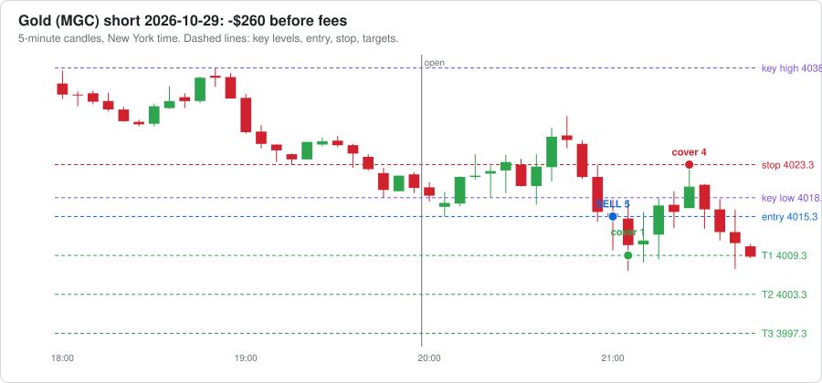

# Agent dashboard

Last updated 2026-10-30 05:30 New York time. Everything here is written by software and AI agents. It can be wrong, so check anything you plan to act on.

**[🪙 Open the Crypto Dashboard →](CRYPTO-DASHBOARD.md)** · **[𝕏 Open the X Brief Dashboard →](X-DASHBOARD.md)**

## Reminders

- ⏰ When your broker is connected: log every trade in trade-journal.md with a heading like `### Trade #1 | 2026-10-16` (swap the `__` in the template for the trade number) and keep the `- **Session:**` line, so the post-session reviewer can see your trades. Or ask Claude to build automatic trade logging into the paper trading agent.
- ⏰ Before trading real money: make this repo private (GitHub → Settings → Danger Zone → Change visibility). First run `git cherry-pick 0f7e3a2` so the paper trader checks less often and stays under GitHub's 2,000 free Actions minutes a month for private repos (it is public now to keep Actions free and unlimited).
- ⏰ 𝕏 **Turn on X auto-posting once @cashflowbrief00 gets traction:** 500+ followers, OR any post with 10,000+ views, OR 1,000+ views a day for a week (check the account's Analytics). Then tell Claude "turn on X auto-posting". It needs X API keys from developer.x.com (about $2.50-3/month for 5-6 posts a day, within the $25 AI budget) and X's "automated account" label.

[Edit reminders](REMINDERS.md)

## Agent status

| | Agent | What it does | Last ran | Runs |
|---|---|---|---|---|
| 🟢 | Market brief: nasdaq | Writes the brief before the New York session | 21 hours ago | weekdays about 7-8 AM New York time |
| 🟢 | Market brief: gold | Writes the brief before the Asia session | 10 hours ago | Sun-Thu evenings about 6-7 PM New York time |
| 🟢 | World news brief | Overnight news and today's events: politics, economy, war, trade | under an hour ago | daily about 5-6 AM New York time |
| 🟢 | Crypto research brief | Pumping coins, whales, government and adoption news | under an hour ago | daily about 5:30-6:30 AM New York time |
| 🟢 | Stock research brief | Movers, AI, nuclear, minerals, earnings dates and estimates | under an hour ago | Mon, Wed, Fri about 6-7 AM New York time |
| 🟢 | Paper trader | Paper trades every session with your rules and runs a practice prop challenge | 8 hours ago | after each session ends |
| 🟢 | Scorer | Checks each lean against what price did | 11 hours ago | after each session ends |

🟢 ran recently  🟡 a bit late  🔴 check it  ⚪ never ran

## 📒 Trade journal (paper)

- **Tradeify 50K evaluation: balance $48,299**, $299 above the drawdown floor, $4,701 to pass; today -$265, $985 left before the daily loss limit. [Details](paper-trading/summary.md)

Newest first. Times are New York time. Each sale shows contracts @ price, time. The 📈 link opens a chart of the trade; TV opens the same market on TradingView (add [the strategy](tradingview/breakout_strategy.pine) to see each trade marked).

| Date | Market | Side | Lots | Entry | Target 1 | Target 2 | Target 3 / out | Result | What could have gone better | See it |
|---|---|---|---|---|---|---|---|---|---|---|
| 2026-10-30 | Gold | short | 5 | 4015.3 @ 21:00 stop 4023.3 | 1 @ 4009.3, 21:05 ($60) | – | stop: 4 @ 4023.3, 21:25 (-$320) | ❌ **-$265** out 21:25 | • Target 1 paid $60, but the stop stayed at the start. Moving it to breakeven after Target 1 would have ended this trade at about $60 instead of -$260. • Fakeout re-entry (switched off): price closed back beyond the entry at 21:35; re-entering 3 contracts at 4012.9 (stop 4018.0) would have made $111. | [📈 chart](paper-trading/charts/2026-10-29-gold.svg) · [TV](https://www.tradingview.com/chart/?symbol=COMEX_MINI%3AMGC1%21&interval=5) |
| 2026-10-29 | Nasdaq | – | 0 | skipped: risk too big | | | | $0 | Breakout short at 09:35, but even the small size risked $1,101 and only $464 could be lost today without breaking the daily loss limit or the drawdown, so it was skipped. | [TV](https://www.tradingview.com/chart/?symbol=CME_MINI%3AMNQ1%21&interval=5) |
| 2026-10-29 | Gold | short | 5 | 4057.4 @ 20:05 stop 4067.9 | 1 @ 4051.4, 20:30 ($60) | – | stop: 4 @ 4067.9, 21:15 (-$420) | ❌ **-$365** out 21:15 | • Target 1 paid $60, but the stop stayed at the start. Moving it to breakeven after Target 1 would have ended this trade at about $60 instead of -$360. • The entry was 5.60 points past the key level, chasing a stretched move. Waiting for a pullback toward the level would have meant a better price and a smaller risk. | [📈 chart](paper-trading/charts/2026-10-28-gold.svg) · [TV](https://www.tradingview.com/chart/?symbol=COMEX_MINI%3AMGC1%21&interval=5) |
| 2026-10-28 | Nasdaq | short | 3 | 29787.5 @ 09:45 stop 29900.5 | – | – | stop: 3 @ 29900.5, 12:50 (-$678) | ❌ **-$681** out 12:50 | • Price never reached Target 1: the best it did was +3.50 points, and Target 1 needed 30. • The breakout failed and price kept going the other way, so the stop did its job and kept the loss small. • The entry was 100.75 points past the key level, chasing a stretched move. Waiting for a pullback toward the level would have meant a better price and a smaller risk. | [📈 chart](paper-trading/charts/2026-10-28-nasdaq.svg) · [TV](https://www.tradingview.com/chart/?symbol=CME_MINI%3AMNQ1%21&interval=5) |
| 2026-10-28 | Gold | long | 5 | 4083.1 @ 20:05 stop 4075.4 | – | – | stop: 5 @ 4075.4, 20:25 (-$385) | ❌ **-$390** out 20:25 | • Price never reached Target 1: the best it did was +1.00 points, and Target 1 needed 6. • The breakout failed and price kept going the other way, so the stop did its job and kept the loss small. • The entry was 5.20 points past the key level, chasing a stretched move. Waiting for a pullback toward the level would have meant a better price and a smaller risk. | [📈 chart](paper-trading/charts/2026-10-27-gold.svg) · [TV](https://www.tradingview.com/chart/?symbol=COMEX_MINI%3AMGC1%21&interval=5) |
| 2026-10-27 | Nasdaq | long | 5 | 29649.5 @ 09:40 stop 29581.25 | – | – | stop: 5 @ 29581.25, 09:45 (-$682) | ❌ **-$688** out 09:45 | • Price never reached Target 1: the best it did was +28.25 points, and Target 1 needed 30. • The breakout failed and price kept going the other way, so the stop did its job and kept the loss small. • The entry was 20.75 points past the key level, chasing a stretched move. Waiting for a pullback toward the level would have meant a better price and a smaller risk. • Fakeout re-entry (switched off): price closed back beyond the entry at 10:30; re-entering 3 contracts at 29652.0 (stop 29606.75) would have made $8. | [📈 chart](paper-trading/charts/2026-10-27-nasdaq.svg) · [TV](https://www.tradingview.com/chart/?symbol=CME_MINI%3AMNQ1%21&interval=5) |
| 2026-10-27 | Gold | – | 0 | no breakout, no trade | | | | $0 | No confirmed breakout in the first 60 minutes. Key high 4032.90, low 4017.30. | [TV](https://www.tradingview.com/chart/?symbol=COMEX_MINI%3AMGC1%21&interval=5) |
| 2026-10-26 | Nasdaq | – | 0 | no breakout, no trade | | | | $0 | No confirmed breakout in the first 60 minutes. Key high 29354.00, low 29156.75. | [TV](https://www.tradingview.com/chart/?symbol=CME_MINI%3AMNQ1%21&interval=5) |
| 2026-10-26 | Gold | short | 5 | 4001.5 @ 20:05 stop 4011.1 | 1 @ 3995.5, 21:00 ($60) | – | stop: 4 @ 4011.1, 21:15 (-$384) | ❌ **-$329** out 21:15 | • Target 1 paid $60, but the stop stayed at the start. Moving it to breakeven after Target 1 would have ended this trade at about $60 instead of -$324. | [📈 chart](paper-trading/charts/2026-10-25-gold.svg) · [TV](https://www.tradingview.com/chart/?symbol=COMEX_MINI%3AMGC1%21&interval=5) |
| 2026-10-23 | Nasdaq | long | 5 | 29169.25 @ 10:00 stop 29095.0 | – | – | stop: 5 @ 29095.0, 10:15 (-$742) | ❌ **-$748** out 10:15 | • Price never reached Target 1: the best it did was +16.75 points, and Target 1 needed 30. • After the stop, price turned and reached +156.75 points by 10:50. The stop (74.25 points from entry) was too tight: a stop just past the key level (29145.0) would have kept you in. • The entry was 24.25 points past the key level, chasing a stretched move. Waiting for a pullback toward the level would have meant a better price and a smaller risk. • Fakeout re-entry (switched off): price closed back beyond the entry at 10:35; re-entering 3 contracts at 29225.0 (stop 29141.75) would have made $357. | [📈 chart](paper-trading/charts/2026-10-23-nasdaq.svg) · [TV](https://www.tradingview.com/chart/?symbol=CME_MINI%3AMNQ1%21&interval=5) |
| 2026-10-23 | Gold | short | 5 | 4034.4 @ 20:30 stop 4037.1 | – | – | stop: 5 @ 4037.1, 20:45 (-$135) | ❌ **-$140** out 20:45 | • Price never reached Target 1: the best it did was +2.80 points, and Target 1 needed 6. • After the stop, price turned and reached +33.50 points by 22:00. The stop (2.70 points from entry) was too tight: a stop just past the key level (4036.0) would have kept you in. • Fakeout re-entry (switched off): price closed back beyond the entry at 21:00; re-entering 3 contracts at 4034.1 (stop 4045.5) would have made $357. | [📈 chart](paper-trading/charts/2026-10-22-gold.svg) · [TV](https://www.tradingview.com/chart/?symbol=COMEX_MINI%3AMGC1%21&interval=5) |
| 2026-10-22 | Nasdaq | short | 5 | 29359.0 @ 10:25 stop 29455.5 | 1 @ 29329.0, 10:30 ($60) | 2 @ 29299.0, 10:30 ($240) | 2 @ 29269.0, 10:45 ($360) | ✅ **$655** out 10:45 | • Price kept going 236.00 points past Target 3 (by 15:45). Letting the last 2 contract(s) run with a trailing stop could have made up to $944 more. | [📈 chart](paper-trading/charts/2026-10-22-nasdaq.svg) · [TV](https://www.tradingview.com/chart/?symbol=CME_MINI%3AMNQ1%21&interval=5) |
| 2026-10-22 | Gold | short | 5 | 4137.2 @ 20:15 stop 4143.1 | 1 @ 4131.2, 20:35 ($60) | 2 @ 4125.2, 21:25 ($240) | stop: 2 @ 4131.2, 21:30 ($120) | ✅ **$415** out 21:30 | • The last contracts were stopped at Target 1, then price reached Target 3 by 01:45. A looser stop after Target 2 would have caught it. | [📈 chart](paper-trading/charts/2026-10-21-gold.svg) · [TV](https://www.tradingview.com/chart/?symbol=COMEX_MINI%3AMGC1%21&interval=5) |
| 2026-10-21 | Nasdaq | short | 5 | 29818.5 @ 10:15 stop 29843.25 | – | – | stop: 5 @ 29843.25, 10:20 (-$248) | ❌ **-$252** out 10:20 | • Price never reached Target 1: the best it did was +25.75 points, and Target 1 needed 30. • The breakout failed and price kept going the other way, so the stop did its job and kept the loss small. | [📈 chart](paper-trading/charts/2026-10-21-nasdaq.svg) · [TV](https://www.tradingview.com/chart/?symbol=CME_MINI%3AMNQ1%21&interval=5) |
| 2026-10-21 | Gold | – | 0 | no breakout, no trade | | | | $0 | No confirmed breakout in the first 60 minutes. Key high 4149.80, low 4132.00. | [TV](https://www.tradingview.com/chart/?symbol=COMEX_MINI%3AMGC1%21&interval=5) |

**Latest trade:**

[Full journal with every fill](paper-trading/paper-journal.md)

## 👔 CEO check

**❌ 1 broken rule(s)** ([read the full check](reports/ceo/latest.md))

<b>What the CEO checked</b>

##### Futures paper trader

- ❌ Tradeify practice evaluation failed: reset on 2026-10-28: only $96 above the floor, too close for any trade.
- ✅ Tradeify practice evaluation: $564 above the $2,000 trailing drawdown floor.

##### Your trade journal

- ✅ No trades logged yet, nothing to check.

##### Crypto bots

- ✅ Rotation bot: 8 trades, buys only at weekly checks, never more than 4 coins at once.
- ✅ Buy-and-hold bot has never sold.

##### Alpaca copy

- ✅ All 10 Alpaca orders were for the bot's coins and within the limit.

##### Costs

- ✅ Spent $6.86 so far this month on 57 AI runs; on pace for about $7 (budget $50).

##### Agent health

- ✅ Every research brief worked on its last run.

##### Ready to run on its own?

- ⏳ 9 of 15 trading days on the paper record
- ⏳ 1 rule problem(s) in the paper trader above
- ⏳ the Tradeify practice account never failed
- ⏳ the Tradeify practice evaluation has not passed yet
- ⏳ profit factor 0.70 (needs 1.3 or more), total $-1,096 over 13 trades
- ✅ worst trading day $-1,071 (needs $-1,250 or better)
- ⏳ You: Tradeify confirms in writing that TradersPost automation is allowed on the Select 50K
- ⏳ You: 2+ weeks of the live 50K alerts traded by hand with no rule broken
- ⏳ You + Claude: 2-3 sessions on a TradersPost paper account matching the chart

## 📅 Weekly report

<b>Week ending 2026-10-25</b>

#### The week in one look

- **Futures paper:** +$1,357 this week
- **Rotation bot:** -$23.91 this week
- **Buy-and-hold bot:** -$17.66 this week
- **AI costs:** $3.48 this week

#### Futures paper trading

- **This week:** +$1,357 after fees, 8 trades (5 wins, 3 losses), 2 sessions with no trade
- **Since paper trading began:** +$1,357 over 8 trades
- Nasdaq (MNQ): +$667 over 5 trades
- Gold (MGC): +$690 over 3 trades

| Day | Market | Side | Entry | Result |
|---|---|---|---|---|
| 2026-10-19 | nasdaq | long | 29841.25 at 10:15 | +$357 |
| 2026-10-20 | gold | short | 4150.6 at 20:55 | +$415 |
| 2026-10-20 | nasdaq | long | 29717.75 at 10:05 | +$655 |
| 2026-10-21 | nasdaq | short | 29818.5 at 10:15 | -$252 |
| 2026-10-22 | gold | short | 4137.2 at 20:15 | +$415 |
| 2026-10-22 | nasdaq | short | 29359.0 at 10:25 | +$655 |
| 2026-10-23 | gold | short | 4034.4 at 20:30 | -$140 |
| 2026-10-23 | nasdaq | long | 29169.25 at 10:00 | -$748 |

#### TradingView strategy

| Market | Export date | Forward test (since paper start) | Whole export |
|---|---|---|---|
| Nasdaq (MNQ) | 2026-10-18 | 0 trades, $0 | 25 trades, +$3,684, 56% wins |
| Gold (MGC) | 2026-10-18 | 0 trades, $0 | 22 trades, +$699, 32% wins |

Export the List of trades from each chart and say "update TradingView" to refresh these numbers.

#### Crypto paper bots

| Bot | Start of week | End of week | Change | Since it started ($1,000) |
|---|---|---|---|---|
| Rotation bot | $1,003.26 | $979.35 | -$23.91 (-2.4%) | -$20.65 |
| Buy-and-hold bot | $1,001.63 | $983.97 | -$17.66 (-1.8%) | -$16.03 |

Trades this week:

| Day | Bot | | Coin | Amount | Profit / loss |
|---|---|---|---|---|---|
| 2026-10-22 | Rotation bot | 🔴 Sell | AVAX | $186.17 | -$14.58 |
| 2026-10-22 | Rotation bot | 🔴 Sell | BCH | $198.91 | -$1.88 |
| 2026-10-22 | Rotation bot | 🔴 Sell | BTC | $199.02 | -$1.78 |
| 2026-10-22 | Rotation bot | 🔴 Sell | SUI | $198.38 | -$2.41 |

**Alpaca copy:** 3 order(s) this week: sell AVAX, sell BCH, sell BTC

#### Market briefs (Nasdaq and gold)

- 7 briefs scored; 2 gave a direction, 1 of those were right.
- 5 were Neutral.

#### CEO check

**❌ Rules were broken this week.** 25 checks ran. [Latest CEO check](../ceo/latest.md)

#### AI costs this week

| Agent | Runs | Cost |
|---|---|---|
| world-brief | 8 | $1.01 |
| crypto-brief | 7 | $0.81 |
| market-brief-nasdaq | 5 | $0.62 |
| market-brief-gold | 4 | $0.55 |
| stock-brief | 3 | $0.46 |
| review-gold | 1 | $0.03 |
| x-posts | 2 | $0.01 |
| **Total** | 30 | **$3.48** |

At this pace: about $15 a month.

[Main dashboard](../../DASHBOARD.md) · [Crypto dashboard](../../CRYPTO-DASHBOARD.md)

[All weekly reports](reports/weekly/)

## Paper trading

- Total after fees: **-$1,360** over 14 trades (19 sessions watched)
- Trading days with a trade: **10**, profitable: **3**, losing: 7
- Win rate: 36%
- Profit factor: 0.65
- Biggest drop from a high (max drawdown): $3,605
- Room left before the $4,000 max drawdown: **$395**
- Progress toward a prop demo: **10 of 20** trading days

<b>Challenge simulation, results by market, and daily results</b>

#### By market

| Market | Trades | Wins | Total after fees |
|---|---|---|---|
| nasdaq | 7 | 3 | -$702 |
| gold | 7 | 2 | -$659 |

#### Daily results

| Trading day | Sessions | Result after fees |
|---|---|---|
| 2026-10-30 | gold short | -$265 |
| 2026-10-29 | gold short, nasdaq skipped, risk too big for today's limits | -$365 |
| 2026-10-28 | gold long, nasdaq short | -$1,071 |
| 2026-10-27 | gold no trade, nasdaq long | -$688 |
| 2026-10-26 | gold short, nasdaq no trade | -$329 |
| 2026-10-23 | gold short, nasdaq long | -$888 |
| 2026-10-22 | gold short, nasdaq short | $1,070 |
| 2026-10-21 | gold no trade, nasdaq short | -$252 |
| 2026-10-20 | gold short, nasdaq long | $1,070 |
| 2026-10-19 | gold no trade, nasdaq long | $357 |

[Every paper trade](paper-journal.md) · [Raw data](trades.csv)

[Paper trading journal](paper-trading/paper-journal.md) · [TradingView strategy](tradingview/breakout_strategy.pine)

## 📈 TradingView strategy results

From the latest **List of trades** export of each chart. One trade = one entry (TradingView counts each target as a separate trade). Forward test = trades from 2026-10-19 on.

| Market | Export date | Trades | Wins / losses | Win rate | Total | Profit factor | Max drawdown | Forward test |
|---|---|---|---|---|---|---|---|---|
| Nasdaq (MNQ) | 2026-10-18 (trades since 2026-08-25) | 25 | 14 / 11 | 56% | **$3,684** | 1.99 | $1,066 | 0 trades, $0 |
| Gold (MGC) | 2026-10-18 (trades since 2026-08-24) | 22 | 7 / 15 | 32% | **$699** | 1.30 | $1,559 | 0 trades, $0 |
| **Both** | | 47 | 21 / 26 | 45% | **$4,384** | 1.72 | | |

<b>Latest 10 TradingView trades</b>

| Entry (New York) | Market | Side | Entry price | Contracts | Result |
|---|---|---|---|---|---|
| 2026-10-15 09:35 | Nasdaq (MNQ) | short | 29,830.00 | 5 | ❌ -$68 |
| 2026-10-14 20:05 | Gold (MGC) | short | 4,138.90 | 5 | ❌ -$105 |
| 2026-10-14 09:35 | Nasdaq (MNQ) | short | 30,578.50 | 5 | ❌ -$192 |
| 2026-10-13 09:35 | Nasdaq (MNQ) | short | 30,757.25 | 5 | ❌ -$20 |
| 2026-10-12 20:05 | Gold (MGC) | short | 4,187.60 | 5 | ✅ $420 |
| 2026-10-12 09:45 | Nasdaq (MNQ) | short | 30,969.50 | 5 | ✅ $660 |
| 2026-10-08 20:05 | Gold (MGC) | long | 4,168.70 | 5 | ❌ -$20 |
| 2026-10-07 20:05 | Gold (MGC) | short | 4,131.60 | 5 | ❌ -$250 |
| 2026-10-07 09:35 | Nasdaq (MNQ) | short | 31,180.50 | 5 | ❌ -$704 |
| 2026-10-06 20:05 | Gold (MGC) | long | 4,191.20 | 5 | ❌ -$8 |

To refresh: export the List of trades from each chart in TradingView, double-click `tradingview/update-exports.command`, then push in GitHub Desktop.

## Latest briefs

Click a brief to read it here. The summary is at the top of each.

<b>🌍 World news brief, 2026-10-30, event risk Medium</b>

#### Top things for today
1. **Ukraine hit a Russian refinery again.** Kyiv launched a drone attack early Friday on the Novokuibyshevsk refinery in southwestern Russia. Ukraine had paused attacks on Russian oil for over a week under pressure from Trump. (ARA, WSJ headline) Why it matters: diesel and crude supply, energy-driven inflation.
2. **Trump's reaction.** Trump said that if Zelenskyy is again shooting at refineries, he is only making the world oil price higher. (NBC News, Newsmax interview, late Thursday). That quote may refer to the earlier round of strikes. NBC's page was labeled 13 days old. Why it matters: energy prices, inflation, the Fed outlook.
3. **US-Iran war still affects shipping.** CNN's headline says Somali piracy is back as the US-Iran war rattles shipping (headline only). ARA also cites a blockade of the Strait of Hormuz. Why it matters: oil, safe-haven demand.
4. **Employment Cost Index at 8:30 AM.** Forecast 0.8%, previous 0.9%. Why it matters: wage inflation, rate expectations.
5. **Tariffs and midterms.** Nikkei Asia says Trump is holding off overcapacity tariffs as the midterms near (headline only). The midterms are on November 3. Why it matters: trade risk, the dollar.

#### Today's schedule (New York time)
| Time | Event | Who or where | Confirmed? |
|---|---|---|---|
| 1:30 AM | BOJ Press Conference (High impact). Already held. The feed has no outcome. | Japan | Yes |
| 8:30 AM | Employment Cost Index q/q (forecast 0.8%, previous 0.9%) | USD | Yes |

No Trump events or hearings with times were found in the headlines or searches.

Coming up this week: No scheduled events found. The calendar lists nothing major for Saturday, Oct 31.

#### Event risk today
Medium - The Employment Cost Index is the only scheduled US release, but the renewed Ukraine refinery strikes and the Iran war keep energy headlines live.

#### Politics and policy
- Trump responded late Thursday to Ukraine's defiance, speaking to Newsmax. (NBC News)
- CNBC says Trump and Vance scrapped planned appearances in the final stretch of the midterm campaign (headline only).
- CNN has a piece on Trump's team and election claims ("BIG cheating") ahead of November (headline only).
- The Guardian asks whether Trump's global actions, from Ukraine to Iran, will hurt him in elections (headline only).
- No Fed, Treasury or executive-order news was found in the feed.

#### Economics
- No US data was released overnight.
- France's economy shrank 0.1% in Q3 (Le Monde, headline only). WSJ's headline links the contraction to mounting debt worries (headline only).
- Bloomberg says record gasoline prices pushed Kenya's inflation to a three-year high (headline only).
- MUFG Research published an FX Daily Snapshot (headline only).

#### SEC, CFTC and hearings
- No congressional hearings were found.
- SEC: two entities were charged in a $130 million fraud scheme that used false SEC filings (SEC press release, Thu Oct 29).
- CFTC: it hosted a roundtable on 24/7 trading on Wed Oct 28 (CFTC press release).
- CFTC: Crypto Briefing says it held an inaugural Frontier Forum on super intelligence (headline only). 디지털투데이 says the CFTC chair called for redesigned financial rules for autonomous AI agents (headline only).
- CFTC: DeFi Rate says it sued Utah amid prediction-market fights with states (headline only).
- CoinMarketCap says the Hyperliquid Policy Center urged a court to dismiss CME's lawsuit against the CFTC (headline only).

#### War, trade and tariffs
- **Ukraine-Russia:** Monitoring channels call the Novokuybyshevsk attack a resumption of strikes, the first after an unofficial pause that began in mid-October. The refinery is owned by Rosneft. (Kyiv Independent) Why it matters: diesel supply, energy prices.
- **Middle East:** Audacy says Saudi Arabia reported a drone intercepted near Islam's holiest city (headline only). CNN reports a US-Iran war affecting shipping (headline only).
- **Tariffs:** Nikkei Asia says Trump is holding off overcapacity tariffs (headline only). CBC says an American importer facing a $40M tariff bill is suing Trump to end some tariffs on Canada (headline only).

#### Country briefs
- **China:** WSJ says a Chinese executive close to Nvidia's CEO is suspected of giving China information (headline only). SCMP has an opinion piece on US-China relations no longer running on Trump's personal ties (headline only).
- **European Union:** France's Q3 GDP fell 0.1% (Le Monde, WSJ; headline only).
- **United Kingdom:** Nothing found.
- **Japan:** The BOJ press conference was scheduled for 1:30 AM. The feed gives no content.
- **India:** Nothing found.
- **Russia:** Ukraine hit the Novokuibyshevsk refinery (ARA). France 24 says Novaya Gazeta shut down after years of Kremlin pressure (headline only).
- **Canada:** CBC says an importer is suing Trump over some tariffs on Canada (headline only).

[Read the full brief with all the details](reports/news/2026-10-30-world-brief.md) · [All news briefs](reports/news/)

<b>🪙 Crypto brief, 2026-10-30</b>

#### Top things today
1. **Binance hack.** Binance says a suspected hot-wallet hack hit it for about $6.3B. It would be the largest crypto theft on record. Binance has confirmed an attacker submitted unauthorized withdrawals. Withdrawals stay paused, and it expects to resume them within 48 hours. (FinanceFeeds, The Deep Dive) Why it matters: exchange risk is driving the sell-off.
2. **Market drop and liquidations.** BTC is -2.8% and ETH is -4.0% on the day. Traders lost $1.49B to liquidations over the past day. (BeInCrypto) Why it matters: forced selling is amplifying the move, and sentiment is in Fear (30).
3. **Hyperliquid (HYPE) rallies against the market.** ICE, the NYSE owner, will partner with trade[XYZ] to bring Hyperliquid-based perpetual futures to the US. (FXStreet) The deal is subject to regulatory approvals. (crypto.news) Why it matters: HYPE is the day's standout.
4. **Frozen funds.** Circle froze about $800M in USDC and Tether froze more than $1.56B in USDT tied to the hack. (daily.dev) Aave froze its Avalanche markets and Arbitrum locked $30.5M. (Crypto Times) Why it matters: stablecoin issuers and DeFi protocols are freezing assets, which is a rare, fast response.
5. **Treasury buying is uneven.** Strive bought 6,182 BTC from Oct 17 to 23, bringing its total to 43,000 BTC. Strategy bought about 85% less that same week. (24/7 Wall St.) Why it matters: the biggest corporate buyer has slowed.

#### Coins to research
| Coin | 24h move | Why it is moving | Red flags |
|---|---|---|---|
| Hyperliquid (HYPE) | +15.8% | Druckenmiller's investment and a one-word reaction from Elon Musk added to the ICE news. (U.Today) Whales opened $52.7M in HYPE longs. (crypto.news) | Neither company has said whether the US venue will pay anything back to HYPE. The last US-access rally faded within six weeks. (BeInCrypto) The US venue still needs approval. |
| Beam (BEAM) | +37.2% | No news found. | Pump with no news. Market cap is $236.5M. Ranked #154. |
| Kinetiq (KNTQ) | +27.1% | No news found. Any link to the Hyperliquid rally is (unconfirmed). | Pump with no news. Market cap is $179.9M. Volume is $20.3M. |
| Quack AI (Q) | +13.7% | No news found. | Down 58.9% over 7 days, so this is a bounce after a crash. Market cap is $237.4M. |
| THORChain (RUNE) | +9.2% | No news found. CoinCodex lists it among top gainers. | No clear catalyst. Market cap is $219.2M. |
| Ethena (ENA) | -3.9% | It is trending on CoinGecko. Addresses tied to the suspected Binance theft moved 217 million ENA. (ChainCatcher) | Linked to hack-related flows. Whether it is affected beyond this is (unconfirmed). |

No new meme coins were found pumping hard.

#### Whale watch
| When | Coin | Amount (USD) | Who | Direction |
|---|---|---|---|---|
| ~4:40 PM Oct 29 | ETH | ~$449M (195,460 ETH) | Unknown wallet (Whale Alert) | Wallet to new wallet. Not an exchange move. |
| 4:24–5:04 PM Oct 29 | ETH, stablecoins, 60+ tokens | ~$3.3B (on-chain estimate) | Binance hot wallets, flagged as exploiter (Etherscan, FinanceFeeds) | Off an exchange (suspected theft) |
| Last 24h | ENA | Not given (217M ENA) | Addresses tied to the Binance theft (ChainCatcher) | Moved. Direction not stated. |
| Last 24h | HYPE | $52.7M | Whales (crypto.news) | Bought (long positions) |
| Date unconfirmed | BTC | ~$148M (1,900 BTC) | Galaxy Digital (Lookonchain via Coinfomania) | Moved to nine new wallets (unconfirmed) |

Arkham tracks 55 addresses labeled "binance-hacker-1029" holding about $5.78B. That is total holdings, not a confirmed stolen amount.

#### Government and regulation
- **CLARITY Act (H.R. 3633).** It would put spot digital-commodity markets under the CFTC and keep securities under the SEC. It failed to advance in the Senate on September 15, 2026. The cloture vote was 49-50. (Orrick, DataWallet) Passage this Congress looks much less likely.
- **CFTC.** On October 5 it issued an advance notice of proposed rulemaking (Regulation CTX and CAM) on retail crypto trades with leverage or margin. Comments are due December 14. (Sumsub) Binding rules may still be more than a year away. (Orrick)
- **SEC.** In August 2026 it proposed Regulation Crypto Assets, with a registration and exemption framework and a safe harbor. (SEC filing)
- **ICE/trade[XYZ] venue.** The CFTC decision is one of the things that will show whether the HYPE move lasts. (BeInCrypto)
- **Other countries.** Bybit received a full VARA license in Dubai. (Analytics Insight, about 6 days old)
- No new US bills or SEC/CFTC actions in the last few days were found, and no low-profile amendments either. The Binance hack could draw regulatory attention, but I found nothing on that yet.

#### Who is buying and adopting
- **Strive:** the 6,182 BTC purchase above, as reported by 24/7 Wall St. Strategy holds 848,517 BTC at an average cost of $75,446, and its stock is down 51%.
- **Smarter Web Company:** bought 20 BTC for about GBP 1.23M, bringing its total to 2,850 BTC. (Analytics Insight)
- **HSBC:** launched RedCoin (RCHKD), a Hong Kong dollar stablecoin for payments through its PayMe platform.
- **Governments:** no new country purchases found. Arkham reported US government wallets moved about $1.5B in seized crypto on October 7 and 8. A 2025 executive order bars sales of forfeited bitcoin.

#### Next 7 days
| Date | Event | Coin or topic |
|---|---|---|
| Oct 30 – Nov 1 (unconfirmed) | Binance says withdrawals should resume within 48 hours. No fixed date was given. (FinanceFeeds) | Binance, market liquidity |
| Not dated | Binance delayed its PREDICT listing. (Crypto Times) | Binance listings |

No other scheduled events (unlocks, upgrades, hearings, ETF deadlines) were found.

[Read the full brief with all the details](reports/crypto/2026-10-30-crypto-brief.md) · [All crypto briefs](reports/crypto/)

<b>📈 Stocks brief, 2026-10-30</b>

#### Top things today
1. **Alphabet fell 12.6% after a Q3 miss.** EPS was $2.12 against a $3.01 consensus. Free cash flow turned negative on heavy AI spending, and Alphabet said capex will rise again next year (Schwab). Why it matters: it raised doubts about whether AI spending earns a return.
2. **Intel and Amazon dropped after the close Thursday.** Intel fell roughly 17–23% on weak Q4 guidance despite an EPS beat. Amazon fell about 6–7% after a small miss on EPS and revenue (Investing.com, investingLive). Why it matters: they point to a wider AI-cost selloff in tech at the open.
3. **ServiceNow had its worst day ever, down 26.9%.** Its cRPO growth guidance cooled, and the software ETF IGV fell 4.1% midday (Benzinga). Why it matters: a good AI story did not protect software from a bookings slowdown.
4. **Microsoft held up.** It closed down just 0.2%, and coverage described its results as strong (Schwab). Why it matters: the market is rewarding visible AI returns and punishing cash burn.
5. **Cameco reports today (timing unconfirmed).** The setup is a record uranium price against earnings that lag it (Investing.com). Why it matters: it is the main nuclear-fuel print of the week.

#### Stocks to research
| Ticker | Theme | Move | Why | Red flags |
|---|---|---|---|---|
| AMD | AI chips | -2.1% 1d, +11.5% 5d | Reports Nov 3 against a $13.1B revenue estimate. | The chip index fell Thursday; the AI-cost worry is a risk. |
| CRWV | AI cloud | -5.0% 1d, +9.2% 5d | AI cloud names fell 6–7% after hours on Thursday. Reports Nov 10. | Expected loss of $1.21 per share. Sensitive to AI-spending sentiment. |
| USAR | Rare earths | +0.4% 1d, +9.2% 5d | The US government holds about 10% after a $1.6B package (FT). Reports Nov 5. | Revenue estimate is only $13.6M and it is losing money. China put it on an export control list. |
| SMR | Nuclear | +4.4% 1d, +10% 5d | Reports Nov 5. | Revenue estimate is only $3.8M. One headline said analysts cut NuScale price targets (unconfirmed detail). |
| GKOS | Earnings mover | +33.6% | Revenue was $211M against $168M expected, and it raised guidance (CNBC). | After a two-day jump from the $170s, the move may be extended. |
| SPCX | New listing | -0.9% | Space Exploration Technologies, market cap about $2.0T, is among the most active stocks. | I found no news on it today. Alphabet booked an unrealized SpaceX loss of about $8.2B (TradingKey). |

#### AI and tech
- **Alphabet:** Revenue was $127.6B, up 25% but below expectations. Cloud revenue rose 103% to $30.7B, yet search and YouTube ads missed (Benzinga, Schwab). Roughly $500B of market value was lost, the second-largest one-day loss on record.
- **Amazon and Intel:** Amazon posted EPS of $1.89 against $1.97 expected, and revenue of $201.9B against $202.2B (investingLive). Its free cash flow was reported at about -$42.4B (tech-insider.org). Intel's Q3 EPS was $0.52 against $0.41 expected, but revenue and Q4 guidance disappointed. It warned of PC headwinds (Investing.com).
- **Funding:** Microsoft launched a $25B bond offering (ChainCatcher). AI cloud names CoreWeave, Nebius and Iren fell 6–7% after hours.
- **Chips:** The semiconductor index fell for the first time in five sessions, and Marvell fell more than 13% (Bloomingbit). Nvidia, AMD and Micron were less affected than the Alphabet-linked names, though Micron closed down 5.0%.

#### Nuclear and critical minerals
- **Cameco (CCJ):** Reports today. Last quarter's realized uranium price was up 18% to US$67.79 a pound, but uranium gross profit fell 27% as costs rose. The long-term price is at a 19-year high of $96.50 (Investing.com, TIKR). One firm trimmed its target to $95 from $97 and kept Equal Weight.
- **Nuclear sentiment:** Cameco fell about 11.9% over the past month despite a US$120B US–Korea Westinghouse framework. NuScale and Oklo each fell more than 28% (TIKR). Thursday, SMR rose 4.4% and BWXT rose 2.2%.
- **China and rare earths:** The US–China truce on rare earth export controls now runs to January 10, 2027, not November 10 (Startup Fortune, citing Treasury Secretary Bessent). China's controls on seven medium and heavy rare earths stayed in force throughout. In June, Beijing added MP Materials and USA Rare Earth to its own export control list. Pentagon rules barring Chinese-origin rare earths from weapons start January 1 (OilPrice).
- **Government stakes:** One headline cites a US government portfolio of about $30B across 43 deals in chips, minerals and quantum (investingLive). I did not open the details.

#### Earnings
**Results since yesterday (reaction as reported):**
- **Alphabet:** EPS $2.12 against $3.01 expected. Stock -12.6%.
- **ServiceNow:** EPS $1.00 against $1.02 expected. Revenue was $4.106B, slightly above estimates. Stock -26.9%.
- **Amazon:** Missed on both lines. Stock -4.2% in the session, then roughly -6% to -7% after hours (the low was about -12%).
- **Intel:** Beat on EPS, missed on revenue. Stock -3.6% in the session, then about -17% to -23% after hours.
- **Crocs:** EPS $3.69 against $3.31 expected, and it raised guidance. Stock +25.5%.
- **Glaukos:** Beat on revenue and raised guidance. Stock +33.6%.
- **Also moving:** ADT rose 33.2% on a $15.3B all-cash takeover by Thrive Holdings, expected to close in Q1 2027 (CNBC). This was a deal, not earnings.
- **Microsoft and Fortinet:** Microsoft's numbers were not in my results. Fortinet fell more than 20% (CNBC).

**Watchlist calendar.** Timing was not in the live data. I did not confirm it for any name, so all are listed as unconfirmed.

| Date | Ticker | Timing | EPS est. | Revenue est. |
|---|---|---|---|---|
| 10-30 | CCJ | (unconfirmed) | $0.27 | $753.9M |
| 11-02 | AAPL | (unconfirmed) | $1.98 | $113.3B |
| 11-02 | BWXT | (unconfirmed) | $1.19 | $972.4M |
| 11-02 | PLTR | (unconfirmed) | $0.41 | $2.2B |
| 11-03 | AMD | (unconfirmed) | $1.94 | $13.1B |
| 11-03 | SMCI | (unconfirmed) | $1.20 | $16.3B |
| 11-04 | ALB | (unconfirmed) | $2.53 | $1.6B |
| 11-04 | ARM | (unconfirmed) | $0.48 | $1.4B |
| 11-04 | LEU | (unconfirmed) | -$0.13 | $57.0M |
| 11-05 | MP | (unconfirmed) | -$0.01 | $119.0M |
| 11-05 | SMR | (unconfirmed) | -$0.12 | $3.8M |
| 11-05 | USAR | (unconfirmed) | -$0.15 | $13.6M |
| 11-06 | OKLO | (unconfirmed) | -$0.26 | $1.1M |
| 11-06 | VST | (unconfirmed) | $3.09 | $6.0B |
| 11-09 | CEG | (unconfirmed) | $3.84 | $9.3B |
| 11-10 | CRWV | (unconfirmed) | -$1.21 | $3.5B |
| 11-13 | LAC | (unconfirmed) | -$0.03 | n/a |

#### Smart money
- **Cameco:** One firm trimmed its price target to $95 from $97 and kept an Equal Weight rating. The firm was not named in the source (TIKR).
- **Insider buying and Congress trades:** Nothing found in the three themes.
- **Analyst rating changes after Alphabet, Amazon, Intel and ServiceNow:** Nothing found.

[Read the full brief with all the details](reports/stocks/2026-10-30-stock-brief.md) · [All stocks briefs](reports/stocks/)

<b>📊 Nasdaq 100 futures market brief, 2026-10-29</b>

### Nasdaq 100 Futures Brief – Thursday, Oct 29, 2026 (New York session)

#### 1. What is driving the market
- **Big Tech earnings are the main driver.** Nasdaq futures dropped as mixed Alphabet and Microsoft results left investors weighing the payoff from heavy AI spending.
- **Alphabet is weak.** It slid 10.5% in premarket trading after disappointing search advertising results and a big rise in cash burn.
- **Microsoft is strong.** It climbed 3.5% after a cash-flow beat and a forecast for strong cloud growth.
- **Software and chips are soft.** Fortinet fell 25.4% and ServiceNow fell 19%. The chip sector looked set to snap a 4-day win streak.
- **The Fed was not the shock.** The Fed held rates steady in a 10-2 vote on Wednesday.
- **The rest of the market is steadier.** Dow futures were near flat while Nasdaq-100 futures were down about 1%.

#### 2. Scheduled events (New York time)
- **8:30 AM:** Advance Q3 GDP, September PCE inflation, and weekly jobless claims. Kiplinger lists all of these at 8:30 am. One Investing.com preview says 7:30 AM ET, which conflicts with the others. I treat 8:30 as correct.
- **Forecasts:** GDP forecast is 3.2% vs 2.2% before. Core PCE forecast is 0.3%. Jobless claims forecast is 198K. Other sources show slightly different forecasts.
- **ECB decision:** 14:15 CET, with Lagarde's press conference at 14:45 CET. That is about 9:15 and 9:45 AM New York time, by my conversion.
- **Earnings:** Amazon reports after the close, with its call at 5:00 p.m. ET. That is after the session ends. Caterpillar, Eli Lilly and Intel also report. I could not verify their release times.
- **Fed speakers today:** I found none.
- **Tomorrow:** The Bank of Japan decision is Friday.

#### 3. Key levels (from the price data)
- **Previous session high:** 30009.00. This is also the highest high of the last 5 sessions.
- **Previous session low:** 29767.25.
- **Previous close:** 29990.75.
- **Since that close:** high 30178.00, low 29482.50.
- **5-session low:** 28987.00.
- **Latest price:** 29637.00. That is 130.25 below the previous session low, so price has broken under that low.
- **Where price sits:** It is not near the highs. It is below the previous low, which now acts as overhead resistance. The nearest support is the overnight low of 29482.50, about 154.5 points below.

#### 4. Volume
The previous session traded 0.92x the average of the 5 sessions before it. That is slightly below average. It suggests mild participation, not strong conviction. Yesterday's modest, slightly light volume doesn't confirm a strong trend either way.

#### 5. Directional lean
**Bearish, Low confidence.**
Price is below the previous session low and well off the overnight high of 30178.00. The news also leans negative, with AI-spending worries hitting Alphabet and software stocks. Volume is only slightly light, so it neither confirms nor weakens the move. Confidence is low because Microsoft's strong results offset Alphabet's, and the 8:30 AM GDP and PCE data can reverse the tone quickly. Price has also already dropped a lot overnight.

**What would change the lean:** a move back above the previous low of

[Open the file](reports/2026-10-29-nasdaq-brief.md)

<b>📊 Gold futures market brief, 2026-10-29</b>

### Gold Futures Brief: Asia Session, Oct 29–30, 2026

#### 1. What is driving gold
- **Hawkish Fed hold.** The Fed held rates at 3.75%-4.00% on Oct 28 in a 10-2 vote. Cook and Hammack both wanted a 25 bp hike. Futures still priced about an 85% chance of a hike on Dec 9.
- **Strong data on Thursday.** Gold slid as a 3.4% GDP beat kept a December Fed hike in play. I could not verify the September PCE result. Sources I found disagreed on it.
- **Wider backdrop.** Attention is on Middle East tensions, energy prices and whether the Fed hikes again. The 10-year yield was about 5.04% on Oct 28.

#### 2. Scheduled events (New York time)
- **7:30 PM Thu:** Tokyo core CPI for October. Consensus is 2.6%, down from 2.7%. It lands just before the open.
- **Session open, 8:00 PM:** Tokyo 9:00 AM.
- **About 11:00 PM Thu:** Bank of Japan decision with the Outlook Report. It is scheduled for 12:00 JST on Oct 30. There is no fixed release time. OIS pricing favors a hold, with a 2.4% chance of a hike. Sources disagree on the current BOJ rate (0.75% vs 1.25%). I could not settle that.
- **About 2:30 AM Fri:** Governor Ueda's press conference is at 3:30 PM JST, which is 2:30 AM ET.
- **After the session, 8:30 AM Fri:** US Employment Cost Index (forecast 0.8%). Fed's Daly speaks at 12 PM and Musalem at 12:30 PM. These come after the Asia session ends.

I found no major earnings that move gold during the session.

#### 3. Key levels (from the price data)
- Previous session high: **4081.00**
- Previous session low: **4033.40**
- Previous session close: 4034.50
- 5-session high: **4084.10**
- 5-session low: **3990.90**
- Since that close: high 4051.10, low 4016.30
- Latest price: **4024.20**

The latest price is 9.20 below the previous session low. It is also only about 8 points above the post-close low of 4016.30. So it sits **near support**, not resistance. The old low at 4033.40 is now overhead and could act as resistance.

#### 4. Volume
The previous session traded 0.94x the average of the five sessions before it. That is sl

[Open the file](reports/2026-10-29-gold-brief.md)

## Latest lean for each market

| Market | Brief written | Lean | Confidence | Event risk | Price then | Full brief |
|---|---|---|---|---|---|---|
| nasdaq | 2026-10-29 08:39 | ? Unknown | Unknown | n/a | 29637.00 | [read it](reports/2026-10-29-nasdaq-brief.md) |
| gold | 2026-10-29 19:26 | ? Unknown | Unknown | n/a | 4024.20 | [read it](reports/2026-10-29-gold-brief.md) |

A lean is a probability-based view, not a prediction. ▲ Bullish  ▼ Bearish  ◆ Neutral

## Scorecard

- Briefs scored: **16** (Bullish or Bearish calls: 2)
- Right: 1, Wrong: 1, Session ended flat: 0
- Hit rate when the session was decisive: **50%**
- For comparison, price went up in 53% of decisive sessions
- ⚠️ Only 2 directional calls so far. Treat the numbers as noise until there are at least 30.

By confidence:

| Confidence | Right | Wrong | Flat | Hit rate |
|---|---|---|---|---|
| High | 0 | 0 | 0 | n/a |
| Medium | 1 | 0 | 0 | 100% |
| Low | 0 | 1 | 0 | 0% |

[Full scorecard](reports/scorecard.md)

## Charts

## Recent results

| Brief | Market | Lean | Confidence | Session moved | Result |
|---|---|---|---|---|---|
| 2026-10-28 | gold | ◆ Neutral | Low | Down (-0.80%) | Moved |
| 2026-10-28 | nasdaq | ◆ Neutral | Low | Up (0.20%) | Moved |
| 2026-10-27 | gold | ◆ Neutral | Low | Down (-0.44%) | Moved |
| 2026-10-27 | nasdaq | ◆ Neutral | Low | Up (0.85%) | Moved |
| 2026-10-26 | nasdaq | ◆ Neutral | Low | Up (0.85%) | Moved |
| 2026-10-23 | nasdaq | ◆ Neutral | Low | Up (0.32%) | Moved |
| 2026-10-22 | gold | ▼ Bearish | Medium | Down (-0.31%) | Right |
| 2026-10-21 | gold | ◆ Neutral | Low | Down (-0.94%) | Moved |
| 2026-10-21 | nasdaq | ◆ Neutral | Low | Up (0.41%) | Moved |
| 2026-10-20 | gold | ◆ Neutral | Low | Up (0.24%) | Moved |

## Your journals

- Trades logged: **0**. [Open the trade journal](trade-journal.md)
- No-trade sessions explained: **3**. [Open the no-trade journal](no-trade-journal.md)

<b>Latest no-trade sessions</b>

##### No-trade session | 2026-10-18 | Asia
- **Instrument:** Gold futures
- **What happened:** No signal. The rules gave no entry.
- **Why:** No 5-minute candle closed above the previous high (4211.20) or below the previous low (4167.50) in the first 30 minutes after the 20:00 open. (Previous Asia session was 2026-10-15.)
- **First 30 minutes, candle by candle:**
  - 20:00 candle: close 4205.50, closed inside the range (5.70 below the high, 38.00 above the low).
  - 20:05 candle: close 4204.40, closed inside the range (6.80 below the high, 36.90 above the low).
  - 20:10 candle: close 4201.70, closed inside the range (9.50 below the high, 34.20 above the low).
  - 20:15 candle: close 4199.00, closed inside the range (12.20 below the high, 31.50 above the low).
  - 20:20 candle: close 4196.40, closed inside the range (14.80 below the high, 28.90 above the low).
  - 20:25 candle: close 4196.00, closed inside the range (15.20 below the high, 28.50 above the low).
- **Closest call:** Price got within 2.80 of the previous high (its highest point was 4208.40) but never reached it.
- **After the window:** No candle closed beyond either level for the rest of the session.
- **What the market was showing:** The session range was 25.60 points, 60% of the average of the last 5 (a quiet session). Open to close it moved -12.30 points (-0.29%).
- **The morning brief said:** Neutral (Low confidence), event risk Medium.
- **Verdict:** Consistent with your rules. There was no setup, so staying out was correct under the rules.
- **Your notes:**

##### No-trade session | 2026-10-16 | New York
- **Instrument:** Nasdaq 100 futures
- **What happened:** No signal. The rules gave no entry.
- **Why:** No 5-minute candle closed above the previous high (30196.75) or below the previous low (29622.50) in the first 15 minutes after the 09:30 open. (Previous New York session was 2026-10-15.)
- **First 15 minutes, candle by candle:**
  - 09:30 candle: close 29969.75, closed inside the range (227.00 below the high, 347.25 above the low).
  - 09:35 candle: close 29895.25, closed inside the range (301.50 below the high, 272.75 above the low).
  - 09:40 candle: close 29936.25, closed inside the range (260.50 below the high, 313.75 above the low).
- **Closest call:** Price got within 151.00 of the previous high (its highest point was 30045.75) but never reached it.
- **After the window:** A candle first closed below the previous low at 12:45, but that was after the 15-minute window, so the rules did not allow an entry.
- **What the market was showing:** The session range was 777.00 points, 219% of the average of the last 5 (a busy session). Open to close it moved -644.75 points (-2.15%).
- **The morning brief said:** Neutral (Low confidence), event risk Medium.
- **Verdict:** Consistent with your rules. There was no setup, so staying out was correct under the rules.
- **Your notes:**

##### No-trade session | 2026-10-15 | Asia
- **Instrument:** Gold futures
- **What happened:** No signal. The rules gave no entry.
- **Why:** No 5-minute candle closed above the previous high (4183.30) or below the previous low (4152.70) in the first 15 minutes after the 21:00 open. (Previous Asia session was 2026-10-14.)
- **First 15 minutes, candle by candle:**
  - 21:00 candle: close 4176.50, closed inside the range (6.80 below the high, 23.80 above the low).
  - 21:05 candle: close 4178.00, closed inside the range (5.30 below the high, 25.30 above the low).
  - 21:10 candle: close 4178.50, closed inside the range (4.80 below the high, 25.80 above the low).
- **Closest call:** Price got within 1.60 of the previous high (its highest point was 4181.70) but never reached it.
- **After the window:** A candle first closed above the previous high at 22:30, but that was after the 15-minute window, so the rules did not allow an entry.
- **What the market was showing:** The session range was 43.70 points, 98% of the average of the last 5 (a normal session). Open to close it moved +33.70 points (+0.81%).
- **The morning brief said:** Neutral (Low confidence), event risk High.
- **Verdict:** Consistent with your rules. There was no setup, so staying out was correct under the rules.
- **Your notes:**

## Still to build

| Agent | Purpose | Status |
|---|---|---|
| Product selling agent (separate repo) | Main Agent from your Obsidian notes: what to sell, sourcing, advertising | ⚪ not built yet |
| Live demo trading | Sends the TradingView strategy's orders to a Tradovate demo or prop challenge account, behind a risk gatekeeper | ⚪ not built yet |

## Links

- [All reports](reports/)
- [Trading rules](trading-rules.md)
- [Bias log](reports/bias-log.csv)
