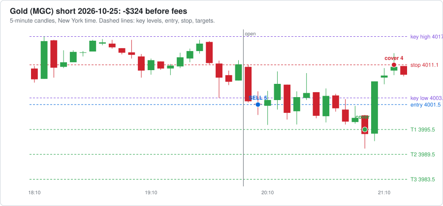

# Agent dashboard

Last updated 2026-10-26 07:17 New York time. Everything here is written by software and AI agents. It can be wrong, so check anything you plan to act on.

**[🪙 Open the Crypto Dashboard →](CRYPTO-DASHBOARD.md)** · **[𝕏 Open the X Brief Dashboard →](X-DASHBOARD.md)**

## Reminders

- ⏰ When your broker is connected: log every trade in trade-journal.md with a heading like `### Trade #1 | 2026-10-16` (swap the `__` in the template for the trade number) and keep the `- **Session:**` line, so the post-session reviewer can see your trades. Or ask Claude to build automatic trade logging into the paper trading agent.
- ⏰ Before trading real money: make this repo private (GitHub → Settings → Danger Zone → Change visibility). First run `git cherry-pick 0f7e3a2` so the paper trader checks less often and stays under GitHub's 2,000 free Actions minutes a month for private repos (it is public now to keep Actions free and unlimited).
- ⏰ 𝕏 **Turn on X auto-posting once @cashflowbrief00 gets traction:** 500+ followers, OR any post with 10,000+ views, OR 1,000+ views a day for a week (check the account's Analytics). Then tell Claude "turn on X auto-posting". It needs X API keys from developer.x.com (about $2.50-3/month for 5-6 posts a day, within the $25 AI budget) and X's "automated account" label.

[Edit reminders](REMINDERS.md)

## Agent status

| | Agent | What it does | Last ran | Runs |
|---|---|---|---|---|
| 🟢 | Market brief: nasdaq | Writes the brief before the New York session | 3 days ago | weekdays about 7-8 AM New York time |
| 🟢 | Market brief: gold | Writes the brief before the Asia session | 12 hours ago | Sun-Thu evenings about 6-7 PM New York time |
| 🟢 | World news brief | Overnight news and today's events: politics, economy, war, trade | under an hour ago | daily about 5-6 AM New York time |
| 🟢 | Crypto research brief | Pumping coins, whales, government and adoption news | under an hour ago | daily about 5:30-6:30 AM New York time |
| 🟢 | Stock research brief | Movers, AI, nuclear, minerals, earnings dates and estimates | under an hour ago | Mon, Wed, Fri about 6-7 AM New York time |
| 🟢 | Paper trader | Paper trades every session with your rules and runs a practice prop challenge | 10 hours ago | after each session ends |
| 🟢 | Scorer | Checks each lean against what price did | under an hour ago | after each session ends |

🟢 ran recently  🟡 a bit late  🔴 check it  ⚪ never ran

## 📒 Trade journal (paper)

- **Tradeify 50K evaluation: balance $51,028**, $784 above the drawdown floor, $1,972 to pass; today -$329, $921 left before the daily loss limit. [Details](paper-trading/summary.md)

Newest first. Times are New York time. Each sale shows contracts @ price, time. The 📈 link opens a chart of the trade; TV opens the same market on TradingView (add [the strategy](tradingview/breakout_strategy.pine) to see each trade marked).

| Date | Market | Side | Lots | Entry | Target 1 | Target 2 | Target 3 / out | Result | What could have gone better | See it |
|---|---|---|---|---|---|---|---|---|---|---|
| 2026-10-26 | Gold | short | 5 | 4001.5 @ 20:05 stop 4011.1 | 1 @ 3995.5, 21:00 ($60) | – | stop: 4 @ 4011.1, 21:15 (-$384) | ❌ **-$329** out 21:15 | • Target 1 paid $60, but the stop stayed at the start. Moving it to breakeven after Target 1 would have ended this trade at about $60 instead of -$324. | [📈 chart](paper-trading/charts/2026-10-25-gold.svg) · [TV](https://www.tradingview.com/chart/?symbol=COMEX_MINI%3AMGC1%21&interval=5) |
| 2026-10-23 | Nasdaq | long | 5 | 29169.25 @ 10:00 stop 29095.0 | – | – | stop: 5 @ 29095.0, 10:15 (-$742) | ❌ **-$748** out 10:15 | • Price never reached Target 1: the best it did was +16.75 points, and Target 1 needed 30. • After the stop, price turned and reached +156.75 points by 10:50. The stop (74.25 points from entry) was too tight: a stop just past the key level (29145.0) would have kept you in. • The entry was 24.25 points past the key level, chasing a stretched move. Waiting for a pullback toward the level would have meant a better price and a smaller risk. • Fakeout re-entry (switched off): price closed back beyond the entry at 10:35; re-entering 3 contracts at 29225.0 (stop 29141.75) would have made $357. | [📈 chart](paper-trading/charts/2026-10-23-nasdaq.svg) · [TV](https://www.tradingview.com/chart/?symbol=CME_MINI%3AMNQ1%21&interval=5) |
| 2026-10-23 | Gold | short | 5 | 4034.4 @ 20:30 stop 4037.1 | – | – | stop: 5 @ 4037.1, 20:45 (-$135) | ❌ **-$140** out 20:45 | • Price never reached Target 1: the best it did was +2.80 points, and Target 1 needed 6. • After the stop, price turned and reached +33.50 points by 22:00. The stop (2.70 points from entry) was too tight: a stop just past the key level (4036.0) would have kept you in. • Fakeout re-entry (switched off): price closed back beyond the entry at 21:00; re-entering 3 contracts at 4034.1 (stop 4045.5) would have made $357. | [📈 chart](paper-trading/charts/2026-10-22-gold.svg) · [TV](https://www.tradingview.com/chart/?symbol=COMEX_MINI%3AMGC1%21&interval=5) |
| 2026-10-22 | Nasdaq | short | 5 | 29359.0 @ 10:25 stop 29455.5 | 1 @ 29329.0, 10:30 ($60) | 2 @ 29299.0, 10:30 ($240) | 2 @ 29269.0, 10:45 ($360) | ✅ **$655** out 10:45 | • Price kept going 236.00 points past Target 3 (by 15:45). Letting the last 2 contract(s) run with a trailing stop could have made up to $944 more. | [📈 chart](paper-trading/charts/2026-10-22-nasdaq.svg) · [TV](https://www.tradingview.com/chart/?symbol=CME_MINI%3AMNQ1%21&interval=5) |
| 2026-10-22 | Gold | short | 5 | 4137.2 @ 20:15 stop 4143.1 | 1 @ 4131.2, 20:35 ($60) | 2 @ 4125.2, 21:25 ($240) | stop: 2 @ 4131.2, 21:30 ($120) | ✅ **$415** out 21:30 | • The last contracts were stopped at Target 1, then price reached Target 3 by 01:45. A looser stop after Target 2 would have caught it. | [📈 chart](paper-trading/charts/2026-10-21-gold.svg) · [TV](https://www.tradingview.com/chart/?symbol=COMEX_MINI%3AMGC1%21&interval=5) |
| 2026-10-21 | Nasdaq | short | 5 | 29818.5 @ 10:15 stop 29843.25 | – | – | stop: 5 @ 29843.25, 10:20 (-$248) | ❌ **-$252** out 10:20 | • Price never reached Target 1: the best it did was +25.75 points, and Target 1 needed 30. • The breakout failed and price kept going the other way, so the stop did its job and kept the loss small. | [📈 chart](paper-trading/charts/2026-10-21-nasdaq.svg) · [TV](https://www.tradingview.com/chart/?symbol=CME_MINI%3AMNQ1%21&interval=5) |
| 2026-10-21 | Gold | – | 0 | no breakout, no trade | | | | $0 | No confirmed breakout in the first 60 minutes. Key high 4149.80, low 4132.00. | [TV](https://www.tradingview.com/chart/?symbol=COMEX_MINI%3AMGC1%21&interval=5) |
| 2026-10-20 | Nasdaq | long | 5 | 29717.75 @ 10:05 stop 29604.0 | 1 @ 29747.75, 10:15 ($60) | 2 @ 29777.75, 10:15 ($240) | 2 @ 29807.75, 10:25 ($360) | ✅ **$655** out 10:25 | • Price kept going 95.75 points past Target 3 (by 10:30). Letting the last 2 contract(s) run with a trailing stop could have made up to $383 more. | [📈 chart](paper-trading/charts/2026-10-20-nasdaq.svg) · [TV](https://www.tradingview.com/chart/?symbol=CME_MINI%3AMNQ1%21&interval=5) |
| 2026-10-20 | Gold | short | 5 | 4150.6 @ 20:55 stop 4152.4 | 1 @ 4144.6, 21:00 ($60) | 2 @ 4138.6, 21:15 ($240) | stop: 2 @ 4144.6, 21:40 ($120) | ✅ **$415** out 21:40 | • Moving the stop to Target 1 after Target 2 locked in the profit; price never reached Target 3 afterwards. | [📈 chart](paper-trading/charts/2026-10-19-gold.svg) · [TV](https://www.tradingview.com/chart/?symbol=COMEX_MINI%3AMGC1%21&interval=5) |
| 2026-10-19 | Nasdaq | long | 3 | 29841.25 @ 10:15 stop 29694.0 | 1 @ 29871.25, 11:00 ($60) | 1 @ 29901.25, 11:15 ($120) | 1 @ 29931.25, 11:20 ($180) | ✅ **$357** out 11:20 | • Price kept going 52.25 points past Target 3 (by 11:35). Letting the last 1 contract(s) run with a trailing stop could have made up to $104 more. | [📈 chart](paper-trading/charts/2026-10-19-nasdaq.svg) · [TV](https://www.tradingview.com/chart/?symbol=CME_MINI%3AMNQ1%21&interval=5) |
| 2026-10-19 | Gold | – | 0 | no breakout, no trade | | | | $0 | No confirmed breakout in the first 60 minutes. Key high 4207.10, low 4191.10. | [TV](https://www.tradingview.com/chart/?symbol=COMEX_MINI%3AMGC1%21&interval=5) |

**Latest trade:**

[Full journal with every fill](paper-trading/paper-journal.md)

## 👔 CEO check

**✅ All clear** ([read the full check](reports/ceo/latest.md))

<b>What the CEO checked</b>

##### Futures paper trader

- ✅ All 9 paper trades followed the rules (one per session, inside the 60-minute window, right size, stop managed).
- ✅ Tradeify practice evaluation: $784 above the $2,000 trailing drawdown floor.

##### Your trade journal

- ✅ No trades logged yet, nothing to check.

##### Crypto bots

- ✅ Rotation bot: 8 trades, buys only at weekly checks, never more than 4 coins at once.
- ✅ Buy-and-hold bot has never sold.

##### Alpaca copy

- ✅ All 10 Alpaca orders were for the bot's coins and within the limit.

##### Costs

- ✅ Spent $3.73 so far this month on 32 AI runs; on pace for about $4 (budget $50).

##### Agent health

- ✅ Every research brief worked on its last run.

## 📅 Weekly report

<b>Week ending 2026-10-25</b>

#### The week in one look

- **Futures paper:** +$1,357 this week
- **Rotation bot:** -$23.91 this week
- **Buy-and-hold bot:** -$17.66 this week
- **AI costs:** $3.48 this week

#### Futures paper trading

- **This week:** +$1,357 after fees, 8 trades (5 wins, 3 losses), 2 sessions with no trade
- **Since paper trading began:** +$1,357 over 8 trades
- Nasdaq (MNQ): +$667 over 5 trades
- Gold (MGC): +$690 over 3 trades

| Day | Market | Side | Entry | Result |
|---|---|---|---|---|
| 2026-10-19 | nasdaq | long | 29841.25 at 10:15 | +$357 |
| 2026-10-20 | gold | short | 4150.6 at 20:55 | +$415 |
| 2026-10-20 | nasdaq | long | 29717.75 at 10:05 | +$655 |
| 2026-10-21 | nasdaq | short | 29818.5 at 10:15 | -$252 |
| 2026-10-22 | gold | short | 4137.2 at 20:15 | +$415 |
| 2026-10-22 | nasdaq | short | 29359.0 at 10:25 | +$655 |
| 2026-10-23 | gold | short | 4034.4 at 20:30 | -$140 |
| 2026-10-23 | nasdaq | long | 29169.25 at 10:00 | -$748 |

#### TradingView strategy

| Market | Export date | Forward test (since paper start) | Whole export |
|---|---|---|---|
| Nasdaq (MNQ) | 2026-10-18 | 0 trades, $0 | 25 trades, +$3,684, 56% wins |
| Gold (MGC) | 2026-10-18 | 0 trades, $0 | 22 trades, +$699, 32% wins |

Export the List of trades from each chart and say "update TradingView" to refresh these numbers.

#### Crypto paper bots

| Bot | Start of week | End of week | Change | Since it started ($1,000) |
|---|---|---|---|---|
| Rotation bot | $1,003.26 | $979.35 | -$23.91 (-2.4%) | -$20.65 |
| Buy-and-hold bot | $1,001.63 | $983.97 | -$17.66 (-1.8%) | -$16.03 |

Trades this week:

| Day | Bot | | Coin | Amount | Profit / loss |
|---|---|---|---|---|---|
| 2026-10-22 | Rotation bot | 🔴 Sell | AVAX | $186.17 | -$14.58 |
| 2026-10-22 | Rotation bot | 🔴 Sell | BCH | $198.91 | -$1.88 |
| 2026-10-22 | Rotation bot | 🔴 Sell | BTC | $199.02 | -$1.78 |
| 2026-10-22 | Rotation bot | 🔴 Sell | SUI | $198.38 | -$2.41 |

**Alpaca copy:** 3 order(s) this week: sell AVAX, sell BCH, sell BTC

#### Market briefs (Nasdaq and gold)

- 7 briefs scored; 2 gave a direction, 1 of those were right.
- 5 were Neutral.

#### CEO check

**❌ Rules were broken this week.** 25 checks ran. [Latest CEO check](../ceo/latest.md)

#### AI costs this week

| Agent | Runs | Cost |
|---|---|---|
| world-brief | 8 | $1.01 |
| crypto-brief | 7 | $0.81 |
| market-brief-nasdaq | 5 | $0.62 |
| market-brief-gold | 4 | $0.55 |
| stock-brief | 3 | $0.46 |
| review-gold | 1 | $0.03 |
| x-posts | 2 | $0.01 |
| **Total** | 30 | **$3.48** |

At this pace: about $15 a month.

[Main dashboard](../../DASHBOARD.md) · [Crypto dashboard](../../CRYPTO-DASHBOARD.md)

[All weekly reports](reports/weekly/)

## Paper trading

- Total after fees: **$1,028** over 9 trades (11 sessions watched)
- Trading days with a trade: **6**, profitable: **3**, losing: 3
- Win rate: 56%
- Profit factor: 1.70
- Biggest drop from a high (max drawdown): $1,216
- Room left before the $4,000 max drawdown: **$2,784**
- Progress toward a prop demo: **6 of 20** trading days

<b>Challenge simulation, results by market, and daily results</b>

#### By market

| Market | Trades | Wins | Total after fees |
|---|---|---|---|
| nasdaq | 5 | 3 | $667 |
| gold | 4 | 2 | $361 |

#### Daily results

| Trading day | Sessions | Result after fees |
|---|---|---|
| 2026-10-26 | gold short | -$329 |
| 2026-10-23 | gold short, nasdaq long | -$888 |
| 2026-10-22 | gold short, nasdaq short | $1,070 |
| 2026-10-21 | gold no trade, nasdaq short | -$252 |
| 2026-10-20 | gold short, nasdaq long | $1,070 |
| 2026-10-19 | gold no trade, nasdaq long | $357 |

[Every paper trade](paper-journal.md) · [Raw data](trades.csv)

[Paper trading journal](paper-trading/paper-journal.md) · [TradingView strategy](tradingview/breakout_strategy.pine)

## 📈 TradingView strategy results

From the latest **List of trades** export of each chart. One trade = one entry (TradingView counts each target as a separate trade). Forward test = trades from 2026-10-19 on.

| Market | Export date | Trades | Wins / losses | Win rate | Total | Profit factor | Max drawdown | Forward test |
|---|---|---|---|---|---|---|---|---|
| Nasdaq (MNQ) | 2026-10-18 (trades since 2026-08-25) | 25 | 14 / 11 | 56% | **$3,684** | 1.99 | $1,066 | 0 trades, $0 |
| Gold (MGC) | 2026-10-18 (trades since 2026-08-24) | 22 | 7 / 15 | 32% | **$699** | 1.30 | $1,559 | 0 trades, $0 |
| **Both** | | 47 | 21 / 26 | 45% | **$4,384** | 1.72 | | |

<b>Latest 10 TradingView trades</b>

| Entry (New York) | Market | Side | Entry price | Contracts | Result |
|---|---|---|---|---|---|
| 2026-10-15 09:35 | Nasdaq (MNQ) | short | 29,830.00 | 5 | ❌ -$68 |
| 2026-10-14 20:05 | Gold (MGC) | short | 4,138.90 | 5 | ❌ -$105 |
| 2026-10-14 09:35 | Nasdaq (MNQ) | short | 30,578.50 | 5 | ❌ -$192 |
| 2026-10-13 09:35 | Nasdaq (MNQ) | short | 30,757.25 | 5 | ❌ -$20 |
| 2026-10-12 20:05 | Gold (MGC) | short | 4,187.60 | 5 | ✅ $420 |
| 2026-10-12 09:45 | Nasdaq (MNQ) | short | 30,969.50 | 5 | ✅ $660 |
| 2026-10-08 20:05 | Gold (MGC) | long | 4,168.70 | 5 | ❌ -$20 |
| 2026-10-07 20:05 | Gold (MGC) | short | 4,131.60 | 5 | ❌ -$250 |
| 2026-10-07 09:35 | Nasdaq (MNQ) | short | 31,180.50 | 5 | ❌ -$704 |
| 2026-10-06 20:05 | Gold (MGC) | long | 4,191.20 | 5 | ❌ -$8 |

To refresh: export the List of trades from each chart in TradingView, double-click `tradingview/update-exports.command`, then push in GitHub Desktop.

## Latest briefs

Click a brief to read it here. The summary is at the top of each.

<b>🌍 World news brief, 2026-10-26, event risk Medium</b>

#### Top things for today
1. **Iran strike risk.** Trump said Sunday "There will not be a strike today." The Pentagon is reportedly planning attacks after the midterms. (Benzinga) Why it matters: energy prices and safe-haven demand.
2. **Oil is near war highs.** Early Monday, WTI was about $101.51 and Brent about $115.23, both lower. (Sunday Guardian) Brent briefly topped $117 on Friday after Iran's Revolutionary Guard claimed hits on seven tankers. Why it matters: energy inflation and rate expectations.
3. **Central bank week.** The Fed and Bank of Canada decide Wednesday, the ECB Thursday and the BoJ Friday. (CoinDesk) The base case is a Fed hold, with about 15% odds of a hike. (Admiral Markets) Why it matters: rates and the dollar.
4. **Possible US tariff cut for Canada.** A headline says the US is expected to remove 50% tariffs on some Canadian products as soon as today. (investingLive, headline only) Why it matters: trade risk and the Canadian dollar.
5. **Gold fell last week.** Gold held steady in Asia after dropping more than 4% last week, as investors weighed energy inflation and policy ahead of the Fed. (Investing.com) Why it matters: real yields and the dollar.

#### Today's schedule (New York time)
| Time | Event | Who or where | Confirmed? |
|---|---|---|---|
| Time not found | Mecca pact officials hold talks with Iranian leaders | Tehran. Saudi Defence Minister Prince Khalid bin Salman, Pakistan's Asim Munir and Turkey's Ibrahim Kalin. | Date confirmed, time (unconfirmed) |
| Time not found | Trump event | Corinth, Mississippi (Jamie Dupree newsletter) | Place reported, time (unconfirmed) |
| Time not found | US Treasury buyback, 20Y-30Y | US Treasury (Newsquawk) | Listed, time (unconfirmed) |
| Time not found | ECB's Elderson speaks | Newsquawk calendar | Listed, time (unconfirmed) |
| Time not found | China Communist Party Fifth Plenum starts (runs Oct 26–29) | China | Confirmed |
| 11:10 AM | 2029 EU bond auction, previous 3.613% | EU (Trading Economics) | Listed |

Other notes:
- Monday has no major data releases from the US (LiteFinance).
- Tuesday: US consumer confidence. Trump holds rallies in Corpus Christi, with remarks at 2 p.m. local time, and Lubbock, with remarks at 6 p.m. The source's time zone isn't stated, and the Texas rallies are in Central time.

#### Event risk today
Medium - No major US data is due, but Iran strike headlines and Trump's remarks can move energy and gold ahead of Wednesday's Fed decision.

#### Politics and policy
- **Trump on Iran.** He accused Iran of faking ship attacks in the Strait of Hormuz to push up oil prices before the midterms. (CBS) Why it matters: energy and risk appetite.
- **Campaign trail.** The midterms are Nov. 3. Trump's reported schedule is Mississippi Monday, then Ohio Wednesday, Florida Friday and Iowa Sunday. (Jamie Dupree)
- **Fed.** Fed Chair Kevin Warsh's comments are the focus. (CoinDesk) Headline: Firstpost says the Fed is expected to hold with inflation elevated (headline only).
- **Congress.** One headline says Sen. McConnell told Trump to plan for lame-duck Pentagon funding (Jamie Dupree, headline only). I found no economy-related bill details.
- Treasury and executive orders: Nothing found.

#### Economics
- Nothing from the US overnight. Headline: Reuters says US growth was boosted by AI with no sign of a turning point higher (headline only).
- Japan data due at 5 AM NY: coincident and leading indexes. I found no actual readings.
- Ahead this week:
  - US Q3 GDP on Thursday, forecast 3.2% versus 2.2% before.
  - September PCE is expected at about 0.5% month on month and 3.6% year on year. (TraderFactor)

#### War, trade and tariffs
- **Iran.** The Tehran talks are the first formal contact between Iran and all three pact members since Saudi Arabia was drawn deeper into the conflict with the Houthis. (The Media Line) Both the US and Iran have reportedly drawn up plans to restart the wider war, possibly after Nov. 3. Qatari mediators met Iranian officials on Sunday. Why it matters: Hormuz shipping and oil.
- **Ukraine-Russia.** Zelenskyy said Kyiv, Washington and Moscow will hold a trilateral meeting in November. Russia's Ushakov said Putin agreed in principle to restart talks after Nov. 10. Why it matters: Russian energy and risk appetite.
- **Tariffs.** Canada tariff report above. Nothing else found.

#### Country briefs
- **China**
  - The Fifth Plenum opens today. No major stimulus is expected from the meeting, and the closing communiqué is the item to watch. (Newsquawk)
  - Beijing revised its outbound investment rules (SCMP).
- **European Union**
  - Von der Leyen has spoken of preparing more trade tools. (SCMP)
  - The ECB decides Thursday. Economists mostly expect a hold (70 of 73). Sources differ on the current deposit rate: 2.50% (CoinDesk) versus 2.65% (Kaohoon).
- **United Kingdom**
  - The Autumn Budget is Wednesday, the same day as the Fed. (Newsquawk)
- **Japan**
  - BoJ decision Friday. Hold expected, with under 5% hike odds. A headline says the yen is acting as a safe haven again (investingLive, headline only).
- **India**
  - Nothing found.
- **Russia**
  - Putin agreed in principle to restart talks (see above). US envoy Witkoff met Putin in St. Petersburg. (Yahoo)
- **Canada**
  - Markets lean toward a 25 bp Bank of Canada hike to 2.50% on Wednesday. (TraderFactor) Admiral Markets says hold. An EU-Canada summit runs Oct 29–30. (Newsquawk)

[Read the full brief with all the details](reports/news/2026-10-26-world-brief.md) · [All news briefs](reports/news/)

<b>🪙 Crypto brief, 2026-10-26</b>

#### Top things today

1. **QNT and ENA lead the 24h gainers.** QNT is up 15.4% and ENA up 9.4%, while BTC is up only 0.2%. Reports tie QNT to its September pick for The Clearing House's US tokenized deposit network (KuCoin News). ENA has no confirmed new announcement (unconfirmed). Why it matters: these are the day's strongest moves, but the cause is not clear.
2. **Bitcoin is stuck near $80K.** It is down 2.8% over 7 days, and Fear and Greed reads 50. US spot BTC ETFs saw $635.6M in outflows on Oct 22 after $524.8M in inflows (Pluang). Why it matters: ETF flows are swinging back and forth.
3. **Whale wallets keep pulling BTC from Wintermute.** Lookonchain says 40 new wallets took 9,458 BTC (about $771.5M) since Oct 1. The data shows transfers only. It does not show who received the coins or whether anyone bought them (CoinDesk via KuCoin). Why it matters: it is read as accumulation, but that is unproven.
4. **The US market-structure bill is stalled.** The CLARITY Act failed a Senate cloture vote 49-50 on Sept 15, and no new vote is scheduled (CryptoTicker). Why it matters: the SEC and CFTC are setting rules without a law.
5. **GRASS has a token unlock tonight.** About $21.5M, or 4.5% of its market value, unlocks at about 8:00 PM ET today (Bitcoinsistemi). GRASS is also up 17.2% over 7 days. Why it matters: new supply is arriving after a rally.

#### Coins to research

| Coin | 24h move | Why it is moving | Red flags |
|---|---|---|---|
| Quant (QNT) | +15.4% | Sept selection by The Clearing House for a US tokenized deposit network (KuCoin News). Today's catalyst is unclear. | Up 15% in a day. Volume is only $115M on a $3.0B cap. Trade sites call the cause an "institutional repricing" without detail (TradersUnion). |
| Ethena (ENA) | +9.4% | Rebound after a roughly 22% monthly drop. Technical buying and social attention, with no confirmed new announcement (crypto.news). | Arthur Hayes sold about $2.7M of ENA (crypto.news). Large token unlocks earlier in October (Publish0x). |
| MemeCore (M) | +8.6% | No news found. | Volume is $1.3M on a $2.3B cap, which is very thin. Up 33.6% in 7 days. |
| Akedo (AKE) | +8.1% | No news found. Tokenpost listed it as Monday's top gainer. | Volume is $9.1M on a $718M cap. A pump with no news. |
| Grass (GRASS) | +6.5% | No news found. | $21.5M unlock tonight (Bitcoinsistemi). Up 17.2% in 7 days. |
| Pyth Network (PYTH) | +6.7% | No news found. Flat over 7 days (+0.1%). | A pump with no news. |

I found no new meme coin pumping hard in the search results. The trending list holds only small-cap names, and I found no news on them.

#### Whale watch

No whale moves found in the last 24 hours. Older items:

| When | Coin | Amount (USD) | Who | Direction |
|---|---|---|---|---|
| Oct 20 (older than 24h) | BTC | $41.5M (500 BTC) | Dormant wallet linked to Clifton Collins; unclear if keys were recovered (Lookonchain) | Onto an exchange (Coinbase Prime) |
| Oct 22 (older than 24h) | BTC to ETH | About $20.6M | Single wallet swapping BTC for ETH (Lookonchain via ChainCatcher) | Bought ETH, sold BTC |

#### Government and regulation

- **CLARITY Act (H.R. 3633):** It would split crypto oversight between the SEC and CFTC. It failed cloture 49-50 on Sept 15 (CryptoTicker). The Senate does not return to legislative business until Nov 9. The bill would need reintroduction in the new Congress in January 2027 (Baker Botts).
- **CFTC:** On Oct 5 it issued an advance notice on Regulation CTX and CAM. These cover leveraged retail crypto trades and a new "crypto asset market" venue type. Comments are due Dec 14 (Troutman Pepper Locke).
- **SEC:** The "Regulation Crypto Assets" proposal closed comments Oct 20 (CryptoTicker). The Oct 1 custody proposal for advisers and funds takes comments until Dec 7 (CryptoTicker). A tokenized-stock venue exemption runs to 2031 (CryptoTicker).
- **Other countries:** One roundup lists an ESMA stablecoin wind-down, EBA supervision of USDC, and a MAS stablecoin consultation. I could not confirm details (unconfirmed) (CryptoInfrastructure). Bybit won a full VARA licence in Dubai (Analytics Insight).
- **Low-profile bills or amendments:** Nothing found.

#### Who is buying and adopting

- **Smarter Web Company (UK):** It added 20 BTC (about £1.23M) on Oct 23. Its total is now 2,850 BTC (Analytics Insight).
- **HSBC:** It launched RedCoin (RCHKD), a Hong Kong dollar stablecoin. It is available through the PayMe platform (Analytics Insight).
- **Countries and governments buying BTC:** Nothing found.

#### Next 7 days

Token unlock times are converted from the source's Turkey time to New York time.

| Date | Event | Coin or topic |
|---|---|---|
| Oct 26, about 8:00 PM ET | $1.59M unlock, 40% of market value (Bitcoinsistemi) | Vultisig (VULT) |
| Oct 26, about 8:00 PM ET | $21.5M unlock, 4.5% of market value (Bitcoinsistemi) | Grass (GRASS) |
| Oct 28, about 8:00 PM ET | $19.7M unlock, 8.4% of market value (Bitcoinsistemi) | Falcon Finance (FF) |
| Oct 26 – Nov 1 | About $145M in unlocks across 16 altcoins (Bitcoinsistemi) | Altcoin unlocks |

Ethereum's Glamsterdam upgrade was reported as delayed, with no new date found (Analytics Insight).

[Read the full brief with all the details](reports/crypto/2026-10-26-crypto-brief.md) · [All crypto briefs](reports/crypto/)

<b>📈 Stocks brief, 2026-10-26</b>

#### Top things today
1. **Earnings and the Fed this week.** Futures were rising and oil was sliding as Wall Street prepared for big earnings and a Fed meeting on Tuesday and Wednesday (TheStreet). Markets see only a 10% chance of a hike at this meeting. Traders are watching for hints about December (TheStreet). Why it matters: it sets the tone for every name on your list.
2. **Big tech reports Wednesday and Thursday.** GOOGL and MSFT report Oct 28, and AMZN reports Oct 29. Investors are focused on capital spending plans (TheStreet). Why it matters: AI spending worries drove last week's losses.
3. **Neocloud stocks are under pressure.** Musk said more than 200 neocloud companies could collapse, and CoreWeave, Nebius and Iren fell (CNBC via TheStreet). CRWV is down 11.7% over 5 days. Why it matters: debt costs are the main worry in AI infrastructure.
4. **AT&T fell 8% on Friday on a SpaceX report.** News linked the drop to a report that SpaceX wants access to at least 80,000 US cell sites. T-Mobile fell 7.7% (Trefis). Why it matters: SpaceX (SPCX, $2.0T market cap) is now moving telecom stocks.
5. **Nuclear, uranium and miners all fell over 5 days.** CEG, VST, LEU, BWXT, SCCO and NEM each lost 6–11% (live data). Gold had its worst week since June as oil rose and rate-hike bets grew (Mining.com). Why it matters: the weakness is broad, not tied to one stock.

#### Stocks to research
| Ticker | Theme | Move | Why | Red flags |
|---|---|---|---|---|
| CRWV | AI | -2.5% 1D, -11.7% 5D | Debt worries, analyst target cuts (Bernstein, UBS, Morgan Stanley). Goldman upgraded it on Oct 19. | Leveraged and unprofitable. Insiders sold more than $470M over three months (MarketBeat). |
| NEM | Gold | -4.6% 1D, -8.2% 5D | Freedom Broker cut it to Hold on Oct 22, and gold fell about 4% on the week. | The 1-day drop is bigger than the news I found. |
| LEU | Nuclear | -10.9% 5D | Reports Nov 4. | Large drop with no news found. Revenue estimate is only $57.2M. |
| USAR | Rare earths | -3.1% 1D, -11.5% 5D | Reports Nov 5. | Small company with a tiny revenue estimate ($13.6M) and a loss expected. No news found. |
| RHI | Staffing | +21.7% | Q3 EPS of $0.49 beat the $0.47 estimate. Staffing revenue grew for the first time since 2022 (TIKR). | Q4 EPS guidance midpoint is below consensus. Valuation is higher after the jump. |
| SPCX | New stock (SpaceX) | +1.9% | Most active by volume, $2.0T market cap. Its Starlink plans are hitting telecom stocks (Trefis). | Newly listed. I found no listing details. |

#### AI and tech
- **Neocloud debt fears.** Bernstein cut its CoreWeave target to $51 and estimated it needs about $85B to fund its backlog. The stock closed down 10.1% on Oct 22 (Motley Fool). HSBC kept a $39 target. Goldman called the drop a buying chance (The Wealth Advisor).
- **Asia AI doubts.** South Korean stocks are down more than 40% from their June high on doubts about AI spending. SK Hynix and Samsung report this week (Kaohoon). Goldman cut its Kospi target to 9,000. Why it matters: it is a read-through for MU.
- **Mega-cap tech lagged.** META is down 9.4% and GOOGL down 6.0% over 5 days (live data). Both are hit by capital spending concerns (TheStreet).

#### Nuclear and critical minerals
- **Uranium supply news.** Namibia approved Bannerman's $353M Etango mine, with first production targeted for 2028 (Mining.com). The US also backed Global Atomic's Niger mine with a conditional $414M loan, reported Sept 25 (Northern Miner).
- **Gold weakness.** Bullion fell 4% last week, as oil-driven rate-hike bets built (Mining.com). NEM fell 4.6% on Friday.
- **Power demand.** On Oct 7, Google agreed to buy power from Constellation Energy, which lifted Australian uranium miners (Reuters via Mining Weekly). CEG reports Nov 9.
- Nothing new found on export limits or new US government deals today.

#### Earnings
**Results since yesterday:** Nothing found for the watchlist. Notable earlier reports:
- **RHI** (reported after the close Thursday): EPS of $0.49 vs. $0.47 expected, and revenue of $1.36B matched estimates. Shares jumped about 22% (Seeking Alpha, Investing.com).
- **T** (reported Wednesday): EPS of $0.65 vs. $0.60 expected, and revenue of $32.3B vs. $31.7B. It raised its 2026 outlook. Shares fell 6.4% that day on subscriber and competition worries, then fell 8% on Friday (Trefis).

| Date | Ticker | Timing | EPS est. | Revenue est. |
|---|---|---|---|---|
| 2026-10-27 | FCX | Not confirmed | $0.83 | $7.4B |
| 2026-10-28 | GOOGL | Not confirmed | $2.97 | $127.8B |
| 2026-10-28 | MSFT | Not confirmed | $4.72 | $90.8B |
| 2026-10-29 | AMZN | Not confirmed | $1.98 | $202.2B |
| 2026-10-30 | CCJ | Not confirmed | $0.27 | $753.9M |
| 2026-11-02 | AAPL | Not confirmed | $1.98 | $113.4B |
| 2026-11-02 | BWXT | Not confirmed | $1.19 | $972.3M |
| 2026-11-02 | PLTR | Not confirmed | $0.41 | $2.2B |
| 2026-11-03 | AMD | Not confirmed | $1.93 | $13.1B |
| 2026-11-03 | SMCI | Not confirmed | $1.20 | $16.3B |
| 2026-11-04 | ALB | Not confirmed | $2.52 | $1.5B |
| 2026-11-04 | ARM | Not confirmed | $0.48 | $1.4B |
| 2026-11-04 | LEU | Not confirmed | -$0.07 | $57.2M |
| 2026-11-05 | MP | Not confirmed | -$0.01 | $119.0M |
| 2026-11-05 | SMR | Not confirmed | -$0.12 | $3.8M |
| 2026-11-05 | USAR | Not confirmed | -$0.15 | $13.6M |
| 2026-11-06 | OKLO | Not confirmed | -$0.26 | $1.1M |
| 2026-11-06 | VST | Not confirmed | $3.01 | $6.9B |
| 2026-11-09 | CEG | Not confirmed | $3.74 | $9.3B |

#### Smart money
- **CRWV:** Morgan Stanley kept Equal-Weight and cut its target to $70 from $99 (GuruFocus). UBS cut its target to $105 and kept Buy (MarketBeat). Goldman upgraded it to Buy on Oct 19 (Briefs).
- **NEM:** Freedom Broker cut it from Buy to Hold on Oct 22 and lowered its target to $116 from $130 (GuruFocus).
- **CoreWeave insiders** sold about $472M of stock over three months, per MarketBeat. GuruFocus puts the figure at about $922M. The sources differ.
- No insider buying or congressional trades found in these themes.

[Read the full brief with all the details](reports/stocks/2026-10-26-stock-brief.md) · [All stocks briefs](reports/stocks/)

<b>📊 Nasdaq 100 futures market brief, 2026-10-23</b>

### Nasdaq 100 Futures Brief for Friday, Oct 23, 2026 (New York Session)

#### 1. What is driving the market
- **AI spending worries:** On Thursday the Nasdaq Composite fell 2.6% and the S&P 500 fell 1.21%. The sell-off followed Meta's plan to raise capital spending. That revived worries that tech firms may borrow more to fund AI buildouts.
- **Chip and Tesla weakness:** Lam Research fell on a merely in-line outlook. Tesla fell after cutting its 2026 capital spending forecast.
- **Oil and Iran:** Rising Middle East tensions sent oil prices higher. One report said WTI neared $100.
- **Overnight:** Nasdaq futures were up 0.18% late Thursday, a small bounce after the chip rout. I could not verify any Friday morning news beyond this.

#### 2. Scheduled events (New York time)
- **9:45 AM:** S&P Global flash PMIs for services and manufacturing. Forecasts differ by source, so check them before the release.
- **10:00 AM:** Michigan 1-year inflation expectations. The forecast is 4.7%. The final Michigan sentiment reading is also due.
- **Fed speakers:** The Fed's blackout period runs through Oct 29, so no Fed officials are expected to speak.
- **Earnings:** American Express and SLB report before the open. I found no mega-cap Nasdaq names today. Alphabet and Microsoft report Oct 28 after the close, and Amazon on Oct 29.

#### 3. Key levels (from the price data)
- Previous session high: **29594.75**
- Previous session low: **29033.00**
- Previous close: **29146.25**
- 5-session high: **30113.00**
- Overnight range since the close: high **29279.00**, low **29022.75**
- Latest price: **29087.50**. It is 54.50 above the previous low and 507.25 below the previous high.

**Price is sitting near support.** The overnight low of 29022.75 briefly traded just under the previous session low of 29033.00. Price then moved back above it.

#### 4. Volume
The previous session traded 1.17x the average of the five sessions before it. That is a little above average. It points to decent participation in Thursday's sell-off, but not an extreme or panic-level surge.

#### 5. Directional lean
**Bias: Neutral. Confidence: Low.**

The signals conflict. The news is negative: AI worries, oil and a heavy tech sell-off. Volume was somewhat above average on that drop. Against that, price is sitting right at the previous low, and the overnight dip under it was bought back. This is a spot where the low can either hold or give way. Today's data (PMIs and inflation expectations) could push either way.

The lean would turn **Bearish** if price takes out and holds below the overnight low of 29022.75, especially with rising volume. It would turn **Bullish** if price recovers the previous close of 29146.25 and then pushes back toward the previous high of 29594.75. Fresh AI or oil headlines could also change it. This is a probability-based lean, not a prediction or a trade instruction.

#### 6. Event risk: **Medium**
The PMIs and inflation expectations come right after the open. The market is also sensitive to oil and AI news, though no Fed speakers or mega-cap tech earnings are scheduled.

#### 7. Sources
- CNBC (cnbc.com)
- Stocktwits (stocktwits.com)
- FXStreet (fxstreet.com)
- tech-insider.org
- Investing.com (za.investing.com)
- Kiplinger (kiplinger.com)
- Trading Economics (tradingeconomics.com)
- Yahoo Finance (finance.yahoo.com)
- Earnings Whispers (earningswhispers.com)
- Market Chameleon (marketchameleon.com)

All price levels and volume come from the supplied price data.

BIAS: Neutral | CONFIDENCE: Low

[Open the file](reports/2026-10-23-nasdaq-brief.md)

<b>📊 Gold futures market brief, 2026-10-25</b>

### Gold Futures Brief: Asia Session, Sunday Oct 25 to Monday Oct 26, 2026

**1. What is driving gold**
- International gold fell about 4% last week, its weakest week in more than four months.
- Oil rose after attacks on Saudi Arabia, which added to inflation worries and to bets that the Fed keeps rates higher for longer. Gold pays no interest, so that outlook weighs on it.
- The Fed is already tightening. In September it raised rates 25 basis points to 3.75%–4.00%.
- Gold briefly lost $4,000 and then reclaimed it on Friday. I could not verify the exact cause of that bounce.

**2. Scheduled events (New York time)**
- **During this session (8:00 PM Sun to 4:00 AM Mon):** I found no major scheduled releases. Kiplinger lists no noteworthy US economic reports for Monday. Unscheduled Middle East oil headlines are the main risk.
- **Just after the session:**
  - Tuesday: US consumer confidence. The FOMC meeting also starts.
  - Wednesday, 2:00 PM: Fed rate decision. The Chair's press conference follows at 2:30 PM. As of Oct 22, CME FedWatch showed about a 90.6% chance of a hold and 9.4% chance of a hike. Odds of a December hike are 84%.
  - Thursday, 8:30 AM: Q3 GDP and September PCE.
  - Friday: Bank of Japan decision and Tokyo CPI.
- Big tech earnings are due this week. I did not verify exact dates or times.

**3. Key levels (from the price data)**
- Previous session high: **4047.40**
- Previous session low: **4000.90**. This is also the lowest low of the last 5 Asia sessions.
- Previous close: **4025.70**
- Since that close: high **4050.20**, low **3989.10**. Price dipped below the old low and came back.
- Highest high of the last 5 sessions: **4211.20**. It is far above current price.
- Latest price is **4012.80**. That is inside the range, 34.60 below the high and 11.90 above the low. It sits **nearer support (the low)** than resistance.

**4. Volume**
The previous session traded 1.24x the average of the 5 sessions before it. That is moderately above average, so participation was decent but not extreme. It shows interest during the dip but does not say which way the market will go. Be careful with the late-Friday dip below the low, because I have no volume data for that move.

**5. Directional lean: Neutral | Confidence: Low**
The signals conflict. The news is bearish: the Fed is hiking, oil is rising and gold had a heavy week. Price is also close to the range low. But price bounced back above 4000.90 after the dip to 3989.10, so sellers have not taken control. Volume is somewhat above average but does not point either way. With the Fed decision coming after this session, traders may stay cautious. This is a probability-based lean, not a prediction or a trade instruction.
**What would change it:** Lean Bearish if price breaks and holds below 3989.10 on rising volume, or if oil spikes. Lean Bullish if price breaks and holds above 4047.40 and 4050.20, or if oil and yield pressure fades.

**6. Event risk: Medium**
No major scheduled data falls inside the session, but oil and Middle East headlines can hit at any time, and traders may position ahead of Wednesday's Fed decision.

**7. Sources**
usagold.com, jmbullion.com, tradingeconomics.com, fxstreet.com, kitco.com, india.com, yardeniquicktakes.com, kiplinger.com, newsquawk.com, litefinance.org, fedratec

[Open the file](reports/2026-10-25-gold-brief.md)

## Latest lean for each market

| Market | Brief written | Lean | Confidence | Event risk | Price then | Full brief |
|---|---|---|---|---|---|---|
| nasdaq | 2026-10-23 08:25 | ◆ Neutral | Low | Medium | 29087.50 | [read it](reports/2026-10-23-nasdaq-brief.md) |
| gold | 2026-10-25 19:14 | ? Unknown | Unknown | Medium | 4012.80 | [read it](reports/2026-10-25-gold-brief.md) |

A lean is a probability-based view, not a prediction. ▲ Bullish  ▼ Bearish  ◆ Neutral

## Scorecard

- Briefs scored: **11** (Bullish or Bearish calls: 2)
- Right: 1, Wrong: 1, Session ended flat: 0
- Hit rate when the session was decisive: **50%**
- For comparison, price went up in 50% of decisive sessions
- ⚠️ Only 2 directional calls so far. Treat the numbers as noise until there are at least 30.

By confidence:

| Confidence | Right | Wrong | Flat | Hit rate |
|---|---|---|---|---|
| High | 0 | 0 | 0 | n/a |
| Medium | 1 | 0 | 0 | 100% |
| Low | 0 | 1 | 0 | 0% |

[Full scorecard](reports/scorecard.md)

## Charts

## Recent results

| Brief | Market | Lean | Confidence | Session moved | Result |
|---|---|---|---|---|---|
| 2026-10-23 | nasdaq | ◆ Neutral | Low | Up (0.32%) | Moved |
| 2026-10-22 | gold | ▼ Bearish | Medium | Down (-0.31%) | Right |
| 2026-10-21 | gold | ◆ Neutral | Low | Down (-0.94%) | Moved |
| 2026-10-21 | nasdaq | ◆ Neutral | Low | Up (0.41%) | Moved |
| 2026-10-20 | gold | ◆ Neutral | Low | Up (0.24%) | Moved |
| 2026-10-20 | nasdaq | ▼ Bearish | Low | Up (0.32%) | Wrong |
| 2026-10-19 | nasdaq | ◆ Neutral | Low | Flat (-0.19%) | Calm |
| 2026-10-18 | gold | ◆ Neutral | Low | Down (-0.29%) | Moved |
| 2026-10-16 | nasdaq | ◆ Neutral | Low | Down (-2.14%) | Moved |
| 2026-10-15 | gold | ◆ Neutral | Low | Up (0.81%) | Moved |

## Your journals

- Trades logged: **0**. [Open the trade journal](trade-journal.md)
- No-trade sessions explained: **3**. [Open the no-trade journal](no-trade-journal.md)

<b>Latest no-trade sessions</b>

##### No-trade session | 2026-10-18 | Asia
- **Instrument:** Gold futures
- **What happened:** No signal. The rules gave no entry.
- **Why:** No 5-minute candle closed above the previous high (4211.20) or below the previous low (4167.50) in the first 30 minutes after the 20:00 open. (Previous Asia session was 2026-10-15.)
- **First 30 minutes, candle by candle:**
  - 20:00 candle: close 4205.50, closed inside the range (5.70 below the high, 38.00 above the low).
  - 20:05 candle: close 4204.40, closed inside the range (6.80 below the high, 36.90 above the low).
  - 20:10 candle: close 4201.70, closed inside the range (9.50 below the high, 34.20 above the low).
  - 20:15 candle: close 4199.00, closed inside the range (12.20 below the high, 31.50 above the low).
  - 20:20 candle: close 4196.40, closed inside the range (14.80 below the high, 28.90 above the low).
  - 20:25 candle: close 4196.00, closed inside the range (15.20 below the high, 28.50 above the low).
- **Closest call:** Price got within 2.80 of the previous high (its highest point was 4208.40) but never reached it.
- **After the window:** No candle closed beyond either level for the rest of the session.
- **What the market was showing:** The session range was 25.60 points, 60% of the average of the last 5 (a quiet session). Open to close it moved -12.30 points (-0.29%).
- **The morning brief said:** Neutral (Low confidence), event risk Medium.
- **Verdict:** Consistent with your rules. There was no setup, so staying out was correct under the rules.
- **Your notes:**

##### No-trade session | 2026-10-16 | New York
- **Instrument:** Nasdaq 100 futures
- **What happened:** No signal. The rules gave no entry.
- **Why:** No 5-minute candle closed above the previous high (30196.75) or below the previous low (29622.50) in the first 15 minutes after the 09:30 open. (Previous New York session was 2026-10-15.)
- **First 15 minutes, candle by candle:**
  - 09:30 candle: close 29969.75, closed inside the range (227.00 below the high, 347.25 above the low).
  - 09:35 candle: close 29895.25, closed inside the range (301.50 below the high, 272.75 above the low).
  - 09:40 candle: close 29936.25, closed inside the range (260.50 below the high, 313.75 above the low).
- **Closest call:** Price got within 151.00 of the previous high (its highest point was 30045.75) but never reached it.
- **After the window:** A candle first closed below the previous low at 12:45, but that was after the 15-minute window, so the rules did not allow an entry.
- **What the market was showing:** The session range was 777.00 points, 219% of the average of the last 5 (a busy session). Open to close it moved -644.75 points (-2.15%).
- **The morning brief said:** Neutral (Low confidence), event risk Medium.
- **Verdict:** Consistent with your rules. There was no setup, so staying out was correct under the rules.
- **Your notes:**

##### No-trade session | 2026-10-15 | Asia
- **Instrument:** Gold futures
- **What happened:** No signal. The rules gave no entry.
- **Why:** No 5-minute candle closed above the previous high (4183.30) or below the previous low (4152.70) in the first 15 minutes after the 21:00 open. (Previous Asia session was 2026-10-14.)
- **First 15 minutes, candle by candle:**
  - 21:00 candle: close 4176.50, closed inside the range (6.80 below the high, 23.80 above the low).
  - 21:05 candle: close 4178.00, closed inside the range (5.30 below the high, 25.30 above the low).
  - 21:10 candle: close 4178.50, closed inside the range (4.80 below the high, 25.80 above the low).
- **Closest call:** Price got within 1.60 of the previous high (its highest point was 4181.70) but never reached it.
- **After the window:** A candle first closed above the previous high at 22:30, but that was after the 15-minute window, so the rules did not allow an entry.
- **What the market was showing:** The session range was 43.70 points, 98% of the average of the last 5 (a normal session). Open to close it moved +33.70 points (+0.81%).
- **The morning brief said:** Neutral (Low confidence), event risk High.
- **Verdict:** Consistent with your rules. There was no setup, so staying out was correct under the rules.
- **Your notes:**

## Still to build

| Agent | Purpose | Status |
|---|---|---|
| Product selling agent (separate repo) | Main Agent from your Obsidian notes: what to sell, sourcing, advertising | ⚪ not built yet |
| Live demo trading | Sends the TradingView strategy's orders to a Tradovate demo or prop challenge account, behind a risk gatekeeper | ⚪ not built yet |

## Links

- [All reports](reports/)
- [Trading rules](trading-rules.md)
- [Bias log](reports/bias-log.csv)
