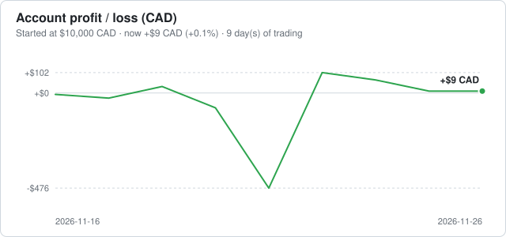
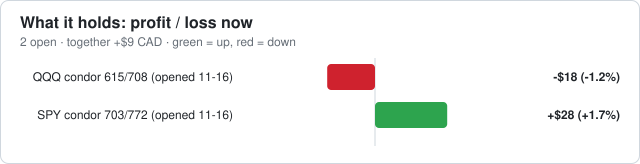

# Iron condor paper account ($10K CAD)

Updated 2026-11-23 23:24 New York. Started 2026-11-16. Goal: steady monthly cash flow from SPY/QQQ iron condors.

| | |
|---|---|
| Account value | **$10,102 CAD** ($7,058 USD) |
| Up / down | **+102 CAD** (+1.0%) |
| Closed this month (2026-11) | **+0 CAD** |
| Closed trades | 0 wins, 0 losses |
| Money at risk now | $3,154 CAD (limit 36% of the account) |

## Open condors

| Underlying | Condor | Opened | Price then / now | Credit | Worth now | Up / down CAD | Max loss CAD |
|---|---|---|---|---|---|---|---|
| QQQ | 1x 600/615 puts + 708/721 calls exp 2026-12-18 | 2026-11-16 | $661.75 / $651.03 | $4.31 | $3.88 | 🟢 +57 | 1,534 |
| SPY | 1x 690/703 puts + 772/787 calls exp 2026-12-18 | 2026-11-16 | $739.95 / $722.29 | $3.71 | $3.37 | 🟢 +45 | 1,620 |

## Cash flow by month (closed trades, CAD)

| Month | Profit / loss |
|---|---|
| (no closed trades yet) | |

Prices from Yahoo Finance option chains. Paper only: no real orders. Rules: agents/condor_trader.py. Every move: [journal.md](journal.md).
