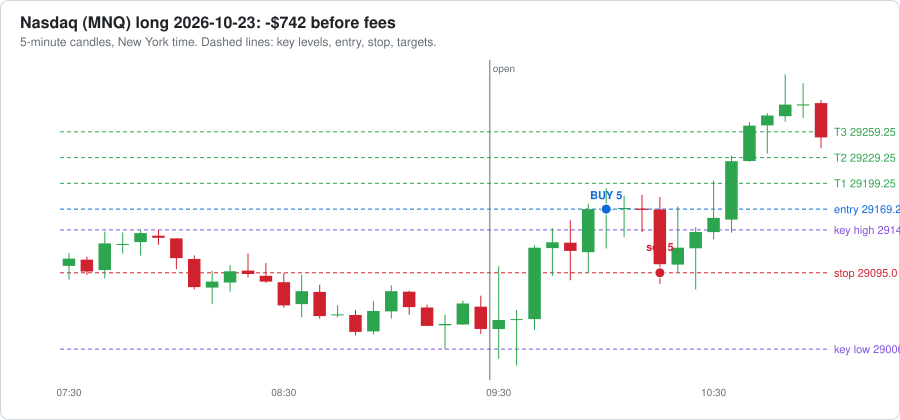
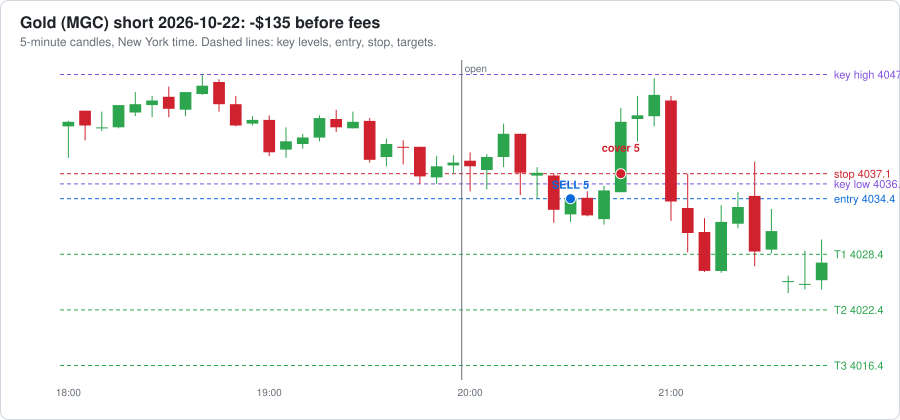
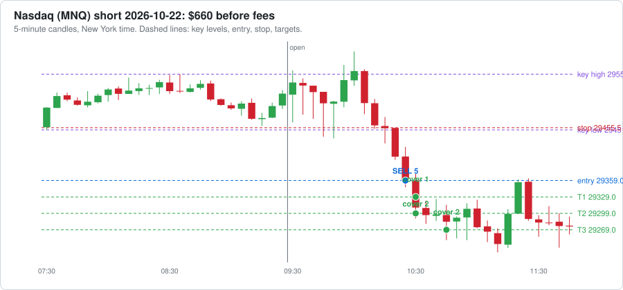
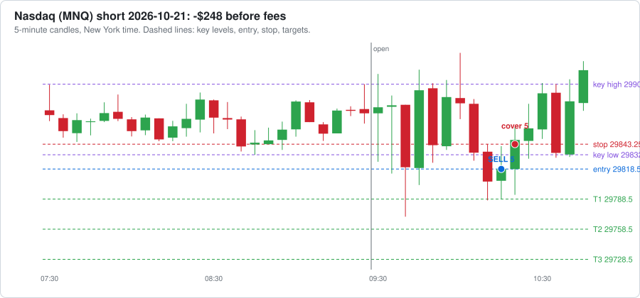
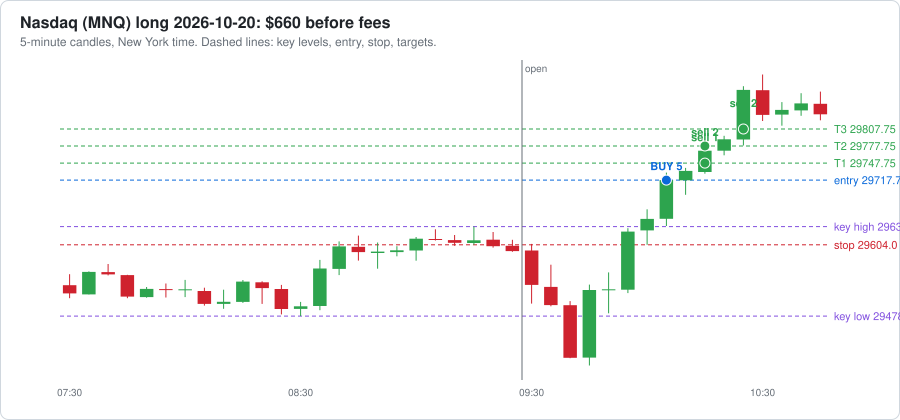
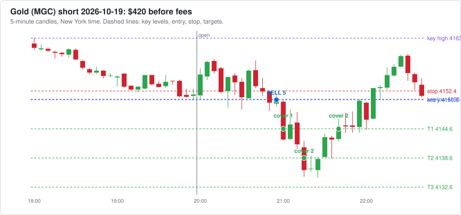
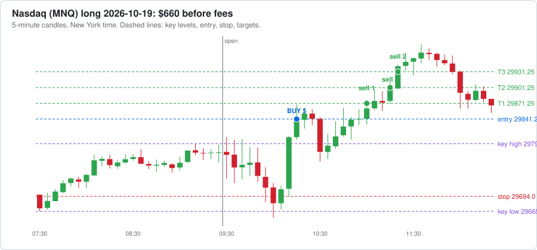

# Paper trading journal

Written automatically by paper_trader.py as each paper trade closes. Nothing here is a real trade.

---

### ❌ 2026-10-23 | Nasdaq (MNQ) | Long | -$748
- **Session start (New York):** 2026-10-23 09:30
- **Why:** two 5-minute candles closed beyond the key high (29145.0)
- **Entry:** Bought **5 contracts** at **29169.25** at **10:00** (sell plan 1/2/2)
- **Stop:** 29095.0

| Time | What | Contracts | Price | Profit |
|---|---|---|---|---|
| 10:15 | Stop | 5 | 29095.0 | -$742 |

- **Exit:** last contract out at **10:15**, average 29095.0
- **Result:** -$742 before fees, **-$748 after fees**
- **What could have gone better:**
  - Price never reached Target 1: the best it did was +16.75 points, and Target 1 needed 30.
  - After the stop, price turned and reached +156.75 points by 10:50. The stop (74.25 points from entry) was too tight: a stop just past the key level (29145.0) would have kept you in.
  - The entry was 24.25 points past the key level, chasing a stretched move. Waiting for a pullback toward the level would have meant a better price and a smaller risk.
  - Biggest move against you while in the trade: 87.50 points ($875 on paper). Best move for you: 16.75 points.

[Open Nasdaq (MNQ) on TradingView](https://www.tradingview.com/chart/?symbol=CME_MINI%3AMNQ1%21&interval=5) (add tradingview/breakout_strategy.pine to see this trade marked)

---

### ❌ 2026-10-23 | Gold (MGC) | Short | -$140
- **Session start (New York):** 2026-10-22 20:00
- **Why:** two 5-minute candles closed beyond the key low (4036.0)
- **Entry:** Sold short **5 contracts** at **4034.4** at **20:30** (sell plan 1/2/2)
- **Stop:** 4037.1

| Time | What | Contracts | Price | Profit |
|---|---|---|---|---|
| 20:45 | Stop | 5 | 4037.1 | -$135 |

- **Exit:** last contract out at **20:45**, average 4037.1
- **Result:** -$135 before fees, **-$140 after fees**
- **What could have gone better:**
  - Price never reached Target 1: the best it did was +2.80 points, and Target 1 needed 6.
  - After the stop, price turned and reached +8.00 points by 21:15. The stop (2.70 points from entry) was too tight: a stop just past the key level (4036.0) would have kept you in.
  - Biggest move against you while in the trade: 9.80 points ($490 on paper). Best move for you: 2.80 points.

[Open Gold (MGC) on TradingView](https://www.tradingview.com/chart/?symbol=COMEX_MINI%3AMGC1%21&interval=5) (add tradingview/breakout_strategy.pine to see this trade marked)

---

### ✅ 2026-10-22 | Nasdaq (MNQ) | Short | $655
- **Session start (New York):** 2026-10-22 09:30
- **Why:** two 5-minute candles closed beyond the key low (29451.5)
- **Entry:** Sold short **5 contracts** at **29359.0** at **10:25** (sell plan 1/2/2)
- **Stop:** 29455.5

| Time | What | Contracts | Price | Profit |
|---|---|---|---|---|
| 10:30 | Target 1 | 1 | 29329.0 | $60 |
| 10:30 | Target 2 | 2 | 29299.0 | $240 |
| 10:45 | Target 3 | 2 | 29269.0 | $360 |

- **Exit:** last contract out at **10:45**, average 29293.0
- **Result:** $660 before fees, **$655 after fees**
- **What could have gone better:**
  - Price kept going 15.50 points past Target 3 (by 10:50). Letting the last 2 contract(s) run with a trailing stop could have made up to $62 more.
  - Biggest move against you while in the trade: 12.00 points ($120 on paper). Best move for you: 109.00 points.

[Open Nasdaq (MNQ) on TradingView](https://www.tradingview.com/chart/?symbol=CME_MINI%3AMNQ1%21&interval=5) (add tradingview/breakout_strategy.pine to see this trade marked)

---

### ✅ 2026-10-22 | Gold (MGC) | Short | $415
- **Session start (New York):** 2026-10-21 20:00
- **Why:** two 5-minute candles closed beyond the key low (4139.1)
- **Entry:** Sold short **5 contracts** at **4137.2** at **20:15** (sell plan 1/2/2)
- **Stop:** 4143.1

| Time | What | Contracts | Price | Profit |
|---|---|---|---|---|
| 20:35 | Target 1 | 1 | 4131.2 | $60 |
| 21:25 | Target 2 | 2 | 4125.2 | $240 |
| 21:30 | Stop | 2 | 4131.2 | $120 |

- **Exit:** last contract out at **21:30**, average 4128.8
- **Result:** $420 before fees, **$415 after fees**
- **What could have gone better:**
  - Moving the stop to Target 1 after Target 2 locked in the profit; price never reached Target 3 afterwards.
  - Biggest move against you while in the trade: 0.80 points ($40 on paper). Best move for you: 13.50 points.

[Open Gold (MGC) on TradingView](https://www.tradingview.com/chart/?symbol=COMEX_MINI%3AMGC1%21&interval=5) (add tradingview/breakout_strategy.pine to see this trade marked)

---

### ❌ 2026-10-21 | Nasdaq (MNQ) | Short | -$252
- **Session start (New York):** 2026-10-21 09:30
- **Why:** two 5-minute candles closed beyond the key low (29832.75)
- **Entry:** Sold short **5 contracts** at **29818.5** at **10:15** (sell plan 1/2/2)
- **Stop:** 29843.25

| Time | What | Contracts | Price | Profit |
|---|---|---|---|---|
| 10:20 | Stop | 5 | 29843.25 | -$248 |

- **Exit:** last contract out at **10:20**, average 29843.25
- **Result:** -$248 before fees, **-$252 after fees**
- **What could have gone better:**
  - Price never reached Target 1: the best it did was +25.75 points, and Target 1 needed 30.
  - The breakout failed and price kept going the other way, so the stop did its job and kept the loss small.
  - Biggest move against you while in the trade: 41.75 points ($418 on paper). Best move for you: 25.75 points.

[Open Nasdaq (MNQ) on TradingView](https://www.tradingview.com/chart/?symbol=CME_MINI%3AMNQ1%21&interval=5) (add tradingview/breakout_strategy.pine to see this trade marked)

---

### ✅ 2026-10-20 | Nasdaq (MNQ) | Long | $655
- **Session start (New York):** 2026-10-20 09:30
- **Why:** two 5-minute candles closed beyond the key high (29636.0)
- **Entry:** Bought **5 contracts** at **29717.75** at **10:05** (sell plan 1/2/2)
- **Stop:** 29604.0

| Time | What | Contracts | Price | Profit |
|---|---|---|---|---|
| 10:15 | Target 1 | 1 | 29747.75 | $60 |
| 10:15 | Target 2 | 2 | 29777.75 | $240 |
| 10:25 | Target 3 | 2 | 29807.75 | $360 |

- **Exit:** last contract out at **10:25**, average 29783.75
- **Result:** $660 before fees, **$655 after fees**
- **What could have gone better:**
  - Price kept going 95.75 points past Target 3 (by 10:30). Letting the last 2 contract(s) run with a trailing stop could have made up to $383 more.
  - Biggest move against you while in the trade: 25.75 points ($258 on paper). Best move for you: 165.25 points.

[Open Nasdaq (MNQ) on TradingView](https://www.tradingview.com/chart/?symbol=CME_MINI%3AMNQ1%21&interval=5) (add tradingview/breakout_strategy.pine to see this trade marked)

---

### ✅ 2026-10-20 | Gold (MGC) | Short | $415
- **Session start (New York):** 2026-10-19 20:00
- **Why:** two 5-minute candles closed beyond the key low (4150.7)
- **Entry:** Sold short **5 contracts** at **4150.6** at **20:55** (sell plan 1/2/2)
- **Stop:** 4152.4

| Time | What | Contracts | Price | Profit |
|---|---|---|---|---|
| 21:00 | Target 1 | 1 | 4144.6 | $60 |
| 21:15 | Target 2 | 2 | 4138.6 | $240 |
| 21:40 | Stop | 2 | 4144.6 | $120 |

- **Exit:** last contract out at **21:40**, average 4142.2
- **Result:** $420 before fees, **$415 after fees**
- **What could have gone better:**
  - Moving the stop to Target 1 after Target 2 locked in the profit; price never reached Target 3 afterwards.
  - Biggest move against you while in the trade: -0.10 points (-$5 on paper). Best move for you: 16.10 points.

[Open Gold (MGC) on TradingView](https://www.tradingview.com/chart/?symbol=COMEX_MINI%3AMGC1%21&interval=5) (add tradingview/breakout_strategy.pine to see this trade marked)

---

### ✅ 2026-10-19 | Nasdaq (MNQ) | Long | $357
- **Session start (New York):** 2026-10-19 09:30
- **Why:** two 5-minute candles closed beyond the key high (29794.25)
- **Entry:** Bought **3 contracts** at **29841.25** at **10:15** (sell plan 1/1/1)
- **Stop:** 29694.0
- **Small size:** less than $1,500 was left before the $4,000 max drawdown, so it traded 1 contract per target.

| Time | What | Contracts | Price | Profit |
|---|---|---|---|---|
| 11:00 | Target 1 | 1 | 29871.25 | $60 |
| 11:15 | Target 2 | 1 | 29901.25 | $120 |
| 11:20 | Target 3 | 1 | 29931.25 | $180 |

- **Exit:** last contract out at **11:20**, average 29901.25
- **Result:** $360 before fees, **$357 after fees**
- **What could have gone better:**
  - Price kept going 52.25 points past Target 3 (by 11:35). Letting the last 1 contract(s) run with a trailing stop could have made up to $104 more.
  - Biggest move against you while in the trade: 81.00 points ($486 on paper). Best move for you: 104.00 points.

[Open Nasdaq (MNQ) on TradingView](https://www.tradingview.com/chart/?symbol=CME_MINI%3AMNQ1%21&interval=5) (add tradingview/breakout_strategy.pine to see this trade marked)

---

## Total

- **Total profit / loss after fees:** **$1,357** over 8 trades
- **Winners:** 5 (62%), **losers:** 3
- **Before fees:** $1,395, fees paid: $38
- **Nasdaq (MNQ):** $667 over 5 trades
- **Gold (MGC):** $690 over 3 trades
