# Paper trading journal

Written automatically by paper_trader.py as each paper trade closes. Nothing here is a real trade.

---

### ✅ 2026-11-13 | Gold (MGC) | Long | $655
- **Session start (New York):** 2026-11-12 20:00
- **Why:** two 5-minute candles closed beyond the key high (3895.2)
- **Entry:** Bought **5 contracts** at **3886.5** at **18:50** (sell plan 1/2/2)
- **Stop:** 3882.3

| Time | What | Contracts | Price | Profit |
|---|---|---|---|---|
| 19:05 | Target 1 | 1 | 3892.5 | $60 |
| 20:15 | Target 2 | 2 | 3898.5 | $240 |
| 20:15 | Target 3 | 2 | 3904.5 | $360 |

- **Exit:** last contract out at **20:15**, average 3899.7
- **Result:** $660 before fees, **$655 after fees**
- **What could have gone better:**
  - Price kept going 15.90 points past Target 3 (by 20:20). Letting the last 2 contract(s) run with a trailing stop could have made up to $318 more.
  - Biggest move against you while in the trade: 3.50 points ($175 on paper). Best move for you: 18.50 points.

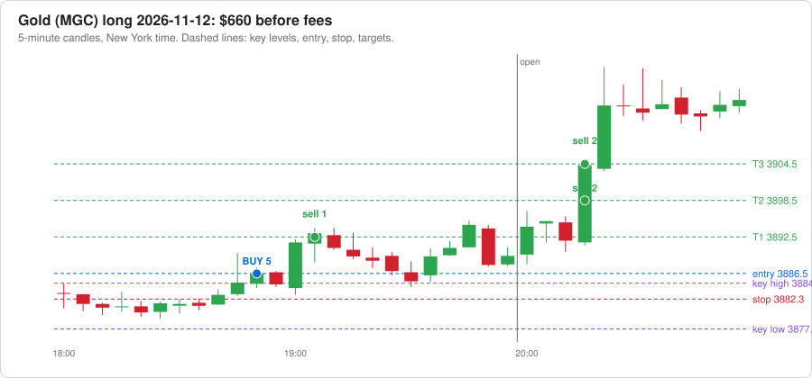

[Open Gold (MGC) on TradingView](https://www.tradingview.com/chart/?symbol=COMEX_MINI%3AMGC1%21&interval=5) (add tradingview/breakout_strategy.pine to see this trade marked)

---

### ❌ 2026-11-12 | Gold (MGC) | Long | -$355
- **Session start (New York):** 2026-11-11 20:00
- **Why:** two 5-minute candles closed beyond the key high (4000.7)
- **Entry:** Bought **5 contracts** at **4004.4** at **20:15** (sell plan 1/2/2)
- **Stop:** 3997.4

| Time | What | Contracts | Price | Profit |
|---|---|---|---|---|
| 20:30 | Stop | 5 | 3997.4 | -$350 |

- **Exit:** last contract out at **20:30**, average 3997.4
- **Result:** -$350 before fees, **-$355 after fees**
- **What could have gone better:**
  - Price never reached Target 1: the best it did was +0.70 points, and Target 1 needed 6.
  - The breakout failed and price kept going the other way, so the stop did its job and kept the loss small.
  - The entry was 3.70 points past the key level, chasing a stretched move. Waiting for a pullback toward the level would have meant a better price and a smaller risk.
  - Biggest move against you while in the trade: 7.40 points ($370 on paper). Best move for you: 0.70 points.

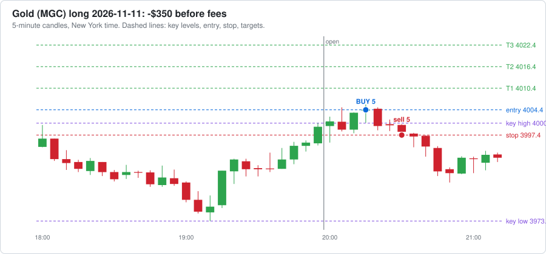

[Open Gold (MGC) on TradingView](https://www.tradingview.com/chart/?symbol=COMEX_MINI%3AMGC1%21&interval=5) (add tradingview/breakout_strategy.pine to see this trade marked)

---

### ❌ 2026-11-11 | Nasdaq (MNQ) | Short | -$867
- **Session start (New York):** 2026-11-11 09:30
- **Why:** two 5-minute candles closed beyond the key low (28311.75)
- **Entry:** Sold short **5 contracts** at **28246.75** at **09:45** (sell plan 1/2/2)
- **Stop:** 28362.0

| Time | What | Contracts | Price | Profit |
|---|---|---|---|---|
| 09:50 | Target 1 | 1 | 28216.75 | $60 |
| 10:25 | Stop | 4 | 28362.0 | -$922 |

- **Exit:** last contract out at **10:25**, average 28332.95
- **Result:** -$862 before fees, **-$867 after fees**
- **What could have gone better:**
  - Target 1 paid $60, but the stop stayed at the start. Moving it to breakeven after Target 1 would have ended this trade at about $60 instead of -$862.
  - The entry was 65.00 points past the key level, chasing a stretched move. Waiting for a pullback toward the level would have meant a better price and a smaller risk.
  - Biggest move against you while in the trade: 141.75 points ($1,418 on paper). Best move for you: 47.75 points.

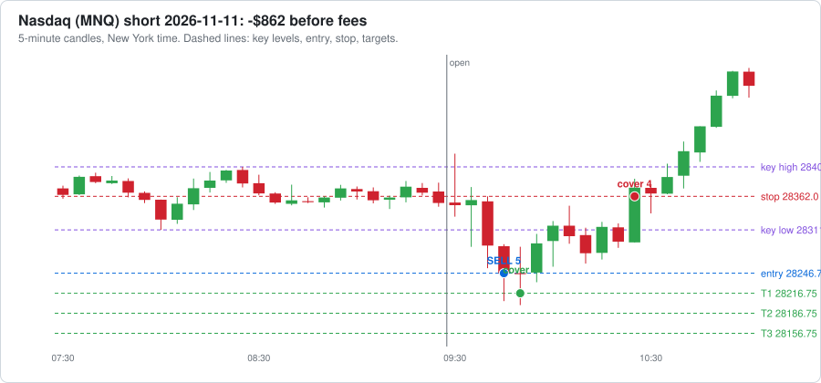

[Open Nasdaq (MNQ) on TradingView](https://www.tradingview.com/chart/?symbol=CME_MINI%3AMNQ1%21&interval=5) (add tradingview/breakout_strategy.pine to see this trade marked)

---

### ✅ 2026-11-11 | Gold (MGC) | Long | $655
- **Session start (New York):** 2026-11-10 20:00
- **Why:** two 5-minute candles closed beyond the key high (4049.5)
- **Entry:** Bought **5 contracts** at **4055.3** at **20:35** (sell plan 1/2/2)
- **Stop:** 4043.7

| Time | What | Contracts | Price | Profit |
|---|---|---|---|---|
| 00:10 | Target 1 | 1 | 4061.3 | $60 |
| 00:30 | Target 2 | 2 | 4067.3 | $240 |
| 00:30 | Target 3 | 2 | 4073.3 | $360 |

- **Exit:** last contract out at **00:30**, average 4068.5
- **Result:** $660 before fees, **$655 after fees**
- **What could have gone better:**
  - Clean trade: price stalled near Target 3, so taking the full profit there was right.
  - Biggest move against you while in the trade: 8.00 points ($400 on paper). Best move for you: 18.40 points.

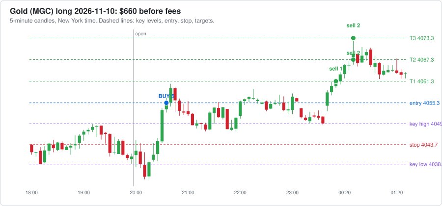

[Open Gold (MGC) on TradingView](https://www.tradingview.com/chart/?symbol=COMEX_MINI%3AMGC1%21&interval=5) (add tradingview/breakout_strategy.pine to see this trade marked)

---

### ❌ 2026-11-10 | Nasdaq (MNQ) | Long | -$667
- **Session start (New York):** 2026-11-10 09:30
- **Why:** two 5-minute candles closed beyond the key high (27997.5)
- **Entry:** Bought **3 contracts** at **28049.75** at **10:00** (sell plan 1/1/1)
- **Stop:** 27868.75
- **Small size:** less than $1,500 was left before the $4,000 max drawdown, so it traded 1 contract per target.

| Time | What | Contracts | Price | Profit |
|---|---|---|---|---|
| 10:05 | Target 1 | 1 | 28079.75 | $60 |
| 10:35 | Stop | 2 | 27868.75 | -$724 |

- **Exit:** last contract out at **10:35**, average 27939.08
- **Result:** -$664 before fees, **-$667 after fees**
- **What could have gone better:**
  - Target 1 paid $60, but the stop stayed at the start. Moving it to breakeven after Target 1 would have ended this trade at about $60 instead of -$664.
  - The entry was 52.25 points past the key level, chasing a stretched move. Waiting for a pullback toward the level would have meant a better price and a smaller risk.
  - Biggest move against you while in the trade: 192.75 points ($1,156 on paper). Best move for you: 30.25 points.

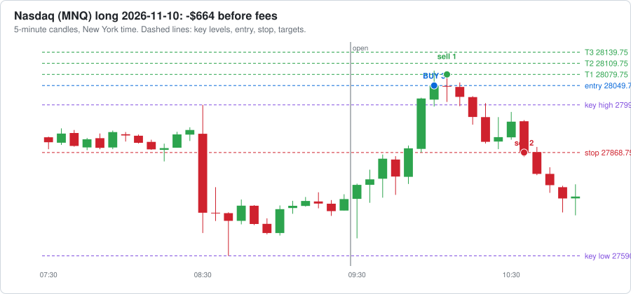

[Open Nasdaq (MNQ) on TradingView](https://www.tradingview.com/chart/?symbol=CME_MINI%3AMNQ1%21&interval=5) (add tradingview/breakout_strategy.pine to see this trade marked)

---

### ❌ 2026-11-09 | Gold (MGC) | Long | -$77
- **Session start (New York):** 2026-11-08 20:00
- **Why:** two 5-minute candles closed beyond the key high (4114.8)
- **Entry:** Bought **5 contracts** at **4115.0** at **20:15** (sell plan 1/2/2)
- **Stop:** 4111.7

| Time | What | Contracts | Price | Profit |
|---|---|---|---|---|
| 20:25 | Target 1 | 1 | 4121.0 | $60 |
| 20:30 | Stop | 4 | 4111.7 | -$132 |

- **Exit:** last contract out at **20:30**, average 4113.56
- **Result:** -$72 before fees, **-$77 after fees**
- **What could have gone better:**
  - Target 1 paid $60, but the stop stayed at the start. Moving it to breakeven after Target 1 would have ended this trade at about $60 instead of -$72.
  - Fakeout re-entry (switched off): price closed back beyond the entry at 20:35; re-entering 3 contracts at 4119.3 (stop 4112.9) would have made $357.
  - Biggest move against you while in the trade: 3.70 points ($185 on paper). Best move for you: 6.20 points.

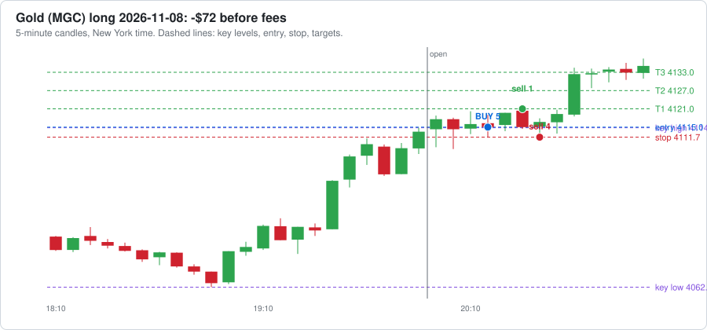

[Open Gold (MGC) on TradingView](https://www.tradingview.com/chart/?symbol=COMEX_MINI%3AMGC1%21&interval=5) (add tradingview/breakout_strategy.pine to see this trade marked)

---

### ✅ 2026-11-06 | Gold (MGC) | Short | $655
- **Session start (New York):** 2026-11-05 20:00
- **Why:** two 5-minute candles closed beyond the key low (4080.4)
- **Entry:** Sold short **5 contracts** at **4072.7** at **20:45** (sell plan 1/2/2)
- **Stop:** 4085.0

| Time | What | Contracts | Price | Profit |
|---|---|---|---|---|
| 20:55 | Target 1 | 1 | 4066.7 | $60 |
| 22:05 | Target 2 | 2 | 4060.7 | $240 |
| 22:30 | Target 3 | 2 | 4054.7 | $360 |

- **Exit:** last contract out at **22:30**, average 4059.5
- **Result:** $660 before fees, **$655 after fees**
- **What could have gone better:**
  - Price kept going 6.30 points past Target 3 (by 23:05). Letting the last 2 contract(s) run with a trailing stop could have made up to $126 more.
  - Biggest move against you while in the trade: 10.40 points ($520 on paper). Best move for you: 19.00 points.

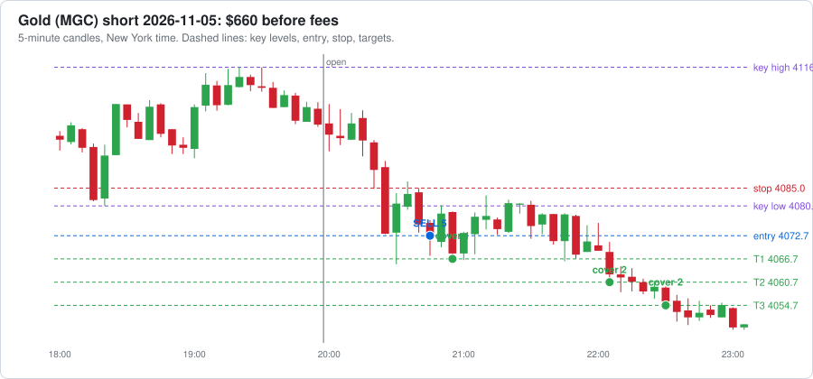

[Open Gold (MGC) on TradingView](https://www.tradingview.com/chart/?symbol=COMEX_MINI%3AMGC1%21&interval=5) (add tradingview/breakout_strategy.pine to see this trade marked)

---

### ✅ 2026-11-05 | Gold (MGC) | Long | $655
- **Session start (New York):** 2026-11-04 20:00
- **Why:** two 5-minute candles closed beyond the key high (4106.4)
- **Entry:** Bought **5 contracts** at **4118.4** at **20:15** (sell plan 1/2/2)
- **Stop:** 4104.3

| Time | What | Contracts | Price | Profit |
|---|---|---|---|---|
| 20:20 | Target 1 | 1 | 4124.4 | $60 |
| 20:35 | Target 2 | 2 | 4130.4 | $240 |
| 20:45 | Target 3 | 2 | 4136.4 | $360 |

- **Exit:** last contract out at **20:45**, average 4131.6
- **Result:** $660 before fees, **$655 after fees**
- **What could have gone better:**
  - Price kept going 8.00 points past Target 3 (by 20:50). Letting the last 2 contract(s) run with a trailing stop could have made up to $160 more.
  - Biggest move against you while in the trade: 9.40 points ($470 on paper). Best move for you: 20.00 points.

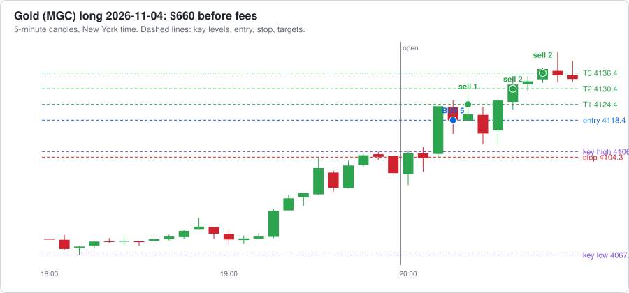

[Open Gold (MGC) on TradingView](https://www.tradingview.com/chart/?symbol=COMEX_MINI%3AMGC1%21&interval=5) (add tradingview/breakout_strategy.pine to see this trade marked)

---

### ✅ 2026-11-04 | Gold (MGC) | Long | $357
- **Session start (New York):** 2026-11-03 20:00
- **Why:** two 5-minute candles closed beyond the key high (3949.3)
- **Entry:** Bought **3 contracts** at **3963.4** at **20:15** (sell plan 1/1/1)
- **Stop:** 3936.5
- **Small size:** less than $1,500 was left before the $4,000 max drawdown, so it traded 1 contract per target.

| Time | What | Contracts | Price | Profit |
|---|---|---|---|---|
| 20:25 | Target 1 | 1 | 3969.4 | $60 |
| 00:30 | Target 2 | 1 | 3975.4 | $120 |
| 00:30 | Target 3 | 1 | 3981.4 | $180 |

- **Exit:** last contract out at **00:30**, average 3975.4
- **Result:** $360 before fees, **$357 after fees**
- **What could have gone better:**
  - Price kept going 51.00 points past Target 3 (by 01:20). Letting the last 1 contract(s) run with a trailing stop could have made up to $510 more.
  - Biggest move against you while in the trade: 26.40 points ($792 on paper). Best move for you: 20.10 points.

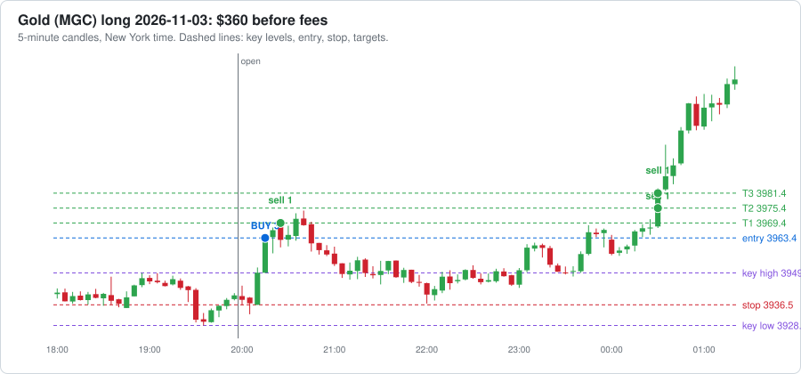

[Open Gold (MGC) on TradingView](https://www.tradingview.com/chart/?symbol=COMEX_MINI%3AMGC1%21&interval=5) (add tradingview/breakout_strategy.pine to see this trade marked)

---

### ❌ 2026-11-02 | Nasdaq (MNQ) | Long | -$1,015
- **Session start (New York):** 2026-11-02 09:30
- **Why:** two 5-minute candles closed beyond the key high (28844.0)
- **Entry:** Bought **5 contracts** at **28886.75** at **10:25** (sell plan 1/2/2)
- **Stop:** 28785.75

| Time | What | Contracts | Price | Profit |
|---|---|---|---|---|
| 10:45 | Stop | 5 | 28785.75 | -$1,010 |

- **Exit:** last contract out at **10:45**, average 28785.75
- **Result:** -$1,010 before fees, **-$1,015 after fees**
- **What could have gone better:**
  - Price never reached Target 1: the best it did was +2.50 points, and Target 1 needed 30.
  - The breakout failed and price kept going the other way, so the stop did its job and kept the loss small.
  - The entry was 42.75 points past the key level, chasing a stretched move. Waiting for a pullback toward the level would have meant a better price and a smaller risk.
  - Biggest move against you while in the trade: 111.75 points ($1,118 on paper). Best move for you: 2.50 points.

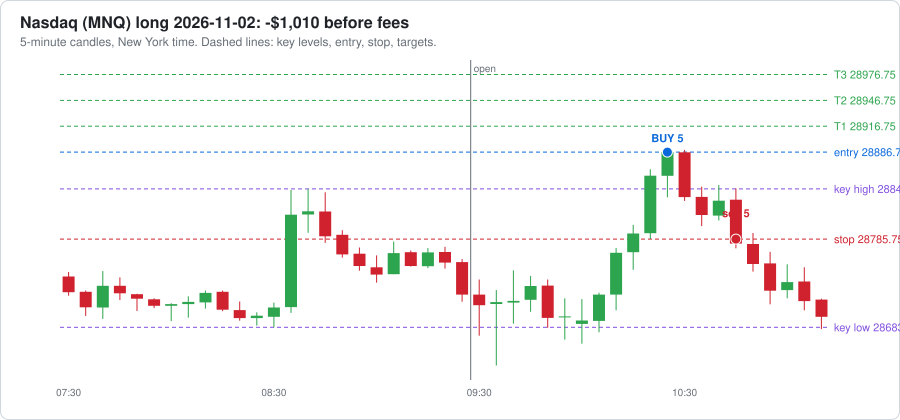

[Open Nasdaq (MNQ) on TradingView](https://www.tradingview.com/chart/?symbol=CME_MINI%3AMNQ1%21&interval=5) (add tradingview/breakout_strategy.pine to see this trade marked)

---

### ❌ 2026-10-30 | Gold (MGC) | Short | -$265
- **Session start (New York):** 2026-10-29 20:00
- **Why:** two 5-minute candles closed beyond the key low (4018.2)
- **Entry:** Sold short **5 contracts** at **4015.3** at **21:00** (sell plan 1/2/2)
- **Stop:** 4023.3

| Time | What | Contracts | Price | Profit |
|---|---|---|---|---|
| 21:05 | Target 1 | 1 | 4009.3 | $60 |
| 21:25 | Stop | 4 | 4023.3 | -$320 |

- **Exit:** last contract out at **21:25**, average 4020.5
- **Result:** -$260 before fees, **-$265 after fees**
- **What could have gone better:**
  - Target 1 paid $60, but the stop stayed at the start. Moving it to breakeven after Target 1 would have ended this trade at about $60 instead of -$260.
  - Fakeout re-entry (switched off): price closed back beyond the entry at 21:35; re-entering 3 contracts at 4012.9 (stop 4018.0) would have made $111.
  - Biggest move against you while in the trade: 8.40 points ($420 on paper). Best move for you: 8.40 points.

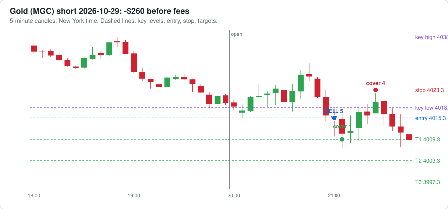

[Open Gold (MGC) on TradingView](https://www.tradingview.com/chart/?symbol=COMEX_MINI%3AMGC1%21&interval=5) (add tradingview/breakout_strategy.pine to see this trade marked)

---

### ❌ 2026-10-29 | Gold (MGC) | Short | -$365
- **Session start (New York):** 2026-10-28 20:00
- **Why:** two 5-minute candles closed beyond the key low (4063.0)
- **Entry:** Sold short **5 contracts** at **4057.4** at **20:05** (sell plan 1/2/2)
- **Stop:** 4067.9

| Time | What | Contracts | Price | Profit |
|---|---|---|---|---|
| 20:30 | Target 1 | 1 | 4051.4 | $60 |
| 21:15 | Stop | 4 | 4067.9 | -$420 |

- **Exit:** last contract out at **21:15**, average 4064.6
- **Result:** -$360 before fees, **-$365 after fees**
- **What could have gone better:**
  - Target 1 paid $60, but the stop stayed at the start. Moving it to breakeven after Target 1 would have ended this trade at about $60 instead of -$360.
  - The entry was 5.60 points past the key level, chasing a stretched move. Waiting for a pullback toward the level would have meant a better price and a smaller risk.
  - Biggest move against you while in the trade: 12.50 points ($625 on paper). Best move for you: 9.60 points.

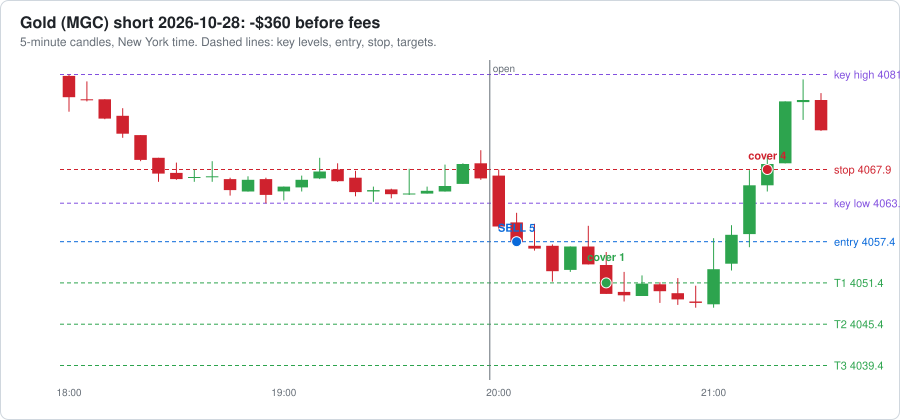

[Open Gold (MGC) on TradingView](https://www.tradingview.com/chart/?symbol=COMEX_MINI%3AMGC1%21&interval=5) (add tradingview/breakout_strategy.pine to see this trade marked)

---

### ❌ 2026-10-28 | Nasdaq (MNQ) | Short | -$681
- **Session start (New York):** 2026-10-28 09:30
- **Why:** two 5-minute candles closed beyond the key low (29888.25)
- **Entry:** Sold short **3 contracts** at **29787.5** at **09:45** (sell plan 1/1/1)
- **Stop:** 29900.5
- **Small size:** less than $1,500 was left before the $4,000 max drawdown, so it traded 1 contract per target.

| Time | What | Contracts | Price | Profit |
|---|---|---|---|---|
| 12:50 | Stop | 3 | 29900.5 | -$678 |

- **Exit:** last contract out at **12:50**, average 29900.5
- **Result:** -$678 before fees, **-$681 after fees**
- **What could have gone better:**
  - Price never reached Target 1: the best it did was +3.50 points, and Target 1 needed 30.
  - The breakout failed and price kept going the other way, so the stop did its job and kept the loss small.
  - The entry was 100.75 points past the key level, chasing a stretched move. Waiting for a pullback toward the level would have meant a better price and a smaller risk.
  - Biggest move against you while in the trade: 133.00 points ($798 on paper). Best move for you: 3.50 points.

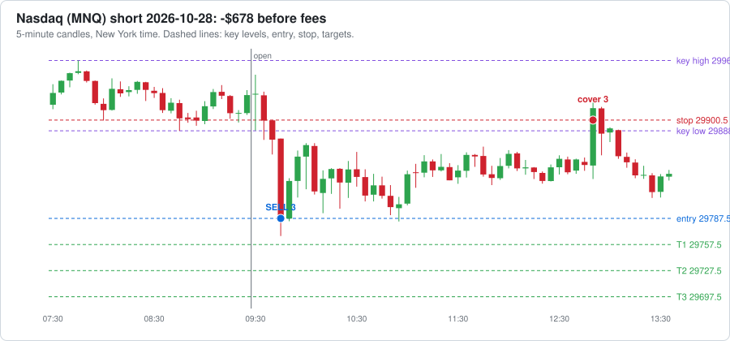

[Open Nasdaq (MNQ) on TradingView](https://www.tradingview.com/chart/?symbol=CME_MINI%3AMNQ1%21&interval=5) (add tradingview/breakout_strategy.pine to see this trade marked)

---

### ❌ 2026-10-28 | Gold (MGC) | Long | -$390
- **Session start (New York):** 2026-10-27 20:00
- **Why:** two 5-minute candles closed beyond the key high (4077.9)
- **Entry:** Bought **5 contracts** at **4083.1** at **20:05** (sell plan 1/2/2)
- **Stop:** 4075.4

| Time | What | Contracts | Price | Profit |
|---|---|---|---|---|
| 20:25 | Stop | 5 | 4075.4 | -$385 |

- **Exit:** last contract out at **20:25**, average 4075.4
- **Result:** -$385 before fees, **-$390 after fees**
- **What could have gone better:**
  - Price never reached Target 1: the best it did was +1.00 points, and Target 1 needed 6.
  - The breakout failed and price kept going the other way, so the stop did its job and kept the loss small.
  - The entry was 5.20 points past the key level, chasing a stretched move. Waiting for a pullback toward the level would have meant a better price and a smaller risk.
  - Biggest move against you while in the trade: 9.40 points ($470 on paper). Best move for you: 1.00 points.

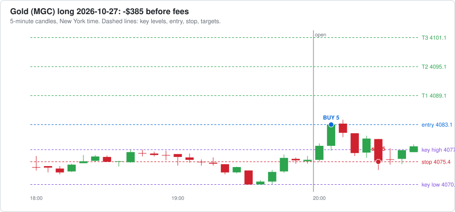

[Open Gold (MGC) on TradingView](https://www.tradingview.com/chart/?symbol=COMEX_MINI%3AMGC1%21&interval=5) (add tradingview/breakout_strategy.pine to see this trade marked)

---

### ❌ 2026-10-27 | Nasdaq (MNQ) | Long | -$688
- **Session start (New York):** 2026-10-27 09:30
- **Why:** two 5-minute candles closed beyond the key high (29628.75)
- **Entry:** Bought **5 contracts** at **29649.5** at **09:40** (sell plan 1/2/2)
- **Stop:** 29581.25

| Time | What | Contracts | Price | Profit |
|---|---|---|---|---|
| 09:45 | Stop | 5 | 29581.25 | -$682 |

- **Exit:** last contract out at **09:45**, average 29581.25
- **Result:** -$682 before fees, **-$688 after fees**
- **What could have gone better:**
  - Price never reached Target 1: the best it did was +28.25 points, and Target 1 needed 30.
  - The breakout failed and price kept going the other way, so the stop did its job and kept the loss small.
  - The entry was 20.75 points past the key level, chasing a stretched move. Waiting for a pullback toward the level would have meant a better price and a smaller risk.
  - Fakeout re-entry (switched off): price closed back beyond the entry at 10:30; re-entering 3 contracts at 29652.0 (stop 29606.75) would have made $8.
  - Biggest move against you while in the trade: 101.50 points ($1,015 on paper). Best move for you: 28.25 points.

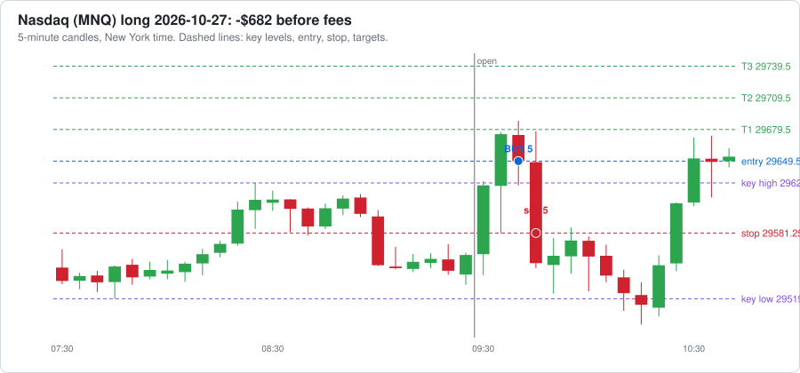

[Open Nasdaq (MNQ) on TradingView](https://www.tradingview.com/chart/?symbol=CME_MINI%3AMNQ1%21&interval=5) (add tradingview/breakout_strategy.pine to see this trade marked)

---

### ❌ 2026-10-26 | Gold (MGC) | Short | -$329
- **Session start (New York):** 2026-10-25 20:00
- **Why:** two 5-minute candles closed beyond the key low (4003.1)
- **Entry:** Sold short **5 contracts** at **4001.5** at **20:05** (sell plan 1/2/2)
- **Stop:** 4011.1

| Time | What | Contracts | Price | Profit |
|---|---|---|---|---|
| 21:00 | Target 1 | 1 | 3995.5 | $60 |
| 21:15 | Stop | 4 | 4011.1 | -$384 |

- **Exit:** last contract out at **21:15**, average 4007.98
- **Result:** -$324 before fees, **-$329 after fees**
- **What could have gone better:**
  - Target 1 paid $60, but the stop stayed at the start. Moving it to breakeven after Target 1 would have ended this trade at about $60 instead of -$324.
  - Biggest move against you while in the trade: 12.40 points ($620 on paper). Best move for you: 10.60 points.

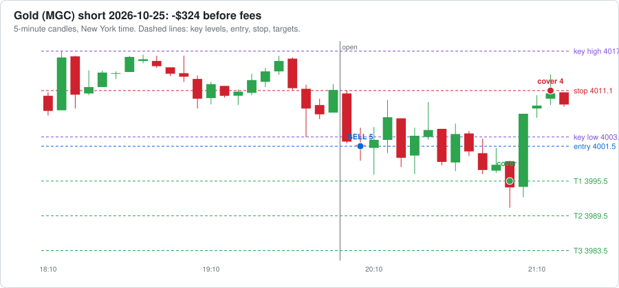

[Open Gold (MGC) on TradingView](https://www.tradingview.com/chart/?symbol=COMEX_MINI%3AMGC1%21&interval=5) (add tradingview/breakout_strategy.pine to see this trade marked)

---

### ❌ 2026-10-23 | Nasdaq (MNQ) | Long | -$748
- **Session start (New York):** 2026-10-23 09:30
- **Why:** two 5-minute candles closed beyond the key high (29145.0)
- **Entry:** Bought **5 contracts** at **29169.25** at **10:00** (sell plan 1/2/2)
- **Stop:** 29095.0

| Time | What | Contracts | Price | Profit |
|---|---|---|---|---|
| 10:15 | Stop | 5 | 29095.0 | -$742 |

- **Exit:** last contract out at **10:15**, average 29095.0
- **Result:** -$742 before fees, **-$748 after fees**
- **What could have gone better:**
  - Price never reached Target 1: the best it did was +16.75 points, and Target 1 needed 30.
  - After the stop, price turned and reached +156.75 points by 10:50. The stop (74.25 points from entry) was too tight: a stop just past the key level (29145.0) would have kept you in.
  - The entry was 24.25 points past the key level, chasing a stretched move. Waiting for a pullback toward the level would have meant a better price and a smaller risk.
  - Fakeout re-entry (switched off): price closed back beyond the entry at 10:35; re-entering 3 contracts at 29225.0 (stop 29141.75) would have made $357.
  - Biggest move against you while in the trade: 87.50 points ($875 on paper). Best move for you: 16.75 points.

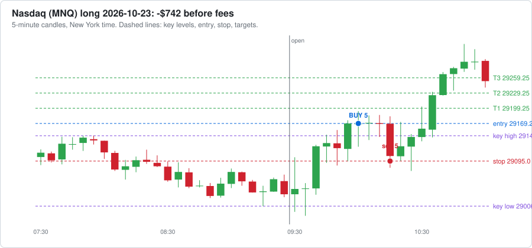

[Open Nasdaq (MNQ) on TradingView](https://www.tradingview.com/chart/?symbol=CME_MINI%3AMNQ1%21&interval=5) (add tradingview/breakout_strategy.pine to see this trade marked)

---

### ❌ 2026-10-23 | Gold (MGC) | Short | -$140
- **Session start (New York):** 2026-10-22 20:00
- **Why:** two 5-minute candles closed beyond the key low (4036.0)
- **Entry:** Sold short **5 contracts** at **4034.4** at **20:30** (sell plan 1/2/2)
- **Stop:** 4037.1

| Time | What | Contracts | Price | Profit |
|---|---|---|---|---|
| 20:45 | Stop | 5 | 4037.1 | -$135 |

- **Exit:** last contract out at **20:45**, average 4037.1
- **Result:** -$135 before fees, **-$140 after fees**
- **What could have gone better:**
  - Price never reached Target 1: the best it did was +2.80 points, and Target 1 needed 6.
  - After the stop, price turned and reached +33.50 points by 22:00. The stop (2.70 points from entry) was too tight: a stop just past the key level (4036.0) would have kept you in.
  - Fakeout re-entry (switched off): price closed back beyond the entry at 21:00; re-entering 3 contracts at 4034.1 (stop 4045.5) would have made $357.
  - Biggest move against you while in the trade: 9.80 points ($490 on paper). Best move for you: 2.80 points.

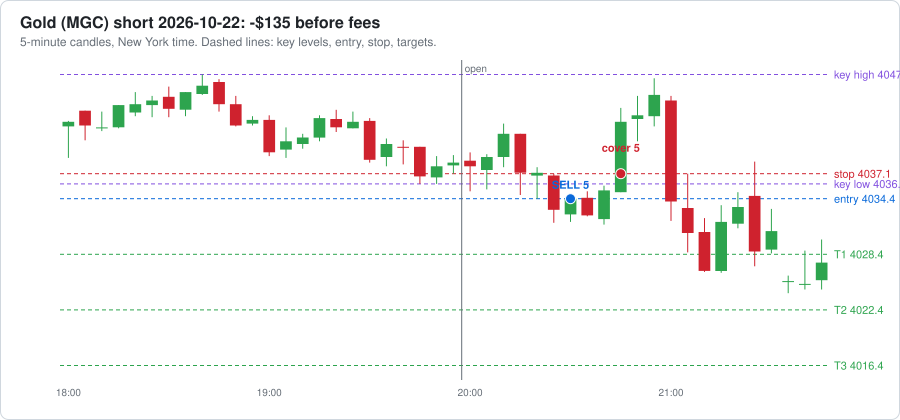

[Open Gold (MGC) on TradingView](https://www.tradingview.com/chart/?symbol=COMEX_MINI%3AMGC1%21&interval=5) (add tradingview/breakout_strategy.pine to see this trade marked)

---

### ✅ 2026-10-22 | Nasdaq (MNQ) | Short | $655
- **Session start (New York):** 2026-10-22 09:30
- **Why:** two 5-minute candles closed beyond the key low (29451.5)
- **Entry:** Sold short **5 contracts** at **29359.0** at **10:25** (sell plan 1/2/2)
- **Stop:** 29455.5

| Time | What | Contracts | Price | Profit |
|---|---|---|---|---|
| 10:30 | Target 1 | 1 | 29329.0 | $60 |
| 10:30 | Target 2 | 2 | 29299.0 | $240 |
| 10:45 | Target 3 | 2 | 29269.0 | $360 |

- **Exit:** last contract out at **10:45**, average 29293.0
- **Result:** $660 before fees, **$655 after fees**
- **What could have gone better:**
  - Price kept going 236.00 points past Target 3 (by 15:45). Letting the last 2 contract(s) run with a trailing stop could have made up to $944 more.
  - Biggest move against you while in the trade: 12.00 points ($120 on paper). Best move for you: 109.00 points.

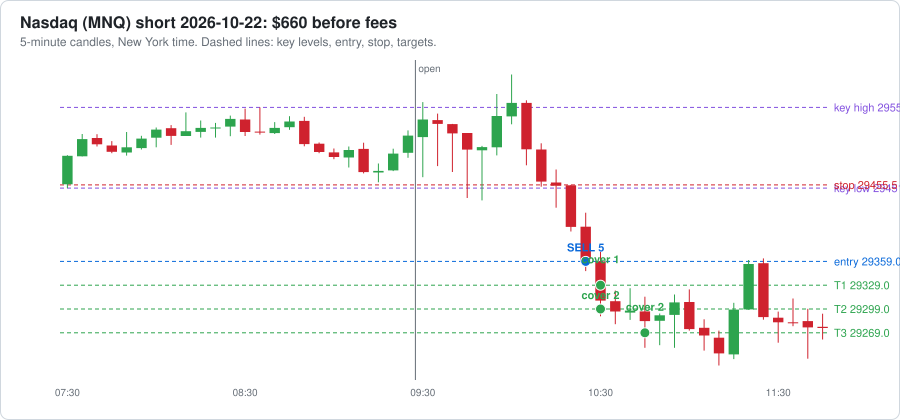

[Open Nasdaq (MNQ) on TradingView](https://www.tradingview.com/chart/?symbol=CME_MINI%3AMNQ1%21&interval=5) (add tradingview/breakout_strategy.pine to see this trade marked)

---

### ✅ 2026-10-22 | Gold (MGC) | Short | $415
- **Session start (New York):** 2026-10-21 20:00
- **Why:** two 5-minute candles closed beyond the key low (4139.1)
- **Entry:** Sold short **5 contracts** at **4137.2** at **20:15** (sell plan 1/2/2)
- **Stop:** 4143.1

| Time | What | Contracts | Price | Profit |
|---|---|---|---|---|
| 20:35 | Target 1 | 1 | 4131.2 | $60 |
| 21:25 | Target 2 | 2 | 4125.2 | $240 |
| 21:30 | Stop | 2 | 4131.2 | $120 |

- **Exit:** last contract out at **21:30**, average 4128.8
- **Result:** $420 before fees, **$415 after fees**
- **What could have gone better:**
  - The last contracts were stopped at Target 1, then price reached Target 3 by 01:45. A looser stop after Target 2 would have caught it.
  - Biggest move against you while in the trade: 0.80 points ($40 on paper). Best move for you: 13.50 points.

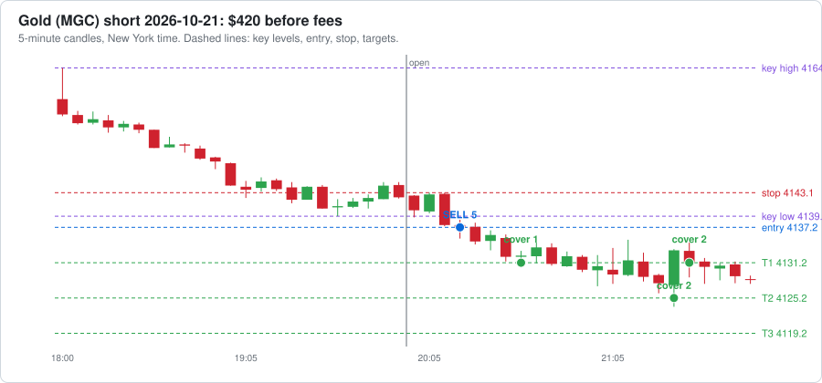

[Open Gold (MGC) on TradingView](https://www.tradingview.com/chart/?symbol=COMEX_MINI%3AMGC1%21&interval=5) (add tradingview/breakout_strategy.pine to see this trade marked)

---

### ❌ 2026-10-21 | Nasdaq (MNQ) | Short | -$252
- **Session start (New York):** 2026-10-21 09:30
- **Why:** two 5-minute candles closed beyond the key low (29832.75)
- **Entry:** Sold short **5 contracts** at **29818.5** at **10:15** (sell plan 1/2/2)
- **Stop:** 29843.25

| Time | What | Contracts | Price | Profit |
|---|---|---|---|---|
| 10:20 | Stop | 5 | 29843.25 | -$248 |

- **Exit:** last contract out at **10:20**, average 29843.25
- **Result:** -$248 before fees, **-$252 after fees**
- **What could have gone better:**
  - Price never reached Target 1: the best it did was +25.75 points, and Target 1 needed 30.
  - The breakout failed and price kept going the other way, so the stop did its job and kept the loss small.
  - Biggest move against you while in the trade: 41.75 points ($418 on paper). Best move for you: 25.75 points.

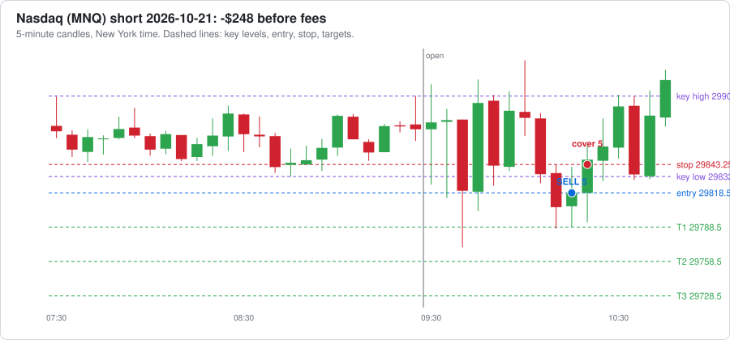

[Open Nasdaq (MNQ) on TradingView](https://www.tradingview.com/chart/?symbol=CME_MINI%3AMNQ1%21&interval=5) (add tradingview/breakout_strategy.pine to see this trade marked)

---

### ✅ 2026-10-20 | Nasdaq (MNQ) | Long | $655
- **Session start (New York):** 2026-10-20 09:30
- **Why:** two 5-minute candles closed beyond the key high (29636.0)
- **Entry:** Bought **5 contracts** at **29717.75** at **10:05** (sell plan 1/2/2)
- **Stop:** 29604.0

| Time | What | Contracts | Price | Profit |
|---|---|---|---|---|
| 10:15 | Target 1 | 1 | 29747.75 | $60 |
| 10:15 | Target 2 | 2 | 29777.75 | $240 |
| 10:25 | Target 3 | 2 | 29807.75 | $360 |

- **Exit:** last contract out at **10:25**, average 29783.75
- **Result:** $660 before fees, **$655 after fees**
- **What could have gone better:**
  - Price kept going 95.75 points past Target 3 (by 10:30). Letting the last 2 contract(s) run with a trailing stop could have made up to $383 more.
  - Biggest move against you while in the trade: 25.75 points ($258 on paper). Best move for you: 165.25 points.

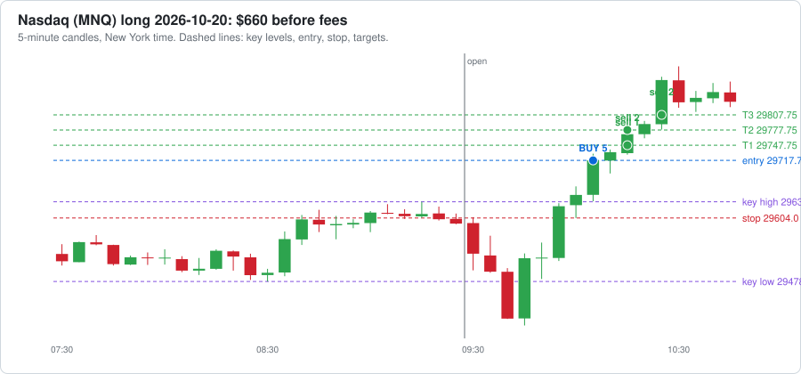

[Open Nasdaq (MNQ) on TradingView](https://www.tradingview.com/chart/?symbol=CME_MINI%3AMNQ1%21&interval=5) (add tradingview/breakout_strategy.pine to see this trade marked)

---

### ✅ 2026-10-20 | Gold (MGC) | Short | $415
- **Session start (New York):** 2026-10-19 20:00
- **Why:** two 5-minute candles closed beyond the key low (4150.7)
- **Entry:** Sold short **5 contracts** at **4150.6** at **20:55** (sell plan 1/2/2)
- **Stop:** 4152.4

| Time | What | Contracts | Price | Profit |
|---|---|---|---|---|
| 21:00 | Target 1 | 1 | 4144.6 | $60 |
| 21:15 | Target 2 | 2 | 4138.6 | $240 |
| 21:40 | Stop | 2 | 4144.6 | $120 |

- **Exit:** last contract out at **21:40**, average 4142.2
- **Result:** $420 before fees, **$415 after fees**
- **What could have gone better:**
  - Moving the stop to Target 1 after Target 2 locked in the profit; price never reached Target 3 afterwards.
  - Biggest move against you while in the trade: -0.10 points (-$5 on paper). Best move for you: 16.10 points.

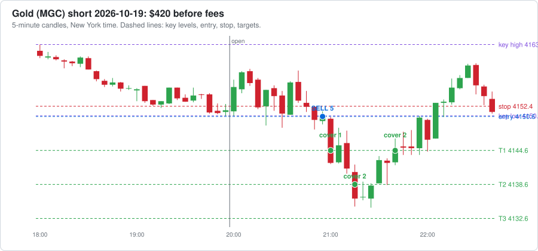

[Open Gold (MGC) on TradingView](https://www.tradingview.com/chart/?symbol=COMEX_MINI%3AMGC1%21&interval=5) (add tradingview/breakout_strategy.pine to see this trade marked)

---

### ✅ 2026-10-19 | Nasdaq (MNQ) | Long | $357
- **Session start (New York):** 2026-10-19 09:30
- **Why:** two 5-minute candles closed beyond the key high (29794.25)
- **Entry:** Bought **3 contracts** at **29841.25** at **10:15** (sell plan 1/1/1)
- **Stop:** 29694.0
- **Small size:** less than $1,500 was left before the $4,000 max drawdown, so it traded 1 contract per target.

| Time | What | Contracts | Price | Profit |
|---|---|---|---|---|
| 11:00 | Target 1 | 1 | 29871.25 | $60 |
| 11:15 | Target 2 | 1 | 29901.25 | $120 |
| 11:20 | Target 3 | 1 | 29931.25 | $180 |

- **Exit:** last contract out at **11:20**, average 29901.25
- **Result:** $360 before fees, **$357 after fees**
- **What could have gone better:**
  - Price kept going 52.25 points past Target 3 (by 11:35). Letting the last 1 contract(s) run with a trailing stop could have made up to $104 more.
  - Biggest move against you while in the trade: 81.00 points ($486 on paper). Best move for you: 104.00 points.

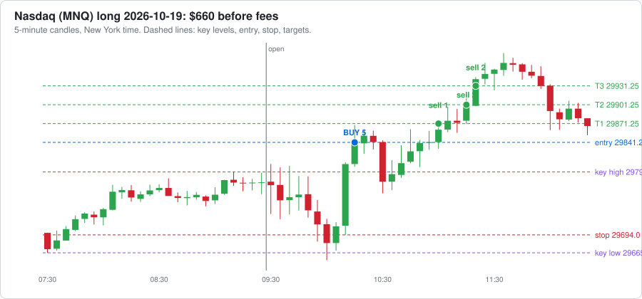

[Open Nasdaq (MNQ) on TradingView](https://www.tradingview.com/chart/?symbol=CME_MINI%3AMNQ1%21&interval=5) (add tradingview/breakout_strategy.pine to see this trade marked)

---

## Total

- **Total profit / loss after fees:** **-$1,364** over 24 trades
- **Winners:** 10 (42%), **losers:** 14
- **Before fees:** -$1,252, fees paid: $112
- **Nasdaq (MNQ):** -$3,250 over 10 trades
- **Gold (MGC):** $1,886 over 14 trades
