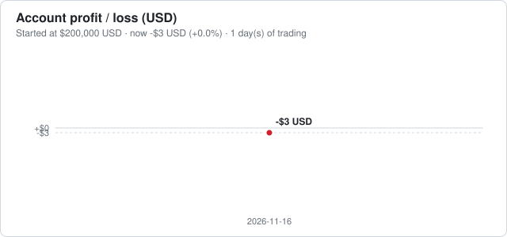

# Ryan-style wheel paper account ($200K USD)

Updated 2026-11-20 19:56 New York. Started 2026-11-16.

| | |
|---|---|
| Account value | **$196,280 USD** |
| Up / down | **-3,720 USD** (-1.9%) |
| Closed trades | 0 wins, 0 losses |
| Cash | $203,471 USD, of which $56,700 USD is set aside to cover the puts |

## What it holds now

| Stock | Holding | Sold put on | Bought shares on | Got / paid | Option worth now | Stock now | Expiry | Up / down USD | Up / down % |
|---|---|---|---|---|---|---|---|---|---|
| BE | 1 put $125 | 2026-11-20 | - | got $11.29 | $11.29 | $142.39 | 2026-12-18 | 🔴 -1 | -0.0% |
| CRDO | 1 put $105 | 2026-11-16 | - | got $8.90 | $18.10 | $99.86 | 2026-12-18 | 🔴 -921 | -8.8% |
| HOOD | 3 puts $65 | 2026-11-16 | - | got $3.02 | $7.35 | $62.17 | 2026-12-18 | 🔴 -1,299 | -6.7% |
| NVDA | 1 put $142 | 2026-11-16 | - | got $5.49 | $20.48 | $125.53 | 2026-12-18 | 🔴 -1,499 | -10.6% |

Prices from Yahoo Finance option chains. Paper only: no real orders. Rules: agents/wheel_rules.py (account "ryan"). Every move: [journal.md](journal.md).
