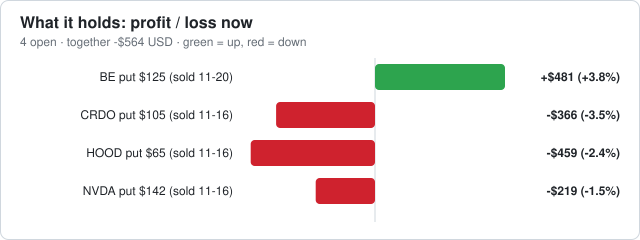

# Ryan-style wheel paper account ($200K USD)

Updated 2026-11-19 20:25 New York. Started 2026-11-16.

| | |
|---|---|
| Account value | **$199,523 USD** |
| Up / down | **-477 USD** (-0.2%) |
| Closed trades | 0 wins, 0 losses |
| Cash | $202,343 USD, of which $44,200 USD is set aside to cover the puts |

## What it holds now

| Stock | Holding | Sold put on | Bought shares on | Got / paid | Option worth now | Stock now | Expiry | Up / down USD | Up / down % |
|---|---|---|---|---|---|---|---|---|---|
| CRDO | 1 put $105 | 2026-11-16 | - | got $8.90 | $9.45 | $122.94 | 2026-12-18 | 🔴 -56 | -0.5% |
| HOOD | 3 puts $65 | 2026-11-16 | - | got $3.02 | $3.95 | $69.17 | 2026-12-18 | 🔴 -279 | -1.4% |
| NVDA | 1 put $142 | 2026-11-16 | - | got $5.49 | $6.90 | $150.96 | 2026-12-18 | 🔴 -142 | -1.0% |

Prices from Yahoo Finance option chains. Paper only: no real orders. Rules: agents/wheel_rules.py (account "ryan"). Every move: [journal.md](journal.md).
