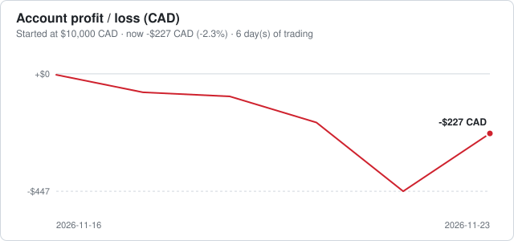
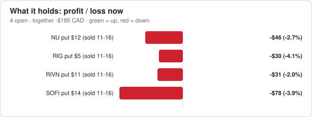

# Wheel paper account ($10K CAD)

Updated 2026-11-20 19:56 New York. Started 2026-11-16.

| | |
|---|---|
| Account value | **$9,553 CAD** ($6,674 USD) |
| Up / down | **-447 CAD** (-4.5%) |
| Closed trades | 0 wins, 0 losses |
| Cash | $10,217 CAD, of which $6,011 CAD is set aside to cover the puts |

## What it holds now

| Stock | Holding | Sold put on | Bought shares on | Got / paid | Option worth now | Stock now | Expiry | Up / down CAD | Up / down % |
|---|---|---|---|---|---|---|---|---|---|
| NU | 1 put $12 | 2026-11-16 | - | got $0.37 | $1.01 | $11.27 | 2026-12-18 | 🔴 -93 | -5.4% |
| RIG | 1 put $5 | 2026-11-16 | - | got $0.18 | $0.48 | $4.64 | 2026-12-18 | 🔴 -43 | -6.0% |
| RIVN | 1 put $11 | 2026-11-16 | - | got $0.44 | $1.29 | $10.33 | 2026-12-18 | 🔴 -124 | -7.9% |
| SOFI | 1 put $14 | 2026-11-16 | - | got $0.55 | $1.85 | $12.48 | 2026-12-18 | 🔴 -188 | -9.4% |

Prices from Yahoo Finance option chains. Paper only: no real orders. Rules: agents/wheel_rules.py (account "ours"). Every move: [journal.md](journal.md).
